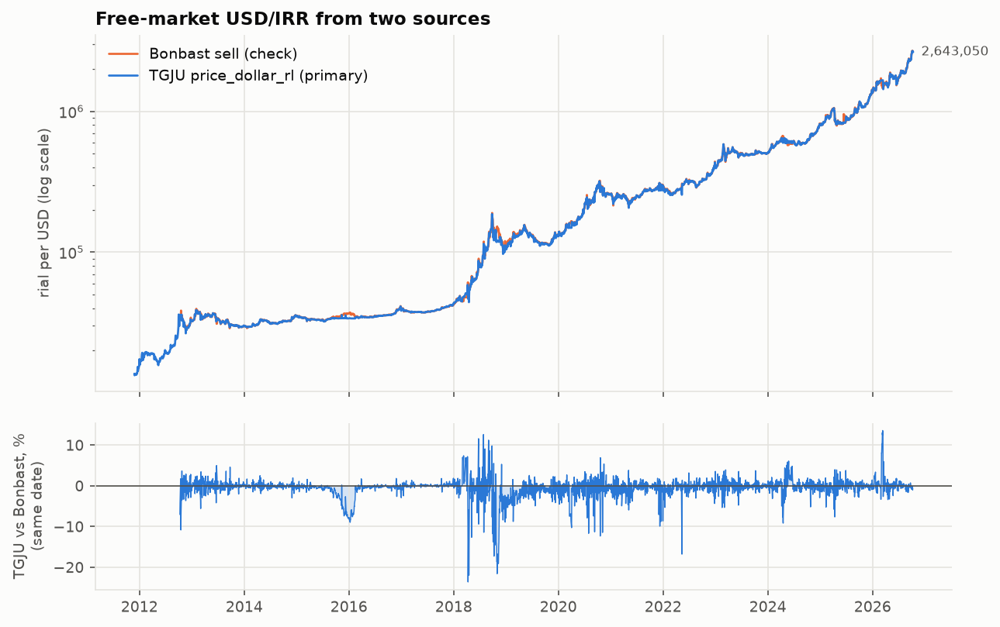
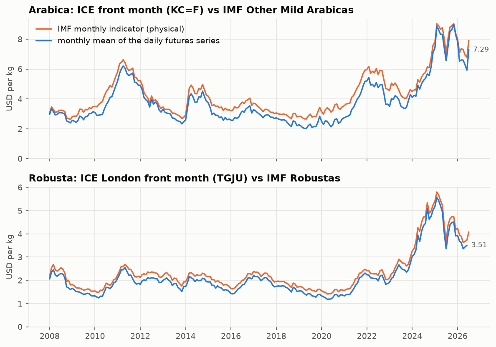
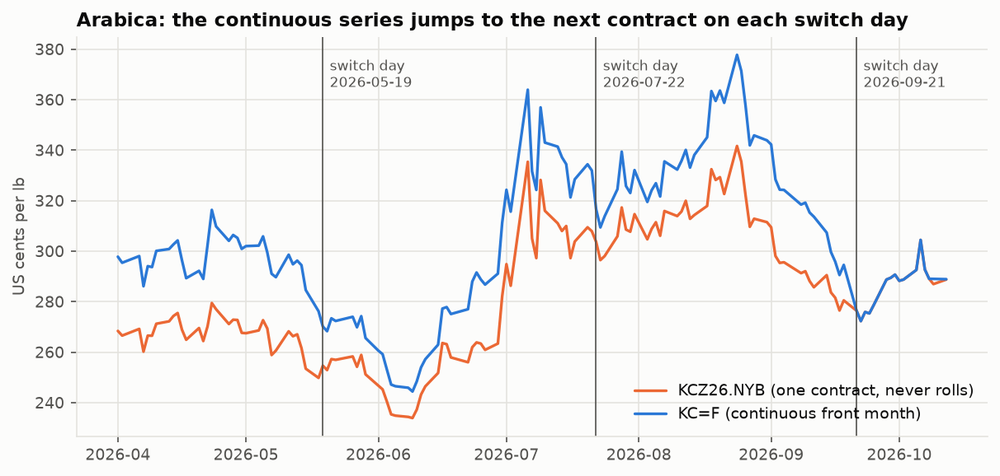
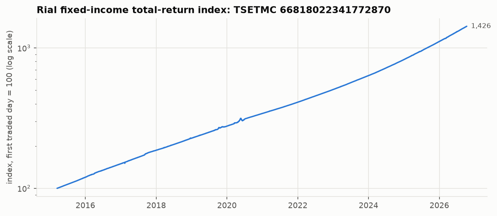
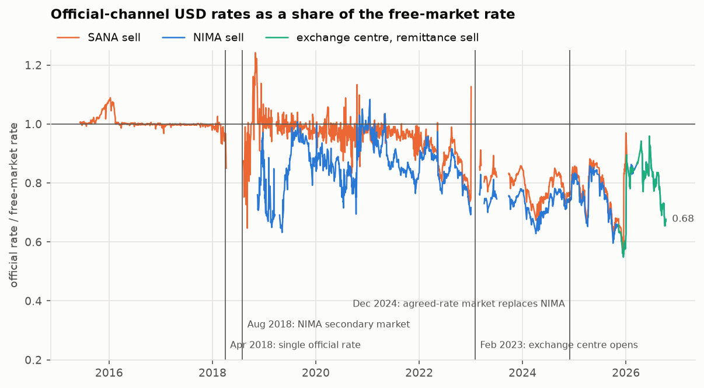

# گزارش مرحلهٔ D1 — داده‌ها

تاریخ ساخت گزارش: ۱۴۰۵-۰۷-۲۰ (2026-10-12). همهٔ عددها، جدول‌ها و شکل‌ها را `scripts/d1_report.py` از روی دادهٔ خام ساخته است. هیچ عددی دستی نوشته نشده است.

## ۱. خلاصه

1. **همهٔ منبع‌ها جواب دادند** و پنل روزانه ساخته شد: دلار آزاد از TGJU (۳٬۹۷۴ روز از ۱۳۹۰-۰۹-۰۵)، Bonbast، عربیکا، روبوستا، شاخص IMF و صندوق درآمد ثابت.
2. **دلار TGJU و Bonbast در بیشتر سال‌ها نزدیک‌اند** (میانهٔ اختلاف ٪۰.۵۶). ولی در ۱۳۹۷ جدا می‌شوند (تا ٪۲۲) و ۱۸ جهش بزرگ روزانهٔ TGJU را Bonbast تأیید نمی‌کند.
3. **قانون «رول» عربیکا روشن و آزموده است** (در ۷۴ از ۷۴ رول از ۲۰۱۲). برای روبوستا فقط شاهد آماری از ۲۰۲۱ به بعد داریم.
4. **روبوستا از TGJU خودکار آمد، ولی در ۱۴۰۵ یک حفرهٔ ۳۵ روزه و ۲۶ ردیف با تاریخ آخر هفته دارد؛ برای این دوره فایل دستی Investing.com لازم است.**
5. **نتیجه:** داده برای شروع D2 کافی است، به شرط اینکه دربارهٔ بندهای بخش ۹ تصمیم بگیرید. مهم‌ترین‌ها: رفتار با دلارِ ۱۳۹۷، فایل دستی روبوستا، و فاصلهٔ قیمت آتی با قیمت فیزیکی قهوه.

## ۲. پوشش داده‌ها

«شکاف» یعنی بیش از ۵ روز تقویمی پشت‌سرهم بدون داده. تاریخ‌ها جلالی‌اند و میلادی در پرانتز آمده است.

| سری | منبع | روش دریافت | اولین تاریخ | آخرین تاریخ | ردیف | شکاف‌ها |
| --- | --- | --- | --- | --- | --- | --- |
| دلار آزاد (اصلی) | TGJU، کلید `price_dollar_rl` | نقطهٔ نمودار، یک درخواست | ۱۳۹۰-۰۹-۰۵ (2011-11-26) | ۱۴۰۵-۰۷-۱۹ (2026-10-11) | ۳٬۹۷۴ | ۱۵ شکاف (۱۴ نوروز، ۱ دیگر) |
| دلار آزاد (کنترل) | Bonbast، نرخ فروش | آرشیو گیت‌هاب، یک فایل | ۱۳۹۱-۰۷-۱۸ (2012-10-09) | ۱۴۰۵-۰۷-۱۷ (2026-10-09) | ۵٬۱۱۴ | بدون شکاف |
| عربیکا | Yahoo `KC=F`، سنت بر پوند | کتابخانهٔ yfinance | ۱۳۷۸-۱۰-۱۳ (2000-01-03) | ۱۴۰۵-۰۷-۲۰ (2026-10-12) | ۶٬۷۱۲ | ۲ شکاف (۱ پایان سال میلادی، ۱ دیگر) |
| روبوستا | TGJU، کلید `commodities-london-coffee`، دلار بر تن | نقطهٔ نمودار، یک درخواست | ۱۳۸۶-۱۰-۲۱ (2008-01-11) | ۱۴۰۵-۰۷-۱۷ (2026-10-09) | ۴٬۷۴۷ | ۲ شکاف (۲ دیگر) |
| صندوق درآمد ثابت | TSETMC، نماد اعتماد | تاریخچهٔ کامل، یک درخواست | ۱۳۹۳-۱۲-۲۴ (2015-03-15) | ۱۴۰۵-۰۷-۱۹ (2026-10-11) | ۲٬۷۳۰ | ۲۱ شکاف (۱۴ نوروز، ۷ دیگر) |
| شاخص ماهانهٔ عربیکا (IMF) | FRED | CSV، یک درخواست | ۱۳۷۰-۱۰-۱۱ (1992-01-01) | ۱۴۰۵-۰۴-۱۰ (2026-07-01) | ۴۱۵ ماه | ماهانه |
| شاخص ماهانهٔ روبوستا (IMF) | FRED | CSV، یک درخواست | ۱۳۷۰-۱۰-۱۱ (1992-01-01) | ۱۴۰۵-۰۴-۱۰ (2026-07-01) | ۴۱۵ ماه | ماهانه |
| رسمی: `nima_sell_usd` | TGJU | نقطهٔ نمودار، یک درخواست | ۱۳۹۷-۰۸-۲۴ (2018-11-15) | ۱۴۰۵-۰۷-۱۹ (2026-10-11) | ۱٬۸۶۰ | ۲ شکاف بیش از ۳۰ روز |
| رسمی: `sana_sell_usd` | TGJU | نقطهٔ نمودار، یک درخواست | ۱۳۹۴-۰۳-۱۹ (2015-06-09) | ۱۴۰۴-۱۰-۱۸ (2026-01-08) | ۲٬۷۴۰ | ۳ شکاف بیش از ۳۰ روز |
| رسمی: `bank_usd` | TGJU | نقطهٔ نمودار، یک درخواست | ۱۳۹۳-۰۵-۲۸ (2014-08-19) | ۱۴۰۵-۰۷-۱۹ (2026-10-11) | ۱٬۶۶۴ | ۵ شکاف بیش از ۳۰ روز |
| رسمی: `ice_transfer_usd_sell` | TGJU | نقطهٔ نمودار، یک درخواست | ۱۴۰۴-۰۸-۱۷ (2025-11-08) | ۱۴۰۵-۰۷-۱۹ (2026-10-11) | ۲۱۵ | ۰ شکاف بیش از ۳۰ روز |
| رسمی: `ice_currency_usd_sell` | TGJU | نقطهٔ نمودار، یک درخواست | ۱۴۰۴-۰۸-۱۷ (2025-11-08) | ۱۴۰۵-۰۲-۰۷ (2026-04-27) | ۶۸ | ۱ شکاف بیش از ۳۰ روز |

* پنل: `data/processed/panel_daily.parquet`، ۹٬۷۸۰ روز تقویمی از ۱۳۷۸-۱۰-۱۳ (2000-01-03) تا ۱۴۰۵-۰۷-۲۰ (2026-10-12)، ۲۶ ستون. هر خانه فقط وقتی پر است که آن سری در آن روز داده دارد. هیچ مقداری پر یا درون‌یابی نشده است.
* واحدها: دلار به ریال. عربیکا به سنت بر پوند و دلار بر کیلو (ضرب در ۰.۰۲۲۰۴۶۲). روبوستا به دلار بر تن و دلار بر کیلو (تقسیم بر ۱٬۰۰۰).
* سری‌های رسمی جدا در `data/processed/official_usd_daily.parquet` هستند و در مدل استفاده نمی‌شوند.

## ۳. نتیجهٔ دسترسی

دو مسیر شبکه آزموده شد: «مستقیم» و «پروکسی». هر تلاش، موفق یا ناموفق، در `data/raw/FETCH_LOG.csv` ثبت شده است. بین هر دو درخواست دست‌کم ۲ ثانیه فاصله است.

| منبع | فایل خام | مسیر | آخرین دریافت (UTC) |
| --- | --- | --- | --- |
| `bonbast` | ۱ | direct | 2026-10-12 |
| `fred` | ۲ | direct | 2026-10-12 |
| `tgju` | ۱۰ | direct | 2026-10-12 |
| `tsetmc` | ۹۹ | direct | 2026-10-12 |
| `yahoo` | ۶ | direct | 2026-10-12 |

فهرست کامل فایل‌ها با تعداد ردیف، بازهٔ تاریخ و sha256 در `data/raw/MANIFEST.csv` است (۱۲۴ ردیف).

**آنچه کار نکرد** (متن دقیق خطا):

| فایل | مسیر | خطا |
| --- | --- | --- |
| `yahoo/KCN26.NYB.csv` | direct | `RuntimeError: yfinance returned no rows (ticker not served)` |
| `yahoo/KCN26.NYB.csv` | proxy | `Timeout: Failed to perform, curl: (28) Connection timed out after 30002 milliseconds. See https://curl.se/libcurl/c/libcurl-errors.html first for more` |
| `yahoo/KCU26.NYB.csv` | direct | `RuntimeError: yfinance returned no rows (ticker not served)` |
| `yahoo/KCU26.NYB.csv` | proxy | `RuntimeError: yfinance returned no rows (ticker not served)` |
| `yahoo/RC_F.csv` | direct | `RuntimeError: yfinance returned no rows (ticker not served)` |
| `yahoo/RC_F.csv` | proxy | `RuntimeError: yfinance returned no rows (ticker not served)` |
| `yahoo/RM_F.csv` | direct | `RuntimeError: yfinance returned no rows (ticker not served)` |
| `yahoo/RM_F.csv` | proxy | `RuntimeError: yfinance returned no rows (ticker not served)` |
| `stooq/rm_f.csv` | direct | `ValueError: Stooq served a JavaScript browser check, not a CSV` |
| `stooq/rm_f.csv` | proxy | `ValueError: Stooq served a JavaScript browser check, not a CSV` |

* قراردادهای منقضی‌شدهٔ عربیکا (مثل `KCU26.NYB`) در Yahoo نیستند. Yahoo فقط قراردادهای زنده را می‌دهد.
* روبوستا در Yahoo نماد ندارد. Stooq به اسکریپت یک «بررسی مرورگر با جاوااسکریپت» می‌دهد؛ آن را دور نزدیم.
* TSETMC فقط از مسیر مستقیم جواب می‌دهد (از مسیر پروکسی تایم‌اوت می‌شود).

**robots.txt و شرایط استفاده**

| میزبان | کاربرد ما | robots.txt | مسیر ما برای ربات عمومی |
| --- | --- | --- | --- |
| `platform.tgju.org` | TGJU، نقطهٔ نمودار | دارد | **ممنوع** |
| `api.tgju.org` | TGJU، نقطهٔ جدول تاریخچه | ندارد / داده نشد | — |
| `www.tgju.org` | TGJU، صفحهٔ تاریخچه (فقط با چشم) | دارد | مجاز |
| `raw.githubusercontent.com` | آرشیو Bonbast | ندارد / داده نشد | — |
| `query1.finance.yahoo.com` | Yahoo Finance (از راه yfinance) | دارد | **ممنوع** |
| `fred.stlouisfed.org` | FRED | دارد | مجاز |
| `cdn.tsetmc.com` | TSETMC، تاریخچهٔ روزانه | ندارد / داده نشد | — |
| `service.tsetmc.com` | TSETMC، فهرست نمادها | دارد | مجاز |
| `stooq.com` | Stooq (جایگزین؛ استفاده نشد) | دارد | **ممنوع** |
| `www.investing.com` | Investing.com (فقط دانلود دستی) | ندارد / داده نشد | — |

* **TGJU:** `platform.tgju.org` (نقطهٔ نمودار) همهٔ مسیرها را برای ربات‌ها بسته است. `api.tgju.org` (نقطهٔ پشت جدول تاریخچه) robots.txt ندارد. پانوشت سایت می‌گوید: «هر گونه کپی برداری از محتوا ... صرفا با موافقت مکتوب مجاز می باشد». TGJU وب‌سرویس فروشی هم دارد.
* **Bonbast:** از خود سایت چیزی نگرفتیم. آرشیو گیت‌هاب مجوز MIT دارد.
* **Yahoo:** robots.txt مسیر API را برای ربات عمومی بسته است. صفحهٔ شرایط استفاده باز نشد (تایم‌اوت) و خوانده نشده است.
* **FRED / IMF:** استفادهٔ شخصی و غیرتجاری آزاد است. این دو سری حق نشر IMF دارند: برای هر استفادهٔ دیگر باید از IMF اجازه گرفت.
* **Investing.com:** به اسکریپت خطای ۴۰۳ می‌دهد. فقط دانلود دستی.
* **نتیجه:** تصمیم D-006 (داده در گیت نمی‌رود) درست است. دربارهٔ نقطهٔ TGJU و ماشین‌حساب عمومی بند ۹ را ببینید.

## ۴. دلار آزاد: TGJU در برابر Bonbast

### ۴-۱. دو نقطهٔ دریافت TGJU یکی‌اند

* نقطهٔ نمودار ۴٬۳۰۴ میله می‌دهد، ولی فقط ۳٬۹۷۴ تاریخ یکتا. در ۳۳۰ تاریخ دو میله هست (۲۶۳ تای آن در ۱۳۹۶ یا پیش‌تر).
* جدول تاریخچهٔ سایت TGJU ۳٬۹۷۴ ردیف دارد. اگر در تاریخ‌های دوتایی **میلهٔ دوم** را نگه داریم، قیمت پایانی در ۳٬۹۷۴ از ۳٬۹۷۴ تاریخ و هر چهار قیمت در ۳٬۹۷۴ تاریخ دقیقاً برابر جدول است.
* میلهٔ اول فقط در ۳۳ تاریخ با جدول برابر است. پس قانون «میلهٔ آخر» درست است. این تاریخ‌ها در ستون `usd_dup_bar` علامت دارند.
* مُهر زمانی ۴٬۳۰۴ از ۴٬۳۰۴ میله ساعت ۰۰:۰۰ UTC است، یعنی بامداد همان روز در تهران. پس از تبدیل به تاریخ تهران، ۰ تاریخ فقط در نمودار و ۰ تاریخ فقط در جدول هست.

### ۴-۲. بررسی روزهای اخیر

| تاریخ | TGJU نمودار | TGJU نقطهٔ جدول | TGJU صفحهٔ تاریخچه | Bonbast همان روز | اختلاف | Bonbast روز بعد | اختلاف |
| --- | --- | --- | --- | --- | --- | --- | --- |
| ۱۴۰۵-۰۷-۱۲ (2026-10-04) | ۲٬۶۸۳٬۰۰۰ | ۲٬۶۸۳٬۰۰۰ | ۲٬۶۸۳٬۰۰۰ | ۲٬۶۹۳٬۰۰۰ | ٪۰.۳۷− | ۲٬۶۹۶٬۰۰۰ | ٪۰.۴۸− |
| ۱۴۰۵-۰۷-۱۳ (2026-10-05) | ۲٬۶۸۷٬۰۰۰ | ۲٬۶۸۷٬۰۰۰ | ۲٬۶۸۷٬۰۰۰ | ۲٬۶۹۶٬۰۰۰ | ٪۰.۳۳− | ۲٬۶۹۱٬۰۰۰ | ٪۰.۱۵− |
| ۱۴۰۵-۰۷-۱۴ (2026-10-06) | ۲٬۶۸۸٬۲۰۰ | ۲٬۶۸۸٬۲۰۰ | ۲٬۶۸۸٬۲۰۰ | ۲٬۶۹۱٬۰۰۰ | ٪۰.۱۰− | ۲٬۶۵۹٬۰۰۰ | ٪۱.۱۰+ |
| ۱۴۰۵-۰۷-۱۵ (2026-10-07) | ۲٬۶۳۲٬۰۰۰ | ۲٬۶۳۲٬۰۰۰ | ۲٬۶۳۲٬۰۰۰ | ۲٬۶۵۹٬۰۰۰ | ٪۱.۰۲− | ۲٬۶۷۷٬۰۰۰ | ٪۱.۶۸− |
| ۱۴۰۵-۰۷-۱۶ (2026-10-08) | ۲٬۶۶۲٬۰۰۰ | ۲٬۶۶۲٬۰۰۰ | ۲٬۶۶۲٬۰۰۰ | ۲٬۶۷۷٬۰۰۰ | ٪۰.۵۶− | ۲٬۶۷۴٬۰۰۰ | ٪۰.۴۵− |
| ۱۴۰۵-۰۷-۱۸ (2026-10-10) | ۲٬۶۵۱٬۰۰۰ | ۲٬۶۵۱٬۰۰۰ | ۲٬۶۵۱٬۰۰۰ | — | — | — | — |
| ۱۴۰۵-۰۷-۱۹ (2026-10-11) | ۲٬۶۴۳٬۰۵۰ | ۲٬۶۴۳٬۰۵۰ | ۲٬۶۴۳٬۰۵۰ | — | — | — | — |

واحد: ریال. آرشیو Bonbast تا ۱۴۰۵-۰۷-۱۷ (2026-10-09) داده دارد.

«صفحهٔ تاریخچه» همان عددهایی است که در HTML صفحهٔ `www.tgju.org/profile/price_dollar_rl/history` چاپ شده است. در ۷ از ۷ تاریخ با نمودار برابر است.

### ۴-۳. توافق دو منبع

«بازده لگاریتمی» یعنی لگاریتم نسبت قیمت امروز به قیمت قبلی. برای تغییرهای کوچک تقریباً همان درصد تغییر است.

**نکتهٔ تاریخ:** آرشیو Bonbast هر روز یک عکس از سایت می‌گیرد و همهٔ روزهای تقویم را دارد (حتی جمعه). در بیشتر سال‌ها عددِ روز *بعدِ* آرشیو به قیمت پایانی TGJU نزدیک‌تر است تا عدد همان روز. پس هر دو هم‌ترازی را گزارش می‌کنیم.

| هم‌ترازی | روز مشترک | میانهٔ قدرمطلق اختلاف | صدک ۹۵ | روزهای بالای ٪۲ | همبستگی بازده روزانه | همبستگی بازده ۵ روزه |
| --- | --- | --- | --- | --- | --- | --- |
| همان تاریخ | ۳٬۷۶۸ | ٪۰.۵۶ | ٪۵.۰۸ | ۶۰۸ (٪۱۶.۱) | ۰.۲۹ | ۰.۷۶ |
| Bonbast یک روز بعد | ۳٬۷۶۸ | ٪۰.۳۸ | ٪۴.۸۹ | ۵۱۷ (٪۱۳.۷) | ۰.۵۵ | ۰.۷۸ |
| نزدیک‌ترِ این دو | ۳٬۷۶۸ | ٪۰.۲۷ | ٪۳.۹۴ | ۴۰۰ (٪۱۰.۶) | — | — |

* همبستگی بازده روزانه پایین است، چون تاریخ دو منبع یک روز جابه‌جا می‌شود. همبستگی ۵ روزه (بازه‌های بدون هم‌پوشانی، ۷۵۳ بازه) این مشکل را ندارد.
* اختلاف‌ها یکنواخت نیستند. جدول زیر به تفکیک سال جلالی است:

| سال | روز | میانهٔ اختلاف (همان روز) | میانهٔ اختلاف (روز بعد) | میانهٔ علامت‌دار (TGJU منهای Bonbast) | روزهای بالای ٪۲ (همان روز) | روزهای بالای ٪۲ (نزدیک‌ترِ دو هم‌ترازی) |
| --- | --- | --- | --- | --- | --- | --- |
| ۱۳۹۱ | ۱۱۲ | ٪۱.۰۷ | ٪۰.۷۰ | ٪۰.۰۰ | ۳۰ | ۱۴ |
| ۱۳۹۲ | ۲۴۶ | ٪۰.۳۷ | ٪۰.۱۶ | ٪۰.۰۷− | ۱۴ | ۲ |
| ۱۳۹۳ | ۲۸۲ | ٪۰.۲۶ | ٪۰.۱۵ | ٪۰.۰۹− | ۲ | ۰ |
| ۱۳۹۴ | ۲۴۳ | ٪۰.۹۰ | ٪۰.۸۵ | ٪۰.۸۹− | ۹۰ | ۸۷ |
| ۱۳۹۵ | ۲۴۰ | ٪۰.۲۶ | ٪۰.۲۹ | ٪۰.۲۰− | ۳ | ۱ |
| ۱۳۹۶ | ۲۴۲ | ٪۰.۱۴ | ٪۰.۱۰ | ٪۰.۰۸+ | ۱۲ | ۹ |
| ۱۳۹۷ | ۲۸۰ | ٪۲.۹۷ | ٪۲.۴۹ | ٪۲.۳۴− | ۱۸۳ | ۱۴۰ |
| ۱۳۹۸ | ۲۸۳ | ٪۰.۹۸ | ٪۰.۶۱ | ٪۰.۷۰− | ۴۹ | ۲۵ |
| ۱۳۹۹ | ۲۸۴ | ٪۰.۹۳ | ٪۰.۴۰ | ٪۰.۳۳− | ۷۲ | ۳۸ |
| ۱۴۰۰ | ۲۸۳ | ٪۰.۶۲ | ٪۰.۳۰ | ٪۰.۲۹− | ۲۵ | ۱۴ |
| ۱۴۰۱ | ۲۵۹ | ٪۰.۵۹ | ٪۰.۲۷ | ٪۰.۰۲− | ۲۷ | ۹ |
| ۱۴۰۲ | ۲۸۳ | ٪۰.۴۰ | ٪۰.۱۷ | ٪۰.۰۲− | ۱۱ | ۱ |
| ۱۴۰۳ | ۲۸۸ | ٪۰.۸۱ | ٪۰.۵۹ | ٪۰.۰۱− | ۴۵ | ۳۴ |
| ۱۴۰۴ | ۲۸۱ | ٪۰.۵۶ | ٪۰.۷۴ | ٪۰.۱۰+ | ۳۸ | ۲۱ |
| ۱۴۰۵ | ۱۶۲ | ٪۰.۴۳ | ٪۰.۹۱ | ٪۰.۰۹− | ۷ | ۵ |

* **۱۳۹۷ سال مشکل‌دار است:** ۱۴۰ روز از ۲۸۰ روز اختلاف بالای ٪۲ دارد و TGJU به‌طور میانه ٪۲.۳۴ پایین‌تر از Bonbast است.
* سال‌های دیگر با ۳۰ روز یا بیشتر اختلاف بالای ٪۲: ۱۳۹۴ (۸۷ روز)، ۱۳۹۹ (۳۸ روز)، ۱۴۰۳ (۳۴ روز).

**۱۰ اختلاف بزرگ** (اختلافی که هیچ‌کدام از دو هم‌ترازی توضیحش نمی‌دهد):

| تاریخ | TGJU | Bonbast همان روز | اختلاف | Bonbast روز بعد | اختلاف |
| --- | --- | --- | --- | --- | --- |
| ۱۳۹۷-۰۱-۲۸ (2018-04-17) | ۴۴٬۱۰۰ | ۵۶٬۵۰۰ | ٪۲۱.۹− | ۵۸٬۰۰۰ | ٪۲۴.۰− |
| ۱۳۹۷-۰۸-۱۳ (2018-11-04) | ۱۲۰٬۵۰۰ | ۱۴۹٬۰۰۰ | ٪۱۹.۱− | ۱۴۸٬۵۰۰ | ٪۱۸.۹− |
| ۱۳۹۷-۰۸-۰۶ (2018-10-28) | ۱۱۸٬۴۰۰ | ۱۴۵٬۵۰۰ | ٪۱۸.۶− | ۱۴۸٬۰۰۰ | ٪۲۰.۰− |
| ۱۳۹۷-۰۸-۰۸ (2018-10-30) | ۱۲۰٬۵۰۰ | ۱۴۸٬۰۰۰ | ٪۱۸.۶− | ۱۵۲٬۵۰۰ | ٪۲۱.۰− |
| ۱۳۹۷-۰۸-۱۴ (2018-11-05) | ۱۲۰٬۳۰۰ | ۱۴۸٬۵۰۰ | ٪۱۹.۰− | ۱۴۶٬۵۰۰ | ٪۱۷.۹− |
| ۱۳۹۷-۰۸-۱۸ (2018-11-09) | ۱۱۸٬۶۰۰ | ۱۴۶٬۵۰۰ | ٪۱۹.۰− | ۱۴۴٬۰۰۰ | ٪۱۷.۶− |
| ۱۳۹۷-۰۸-۱۱ (2018-11-02) | ۱۱۹٬۲۰۰ | ۱۴۴٬۵۰۰ | ٪۱۷.۵− | ۱۴۴٬۵۰۰ | ٪۱۷.۵− |
| ۱۳۹۷-۰۸-۰۹ (2018-10-31) | ۱۱۹٬۶۰۰ | ۱۵۲٬۵۰۰ | ٪۲۱.۶− | ۱۴۴٬۵۰۰ | ٪۱۷.۲− |
| ۱۴۰۱-۰۲-۲۲ (2022-05-12) | ۲۵۵٬۹۰۰ | ۳۰۷٬۵۰۰ | ٪۱۶.۸− | ۳۰۷٬۵۰۰ | ٪۱۶.۸− |
| ۱۳۹۷-۰۸-۱۲ (2018-11-03) | ۱۲۰٬۳۰۰ | ۱۴۴٬۵۰۰ | ٪۱۶.۷− | ۱۴۹٬۰۰۰ | ٪۱۹.۳− |

* ۹ مورد از ۱۰ مورد در ۱۳۹۷ است. از ۱۳۹۷-۰۸-۰۶ تا ۱۳۹۷-۰۸-۱۸ میانهٔ TGJU ۱۱۹٬۹۵۰ ریال و میانهٔ Bonbast ۱۴۷٬۲۵۰ ریال است. این دو عدد نمی‌توانند هر دو «قیمت بازار آزاد» باشند. از روی داده نمی‌شود گفت کدام درست است (بند ۹-۲).
* شکست سطح ×۱۰ یا ×۱۰٬۰۰۰ (اشتباه تومان/ریال یا تغییر واحد پول): TGJU ۰، Bonbast ۰، عربیکا ۰، روبوستا ۰، صندوق ۰ مورد.

*شکل ۱ — بالا: دلار آزاد از TGJU و Bonbast، مقیاس لگاریتمی. پایین: درصد اختلاف TGJU با Bonbast در همان تاریخ.*

## ۵. قهوه: مقایسه با IMF و مدیریت رول

### ۵-۱. سری روزانه در برابر شاخص ماهانهٔ IMF

سری روزانه قیمت «قرارداد آتی سررسید نزدیک» در بورس ICE است. شاخص IMF قیمت «فیزیکی» است، یعنی قیمت قهوهٔ واقعی تحویلی. پس انتظار داریم سطح‌ها فاصله داشته باشند ولی تغییرها هم‌جهت باشند. میانگین ماهانهٔ سری روزانه را (ماه‌های با دست‌کم ۱۵ روز داده) با IMF مقایسه کردیم، از ۲۰۰۸.

| سری | ماه | همبستگی تغییر ماهانه (لگاریتمی) | میانهٔ نسبت آتی به IMF | بازهٔ نسبت ماهانه |
| --- | --- | --- | --- | --- |
| عربیکا | ۲۲۳ | ۰.۹۷۱ | ۰.۸۷۳ | ۰.۶۸۳ تا ۰.۹۹۵ |
| روبوستا | ۲۲۲ | ۰.۹۷۹ | ۰.۸۹۸ | ۰.۸۳۵ تا ۰.۹۶۰ |

| سال میلادی | عربیکا: نسبت آتی به IMF | عربیکا: فاصله (دلار بر کیلو) | روبوستا: نسبت آتی به IMF | روبوستا: فاصله (دلار بر کیلو) |
| --- | --- | --- | --- | --- |
| ۲۰۰۸ | ۰.۹۴۵ | ۰.۱۷ | ۰.۹۰۵ | ۰.۲۲ |
| ۲۰۰۹ | ۰.۸۷۱ | ۰.۴۱ | ۰.۸۹۰ | ۰.۱۸ |
| ۲۰۱۰ | ۰.۸۳۰ | ۰.۷۲ | ۰.۸۸۹ | ۰.۱۹ |
| ۲۰۱۱ | ۰.۹۳۳ | ۰.۴۰ | ۰.۹۰۹ | ۰.۲۱ |
| ۲۰۱۲ | ۰.۹۳۸ | ۰.۲۵ | ۰.۸۸۸ | ۰.۲۵ |
| ۲۰۱۳ | ۰.۹۰۱ | ۰.۳۰ | ۰.۸۹۰ | ۰.۲۳ |
| ۲۰۱۴ | ۰.۸۸۶ | ۰.۵۱ | ۰.۹۰۵ | ۰.۲۱ |
| ۲۰۱۵ | ۰.۸۲۸ | ۰.۶۰ | ۰.۸۸۰ | ۰.۲۳ |
| ۲۰۱۶ | ۰.۸۲۹ | ۰.۶۱ | ۰.۸۹۴ | ۰.۲۰ |
| ۲۰۱۷ | ۰.۸۸۳ | ۰.۳۹ | ۰.۹۱۲ | ۰.۱۹ |
| ۲۰۱۸ | ۰.۸۴۷ | ۰.۴۴ | ۰.۸۹۶ | ۰.۱۹ |
| ۲۰۱۹ | ۰.۷۷۴ | ۰.۶۵ | ۰.۸۷۰ | ۰.۲۱ |
| ۲۰۲۰ | ۰.۷۳۶ | ۰.۸۸ | ۰.۸۵۵ | ۰.۲۲ |
| ۲۰۲۱ | ۰.۸۱۶ | ۰.۸۰ | ۰.۸۸۴ | ۰.۲۲ |
| ۲۰۲۲ | ۰.۸۳۸ | ۰.۹۰ | ۰.۹۱۰ | ۰.۲۱ |
| ۲۰۲۳ | ۰.۸۳۹ | ۰.۷۳ | ۰.۹۰۹ | ۰.۲۴ |
| ۲۰۲۴ | ۰.۹۲۰ | ۰.۴۴ | ۰.۹۳۰ | ۰.۳۰ |
| ۲۰۲۵ | ۰.۹۶۱ | ۰.۳۲ | ۰.۹۴۲ | ۰.۲۷ |
| ۲۰۲۶ | ۰.۹۱۴ | ۰.۶۲ | ۰.۹۳۲ | ۰.۲۶ |

* **تغییرها خیلی خوب هم‌خوان‌اند** (همبستگی ۰.۹۷ و ۰.۹۸). پس سری‌های روزانه برای مدل‌کردن *نوسان* مناسب‌اند.
* **روبوستا:** فاصله پایدار است، بین ۰.۱۸ و ۰.۳۰ دلار بر کیلو. این هم تأیید می‌کند که کلید `commodities-london-coffee` در TGJU واقعاً روبوستا است.
* **عربیکا — هشدار:** فاصله پایدار نیست، از ۰.۱۷ تا ۰.۹۰ دلار بر کیلو. شاخص IMF «عربیکای ملایم» است که بالاتر از قرارداد آتی معامله می‌شود و این اضافه‌بها در زمان عوض می‌شود. برای *نوسان* مشکلی نیست، ولی برای *سطح* هزینهٔ محموله مهم است (بند ۹-۶).

*شکل ۲ — میانگین ماهانهٔ سری روزانهٔ آتی (آبی) و شاخص ماهانهٔ IMF (نارنجی)، دلار بر کیلو.*

### ۵-۲. رول قراردادها

«رول» یعنی این: سری پیوسته همیشه قیمت نزدیک‌ترین قرارداد را نشان می‌دهد. وقتی آن قرارداد تمام می‌شود، سری به قرارداد بعدی می‌پرد. قیمت دو قرارداد فرق دارد، پس در آن روز یک پرش ساختگی می‌بینیم که برای خریدار تغییر قیمت واقعی نیست.

**عربیکا (`KC=F`) — قانون:** سری تا «آخرین روز معامله»ی قرارداد روی همان قرارداد می‌ماند و از روز کاری بعد قرارداد بعدی را نشان می‌دهد. طبق مقررات ICE، آخرین روز معامله ۸ روز کاری پیش از آخرین روز کاریِ ماه تحویل است (ماه‌های مارس، مه، ژوئیه، سپتامبر، دسامبر). پس «روز پرش» روزی است که دقیقاً ۷ روز معاملاتی تا پایان آن ماه مانده است.

شاهد ۱ — مقایسه با یک قرارداد تکی که رول ندارد. Yahoo قراردادهای منقضی را نمی‌دهد، پس از قراردادهای زنده استفاده کردیم:

| روز پرش طبق قانون | بازده `KC=F` | بازده `KCZ26.NYB` | پرش ساختگی | از این روز `KC=F` = `KCZ26.NYB`؟ |
| --- | --- | --- | --- | --- |
| ۱۴۰۵-۰۲-۲۹ (2026-05-19) | ٪۲.۲۱− | ٪۱.۹۲+ | ٪۴.۱۴− | — |
| ۱۴۰۵-۰۴-۳۱ (2026-07-22) | ٪۴.۷۲− | ٪۱.۳۷− | ٪۳.۳۵− | — |
| ۱۴۰۵-۰۶-۳۰ (2026-09-21) | ٪۶.۳۶− | ٪۱.۴۷− | ٪۴.۸۹− | بله |

* در آخرین رول، قیمت `KC=F` دقیقاً از همان روزی که قانون می‌گوید با `KCZ26.NYB` یکی می‌شود و روز قبلش یکی نیست.
* هر ۵ قرارداد زنده همین پرش‌ها را در همین روزها نشان می‌دهند؛ بیشترین اختلاف بین قراردادها ٪۰.۱۸ است. جمع این سه پرش ٪۱۲.۴− است: افتی که در `KC=F` دیده می‌شود ولی هیچ خریداری آن را تجربه نکرده است.

شاهد ۲ — حجم معامله. در ماه تحویل حجم قراردادِ رو به پایان به چند قرارداد در روز می‌رسد. در «آخرین روز معامله» سری یک‌باره حجم قرارداد بعدی را نشان می‌دهد و قیمت یک روز بعد می‌پرد:

* برگشت حجم دقیقاً در روز پیش از «روز پرش»: ۱۲۵ از ۱۳۴ رول از ۲۰۰۰، و ۷۴ از ۷۴ رول از ۲۰۱۲. آخرین مورد ناجور در ۲۰۰۷ است.
* در ۱۳ روز پیش از هر پرش، سری هنوز روی قرارداد کم‌معامله است. انحراف معیار اختلاف بازدهٔ روزانهٔ آن با `KCZ26.NYB` در این روزها ٪۱.۰۶ است، در برابر ٪۰.۸۲ در روزهای دیگر (۱۴۰۲-۱۰-۱۳ تا ۱۴۰۵-۰۷-۲۰). کمی نویز بیشتر، نه یک مشکل بزرگ.

**روبوستا (TGJU) — قانون موقت:** همان منطق. آخرین روز معاملهٔ روبوستا در ICE لندن ۴ روز کاری پیش از آخرین روز کاریِ ماه تحویل است (ژانویه، مارس، مه، ژوئیه، سپتامبر، نوامبر). پس روز پرش روزی است که ۳ روز معاملاتی تا پایان ماه مانده است.

برای روبوستا نه قرارداد تکی داریم و نه حجم. شاهد فقط آماری است: آن بخش از بازدهٔ روزانهٔ روبوستا را که عربیکا توضیح نمی‌دهد (بازدهٔ روبوستا منهای ۰.۵ برابرِ بازدهٔ عربیکا) بر اساس «چند روز معاملاتی تا پایان ماه تحویل مانده» گروه کردیم:

| روز مانده تا پایان ماه | ۲۰۰۸–۲۰۱۲ | ۲۰۱۳–۲۰۱۶ | ۲۰۱۷–۲۰۲۰ | ۲۰۲۱–۲۰۲۶ |
| --- | --- | --- | --- | --- |
| ۰ | ٪۱.۱۵ / ٪۰.۰۶+ | ٪۱.۰۶ / ٪۰.۳۳− | ٪۰.۹۲ / ٪۰.۱۰− | ٪۰.۷۸ / ٪۰.۱۷− |
| ۱ | ٪۰.۹۷ / ٪۰.۳۷− | ٪۱.۲۱ / ٪۰.۰۵− | ٪۱.۰۱ / ٪۰.۴۰− | ٪۱.۰۹ / ٪۰.۲۰+ |
| ۲ | ٪۱.۳۹ / ٪۰.۴۷+ | ٪۱.۴۲ / ٪۰.۰۶− | ٪۰.۹۰ / ٪۰.۱۸+ | ٪۱.۱۹ / ٪۰.۳۴+ |
| ۳ ← روز پرش | ٪۱.۱۳ / ٪۰.۳۶+ | ٪۱.۱۲ / ٪۰.۱۸− | ٪۱.۳۲ / ٪۰.۳۸+ | ٪۲.۲۶ / ٪۱.۳۳− |
| ۴ | ٪۱.۱۹ / ٪۰.۲۲+ | ٪۰.۸۰ / ٪۰.۱۹− | ٪۱.۳۳ / ٪۰.۱۰+ | ٪۱.۲۷ / ٪۰.۰۷+ |
| ۵ | ٪۱.۴۹ / ٪۰.۱۸+ | ٪۱.۰۹ / ٪۰.۱۰− | ٪۰.۸۵ / ٪۰.۰۹− | ٪۱.۳۲ / ٪۰.۱۸+ |
| ۶ | ٪۱.۶۹ / ٪۰.۱۲− | ٪۱.۰۳ / ٪۰.۲۶+ | ٪۱.۰۲ / ٪۰.۰۷− | ٪۱.۴۴ / ٪۰.۰۱+ |
| همهٔ روزها | ٪۱.۴۶ / ٪۰.۰۱− | ٪۱.۲۰ / ٪۰.۰۱+ | ٪۱.۰۲ / ٪۰.۰۴− | ٪۱.۴۷ / ٪۰.۰۴+ |

هر خانه: انحراف معیار / میانگین.

* در ۲۰۲۱ تا ۲۰۲۶ روز پرش آشکار است: انحراف معیار ٪۲.۲۶ (در برابر ٪۱.۴۷ در همهٔ روزها) و میانگین ٪۱.۳۳−. میانگین منفی یعنی قرارداد نزدیک گران‌تر از قرارداد بعدی بوده است (به این حالت «بک‌واردیشن» می‌گویند).
* پیش از ۲۰۲۱ هیچ روزی برجسته نیست. یا پرش‌ها کوچک بوده‌اند یا روش منبع فرق داشته؛ از روی داده نمی‌شود فهمید (بند ۹-۳).

**اثر حذف روزهای رول**

| سری | دوره | روز رول | نوسان روزانه با رول | نوسان روزانه بدون رول | میانگین قدرمطلق بازده در روز رول | در روزهای دیگر | جمع بازدهٔ روزهای رول در سال |
| --- | --- | --- | --- | --- | --- | --- | --- |
| عربیکا | کل تاریخچه | ۱۳۴ | ٪۲.۱۷۳ | ٪۲.۱۴۵ | ٪۲.۵۳ | ٪۱.۵۹ | ٪۴.۷+ |
| عربیکا | از ۲۰۱۲ | ۷۴ | ٪۲.۱۶۸ | ٪۲.۱۴۳ | ٪۲.۴۹ | ٪۱.۶۲ | ٪۲.۳+ |
| عربیکا | از ۲۰۲۱ | ۲۹ | ٪۲.۳۴۳ | ٪۲.۳۲۵ | ٪۲.۴۴ | ٪۱.۷۸ | ٪۳.۴− |
| روبوستا | کل تاریخچه | ۱۱۳ | ٪۱.۶۸۳ | ٪۱.۶۸۰ | ٪۱.۳۶ | ٪۱.۲۳ | ٪۰.۸− |
| روبوستا | از ۲۰۱۲ | ۸۹ | ٪۱.۶۱۸ | ٪۱.۶۰۷ | ٪۱.۵۷ | ٪۱.۱۹ | ٪۱.۲− |
| روبوستا | از ۲۰۲۱ | ۳۵ | ٪۱.۹۶۲ | ٪۱.۹۴۲ | ٪۲.۱۵ | ٪۱.۴۴ | ٪۶.۴− |

* «نوسان روزانه» انحراف معیار بازدهٔ لگاریتمی روزانه است. حذف رول نوسان را کم تغییر می‌دهد، ولی **جهت** را زیاد: از ۲۰۲۱ جمع بازدهٔ روزهای رول عربیکا حدود ٪۳.۴− در سال و روبوستا ٪۶.۴− در سال است. بخش بزرگی از این، افت ساختگی است.
* جمع بازدهٔ روزهای رول در سال‌های اخیر: ۲۰۲۳: عربیکا ٪۹.۵−، روبوستا ٪۱۸.۵−؛ ۲۰۲۴: عربیکا ٪۲.۹+، روبوستا ٪۱۰.۷−؛ ۲۰۲۵: عربیکا ٪۹.۳−، روبوستا ٪۶.۵−؛ ۲۰۲۶: عربیکا ٪۱۲.۱−، روبوستا ٪۱.۲+.
* در پنل ۱۳۴ روز رول عربیکا و ۱۱۳ روز رول روبوستا علامت خورده است. سطح قیمت‌ها دست‌نخورده است؛ فقط بازدهٔ آن روزها در تابع بازده خالی می‌شود.

*شکل ۳ — عربیکا در ۲۰۲۶: سری پیوستهٔ `KC=F` (آبی) و قرارداد `KCZ26.NYB` (نارنجی). خط‌های عمودی روزهای پرش طبق قانون‌اند.*

### ۵-۳. تقویم مشترک

بازار ارز ایران و بورس ICE روزهای کاری متفاوت دارند. «تقویم مشترک» یعنی فقط روزهایی که همهٔ سری‌های انتخاب‌شده داده دارند. بازده بین دو روز مشترکِ پشت‌سرهم حساب می‌شود، پس هیچ حرکتی گم نمی‌شود و هیچ مقداری پر نمی‌شود.

| ستون‌ها | روز مشترک | از | میانگین در پنجرهٔ ۹۱ روزه | صدک ۵ | کمینه |
| --- | --- | --- | --- | --- | --- |
| دلار + عربیکا + روبوستا | ۲٬۴۰۷ | ۱۳۹۰-۰۹-۰۷ | ۴۰.۴ | ۳۲ | ۲۸ |
| دلار + عربیکا | ۲٬۴۶۸ | ۱۳۹۰-۰۹-۰۷ | ۴۱.۴ | ۳۳ | ۳۰ |
| دلار + عربیکا + روبوستا + صندوق | ۱٬۴۸۰ | ۱۳۹۳-۱۲-۲۵ | ۳۲.۲ | ۲۷ | ۱۱ |

* **در یک پنجرهٔ ۳ ماهه به‌طور میانگین فقط ۴۰.۴ روز مشترک هست.** در همان پنجره دلار به‌تنهایی ۶۶.۶ روز و عربیکا ۶۲.۶ روز داده دارد. دلیل: دلار پنجشنبه و جمعه کم‌داده است و قهوه شنبه و یکشنبه بسته است.
* بازده‌های مشترک هم‌طول نیستند: ۱٬۴۹۵ بازدهٔ یک‌روزه، ۵۶۰ بازدهٔ ۴ یا ۵ روزه (از روی آخر هفته)، و بلندترین ۳۵ روز. D2 باید این را در نظر بگیرد (بند ۹-۵).
* در دورهٔ جنگ (از ۱۴۰۴-۱۲-۰۹): میانگین ۳۹.۸ و کمینه ۲۸ روز مشترک در پنجرهٔ ۹۱ روزه.
* به‌خاطر علامت رول، ۷۵ بازدهٔ عربیکا و ۸۹ بازدهٔ روبوستا از ۲٬۴۰۶ بازدهٔ مشترک خالی شده است.

## ۶. پرچم‌های کیفیت

### ۶-۱. شکاف‌های بیش از ۵ روز

| سری | همهٔ شکاف‌ها | تعطیلات شناخته‌شده | طول آن‌ها | شکاف‌های دیگر |
| --- | --- | --- | --- | --- |
| دلار TGJU | ۱۵ | ۱۴ | ۶ تا ۸ روز | ۱ |
| دلار Bonbast | ۰ | ۰ | — | ۰ |
| عربیکا | ۲ | ۱ | ۶ تا ۶ روز | ۱ |
| روبوستا | ۲ | ۰ | — | ۲ |
| صندوق | ۲۱ | ۱۴ | ۶ تا ۱۰ روز | ۷ |

«تعطیلات شناخته‌شده» برای سری‌های ایران نوروز (۱ تا ۱۳ فروردین) و برای قهوه پایان سال میلادی است. شکاف‌های دیگر، تک‌تک:

| سری | آخرین روز پیش از شکاف | اولین روز پس از شکاف | روز تقویمی | توضیح |
| --- | --- | --- | --- | --- |
| دلار TGJU | ۱۴۰۴-۰۳-۲۱ (2025-06-11) | ۱۴۰۴-۰۴-۰۳ (2025-06-24) | ۱۳ | جنگ ۱۲ روزه، خرداد ۱۴۰۴ |
| عربیکا | ۱۳۸۰-۰۶-۱۹ (2001-09-10) | ۱۳۸۰-۰۶-۲۶ (2001-09-17) | ۷ | تعطیلی بازار نیویورک پس از ۱۱ سپتامبر |
| روبوستا | ۱۴۰۵-۰۱-۱۱ (2026-03-31) | ۱۴۰۵-۰۱-۱۹ (2026-04-08) | ۸ | — |
| روبوستا | ۱۴۰۵-۰۴-۲۹ (2026-07-20) | ۱۴۰۵-۰۶-۰۲ (2026-08-24) | ۳۵ | — |
| صندوق | ۱۳۹۳-۱۲-۲۶ (2015-03-17) | ۱۳۹۴-۰۲-۲۷ (2015-05-17) | ۶۱ | دو ماه نخست پس از پذیرش، تقریباً بدون معامله |
| صندوق | ۱۳۹۷-۰۳-۱۳ (2018-06-03) | ۱۳۹۷-۰۳-۱۹ (2018-06-09) | ۶ | — |
| صندوق | ۱۴۰۰-۰۴-۲۸ (2021-07-19) | ۱۴۰۰-۰۵-۰۴ (2021-07-26) | ۷ | — |
| صندوق | ۱۴۰۰-۰۵-۲۴ (2021-08-15) | ۱۴۰۰-۰۵-۳۱ (2021-08-22) | ۷ | — |
| صندوق | ۱۴۰۴-۰۳-۲۱ (2025-06-11) | ۱۴۰۴-۰۳-۳۱ (2025-06-21) | ۱۰ | جنگ ۱۲ روزه، خرداد ۱۴۰۴ |
| صندوق | ۱۴۰۴-۱۲-۰۶ (2026-02-25) | ۱۴۰۴-۱۲-۱۷ (2026-03-08) | ۱۱ | آغاز جنگ، اسفند ۱۴۰۴ |
| صندوق | ۱۴۰۵-۰۴-۱۰ (2026-07-01) | ۱۴۰۵-۰۴-۱۶ (2026-07-07) | ۶ | — |

* **بزرگ‌ترین حفرهٔ روبوستا:** از ۱۴۰۵-۰۴-۲۹ (2026-07-20) تا ۱۴۰۵-۰۶-۰۲ (2026-08-24)، یعنی ۳۵ روز، در دورهٔ جنگ. روز رولِ 2026-07-28 هم داخل همین حفره است؛ علامت رول روی اولین روز پس از حفره نشسته است.
* دلار TGJU از آغاز جنگ (۱۴۰۴-۱۲-۰۹) تا امروز ۰ شکاف بیش از ۵ روز دارد.

### ۶-۲. مقدار راکد (۵ مشاهدهٔ پشت‌سرهم یا بیشتر با یک قیمت)

| سری | تعداد دوره | جمع مشاهده‌ها | بلندترین دوره |
| --- | --- | --- | --- |
| دلار TGJU | ۱ | ۵ | ۵ |
| دلار Bonbast | ۲۶ | ۱۸۹ | ۱۶ |
| عربیکا | ۰ | ۰ | ۰ |
| روبوستا | ۰ | ۰ | ۰ |
| صندوق | ۰ | ۰ | ۰ |

* دلار TGJU: از ۱۳۹۴-۱۱-۱۷ (2016-02-06) تا ۱۳۹۴-۱۱-۲۴ (2016-02-13)، ۵ مشاهده با قیمت ۳۳٬۸۰۰ ریال.
* آرشیو Bonbast در روزهای تعطیل همان عدد قبلی را تکرار می‌کند: ۲۶ دورهٔ راکد، که ۱۴ تای آن روزهای نوروز را در بر دارد.

### ۶-۳. تاریخ تکراری و ردیف‌های مشکوک

* دلار TGJU: ۳۳۰ تاریخ با دو میله در نقطهٔ نمودار (بخش ۴-۱). در پنل یک ردیف برای هر تاریخ هست.
* روبوستا TGJU: ۱ تاریخ با دو میله.
* تاریخ تکراری در منبع‌های دیگر: Bonbast ۰، عربیکا ۰، صندوق ۰.
* **روبوستا ۲۶ ردیف با تاریخ شنبه یا یکشنبه دارد**، که ۲۴ تای آن در ۲۰۲۶ است (از ۱۴۰۴-۱۱-۱۸ (2026-02-07)). ICE در آخر هفته معامله ندارد. این ردیف‌ها در ستون `robusta_weekend` علامت دارند و فعلاً در بازده‌ها «مشاهده‌نشده» حساب می‌شوند (بند ۹-۴).
* صندوق: TSETMC ۵۵ ردیف بدون معامله (حجم صفر) هم می‌دهد. این ردیف‌ها در پنل نیستند.
* عربیکا: `KC=F` ۲ روز را ندارد که قرارداد `KCZ26.NYB` در آن معامله شده است: 2025-05-26، 2026-10-09.

### ۶-۴. حرکت‌های شدید روزانه

**دلار TGJU، قدرمطلق بازده بالای ٪۱۰: ۳۴ مورد.** هر مورد با Bonbast روی همان دو تاریخ، و با یک روز جابه‌جایی، مقایسه شده است. «تأیید» یعنی Bonbast هم‌جهت و دست‌کم نصف آن اندازه حرکت کرده است.

| تاریخ | قیمت قبلی | قیمت | بازده TGJU | Bonbast همان روزها | Bonbast یک روز بعد | نتیجه |
| --- | --- | --- | --- | --- | --- | --- |
| ۱۳۹۰-۱۱-۰۵ (2012-01-25) | ۱۹٬۱۰۰ | ۱۷٬۱۰۰ | ٪۱۱.۱− | — | — | پیش از آغاز Bonbast |
| ۱۳۹۱-۰۷-۰۸ (2012-09-29) | ۲۶٬۹۵۰ | ۲۹٬۸۰۰ | ٪۱۰.۱+ | — | — | پیش از آغاز Bonbast |
| ۱۳۹۱-۰۷-۰۹ (2012-09-30) | ۲۹٬۸۰۰ | ۳۴٬۷۰۰ | ٪۱۵.۲+ | — | — | پیش از آغاز Bonbast |
| ۱۳۹۱-۰۷-۱۲ (2012-10-03) | ۳۴٬۰۰۰ | ۳۰٬۰۰۰ | ٪۱۲.۵− | — | — | پیش از آغاز Bonbast |
| ۱۳۹۱-۰۷-۱۶ (2012-10-07) | ۳۰٬۰۰۰ | ۳۳٬۴۰۰ | ٪۱۰.۷+ | — | — | پیش از آغاز Bonbast |
| ۱۳۹۱-۰۸-۱۴ (2012-11-04) | ۳۲٬۹۰۰ | ۲۹٬۵۰۰ | ٪۱۰.۹− | ٪۵.۷− | ٪۳.۵− | تأیید |
| ۱۳۹۷-۰۱-۱۸ (2018-04-07) | ۵۰٬۹۴۰ | ۵۶٬۶۰۰ | ٪۱۰.۵+ | ٪۲.۹+ | ٪۱۱.۴+ | تأیید |
| ۱۳۹۷-۰۱-۲۲ (2018-04-11) | ۵۵٬۰۳۰ | ۴۶٬۶۰۰ | ٪۱۶.۶− | ٪۰.۰ | ٪۱۰.۴− | تأیید |
| ۱۳۹۷-۰۱-۲۸ (2018-04-17) | ۵۲٬۷۰۰ | ۴۴٬۱۰۰ | ٪۱۷.۸− | ٪۰.۹+ | ٪۲.۶+ | **تأیید نشد** |
| ۱۳۹۷-۰۱-۲۹ (2018-04-18) | ۴۴٬۱۰۰ | ۴۸٬۷۸۰ | ٪۱۰.۱+ | ٪۲.۶+ | ٪۰.۰ | **تأیید نشد** |
| ۱۳۹۷-۰۴-۰۲ (2018-06-23) | ۷۴٬۹۱۱ | ۸۷٬۰۵۰ | ٪۱۵.۰+ | ٪۶.۲+ | ٪۱۷.۶+ | تأیید |
| ۱۳۹۷-۰۵-۰۶ (2018-07-28) | ۹۴٬۵۶۰ | ۱۱۰٬۳۶۸ | ٪۱۵.۵+ | ٪۵.۲+ | ٪۱۸.۶+ | تأیید |
| ۱۳۹۷-۰۵-۱۶ (2018-08-07) | ۸۹٬۷۶۰ | ۱۰۲٬۵۴۰ | ٪۱۳.۳+ | ٪۲.۱− | ٪۵.۷+ | **تأیید نشد** |
| ۱۳۹۷-۰۶-۱۰ (2018-09-01) | ۱۱۰٬۳۵۰ | ۱۲۴٬۵۷۳ | ٪۱۲.۱+ | ٪۲.۲+ | ٪۷.۰+ | تأیید |
| ۱۳۹۷-۰۷-۰۸ (2018-09-30) | ۱۷۰٬۲۲۰ | ۱۵۱٬۷۷۰ | ٪۱۱.۵− | ٪۱.۷− | ٪۹.۴− | تأیید |
| ۱۳۹۷-۰۷-۱۶ (2018-10-08) | ۱۴۱٬۴۰۰ | ۱۲۱٬۴۰۰ | ٪۱۵.۳− | ٪۵.۸+ | ٪۵.۱+ | **تأیید نشد** |
| ۱۳۹۷-۰۷-۲۰ (2018-10-12) | ۱۲۱٬۹۰۰ | ۱۴۲٬۷۰۰ | ٪۱۵.۸+ | ٪۱.۴− | ٪۲.۱− | **تأیید نشد** |
| ۱۳۹۷-۰۷-۲۴ (2018-10-16) | ۱۳۵٬۵۰۰ | ۱۲۱٬۸۰۰ | ٪۱۰.۷− | ٪۰.۷+ | ٪۱.۸− | **تأیید نشد** |
| ۱۳۹۷-۰۸-۰۲ (2018-10-24) | ۱۴۰٬۳۹۰ | ۱۱۸٬۸۰۰ | ٪۱۶.۷− | ٪۰.۴− | ٪۰.۰ | **تأیید نشد** |
| ۱۳۹۷-۰۹-۲۰ (2018-12-11) | ۱۰۸٬۱۹۰ | ۹۷٬۱۰۰ | ٪۱۰.۸− | ٪۴.۶− | ٪۰.۵− | **تأیید نشد** |
| ۱۳۹۹-۰۵-۰۴ (2020-07-25) | ۲۰۲٬۹۱۰ | ۲۳۰٬۹۷۰ | ٪۱۳.۰+ | ٪۶.۰+ | ٪۴.۴+ | **تأیید نشد** |
| ۱۳۹۹-۰۵-۰۹ (2020-07-30) | ۲۳۵٬۴۷۰ | ۲۰۸٬۰۲۰ | ٪۱۲.۴− | ٪۰.۲+ | ٪۰.۰ | **تأیید نشد** |
| ۱۳۹۹-۰۵-۱۱ (2020-08-01) | ۲۰۸٬۰۲۰ | ۲۳۲٬۲۰۰ | ٪۱۱.۰+ | ٪۰.۶− | ٪۱.۰− | **تأیید نشد** |
| ۱۳۹۹-۰۶-۲۰ (2020-09-10) | ۲۵۳٬۷۱۰ | ۲۲۸٬۰۰۰ | ٪۱۰.۷− | ٪۰.۱− | ٪۰.۰ | **تأیید نشد** |
| ۱۳۹۹-۰۶-۲۲ (2020-09-12) | ۲۲۸٬۰۰۰ | ۲۶۸٬۴۲۰ | ٪۱۶.۳+ | ٪۲.۳+ | ٪۴.۶+ | **تأیید نشد** |
| ۱۳۹۹-۰۷-۲۸ (2020-10-19) | ۳۰۳٬۵۴۰ | ۲۶۶٬۹۸۰ | ٪۱۲.۸− | ٪۳.۴− | ٪۱۰.۲− | تأیید |
| ۱۴۰۰-۰۹-۱۳ (2021-12-04) | ۲۷۳٬۲۴۰ | ۳۰۳٬۳۸۰ | ٪۱۰.۵+ | ٪۲.۹+ | ٪۳.۵+ | **تأیید نشد** |
| ۱۴۰۰-۰۹-۱۸ (2021-12-09) | ۳۰۷٬۰۶۰ | ۲۷۷٬۰۴۰ | ٪۱۰.۳− | ٪۰.۲− | ٪۰.۰ | **تأیید نشد** |
| ۱۴۰۱-۰۲-۲۴ (2022-05-14) | ۲۵۵٬۹۰۰ | ۳۰۵٬۶۷۰ | ٪۱۷.۸+ | ٪۲.۰− | ٪۰.۵− | **تأیید نشد** |
| ۱۴۰۱-۱۱-۳۰ (2023-02-19) | ۴۵۱٬۱۲۰ | ۴۹۹٬۰۲۰ | ٪۱۰.۱+ | ٪۲.۸+ | ٪۴.۶+ | **تأیید نشد** |
| ۱۴۰۱-۱۲-۰۶ (2023-02-25) | ۵۲۵٬۸۳۱ | ۵۸۴٬۹۳۰ | ٪۱۰.۷+ | ٪۱۱.۴+ | ٪۹.۷+ | تأیید |
| ۱۴۰۱-۱۲-۲۰ (2023-03-11) | ۴۹۲٬۹۸۸ | ۴۴۵٬۰۵۰ | ٪۱۰.۲− | ٪۱۴.۲− | ٪۱۲.۸− | تأیید |
| ۱۴۰۴-۰۱-۲۳ (2025-04-12) | ۹۶۲٬۱۵۰ | ۸۵۹٬۹۰۰ | ٪۱۱.۲− | ٪۵.۶− | ٪۹.۵− | تأیید |
| ۱۴۰۴-۱۲-۲۴ (2026-03-15) | ۱٬۶۶۳٬۶۰۰ | ۱٬۴۷۰٬۰۰۰ | ٪۱۲.۴− | ٪۰.۰ | ٪۰.۰ | **تأیید نشد** |

* تأیید: ۱۱. تأیید نشد: ۱۸. بدون Bonbast: ۵. نتیجه در ستون `usd_outlier_check` پنل هم هست.
* ۱۲ مورد از ۱۸ مورد تأییدنشده جفت‌اند: در کمتر از ۱۰ روز یک حرکت شدید در جهت مخالف هم هست (پرش و برگشت). این شبیه قیمت اشتباه در TGJU است، نه حرکت بازار. خودِ Bonbast در کل دوره فقط ۹ حرکت بالای ٪۱۰ دارد.

**عربیکا، قدرمطلق بازده بالای ٪۸: ۲۹ مورد** (سنت بر پوند):

| تاریخ | قیمت قبلی | قیمت | بازده | روز رول؟ |
| --- | --- | --- | --- | --- |
| ۱۳۷۹-۰۴-۲۳ (2000-07-13) | ۸۹.۷۰ | ۹۹.۲۰ | ٪۱۰.۱+ | — |
| ۱۳۷۹-۰۴-۲۴ (2000-07-14) | ۹۹.۲۰ | ۸۹.۱۵ | ٪۱۰.۷− | — |
| ۱۳۷۹-۰۴-۲۷ (2000-07-17) | ۸۹.۱۵ | ۹۸.۶۵ | ٪۱۰.۱+ | — |
| ۱۳۷۹-۰۴-۲۸ (2000-07-18) | ۹۸.۶۵ | ۱۱۶.۵۰ | ٪۱۶.۶+ | — |
| ۱۳۷۹-۰۴-۳۰ (2000-07-20) | ۱۱۱.۱۵ | ۹۷.۷۵ | ٪۱۲.۸− | بله |
| ۱۳۷۹-۰۵-۰۳ (2000-07-24) | ۹۶.۶۵ | ۸۶.۳۰ | ٪۱۱.۳− | — |
| ۱۳۸۰-۰۵-۲۶ (2001-08-17) | ۴۹.۱۵ | ۵۴.۳۵ | ٪۱۰.۱+ | — |
| ۱۳۸۰-۰۵-۲۹ (2001-08-20) | ۵۴.۳۵ | ۵۰.۰۰ | ٪۸.۳− | — |
| ۱۳۸۰-۰۸-۲۳ (2001-11-14) | ۴۴.۸۵ | ۴۹.۷۰ | ٪۱۰.۳+ | — |
| ۱۳۸۰-۱۲-۲۰ (2002-03-11) | ۴۸.۴۵ | ۵۲.۸۵ | ٪۸.۷+ | — |
| ۱۳۸۱-۰۷-۲۲ (2002-10-14) | ۵۷.۳۵ | ۶۲.۸۰ | ٪۹.۱+ | — |
| ۱۳۸۱-۰۷-۲۳ (2002-10-15) | ۶۲.۸۰ | ۶۹.۷۰ | ٪۱۰.۴+ | — |
| ۱۳۸۳-۰۸-۲۵ (2004-11-15) | ۸۰.۵۰ | ۹۱.۶۵ | ٪۱۳.۰+ | — |
| ۱۳۸۴-۰۵-۲۴ (2005-08-15) | ۱۰۴.۹۰ | ۹۶.۱۵ | ٪۸.۷− | — |
| ۱۳۸۴-۰۶-۲۹ (2005-09-20) | ۸۴.۴۵ | ۹۱.۷۵ | ٪۸.۳+ | — |
| ۱۳۸۶-۱۲-۲۷ (2008-03-17) | ۱۵۰.۰۵ | ۱۳۴.۳۰ | ٪۱۱.۱− | — |
| ۱۳۸۹-۰۶-۰۲ (2010-08-24) | ۱۸۱.۵۰ | ۱۶۶.۸۵ | ٪۸.۴− | — |
| ۱۳۹۱-۰۹-۲۹ (2012-12-19) | ۱۳۳.۵۰ | ۱۴۴.۹۰ | ٪۸.۲+ | بله |
| ۱۳۹۲-۱۱-۱۴ (2014-02-03) | ۱۲۵.۲۰ | ۱۳۵.۹۵ | ٪۸.۲+ | — |
| ۱۳۹۲-۱۱-۲۹ (2014-02-18) | ۱۳۹.۹۰ | ۱۵۲.۶۵ | ٪۸.۷+ | — |
| ۱۳۹۲-۱۱-۳۰ (2014-02-19) | ۱۵۲.۶۵ | ۱۷۱.۷۵ | ٪۱۱.۸+ | — |
| ۱۳۹۲-۱۲-۱۴ (2014-03-05) | ۱۸۵.۱۵ | ۲۰۰.۶۵ | ٪۸.۰+ | — |
| ۱۴۰۰-۰۴-۳۱ (2021-07-22) | ۱۷۶.۰۰ | ۱۹۳.۶۵ | ٪۹.۶+ | — |
| ۱۴۰۰-۰۵-۰۴ (2021-07-26) | ۱۸۹.۰۰ | ۲۰۷.۸۰ | ٪۹.۵+ | — |
| ۱۴۰۰-۰۵-۰۸ (2021-07-30) | ۱۹۶.۵۰ | ۱۷۹.۵۵ | ٪۹.۰− | — |
| ۱۴۰۴-۰۶-۲۶ (2025-09-17) | ۴۲۲.۲۵ | ۳۸۸.۵۵ | ٪۸.۳− | — |
| ۱۴۰۵-۰۴-۱۵ (2026-07-06) | ۳۱۵.۶۵ | ۳۶۳.۹۵ | ٪۱۴.۲+ | — |
| ۱۴۰۵-۰۴-۱۶ (2026-07-07) | ۳۶۳.۹۵ | ۳۳۱.۶۰ | ٪۹.۳− | — |
| ۱۴۰۵-۰۴-۱۸ (2026-07-09) | ۳۲۴.۲۵ | ۳۵۶.۹۵ | ٪۹.۶+ | — |

**روبوستا، قدرمطلق بازده بالای ٪۸: ۴ مورد** (دلار بر تن):

| تاریخ | قیمت قبلی | قیمت | بازده | روز رول؟ |
| --- | --- | --- | --- | --- |
| ۱۳۸۹-۰۶-۰۲ (2010-08-24) | ۱٬۷۳۷.۰۰ | ۱٬۶۰۰.۰۰ | ٪۸.۲− | — |
| ۱۴۰۳-۰۹-۱۲ (2024-12-02) | ۵٬۳۷۷.۰۰ | ۴٬۸۰۶.۰۰ | ٪۱۱.۲− | — |
| ۱۴۰۴-۰۴-۲۳ (2025-07-14) | ۳٬۱۷۰.۰۰ | ۳٬۴۶۵.۰۰ | ٪۸.۹+ | — |
| ۱۴۰۵-۰۴-۱۵ (2026-07-06) | ۳٬۷۴۵.۰۰ | ۴٬۰۷۶.۰۰ | ٪۸.۵+ | — |

* حرکت‌های عربیکا در ۲۰۲۶ واقعی‌اند: قرارداد پرمعاملهٔ `KCZ26.NYB` در همان روزها ٪۱۵.۸+، ٪۹.۵−، ٪۹.۹+ حرکت کرده است.

## ۷. شاخص هزینهٔ فرصت ریالی و صندوق منتخب

«هزینهٔ فرصت» یعنی سودی که ریال می‌توانست در این فاصله بگیرد اگر زود دلار نمی‌خریدیم. برای اندازه‌گیری آن از یک صندوق درآمد ثابت قابل‌معامله (ETF) استفاده می‌کنیم.

* TSETMC ۹۸ صندوق درآمد ثابت قابل‌معامله فهرست می‌کند (زیرگروه ۶۸۱۲). تاریخچهٔ همه را گرفتیم (۹۸ صندوق با دست‌کم یک معامله).
* قانون انتخاب: بین صندوق‌هایی که هنوز معامله می‌شوند و سود نقدی دوره‌ای نمی‌دهند، آن‌که بیشترین روز معاملاتی را دارد.

| نماد | اولین روز معامله | روز معاملاتی | بلندترین شکاف (روز) | افت بیش از ٪۰.۴ | افت در سال | وضعیت |
| --- | --- | --- | --- | --- | --- | --- |
| اعتماد | ۱۳۹۳-۱۲-۲۴ (2015-03-15) | ۲٬۷۳۰ | ۶۱ | ۶ | ۰.۵ | **منتخب** |
| آکورد | ۱۳۹۴-۱۱-۱۴ (2016-02-03) | ۲٬۵۲۳ | ۳۵ | ۴ | ۰.۴ | — |
| صایند | ۱۳۹۴-۰۳-۱۶ (2015-06-06) | ۲٬۴۹۰ | ۳۵ | ۱۲۲ | ۱۰.۷ | سود نقدی می‌دهد |
| پارند | ۱۳۹۵-۰۴-۱۹ (2016-07-09) | ۲٬۴۲۰ | ۲۸ | ۱۲۸ | ۱۲.۵ | سود نقدی می‌دهد |
| کیان | ۱۳۹۵-۰۸-۲۳ (2016-11-13) | ۲٬۳۴۷ | ۲۸ | ۱۵ | ۱.۵ | — |
| امین یکم | ۱۳۹۵-۰۹-۱۳ (2016-12-03) | ۲٬۳۴۲ | ۱۹ | ۱۳۰ | ۱۳.۲ | سود نقدی می‌دهد |
| تداوم | ۱۳۹۳-۱۲-۱۶ (2015-03-07) | ۲٬۳۴۰ | ۵۳ | ۱۲۹ | ۱۱.۱ | سود نقدی می‌دهد |
| کمند | ۱۳۹۶-۰۵-۰۷ (2017-07-29) | ۲٬۱۵۹ | ۲۸ | ۱۲۱ | ۱۳.۱ | سود نقدی می‌دهد |
| فیروزا | ۱۳۹۶-۱۰-۰۴ (2017-12-25) | ۲٬۰۶۵ | ۱۷ | ۷۴ | ۸.۴ | سود نقدی می‌دهد |
| سخند | ۱۳۹۴-۰۴-۱۳ (2015-07-04) | ۱٬۹۲۸ | ۱۲۶ | ۱۶۱ | ۱۴.۳ | سود نقدی می‌دهد |

* **صندوق منتخب: اعتماد** (صندوق س.اعتماد آفرین پارسیان-د، کد TSETMC `66818022341772870`)، از ۱۳۹۳-۱۲-۲۴ (2015-03-15)، ۲٬۷۳۰ روز معاملاتی.
* **روش بازده کل:** بر پایهٔ قیمت پایانی. این صندوق سود نقدی تقسیم نمی‌کند: قیمتش از ۱۰٬۰۰۰ به ۱۴۲٬۵۷۳ ریال رسیده و در کل تاریخچه فقط ۶ روز افت بیش از ٪۰.۴ دارد. پس قیمت همان بازده کل است.
* چرا NAV یا قیمت تعدیل‌شده لازم نشد: TSETMC «قیمت دیروز» را پس از تقسیم سود صندوق‌ها اصلاح نمی‌کند. در ۳۰ صندوقِ سودپرداز، هر پرداخت یک افت قیمت می‌سازد (میانهٔ افت بین صندوق‌ها: ٪۱.۷۳). برای همین صندوقی انتخاب شد که اصلاً سود نقدی نمی‌دهد.

| سال جلالی | از | تا | روز معاملاتی | بازده دوره | بازده سالانه‌شده |
| --- | --- | --- | --- | --- | --- |
| ۱۳۹۳ | ۱۳۹۳-۱۲-۲۴ | ۱۳۹۳-۱۲-۲۶ | ۳ | ٪۰.۰۰ | — |
| ۱۳۹۴ | ۱۳۹۳-۱۲-۲۶ | ۱۳۹۴-۱۲-۲۶ | ۲۰۹ | ٪۲۵.۸۳ | ٪۲۵.۸۳ |
| ۱۳۹۵ | ۱۳۹۴-۱۲-۲۶ | ۱۳۹۵-۱۲-۲۸ | ۲۴۲ | ٪۲۴.۶۶ | ٪۲۴.۵۱ |
| ۱۳۹۶ | ۱۳۹۵-۱۲-۲۸ | ۱۳۹۶-۱۲-۲۸ | ۲۴۱ | ٪۲۳.۹۱ | ٪۲۳.۸۴ |
| ۱۳۹۷ | ۱۳۹۶-۱۲-۲۸ | ۱۳۹۷-۱۲-۲۸ | ۲۴۰ | ٪۲۲.۲۶ | ٪۲۲.۲۶ |
| ۱۳۹۸ | ۱۳۹۷-۱۲-۲۸ | ۱۳۹۸-۱۲-۲۸ | ۲۳۸ | ٪۲۲.۸۵ | ٪۲۲.۸۵ |
| ۱۳۹۹ | ۱۳۹۸-۱۲-۲۸ | ۱۳۹۹-۱۲-۲۷ | ۲۴۳ | ٪۲۱.۵۶ | ٪۲۱.۶۳ |
| ۱۴۰۰ | ۱۳۹۹-۱۲-۲۷ | ۱۴۰۰-۱۲-۲۸ | ۲۳۹ | ٪۲۰.۹۸ | ٪۲۰.۸۶ |
| ۱۴۰۱ | ۱۴۰۰-۱۲-۲۸ | ۱۴۰۱-۱۲-۲۸ | ۲۳۷ | ٪۲۳.۴۲ | ٪۲۳.۴۲ |
| ۱۴۰۲ | ۱۴۰۱-۱۲-۲۸ | ۱۴۰۲-۱۲-۲۸ | ۲۴۰ | ٪۲۶.۱۷ | ٪۲۶.۱۷ |
| ۱۴۰۳ | ۱۴۰۲-۱۲-۲۸ | ۱۴۰۳-۱۲-۲۸ | ۲۳۵ | ٪۳۱.۵۶ | ٪۳۱.۵۶ |
| ۱۴۰۴ | ۱۴۰۳-۱۲-۲۸ | ۱۴۰۴-۱۲-۲۷ | ۲۳۱ | ٪۳۴.۹۵ | ٪۳۴.۹۵ |
| ۱۴۰۵ | ۱۴۰۴-۱۲-۲۷ | ۱۴۰۵-۰۷-۱۹ | ۱۳۲ | ٪۲۰.۱۲ | ٪۳۸.۱۶ |

* بازده هر سال از آخرین قیمت سال قبل تا آخرین قیمت همان سال است و روی روزهای تقویمیِ واقعی سالانه شده است. سال اول و سال جاری ناقص‌اند.
* **محدودیت:** شاخص از ۱۳۹۳-۱۲-۲۴ شروع می‌شود، ولی دلار از ۱۳۹۰-۰۹-۰۵. TSETMC برای صندوق درآمد ثابتِ قابل‌معامله تاریخچهٔ قدیمی‌تری ندارد (بند ۹-۷).

*شکل ۴ — شاخص بازده کل صندوق اعتماد، مقیاس لگاریتمی، اولین روز = ۱۰۰.*

## ۸. کانال رسمی (فقط برای اطلاع)

این بخش در مدل استفاده نمی‌شود (D-002). نسبت هر نرخ رسمی به دلار آزاد TGJU در همان روز حساب شده است. عدد ۰.۸ یعنی نرخ رسمی ٪۲۰ ارزان‌تر از بازار آزاد بوده است.

| کلید TGJU | از | تا | روز | تاریخ تکراری | شکست سطح ×۱۰ |
| --- | --- | --- | --- | --- | --- |
| `nima_sell_usd` | ۱۳۹۷-۰۸-۲۴ | ۱۴۰۵-۰۷-۱۹ | ۱٬۸۶۰ | ۳۰ | ۰ |
| `sana_sell_usd` | ۱۳۹۴-۰۳-۱۹ | ۱۴۰۴-۱۰-۱۸ | ۲٬۷۴۰ | ۲۰ | ۲ |
| `bank_usd` | ۱۳۹۳-۰۵-۲۸ | ۱۴۰۵-۰۷-۱۹ | ۱٬۶۶۴ | ۳ | ۵۱ |
| `ice_transfer_usd_sell` | ۱۴۰۴-۰۸-۱۷ | ۱۴۰۵-۰۷-۱۹ | ۲۱۵ | ۰ | ۰ |
| `ice_currency_usd_sell` | ۱۴۰۴-۰۸-۱۷ | ۱۴۰۵-۰۲-۰۷ | ۶۸ | ۰ | ۰ |

میانهٔ نسبت به دلار آزاد، به تفکیک سال جلالی (سال‌های با کمتر از ۲۰ روز داده خالی‌اند):

| سال | `nima_sell_usd` | `sana_sell_usd` | `bank_usd` | `ice_transfer_usd_sell` | `ice_currency_usd_sell` |
| --- | --- | --- | --- | --- | --- |
| ۱۳۹۳ | — | — | ۰.۸۲ | — | — |
| ۱۳۹۴ | — | ۱.۰۱ | ۰.۸۸ | — | — |
| ۱۳۹۵ | — | ۱.۰۰ | ۰.۸۸ | — | — |
| ۱۳۹۶ | — | ۱.۰۰ | ۰.۸۶ | — | — |
| ۱۳۹۷ | ۰.۷۴ | ۱.۰۰ | ۰.۶۶ | — | — |
| ۱۳۹۸ | ۰.۸۹ | ۰.۹۸ | — | — | — |
| ۱۳۹۹ | ۰.۸۷ | ۰.۹۷ | — | — | — |
| ۱۴۰۰ | ۰.۸۷ | ۰.۹۶ | — | — | — |
| ۱۴۰۱ | ۰.۸۳ | ۰.۸۸ | — | — | — |
| ۱۴۰۲ | ۰.۷۵ | ۰.۸۲ | ۰.۰۹ | — | — |
| ۱۴۰۳ | ۰.۷۵ | ۰.۷۸ | ۰.۶۷ | — | — |
| ۱۴۰۴ | ۰.۷۵ | ۰.۷۷ | ۰.۶۱ | ۰.۶۳ | ۰.۸۵ |
| ۱۴۰۵ | ۰.۸۲ | — | ۰.۷۶ | ۰.۸۲ | — |

* **`bank_usd` قابل اعتماد نیست:** ۵۱ شکست سطح ×۱۰ دارد (جابه‌جایی تومان و ریال؛ ۴۶ تای آن در ۱۳۹۷). در شکل نیامده است.
* `sana_sell_usd` تا ۱۴۰۰ نزدیک بازار آزاد است (نسبت سالانه بین ۰.۹۶ و ۱.۰۱).
* نیما در ۱۳۹۸ تا ۱۴۰۰ بین ٪۱۱ و ٪۱۳ ارزان‌تر از بازار آزاد بوده، و در ۱۴۰۲ تا ۱۴۰۴ حدود ٪۲۵ (میانهٔ سالانه).
* کلید `nima_sell_usd` در ۲۰۳ از ۲۰۶ روز مشترک دقیقاً همان عددِ حوالهٔ مرکز مبادله (`ice_transfer_usd_sell`) است.
* تغییرهای شناخته‌شدهٔ رژیم (تاریخ‌ها در حد ماه و از دانستهٔ عمومی‌اند؛ لطفاً بازبینی کنید): فروردین ۱۳۹۷: اعلام نرخ رسمی واحد؛ مرداد ۱۳۹۷: بازار ثانویهٔ نیما؛ اسفند ۱۴۰۱: آغاز کار مرکز مبادله؛ آذر ۱۴۰۳: بازار توافقی جای نیما را گرفت.

*شکل ۵ — نسبت نرخ‌های کانال رسمی به دلار آزاد. خط‌های عمودی تغییرهای رژیم‌اند.*

## ۹. تصمیم‌های لازم

در هر بند، گزینهٔ پیش‌فرضِ موقت همان است که الان در کد است.

**۹-۱. کدام نقطهٔ TGJU؟**
* یافته: `platform.tgju.org` در robots.txt همه‌چیز را برای ربات‌ها بسته است. نقطهٔ پشت جدول تاریخچه (`api.tgju.org`) همان داده را می‌دهد (برابری در ۳٬۹۷۴ از ۳٬۹۷۴ تاریخ) و منعی ندارد.
* گزینه‌ها: (الف) ماندن روی نقطهٔ نمودار، طبق اسپک [پیش‌فرض موقت]؛ (ب) رفتن به نقطهٔ جدول.
* پیشنهاد: **(ب)**. عددها عوض نمی‌شوند، قانون «میلهٔ آخر» هم دیگر لازم نیست. تا تصمیم شما هر دو فایل خام نگه داشته شده است.

**۹-۲. دلارِ ۱۳۹۷ و جهش‌های تأییدنشدهٔ TGJU**
* یافته: در ۱۳۹۷ دو منبع تا ٪۲۲ فاصله دارند، و ۱۸ حرکت بالای ٪۱۰ در TGJU را Bonbast تأیید نمی‌کند. سناریوی تنش «جهش ارز ۱۳۹۷» (D-005) مستقیم به این بستگی دارد.
* گزینه‌ها: (الف) TGJU خام، بدون هیچ حذف [پیش‌فرض موقت، طبق D-001]؛ (ب) TGJU، ولی بازدهٔ روزهای `not_confirmed` خالی شود؛ (ج) Bonbast سری اصلی شود؛ (د) TGJU اصلی بماند و D2 همهٔ نتیجه‌ها را یک بار هم با Bonbast حساب کند.
* پیشنهاد: **(د)**، و در کنارش نتیجهٔ (ب) هم گزارش شود. اگر نتیجه‌ها نزدیک بودند مسئله بسته است؛ اگر نه، آن‌وقت D-001 را بازبینی کنید.

**۹-۳. قانون رول روبوستا**
* یافته: قانون عربیکا با داده تأیید شد. برای روبوستا شاهد فقط آماری است و فقط از ۲۰۲۱.
* گزینه‌ها: (الف) همان قانون روی کل تاریخچه [پیش‌فرض موقت؛ ۱۱۳ بازده خالی می‌شود]؛ (ب) فقط از ۲۰۲۱؛ (ج) بدون حذف.
* پیشنهاد: **(الف)**. اگر پیش از ۲۰۲۱ پرشی نبوده، فقط ٪۲.۴ بازده‌ها را بی‌دلیل کنار گذاشته‌ایم؛ اگر بوده، درست عمل کرده‌ایم. فایل Investing.com هم این را روشن نمی‌کند، چون آن هم سری پیوسته است.

**۹-۴. روبوستا در ۱۴۰۵ — فایل دستی لازم است**
* یافته: ۲ حفره (۳۵ روز از ۱۴۰۵-۰۴-۲۹، ۸ روز از ۱۴۰۵-۰۱-۱۱) و ۲۴ ردیف با تاریخ آخر هفته در ۲۰۲۶. ۲ حفره و ۲۰ ردیف در دورهٔ جنگ است، که طبق D-005 مهم است.
* درخواست: فایل روزانهٔ Investing.com (از 2012-01-01 تا امروز) را دانلود و در `data/raw/manual/robusta_investing.csv` ذخیره کنید. خواننده‌اش نوشته و تست شده است. پنل هر جا آن فایل داده داشته باشد از آن استفاده می‌کند و در ستون `robusta_source` علامت می‌زند.
* ردیف‌های آخر هفته: (الف) مشاهده‌نشده حساب شوند [پیش‌فرض موقت]؛ (ب) ردیف شنبه به‌جای جمعه بنشیند. پیشنهاد: **(الف)** تا فایل دستی برسد.

**۹-۵. بازده‌های تقویم مشترک هم‌طول نیستند (برای D2)**
* یافته: فقط ۴۰.۴ روز مشترک در ۳ ماه، آمیخته‌ای از بازده‌های ۱ روزه و ۴ تا ۵ روزه.
* گزینه‌ها: (الف) بوت‌استرپ روی همین بازده‌ها، با شمردن افق بر حسب روز تقویمی؛ (ب) بازده‌های هفتگی (چهارشنبه تا چهارشنبه)؛ (ج) بوت‌استرپ جدا برای هر تقویم و جفت‌کردن بلوک‌ها با تاریخ.
* پیشنهاد: در D2 تصمیم بگیرید؛ نظر اولیهٔ من **(ب)** است، چون ساده و هم‌طول است و هیچ حرکتی را گم نمی‌کند.

**۹-۶. قیمت آتی، قیمتی نیست که واردکننده می‌پردازد (برای D2)**
* یافته: قیمت آتی عربیکا ٪۴ تا ٪۲۶ پایین‌تر از شاخص فیزیکی IMF است و این فاصله ناپایدار است. برای روبوستا فاصله پایدار است.
* گزینه‌ها: (الف) فقط قیمت آتی؛ (ب) یک ورودی «اضافه‌بها روی قیمت آتی» در ماشین‌حساب، با پیش‌فرضی از همین جدول.
* پیشنهاد: **(ب)**.

**۹-۷. شاخص هزینهٔ فرصت از ۱۳۹۴ شروع می‌شود (برای D2)**
* یافته: صندوق از ۱۳۹۳-۱۲-۲۴ داده دارد؛ حدود ۱۱.۶ سال.
* گزینه‌ها: (الف) بک‌تست راهبردها از ۱۳۹۴ [پیشنهاد]؛ (ب) برای پیش از آن یک نرخ ثابت سالانه فرض شود.

**۹-۸. دادهٔ عمومی در ماشین‌حساب (برای مرحله‌های بعد)**
* یافته: TGJU کپی را به موافقت مکتوب مشروط کرده و سری‌های IMF حق نشر دارند.
* پیشنهاد: ماشین‌حساب عمومی فقط پارامترهای برآوردشده و شکل‌ها را داشته باشد، نه سری خام. اگر سری خام لازم شد، پیش از انتشار از TGJU اجازه بگیرید.

