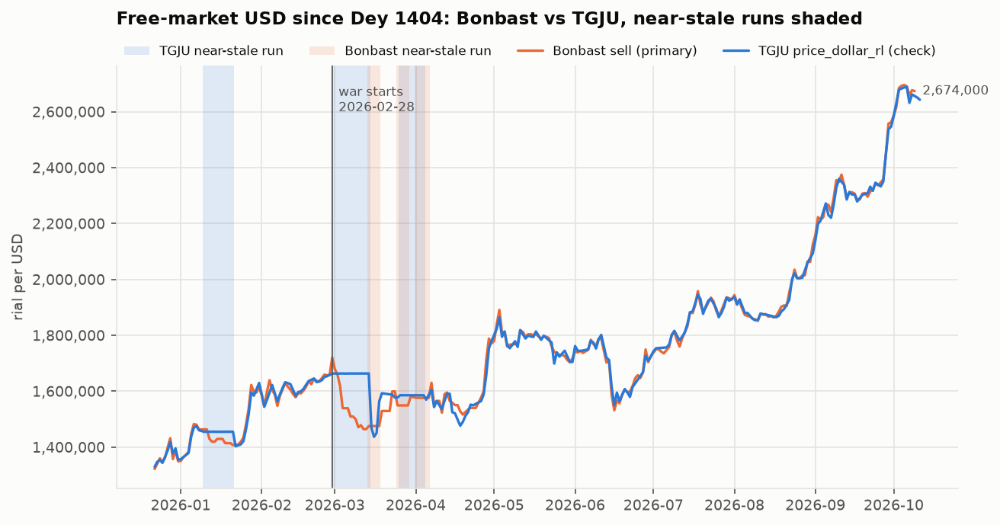
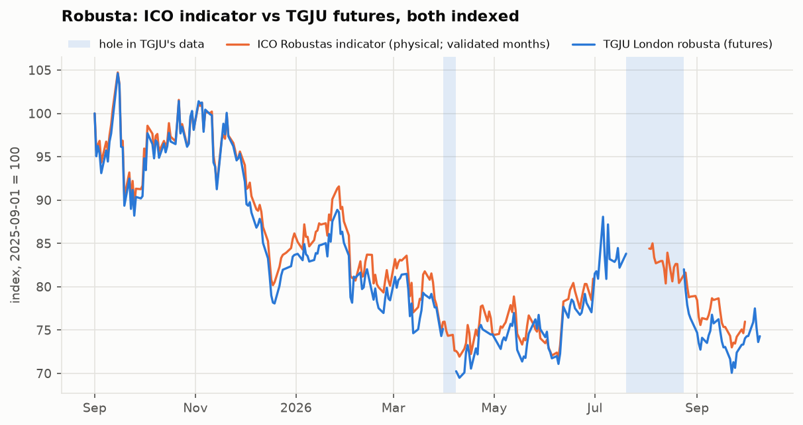
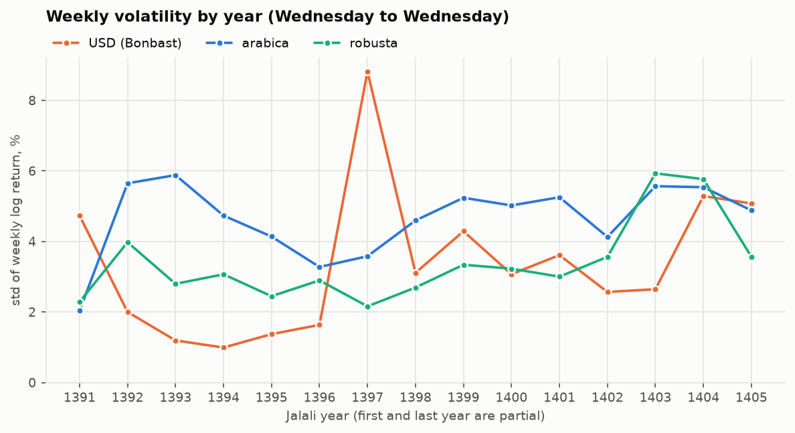

# الحاقیهٔ D1b — دلار Bonbast، پنل هفتگی، حفره‌های روبوستا

> **یادداشت ۱۴۰۵-۰۷-۲۱ (2026-10-13):** وضعیت PDF ماه ژوئیهٔ ۲۰۲۶ ICO و روش ساخت تغییرهای چندهفته‌ای قهوه در این الحاقیه با تصمیم‌های D-021 و D-022 جایگزین شده است؛ گزارش D2 (`reports/d2_eda/README.md`) را ببینید. بقیهٔ الحاقیه همان است که بازبینی شد و دوباره ساخته نشده است.

تاریخ ساخت: ۱۴۰۵-۰۷-۲۱ (2026-10-13). این الحاقیه گزارش D1 را بازنویسی نمی‌کند؛ فقط آنچه پس از بازبینی D1 عوض شد را گزارش می‌کند. همهٔ عددها، جدول‌ها و شکل‌ها را `scripts/d1b_addendum.py` ساخته است.

تصمیم‌های بازبینی (D-001 بازنگری‌شده و D-007 تا D-020) در `DECISIONS.md` ثبت شده‌اند. گزارش D1 با کدِ برچسب `d1` در گیت بازتولید می‌شود؛ اسکریپت آن دیگر روی کد فعلی اجرا نمی‌شود.

## ۱. خلاصه

1. **TGJU حالا فقط از نقطهٔ جدول تاریخچه می‌آید** و ستون D1 را دقیقاً بازمی‌سازد (۳٬۹۷۴ از ۳٬۹۷۴ تاریخ برابر). نقطهٔ نمودار و قانون «میلهٔ آخر» از کد حذف شد.
2. **دلار اصلی Bonbast است** (`usd_free`) و TGJU ستون کنترل (`usd_tgju`). آشکارساز «تقریباً راکد» ۱۲ دوره در TGJU پیدا می‌کند که بررسی دقیق‌برابر فقط ۱ تای آن را می‌دید. از ۳۴ دورهٔ Bonbast، ۲۶ تا تکرار دقیق عدد در تعطیلات است.
3. **پنل هفتگی ساخته شد:** ۷۳۱ چهارشنبه از ۱۳۹۱-۰۷-۱۹ تا ۱۴۰۵-۰۷-۱۵. بازده‌های هفتگی دلار جمع‌پذیرند و بازدهٔ هفتگی قهوه روزهای رول را کنار می‌گذارد.
4. **حفره‌های روبوستا با شاخص ICO پر شد (D-020):** آزمون سازگاری قبول شد (۴۱ هفته، همبستگی ۰.۹۷، نسبت نوسان ۰.۹۲). ۴ بازدهٔ هفتگی از ICO آمد و ۲ هفته خالی ماند، چون PDF ماه ۲۰۲۶-۰۷ اعتبارسنجی را رد شد.
5. **از شما لازم است:** تصمیم دربارهٔ ماه ردشدهٔ ICO و تأیید برداشت من از D-018 (بخش ۷).

## ۲. نقطهٔ دریافت TGJU (D-007)

همهٔ کلیدهای TGJU حالا از `api.tgju.org` (نقطهٔ پشت جدول تاریخچه) خوانده می‌شوند: دلار آزاد، روبوستا و پنج سری کانال رسمی. جدول برای هر تاریخ فقط یک ردیف دارد، پس قانون «میلهٔ آخر» لازم نیست. اگر روزی تاریخی دو بار بیاید، کد می‌ایستد و بی‌صدا انتخاب نمی‌کند.

مقایسهٔ ستون تازه (از جدول) با ستون D1 (از نمودار)، تاریخ به تاریخ:

| کلید | ردیف در D1 | ردیف در جدول | برابر | نابرابر | فقط در D1 | فقط در جدول |
| --- | --- | --- | --- | --- | --- | --- |
| `price_dollar_rl` | ۳٬۹۷۴ | ۳٬۹۷۴ | ۳٬۹۷۴ | ۰ | ۰ | ۰ |
| `commodities-london-coffee` | ۴٬۷۷۳ | ۴٬۷۷۳ | ۴٬۷۷۳ | ۰ | ۰ | ۰ |
| `nima_sell_usd` | ۱٬۸۶۰ | ۱٬۸۶۰ | ۱٬۸۵۶ | ۴ | ۰ | ۰ |
| `sana_sell_usd` | ۲٬۷۴۰ | ۲٬۷۴۰ | ۲٬۷۴۰ | ۰ | ۰ | ۰ |
| `bank_usd` | ۱٬۶۶۴ | ۱٬۶۶۴ | ۱٬۶۶۴ | ۰ | ۰ | ۰ |
| `ice_transfer_usd_sell` | ۲۱۵ | ۲۱۵ | ۲۱۵ | ۰ | ۰ | ۰ |
| `ice_currency_usd_sell` | ۶۸ | ۶۸ | ۶۸ | ۰ | ۰ | ۰ |

* **دلار و روبوستا دقیقاً یکی‌اند.** هیچ عددی در پنل با این تغییر عوض نشد.
* `nima_sell_usd` در ۴ تاریخ فرق دارد: 2018-12-17، 2018-12-18، 2018-12-19، 2018-12-26. در این تاریخ‌ها جدول میله‌ای غیر از «میلهٔ آخرِ» نمودار را نشان می‌دهد. این سری فقط برای اطلاع است.
* فایل‌های خام نقطهٔ نمودار (۷ فایل `chart_*.json`) به‌عنوان سابقه در `data/raw/tgju/` مانده‌اند. هیچ کدی آن‌ها را نمی‌خواند.

## ۳. دلار اصلی = Bonbast (D-001 بازنگری‌شده)

### ۳-۱. ستون‌های پنل

| ستون | منبع | نقش | اولین تاریخ | آخرین تاریخ | ردیف |
| --- | --- | --- | --- | --- | --- |
| `usd_free` | Bonbast، نرخ فروش، تومان × ۱۰، تاریخ همان‌طور که منتشر شده | اصلی | ۱۳۹۱-۰۷-۱۸ (2012-10-09) | ۱۴۰۵-۰۷-۱۷ (2026-10-09) | ۵٬۱۱۴ |
| `usd_tgju` | TGJU، کلید `price_dollar_rl`، قیمت پایانی | کنترل | ۱۳۹۰-۰۹-۰۵ (2011-11-26) | ۱۴۰۵-۰۷-۱۹ (2026-10-11) | ۳٬۹۷۴ |

* نام ستون‌ها نسبت به D1 عوض شده است: `usd_irr_bonbast` ← `usd_free` و `usd_irr` ← `usd_tgju`.
* Bonbast برای هر روز تقویمی یک عدد دارد، حتی جمعه و تعطیلات. پیش از ۱۳۹۱-۰۷-۱۸ دلار اصلی داده ندارد.

### ۳-۲. بازسازی یافتهٔ بازبینی

یافتهٔ شما از روی فایل‌های خام این بود که TGJU در چند دوره نرخ بازار آزاد خیابانی نیست. همان عددها از روی پنل:

| بازه | روز مشترک | بازهٔ TGJU | میانهٔ TGJU | بازهٔ Bonbast | میانهٔ Bonbast | میانهٔ فاصله (TGJU نسبت به Bonbast) | میانهٔ گام روزانهٔ TGJU |
| --- | --- | --- | --- | --- | --- | --- | --- |
| ۱۳۹۴-۰۷-۰۱ تا ۱۳۹۴-۱۱-۳۰ | ۹۹ | ۳۳٬۸۰۰ تا ۳۵٬۷۵۰ | ۳۳٬۹۰۲ | ۳۴٬۲۵۰ تا ۳۷٬۲۸۰ | ۳۵٬۹۵۰ | ٪۵.۵− | ٪۰.۰۳ |
| ۱۳۹۷-۰۱-۲۱ تا ۱۳۹۷-۰۲-۰۱ | ۸ | ۴۴٬۱۰۰ تا ۵۵٬۸۷۰ | ۵۰٬۵۶۴ | ۵۵٬۰۰۰ تا ۶۱٬۰۰۰ | ۵۷٬۲۵۰ | ٪۱۰.۵− | ٪۷.۳۲ |
| ۱۳۹۷-۰۷-۲۷ تا ۱۳۹۷-۰۸-۲۷ | ۲۲ | ۱۱۸٬۴۰۰ تا ۱۴۴٬۱۵۰ | ۱۲۰٬۳۰۰ | ۱۲۵٬۵۰۰ تا ۱۵۲٬۵۰۰ | ۱۴۰٬۲۵۰ | ٪۱۴.۴− | ٪۱.۱۰ |

* بزرگ‌ترین رشد ۱۳ هفته‌ای که در ۱۳۹۷ تمام می‌شود: Bonbast ٪۱۴۱+، TGJU ٪۱۱۳+ (هر دو در هفتهٔ ۱۳۹۷-۰۷-۰۴).
* همبستگی تغییرهای ۱۳ هفته‌ایِ بدون هم‌پوشانی، بسته به اینکه شمارش از کدام هفته شروع شود (۱۳ حالت، هر کدام حدود ۵۶ بازه): با ۱۳۹۷ بین ۰.۹۱ و ۰.۹۹؛ بدون بازه‌هایی که به ۱۳۹۷ می‌خورند بین ۰.۹۵ و ۰.۹۹.
* این عددها با یافتهٔ شما می‌خواند، با یک تفاوت: همبستگی ۱۳ هفته‌ای بیرون از ۱۳۹۷ در بعضی نقطه‌های شروع تا ۰.۹۵ پایین می‌آید، نه ۰.۹۸.

### ۳-۳. آشکارساز «تقریباً راکد»

«تقریباً راکد» یعنی ۵ مشاهدهٔ پشت‌سرهم یا بیشتر که هر کدام کمتر از ٪۰.۰۵ با مشاهدهٔ قبلی فرق دارد (تغییر لگاریتمی). بررسی قدیمیِ «عدد دقیقاً تکراری» هم سر جایش است؛ هر دو در پنل ستون دارند (`*_near_stale` و `*_stale`).

| سری | دورهٔ تقریباً راکد | مشاهده در این دوره‌ها | بلندترین دوره | دورهٔ دقیقاً تکراری | مشاهده در آن‌ها |
| --- | --- | --- | --- | --- | --- |
| دلار Bonbast | ۳۴ | ۲۳۲ | ۱۶ | ۲۶ | ۱۸۹ |
| دلار TGJU | ۱۲ | ۹۰ | ۱۳ | ۱ | ۵ |
| عربیکا | ۰ | ۰ | ۰ | ۰ | ۰ |
| روبوستا | ۰ | ۰ | ۰ | ۰ | ۰ |
| صندوق | ۶ | ۳۱ | ۶ | ۰ | ۰ |

**دوره‌های TGJU:**

| از | تا | مشاهده | اولین عدد | آخرین عدد | بزرگ‌ترین گام | Bonbast در همان بازه (اول ← آخر) | تغییر Bonbast |
| --- | --- | --- | --- | --- | --- | --- | --- |
| ۱۳۹۴-۰۷-۱۸ (2015-10-10) | ۱۳۹۴-۰۷-۲۵ (2015-10-17) | ۶ | ۳۳٬۹۰۰ | ۳۳٬۸۷۰ | ٪۰.۰۳۰ | ۳۴٬۹۰۰ ← ۳۴٬۶۵۰ | ٪۰.۷− |
| ۱۳۹۴-۰۸-۱۶ (2015-11-07) | ۱۳۹۴-۰۸-۲۰ (2015-11-11) | ۵ | ۳۳٬۹۵۰ | ۳۳٬۹۳۰ | ٪۰.۰۲۹ | ۳۵٬۱۸۰ ← ۳۵٬۶۷۰ | ٪۱.۴+ |
| ۱۳۹۴-۰۸-۲۳ (2015-11-14) | ۱۳۹۴-۰۹-۰۱ (2015-11-22) | ۷ | ۳۳٬۹۴۰ | ۳۳٬۹۴۰ | ٪۰.۰۲۹ | ۳۶٬۰۰۰ ← ۳۵٬۹۸۰ | ٪۰.۱− |
| ۱۳۹۴-۰۹-۰۷ (2015-11-28) | ۱۳۹۴-۰۹-۱۶ (2015-12-07) | ۷ | ۳۳٬۹۹۰ | ۳۳٬۹۶۰ | ٪۰.۰۳۲ | ۳۶٬۷۰۰ ← ۳۶٬۴۵۰ | ٪۰.۷− |
| ۱۳۹۴-۰۹-۲۵ (2015-12-16) | ۱۳۹۴-۱۰-۰۲ (2015-12-23) | ۵ | ۳۳٬۸۶۴ | ۳۳٬۸۵۴ | ٪۰.۰۴۷ | ۳۶٬۵۷۰ ← ۳۶٬۶۷۰ | ٪۰.۳+ |
| ۱۳۹۴-۱۰-۲۳ (2016-01-13) | ۱۳۹۴-۱۰-۳۰ (2016-01-20) | ۶ | ۳۳٬۸۴۶ | ۳۳٬۸۴۳ | ٪۰.۰۳۰ | ۳۶٬۶۵۰ ← ۳۶٬۱۲۰ | ٪۱.۴− |
| ۱۳۹۴-۱۱-۰۴ (2016-01-24) | ۱۳۹۴-۱۱-۱۴ (2016-02-03) | ۹ | ۳۳٬۸۵۰ | ۳۳٬۸۱۷ | ٪۰.۰۳۰ | ۳۶٬۵۵۰ ← ۳۶٬۳۲۰ | ٪۰.۶− |
| ۱۳۹۴-۱۱-۱۷ (2016-02-06) | ۱۳۹۴-۱۱-۲۴ (2016-02-13) | ۵ | ۳۳٬۸۰۰ | ۳۳٬۸۰۰ | ٪۰.۰۰۰ | ۳۵٬۹۵۰ ← ۳۵٬۰۰۰ | ٪۲.۶− |
| ۱۳۹۸-۱۲-۲۸ (2020-03-18) | ۱۳۹۹-۰۱-۱۴ (2020-04-02) | ۸ | ۱۴۹٬۰۳۰ | ۱۴۸٬۹۶۰ | ٪۰.۰۳۴ | ۱۶۱٬۰۰۰ ← ۱۶۶٬۰۰۰ | ٪۳.۱+ |
| ۱۴۰۴-۱۰-۲۰ (2026-01-10) | ۱۴۰۴-۱۱-۰۱ (2026-01-21) | ۱۱ | ۱٬۴۵۵٬۰۰۰ | ۱٬۴۵۵٬۲۵۰ | ٪۰.۰۲۷ | ۱٬۴۶۳٬۵۰۰ ← ۱٬۴۰۷٬۵۰۰ | ٪۳.۸− |
| ۱۴۰۴-۱۲-۰۹ (2026-02-28) | ۱۴۰۴-۱۲-۲۳ (2026-03-14) | ۱۳ | ۱٬۶۶۳٬۶۰۰ | ۱٬۶۶۳٬۶۰۰ | ٪۰.۰۲۴ | ۱٬۷۲۰٬۵۰۰ ← ۱٬۴۷۵٬۵۰۰ | ٪۱۴.۲− |
| ۱۴۰۵-۰۱-۰۶ (2026-03-26) | ۱۴۰۵-۰۱-۱۵ (2026-04-04) | ۸ | ۱٬۵۸۵٬۸۰۰ | ۱٬۵۸۵٬۷۰۰ | ٪۰.۰۱۶ | ۱٬۵۴۹٬۵۰۰ ← ۱٬۵۷۶٬۵۰۰ | ٪۱.۷+ |

* ۸ دوره در ۱۳۹۴ است و ۳ دوره از دی ۱۴۰۴ به بعد.
* **دو هفتهٔ اول جنگ:** TGJU از ۱۴۰۴-۱۲-۰۹ تا ۱۴۰۴-۱۲-۲۳ روی حدود ۱٬۶۶۳٬۶۰۰ ریال مانده است، در حالی که Bonbast از ۱٬۷۲۰٬۵۰۰ به ۱٬۴۷۵٬۵۰۰ رسیده (٪۱۴.۲−). روز بعد (۱۴۰۴-۱۲-۲۴) TGJU یک‌باره ٪۱۲.۴− حرکت می‌کند: همان «جهش تأییدنشده»ی گزارش D1، که در واقع جبرانِ دورهٔ راکد است.

**دوره‌های Bonbast:**

| از | تا | روز | عدد | تکرار دقیق؟ (وگرنه بزرگ‌ترین گام) | توضیح |
| --- | --- | --- | --- | --- | --- |
| ۱۳۹۱-۱۰-۱۳ (2013-01-02) | ۱۳۹۱-۱۰-۱۸ (2013-01-07) | ۶ | ۳۲٬۴۰۰ | بله | — |
| ۱۳۹۱-۱۲-۲۷ (2013-03-17) | ۱۳۹۲-۰۱-۰۴ (2013-03-24) | ۸ | ۳۴٬۳۰۰ | بله | نوروز |
| ۱۳۹۲-۰۸-۲۱ (2013-11-12) | ۱۳۹۲-۰۸-۲۵ (2013-11-16) | ۵ | ۳۰٬۱۲۰ | بله | — |
| ۱۳۹۲-۱۲-۲۸ (2014-03-19) | ۱۳۹۳-۰۱-۰۴ (2014-03-24) | ۶ | ۳۰٬۲۵۰ | بله | نوروز |
| ۱۳۹۳-۰۱-۱۱ (2014-03-31) | ۱۳۹۳-۰۱-۱۵ (2014-04-04) | ۵ | ۳۰٬۶۰۰ | بله | نوروز |
| ۱۳۹۳-۰۳-۱۱ (2014-06-01) | ۱۳۹۳-۰۳-۱۶ (2014-06-06) | ۶ | ۳۲٬۸۲۰ | ٪۰.۰۳۰ | — |
| ۱۳۹۳-۰۷-۱۷ (2014-10-09) | ۱۳۹۳-۰۷-۲۱ (2014-10-13) | ۵ | ۳۲٬۵۲۰ | ٪۰.۰۳۱ | — |
| ۱۳۹۳-۱۲-۲۸ (2015-03-19) | ۱۳۹۴-۰۱-۱۴ (2015-04-03) | ۱۶ | ۳۳٬۴۵۰ | بله | نوروز |
| ۱۳۹۴-۰۵-۲۶ (2015-08-17) | ۱۳۹۴-۰۵-۳۰ (2015-08-21) | ۵ | ۳۳٬۶۵۰ | ٪۰.۰۳۰ | — |
| ۱۳۹۴-۱۲-۲۷ (2016-03-17) | ۱۳۹۵-۰۱-۱۳ (2016-04-01) | ۱۶ | ۳۴٬۶۰۰ | بله | نوروز |
| ۱۳۹۵-۰۲-۲۹ (2016-05-18) | ۱۳۹۵-۰۳-۰۲ (2016-05-22) | ۵ | ۳۴٬۴۴۰ | ٪۰.۰۲۹ | — |
| ۱۳۹۵-۰۷-۱۹ (2016-10-10) | ۱۳۹۵-۰۷-۲۳ (2016-10-14) | ۵ | ۳۶٬۰۵۰ | بله | — |
| ۱۳۹۵-۱۲-۲۸ (2017-03-18) | ۱۳۹۶-۰۱-۱۳ (2017-04-02) | ۱۶ | ۳۷٬۳۰۰ | بله | نوروز |
| ۱۳۹۶-۰۱-۲۹ (2017-04-18) | ۱۳۹۶-۰۲-۰۲ (2017-04-22) | ۵ | ۳۷٬۴۹۰ | ٪۰.۰۲۷ | — |
| ۱۳۹۶-۰۵-۱۸ (2017-08-09) | ۱۳۹۶-۰۵-۲۳ (2017-08-14) | ۶ | ۳۸٬۱۲۰ | ٪۰.۰۲۶ | — |
| ۱۳۹۶-۰۸-۱۵ (2017-11-06) | ۱۳۹۶-۰۸-۱۹ (2017-11-10) | ۵ | ۴۰٬۷۵۰ | ٪۰.۰۴۹ | — |
| ۱۳۹۶-۰۹-۱۹ (2017-12-10) | ۱۳۹۶-۰۹-۲۴ (2017-12-15) | ۶ | ۴۲٬۰۷۰ | ٪۰.۰۴۸ | — |
| ۱۳۹۶-۱۲-۲۸ (2018-03-19) | ۱۳۹۷-۰۱-۱۳ (2018-04-02) | ۱۵ | ۴۷٬۷۳۰ | بله | نوروز |
| ۱۳۹۷-۰۲-۰۱ (2018-04-21) | ۱۳۹۷-۰۲-۰۵ (2018-04-25) | ۵ | ۵۶٬۰۰۰ | بله | — |
| ۱۳۹۷-۰۳-۱۲ (2018-06-02) | ۱۳۹۷-۰۳-۱۶ (2018-06-06) | ۵ | ۶۴٬۵۰۰ | بله | — |
| ۱۳۹۷-۱۲-۲۸ (2019-03-19) | ۱۳۹۸-۰۱-۰۴ (2019-03-24) | ۶ | ۱۳۵٬۰۰۰ | بله | نوروز |
| ۱۳۹۸-۰۱-۲۸ (2019-04-17) | ۱۳۹۸-۰۲-۰۱ (2019-04-21) | ۵ | ۱۳۷٬۰۰۰ | بله | — |
| ۱۳۹۸-۰۳-۱۳ (2019-06-03) | ۱۳۹۸-۰۳-۱۷ (2019-06-07) | ۵ | ۱۳۳٬۵۰۰ | بله | — |
| ۱۳۹۸-۰۷-۲۳ (2019-10-15) | ۱۳۹۸-۰۷-۲۷ (2019-10-19) | ۵ | ۱۱۵٬۰۰۰ | بله | — |
| ۱۳۹۸-۰۸-۲۵ (2019-11-16) | ۱۳۹۸-۰۸-۲۹ (2019-11-20) | ۵ | ۱۲۳٬۸۰۰ | بله | — |
| ۱۳۹۸-۱۲-۲۸ (2020-03-18) | ۱۳۹۹-۰۱-۰۴ (2020-03-23) | ۶ | ۱۶۱٬۰۰۰ | بله | نوروز |
| ۱۳۹۹-۰۳-۱۳ (2020-06-02) | ۱۳۹۹-۰۳-۱۷ (2020-06-06) | ۵ | ۱۷۷٬۵۰۰ | بله | — |
| ۱۳۹۹-۱۲-۲۸ (2021-03-18) | ۱۴۰۰-۰۱-۰۶ (2021-03-26) | ۹ | ۲۵۲٬۰۰۰ | بله | نوروز |
| ۱۴۰۰-۱۲-۲۶ (2022-03-17) | ۱۴۰۱-۰۱-۰۵ (2022-03-25) | ۹ | ۲۶۳٬۰۰۰ | بله | نوروز |
| ۱۴۰۱-۱۲-۲۹ (2023-03-20) | ۱۴۰۲-۰۱-۰۴ (2023-03-24) | ۵ | ۴۹۴٬۰۰۰ | بله | نوروز |
| ۱۴۰۳-۰۳-۲۳ (2024-06-12) | ۱۴۰۳-۰۳-۲۷ (2024-06-16) | ۵ | ۵۸۹٬۰۰۰ | بله | — |
| ۱۴۰۴-۱۲-۲۳ (2026-03-14) | ۱۴۰۴-۱۲-۲۷ (2026-03-18) | ۵ | ۱٬۴۷۵٬۵۰۰ | بله | جنگ |
| ۱۴۰۵-۰۱-۰۵ (2026-03-25) | ۱۴۰۵-۰۱-۰۹ (2026-03-29) | ۵ | ۱٬۵۴۹٬۵۰۰ | بله | نوروز |
| ۱۴۰۵-۰۱-۱۲ (2026-04-01) | ۱۴۰۵-۰۱-۱۷ (2026-04-06) | ۶ | ۱٬۵۷۶٬۵۰۰ | بله | نوروز |

* ۱۴ دوره از ۳۴ دوره روزهای نوروز را در بر دارد و ۳ دوره پس از آغاز جنگ است. این همان محدودیت شناخته‌شدهٔ Bonbast است: در تعطیلی یا قطعی، آرشیو عدد قبلی را تکرار می‌کند.
* صندوق ۶ دوره دارد که ۰ تای آن تکرار دقیق عدد است: در این دوره‌ها قیمت روزی کمتر از ٪۰.۰۵ بالا رفته است. دو سری قهوه روی هم ۰ دوره دارند.
* دوره‌های صندوق: ۱۳۹۶-۰۶-۲۶ تا ۱۳۹۶-۰۷-۰۱ (۵ مشاهده)؛ ۱۳۹۶-۰۹-۲۲ تا ۱۳۹۶-۰۹-۲۸ (۵ مشاهده)؛ ۱۳۹۸-۰۶-۱۷ تا ۱۳۹۸-۰۶-۲۶ (۶ مشاهده)؛ ۱۳۹۸-۰۹-۱۳ تا ۱۳۹۸-۰۹-۱۹ (۵ مشاهده)؛ ۱۳۹۸-۰۹-۲۰ تا ۱۳۹۸-۰۹-۲۶ (۵ مشاهده)؛ ۱۴۰۰-۰۳-۲۹ تا ۱۴۰۰-۰۴-۰۲ (۵ مشاهده).

*شکل ۱ — دلار آزاد از ۱۴۰۴-۱۰-۰۱: Bonbast (نارنجی، اصلی) و TGJU (آبی، کنترل). نوارهای کم‌رنگ دوره‌های تقریباً راکدِ هر منبع‌اند، به همان رنگ.*

### ۳-۴. TGJU در برابر Bonbast، به تفکیک سال

مرجع Bonbast است. فاصله = TGJU تقسیم بر Bonbast در همان تاریخ، منهای یک.

| سال | روز Bonbast | روز مشترک با TGJU | میانهٔ قدرمطلق فاصله | میانهٔ فاصله | روزهای فاصله بالای ٪۲ | همان، با یک روز جابه‌جایی مجاز | روز تقریباً راکد Bonbast | روز تقریباً راکد TGJU |
| --- | --- | --- | --- | --- | --- | --- | --- | --- |
| ۱۳۹۱ | ۱۶۳ | ۱۱۲ | ٪۱.۰۷ | ٪۰.۰۰ | ۳۰ | ۱۴ | ۱۰ | ۰ |
| ۱۳۹۲ | ۳۶۵ | ۲۴۶ | ٪۰.۳۷ | ٪۰.۰۷− | ۱۴ | ۲ | ۱۱ | ۰ |
| ۱۳۹۳ | ۳۶۵ | ۲۸۲ | ٪۰.۲۶ | ٪۰.۰۹− | ۲ | ۰ | ۲۲ | ۰ |
| ۱۳۹۴ | ۳۶۵ | ۲۴۳ | ٪۰.۹۰ | ٪۰.۸۹− | ۹۰ | ۸۷ | ۲۲ | ۵۰ |
| ۱۳۹۵ | ۳۶۶ | ۲۴۰ | ٪۰.۲۶ | ٪۰.۲۰− | ۳ | ۱ | ۲۶ | ۰ |
| ۱۳۹۶ | ۳۶۵ | ۲۴۲ | ٪۰.۱۴ | ٪۰.۰۸+ | ۱۲ | ۹ | ۳۷ | ۰ |
| ۱۳۹۷ | ۳۶۵ | ۲۸۰ | ٪۲.۹۷ | ٪۲.۳۴− | ۱۸۳ | ۱۴۰ | ۲۵ | ۰ |
| ۱۳۹۸ | ۳۶۵ | ۲۸۳ | ٪۰.۹۸ | ٪۰.۷۰− | ۴۹ | ۲۵ | ۲۶ | ۱ |
| ۱۳۹۹ | ۳۶۶ | ۲۸۴ | ٪۰.۹۳ | ٪۰.۳۳− | ۷۲ | ۳۸ | ۱۲ | ۷ |
| ۱۴۰۰ | ۳۶۵ | ۲۸۳ | ٪۰.۶۲ | ٪۰.۲۹− | ۲۵ | ۱۴ | ۱۰ | ۰ |
| ۱۴۰۱ | ۳۶۵ | ۲۵۹ | ٪۰.۵۹ | ٪۰.۰۲− | ۲۷ | ۹ | ۶ | ۰ |
| ۱۴۰۲ | ۳۶۵ | ۲۸۳ | ٪۰.۴۰ | ٪۰.۰۲− | ۱۱ | ۱ | ۴ | ۰ |
| ۱۴۰۳ | ۳۶۶ | ۲۸۸ | ٪۰.۸۱ | ٪۰.۰۱− | ۴۵ | ۳۴ | ۵ | ۰ |
| ۱۴۰۴ | ۳۶۵ | ۲۸۱ | ٪۰.۵۶ | ٪۰.۱۰+ | ۳۸ | ۲۱ | ۵ | ۲۴ |
| ۱۴۰۵ | ۲۰۳ | ۱۶۲ | ٪۰.۴۳ | ٪۰.۰۹− | ۷ | ۵ | ۱۱ | ۸ |

* بدترین سال‌ها: ۱۳۹۷ (۱۴۰ روز، میانهٔ فاصله ٪۲.۳−) و ۱۳۹۴ (۸۷ روز، میانهٔ فاصله ٪۰.۹−). در هر دو TGJU پایین‌تر از Bonbast است.
* بررسی روزانهٔ D1 هم سر جایش است (ستون `usd_outlier_check`، فقط برای اطلاع، D-008): از ۳۴ حرکت روزانهٔ بالای ٪۱۰ در TGJU، ۱۱ تأیید، ۱۸ تأییدنشده و ۵ پیش از آغاز Bonbast. خود Bonbast ۹ حرکت روزانهٔ بالای ٪۱۰ دارد.

### ۳-۵. حرکت‌های هفتگی بزرگ Bonbast و بررسی با TGJU

هفته‌هایی که بازدهٔ لگاریتمی چهارشنبه تا چهارشنبهٔ Bonbast از ٪۱۰ بیشتر است: ۲۳ هفته از ۷۳۰ هفته. «تأیید» یعنی TGJU در همان هفته هم‌جهت و دست‌کم نصف آن اندازه حرکت کرده است.

| چهارشنبه | Bonbast هفتهٔ قبل | Bonbast | بازده Bonbast | بازده TGJU | نتیجه | یادداشت |
| --- | --- | --- | --- | --- | --- | --- |
| ۱۳۹۷-۰۱-۲۲ (2018-04-11) | ۵۱٬۲۰۰ | ۶۱٬۰۰۰ | ٪۱۷.۵+ | ٪۸.۹− | **تأیید نشد** | — |
| ۱۳۹۷-۰۲-۱۹ (2018-05-09) | ۶۰٬۵۰۰ | ۶۷٬۳۰۰ | ٪۱۰.۷+ | ٪۱۰.۹+ | تأیید | — |
| ۱۳۹۷-۰۳-۲۳ (2018-06-13) | ۶۴٬۵۰۰ | ۷۲٬۵۰۰ | ٪۱۱.۷+ | ٪۵.۲+ | **تأیید نشد** | — |
| ۱۳۹۷-۰۵-۰۳ (2018-07-25) | ۸۲٬۰۰۰ | ۹۳٬۰۰۰ | ٪۱۲.۶+ | ٪۱۲.۸+ | تأیید | — |
| ۱۳۹۷-۰۵-۱۰ (2018-08-01) | ۹۳٬۰۰۰ | ۱۰۶٬۵۰۰ | ٪۱۳.۶+ | ٪۱۹.۳+ | تأیید | — |
| ۱۳۹۷-۰۶-۱۴ (2018-09-05) | ۱۰۹٬۶۰۰ | ۱۴۰٬۰۰۰ | ٪۲۴.۵+ | ٪۲۰.۰+ | تأیید | — |
| ۱۳۹۷-۰۷-۰۴ (2018-09-26) | ۱۴۵٬۳۰۰ | ۱۹۰٬۰۰۰ | ٪۲۶.۸+ | ٪۱۸.۴+ | تأیید | — |
| ۱۳۹۷-۰۷-۱۱ (2018-10-03) | ۱۹۰٬۰۰۰ | ۱۴۷٬۰۰۰ | ٪۲۵.۷− | ٪۳۲.۴− | تأیید | — |
| ۱۳۹۷-۰۸-۲۳ (2018-11-14) | ۱۴۶٬۵۰۰ | ۱۳۰٬۰۰۰ | ٪۱۱.۹− | ٪۱.۶− | **تأیید نشد** | — |
| ۱۳۹۷-۰۹-۰۷ (2018-11-28) | ۱۳۱٬۰۰۰ | ۱۱۶٬۰۰۰ | ٪۱۲.۲− | ٪۱۲.۷− | تأیید | — |
| ۱۳۹۷-۱۰-۰۵ (2018-12-26) | ۱۰۳٬۰۰۰ | ۱۱۸٬۰۰۰ | ٪۱۳.۶+ | ٪۷.۵+ | تأیید | — |
| ۱۳۹۷-۱۲-۰۱ (2019-02-20) | ۱۲۴٬۵۰۰ | ۱۳۸٬۵۰۰ | ٪۱۰.۷+ | ٪۶.۴+ | تأیید | — |
| ۱۳۹۸-۱۲-۰۷ (2020-02-26) | ۱۴۴٬۰۰۰ | ۱۵۹٬۲۰۰ | ٪۱۰.۰+ | ٪۸.۷+ | تأیید | — |
| ۱۴۰۰-۰۲-۱۵ (2021-05-05) | ۲۳۸٬۴۰۰ | ۲۰۹٬۰۰۰ | ٪۱۳.۲− | ٪۸.۱− | تأیید | — |
| ۱۴۰۱-۱۰-۰۷ (2022-12-28) | ۳۹۶٬۰۰۰ | ۴۴۰٬۰۰۰ | ٪۱۰.۵+ | ٪۸.۸+ | تأیید | — |
| ۱۴۰۱-۱۰-۱۴ (2023-01-04) | ۴۴۰٬۰۰۰ | ۳۹۸٬۰۰۰ | ٪۱۰.۰− | ٪۸.۱− | تأیید | — |
| ۱۴۰۴-۰۱-۲۷ (2025-04-16) | ۹۹۷٬۵۰۰ | ۸۸۶٬۵۰۰ | ٪۱۱.۸− | ٪۱۶.۴− | تأیید | — |
| ۱۴۰۴-۰۳-۲۸ (2025-06-18) | ۸۲۵٬۰۰۰ | ۹۳۹٬۵۰۰ | ٪۱۳.۰+ | — | TGJU ندارد | TGJU بیش از ۵ روز بدون داده |
| ۱۴۰۴-۰۴-۰۴ (2025-06-25) | ۹۳۹٬۵۰۰ | ۸۳۱٬۵۰۰ | ٪۱۲.۲− | — | TGJU ندارد | — |
| ۱۴۰۴-۱۱-۰۸ (2026-01-28) | ۱٬۴۰۷٬۵۰۰ | ۱٬۶۲۲٬۵۰۰ | ٪۱۴.۲+ | ٪۹.۲+ | تأیید | — |
| ۱۴۰۵-۰۲-۰۹ (2026-04-29) | ۱٬۵۴۰٬۵۰۰ | ۱٬۷۸۸٬۵۰۰ | ٪۱۴.۹+ | ٪۱۲.۲+ | تأیید | — |
| ۱۴۰۵-۰۳-۲۷ (2026-06-17) | ۱٬۷۸۸٬۰۰۰ | ۱٬۵۶۷٬۰۰۰ | ٪۱۳.۲− | ٪۱۱.۳− | تأیید | — |
| ۱۴۰۵-۰۶-۱۱ (2026-09-02) | ۲٬۰۰۴٬۰۰۰ | ۲٬۲۲۳٬۰۰۰ | ٪۱۰.۴+ | ٪۹.۲+ | تأیید | — |

* تأیید: ۱۸. تأیید نشد: ۳. ۱۲ هفته از ۲۳ هفته در ۱۳۹۷ است.
* هفته‌های تأییدنشده: ۱۳۹۷-۰۱-۲۲، ۱۳۹۷-۰۳-۲۳، ۱۳۹۷-۰۸-۲۳. این‌ها هفته‌هایی هستند که TGJU یا بسته بوده یا نرخ مدیریت‌شده نشان داده است؛ یعنی همان دوره‌هایی که دلیل تغییر D-001 بودند.

### ۳-۶. همبستگی بازدهٔ هفتگی با TGJU

فقط برای اطلاع. Bonbast یک بار همان‌طور که منتشر شده و یک بار با یک روز جابه‌جایی به عقب (عددِ روز t+1 روی روز t) هفتگی شده است. **در پنل هیچ جابه‌جایی انجام نشده است.**

| Bonbast | هفته | همبستگی | هفته بدون ۱۳۹۷ | همبستگی بدون ۱۳۹۷ | انحراف معیار اختلاف دو بازده |
| --- | --- | --- | --- | --- | --- |
| همان‌طور که منتشر شده | ۷۳۰ | ۰.۷۴۶ | ۶۷۷ | ۰.۷۶۴ | ٪۲.۷۲ |
| یک روز به عقب | ۷۳۰ | ۰.۷۹۴ | ۶۷۷ | ۰.۷۹۹ | ٪۲.۳۵ |

* جابه‌جایی یک‌روزه همبستگی را از ۰.۷۵ به ۰.۷۹ می‌برد. یعنی بخشی از اختلاف هفتگی دو منبع فقط زمان‌بندی عکس روزانهٔ Bonbast است؛ بقیه اختلاف واقعی دو منبع است.
* همبستگی هفتگی با اینکه بالا نیست، در افق ۱۳ هفته‌ای به ۰.۹۱ تا ۰.۹۹ می‌رسد (بخش ۳-۲). برای افق سه‌ماههٔ مدل، زمان‌بندی یک‌روزه اهمیت کمی دارد.

## ۴. روبوستا: پر کردن حفره‌ها با شاخص ICO (D-020)

مسیر Investing.com کنار گذاشته شد (دانلودش بازهٔ تاریخ انتخاب‌شده را نادیده می‌گیرد). فایل یک‌ماههٔ قبلی دیگر خوانده نمی‌شود و خواننده‌اش از کد حذف شد. به‌جای آن از PDFهای ماهانهٔ «قیمت‌های شاخص» سازمان بین‌المللی قهوه (ICO) استفاده می‌کنیم: یک ردیف برای هر روز معاملاتی، به سنت بر پوند.

**نکتهٔ مهم:** ستون Robustas در ICO قیمت «فیزیکی» است، نه قیمت آتی ICE. پس فقط برای *بازده* استفاده می‌شود و هیچ‌وقت برای *سطح*. ستون سطح روبوستا همان TGJU می‌ماند و حفره‌هایش پر نمی‌شود.

### ۴-۱. دانلود و اعتبارسنجی

بازهٔ خواسته‌شده: ۲۰۲۵-۰۱ تا ۲۰۲۶-۰۹ (۲۱ ماه). هر ماه با ۴ نام آزموده شد (دو الگوی نام، در `ico.org` و `icocoffee.org`). شرط اعتبار: میانگین، بیشینه و کمینهٔ ردیف‌های خوانده‌شده باید با ردیف‌های Average، High و Low چاپ‌شده در خود PDF تا ۰.۰۱ یکی باشد.

| ماه | بارگیری | ردیف | میانگین: خوانده / چاپ‌شده | بیشینه: خوانده / چاپ‌شده | کمینه: خوانده / چاپ‌شده | نتیجه |
| --- | --- | --- | --- | --- | --- | --- |
| ۲۰۲۵-۰۱ | **بارگیری نشد** | — | — | — | — | استفاده نمی‌شود |
| ۲۰۲۵-۰۲ | **بارگیری نشد** | — | — | — | — | استفاده نمی‌شود |
| ۲۰۲۵-۰۳ | **بارگیری نشد** | — | — | — | — | استفاده نمی‌شود |
| ۲۰۲۵-۰۴ | **بارگیری نشد** | — | — | — | — | استفاده نمی‌شود |
| ۲۰۲۵-۰۵ | **بارگیری نشد** | — | — | — | — | استفاده نمی‌شود |
| ۲۰۲۵-۰۶ | **بارگیری نشد** | — | — | — | — | استفاده نمی‌شود |
| ۲۰۲۵-۰۷ | **بارگیری نشد** | — | — | — | — | استفاده نمی‌شود |
| ۲۰۲۵-۰۸ | **بارگیری نشد** | — | — | — | — | استفاده نمی‌شود |
| ۲۰۲۵-۰۹ | بله | ۲۲ | ۲۱۰.۸۴۷ / ۲۱۰.۸۵ | ۲۳۰.۹۳ / ۲۳۰.۹۳ | ۱۹۷.۰۰ / ۱۹۷.۰۰ | معتبر |
| ۲۰۲۵-۱۰ | بله | ۲۳ | ۲۱۵.۰۶۰ / ۲۱۵.۰۶ | ۲۲۳.۹۴ / ۲۲۳.۹۴ | ۲۰۸.۸۲ / ۲۰۸.۸۲ | معتبر |
| ۲۰۲۵-۱۱ | بله | ۲۰ | ۲۱۴.۹۱۳ / ۲۱۴.۹۱ | ۲۲۳.۲۴ / ۲۲۳.۲۴ | ۲۰۲.۲۱ / ۲۰۲.۲۱ | معتبر |
| ۲۰۲۵-۱۲ | بله | ۲۲ | ۱۹۰.۵۲۹ / ۱۹۰.۵۳ | ۲۰۷.۳۳ / ۲۰۷.۳۳ | ۱۷۶.۷۹ / ۱۷۶.۷۹ | معتبر |
| ۲۰۲۶-۰۱ | بله | ۲۱ | ۱۹۲.۵۱۷ / ۱۹۲.۵۲ | ۲۰۱.۹۲ / ۲۰۱.۹۲ | ۱۸۵.۸۷ / ۱۸۵.۸۷ | معتبر |
| ۲۰۲۶-۰۲ | بله | ۲۰ | ۱۷۹.۷۲۹ / ۱۷۹.۷۳ | ۱۸۹.۴۶ / ۱۸۹.۴۶ | ۱۷۴.۹۳ / ۱۷۴.۹۳ | معتبر |
| ۲۰۲۶-۰۳ | بله | ۲۲ | ۱۷۶.۷۶۶ / ۱۷۶.۷۷ | ۱۸۴.۳۰ / ۱۸۴.۳۰ | ۱۶۴.۷۸ / ۱۶۴.۷۸ | معتبر |
| ۲۰۲۶-۰۴ | بله | ۲۲ | ۱۶۴.۶۴۵ / ۱۶۴.۶۴ | ۱۷۱.۶۳ / ۱۷۱.۶۳ | ۱۵۸.۶۰ / ۱۵۸.۶۰ | معتبر |
| ۲۰۲۶-۰۵ | بله | ۲۱ | ۱۶۶.۵۱۲ / ۱۶۶.۵۱ | ۱۷۳.۹۲ / ۱۷۳.۹۲ | ۱۶۱.۶۹ / ۱۶۱.۶۹ | معتبر |
| ۲۰۲۶-۰۶ | بله | ۲۲ | ۱۶۹.۳۹۰ / ۱۶۹.۳۹ | ۱۷۸.۴۳ / ۱۷۸.۴۳ | ۱۵۸.۳۶ / ۱۵۸.۳۶ | معتبر |
| ۲۰۲۶-۰۷ | بله | ۲۳ | ۱۸۴.۷۸۴ / ۱۸۴.۸۷ | ۱۹۲.۹۴ / ۱۹۲.۹۴ | ۱۷۹.۲۰ / ۱۷۹.۲۰ | **ردشده؛ استفاده نمی‌شود** |
| ۲۰۲۶-۰۸ | بله | ۲۱ | ۱۸۰.۶۳۴ / ۱۸۰.۶۳ | ۱۸۷.۴۴ / ۱۸۷.۴۴ | ۱۷۳.۷۱ / ۱۷۳.۷۱ | معتبر |
| ۲۰۲۶-۰۹ | بله | ۲۲ | ۱۶۷.۴۸۶ / ۱۶۷.۴۹ | ۱۷۳.۴۷ / ۱۷۳.۴۷ | ۱۶۰.۹۶ / ۱۶۰.۹۶ | معتبر |

* بارگیری‌شده: ۱۳ ماه از ۲۱. معتبر: ۱۲ ماه.
* **بارگیری نشد (۸ ماه):** ۲۰۲۵-۰۱، ۲۰۲۵-۰۲، ۲۰۲۵-۰۳، ۲۰۲۵-۰۴، ۲۰۲۵-۰۵، ۲۰۲۵-۰۶، ۲۰۲۵-۰۷، ۲۰۲۵-۰۸. هیچ‌کدام از نام‌ها جواب نداد (خطای ۴۰۴). صفحهٔ «اطلاعات عمومی بازار» ICO فقط ماه‌های اخیر را پیوند می‌دهد.
* **ماه ۲۰۲۶-۰۷ رد شد:** ۲۳ ردیف خوانده شد و بیشینه و کمینه درست‌اند، ولی میانگین ردیف‌ها ۱۸۴.۷۸۴ است و PDF ۱۸۴.۸۷ چاپ کرده (اختلاف ۰.۰۸۶). این اندازه برابر است با اینکه یک ردیف ۱.۹۸ سنت جابه‌جا باشد. تنها ردیفی که عیناً عدد روز قبل را تکرار کرده 2026-07-17 است. یعنی خواندن درست است و ناسازگاری در خود PDF است. طبق قانون، این ماه استفاده نشد (بخش ۷-۱).
* فایل‌ها بدون تغییر در `data/raw/ico/` ذخیره و در MANIFEST ثبت شده‌اند. robots.txt سایت ICO این مسیر را منع نکرده است.

### ۴-۲. آزمون سازگاری (پیش از دیدن نتیجه ثابت شده بود)

قانون: روی هفته‌های 2025-01-01 تا 2026-09-30 که هر دو سری قیمت تازه دارند و روز رول TGJU در هفته نیست، بازدهٔ لگاریتمی هفتگی ICO Robustas با روبوستای TGJU مقایسه می‌شود. قبولی = همبستگی دست‌کم ۰.۹۰ و نسبت نوسان هفتگی (ICO به TGJU) بین ۰.۸۰ و ۱.۲۵.

| سنجه | مقدار | در بازهٔ قبولی؟ |
| --- | --- | --- |
| هفته‌های آزمون | ۴۱ | — |
| همبستگی بازدهٔ هفتگی | ۰.۹۷۰ | بله |
| نوسان هفتگی ICO | ٪۳.۷۸ | — |
| نوسان هفتگی TGJU | ٪۴.۰۸ | — |
| نسبت نوسان (ICO / TGJU) | ۰.۹۲۴ | بله |

* **نتیجه: قبول.**
* هفته‌های آزمون از ۱۴۰۴-۰۶-۱۹ تا ۱۴۰۵-۰۷-۰۱ است، نه از ژانویهٔ ۲۰۲۵: PDFهای پیش از آن بارگیری نشد. هفته‌های ماه ردشده هم در آزمون نیستند. پس آزمون روی هفته‌های کمتری از آنچه در نظر بود انجام شده است.

### ۴-۳. هفته‌های پرشده

هفته‌هایی که بازدهٔ روبوستای TGJU طبق D-018 خالی است (بخش ۵)، و آنچه جایش نشست:

| چهارشنبه | چرا خالی بود | آخرین مشاهدهٔ TGJU | تغییر خام سطح TGJU | بازدهٔ هفتگی ICO | بازدهٔ نهایی |
| --- | --- | --- | --- | --- | --- |
| ۱۴۰۵-۰۱-۱۹ (2026-04-08) | اولین مشاهده پس از حفره | ۱۴۰۵-۰۱-۱۹ | ٪۶.۷۲− | ٪۴.۵۶− | ICO |
| ۱۴۰۵-۰۵-۰۷ (2026-07-29) | سطح کهنه (داخل حفره) | ۱۴۰۵-۰۴-۲۹ | ٪۰.۰۰ | — | **خالی ماند** |
| ۱۴۰۵-۰۵-۱۴ (2026-08-05) | سطح کهنه (داخل حفره) | ۱۴۰۵-۰۴-۲۹ | ٪۰.۰۰ | — | **خالی ماند** |
| ۱۴۰۵-۰۵-۲۱ (2026-08-12) | سطح کهنه (داخل حفره) | ۱۴۰۵-۰۴-۲۹ | ٪۰.۰۰ | ٪۳.۴۶− | ICO |
| ۱۴۰۵-۰۵-۲۸ (2026-08-19) | سطح کهنه (داخل حفره) | ۱۴۰۵-۰۴-۲۹ | ٪۰.۰۰ | ٪۰.۶۳+ | ICO |
| ۱۴۰۵-۰۶-۰۴ (2026-08-26) | اولین مشاهده پس از حفره | ۱۴۰۵-۰۶-۰۴ | ٪۷.۳۳− | ٪۳.۲۱− | ICO |

* ۴ هفته از ICO پر شد (`robusta_return_source = "ico"`). در این هفته‌ها چیزی بابت رول کنار گذاشته نمی‌شود، چون ICO رول ندارد.
* **۲ هفته خالی ماند** (۱۴۰۵-۰۵-۰۷، ۱۴۰۵-۰۵-۱۴): بازدهٔ ICO این هفته‌ها به سطح‌های ماه ردشده نیاز دارد.
* «تغییر خام سطح TGJU» در هفته‌های داخل حفره صفر است (سطح تکان نخورده) و در اولین هفتهٔ پس از حفره کل حرکتِ حفره را یک‌جا دارد، به‌اضافهٔ پرش رولِ داخل حفره. برای همین این بازده‌ها استفاده نمی‌شوند.
* حفره‌های سطح روبوستا سر جایشان هستند: ۱۴۰۵-۰۴-۲۹ تا ۱۴۰۵-۰۶-۰۲ (۳۵ روز)؛ ۱۴۰۵-۰۱-۱۱ تا ۱۴۰۵-۰۱-۱۹ (۸ روز).
* ردیف‌های TGJU با تاریخ شنبه یا یکشنبه (۲۶ ردیف) در سری روبوستا نیستند (D-010). در ستون `robusta_tgju_usd_t` مانده‌اند و `robusta_weekend` آن‌ها را علامت می‌زند.

*شکل ۲ — شاخص فیزیکی ICO Robustas (نارنجی، فقط ماه‌های معتبر) و آتی روبوستای TGJU (آبی)، هر دو در اولین روز مشترک برابر ۱۰۰. نوارهای آبی کم‌رنگ حفره‌های دادهٔ TGJU‌اند.*

### ۴-۴. آیا تاریخ‌های TGJU در ۲۰۲۶ یک روز جابه‌جا شده‌اند؟

فایل Investing بازهٔ مشکوک (بهمن ۱۴۰۴ تا مرداد ۱۴۰۵) را ندارد. پس با عربیکا آزمودیم، که تاریخ‌هایش از منبع دیگری (Yahoo) است: همبستگی بازدهٔ روزانهٔ روبوستا با عربیکا در تأخیرهای −۱، ۰ و +۱.

| دوره | بازه | بازدهٔ روزانه | تأخیر −۱ | تأخیر ۰ | تأخیر +۱ |
| --- | --- | --- | --- | --- | --- |
| ۲۰۲۱ | ۱۳۹۹-۱۰-۱۲ تا ۱۴۰۰-۱۰-۱۰ | ۲۴۷ | ۰.۰۰ | **۰.۷۱** | ۰.۰۴ |
| ۲۰۲۲ | ۱۴۰۰-۱۰-۱۱ تا ۱۴۰۱-۱۰-۱۰ | ۲۴۲ | ۰.۰۱ | **۰.۶۹** | ۰.۰۴− |
| ۲۰۲۳ | ۱۴۰۱-۱۰-۱۱ تا ۱۴۰۲-۱۰-۱۰ | ۲۴۵ | ۰.۰۴ | **۰.۵۰** | ۰.۱۳− |
| ۲۰۲۴ | ۱۴۰۲-۱۰-۱۱ تا ۱۴۰۳-۱۰-۱۱ | ۲۴۷ | ۰.۰۴− | **۰.۷۶** | ۰.۰۳− |
| ۲۰۲۵ | ۱۴۰۳-۱۰-۱۲ تا ۱۴۰۴-۱۰-۱۰ | ۲۴۷ | ۰.۰۸− | **۰.۷۴** | ۰.۰۳ |
| ۲۰۲۶، پیش از اولین ردیف آخر هفته | ۱۴۰۴-۱۰-۱۱ تا ۱۴۰۴-۱۱-۱۷ | ۲۴ | ۰.۲۱− | **۰.۶۲** | ۰.۱۶ |
| ۲۰۲۶، دورهٔ ردیف‌های آخر هفته | ۱۴۰۴-۱۱-۱۸ تا ۱۴۰۵-۰۵-۳۱ | ۱۰۱ | ۰.۱۷− | **۰.۷۵** | ۰.۲۱− |
| ۲۰۲۶، پس از آخرین ردیف آخر هفته | ۱۴۰۵-۰۶-۰۱ تا ۱۴۰۵-۰۷-۲۰ | ۳۱ | ۰.۲۳ | **۰.۶۶** | ۰.۳۱ |

* **نه، جابه‌جا نشده‌اند.** در ۸ دوره از ۸ دوره اوج همبستگی در تأخیر ۰ است، از جمله در دورهٔ ردیف‌های آخر هفته. ردیف‌های روز کاری TGJU تاریخ درست دارند؛ ردیف‌های آخر هفته ردیف اضافه‌اند، نه جابه‌جایی کل سری.
* خود ردیف‌های آخر هفته نه تکرار جمعه‌اند و نه پیش‌نمایش دوشنبه: میانهٔ فاصله‌شان از روز کاری قبل ٪۱.۰۸ و از روز کاری بعد ٪۱.۵۴ است (۲۶ ردیف). منشأشان روشن نیست؛ کنار گذاشتنشان (D-010) درست است.

### ۴-۵. شاهد رول روی سری اصلی

قانون رول روبوستا روی کل تاریخچه اعمال می‌شود (D-009): روز پرش روزی است که ۳ روز معاملاتی تا پایان ماه تحویل مانده است. شاهد آماری D1 روی سری اصلی فعلی دوباره حساب شد (بازدهٔ روبوستا منهای ۰.۵ برابر بازدهٔ عربیکا؛ هر خانه: انحراف معیار / میانگین):

| روز مانده تا پایان ماه | ۲۰۰۸–۲۰۱۲ | ۲۰۱۳–۲۰۱۶ | ۲۰۱۷–۲۰۲۰ | ۲۰۲۱–۲۰۲۶ |
| --- | --- | --- | --- | --- |
| ۰ | ٪۱.۱۵ / ٪۰.۰۶+ | ٪۱.۰۶ / ٪۰.۳۳− | ٪۰.۹۲ / ٪۰.۱۰− | ٪۰.۷۸ / ٪۰.۱۷− |
| ۱ | ٪۰.۹۷ / ٪۰.۳۷− | ٪۱.۲۱ / ٪۰.۰۵− | ٪۱.۰۱ / ٪۰.۴۰− | ٪۱.۰۹ / ٪۰.۲۰+ |
| ۲ | ٪۱.۳۹ / ٪۰.۴۷+ | ٪۱.۴۲ / ٪۰.۰۶− | ٪۰.۹۰ / ٪۰.۱۸+ | ٪۱.۱۹ / ٪۰.۳۴+ |
| ۳ ← روز پرش | ٪۱.۱۳ / ٪۰.۳۶+ | ٪۱.۱۲ / ٪۰.۱۸− | ٪۱.۳۲ / ٪۰.۳۸+ | ٪۲.۲۶ / ٪۱.۳۳− |
| ۴ | ٪۱.۱۹ / ٪۰.۲۲+ | ٪۰.۸۰ / ٪۰.۱۹− | ٪۱.۳۳ / ٪۰.۱۰+ | ٪۱.۲۷ / ٪۰.۰۷+ |
| ۵ | ٪۱.۴۹ / ٪۰.۱۸+ | ٪۱.۰۹ / ٪۰.۱۰− | ٪۰.۸۵ / ٪۰.۰۹− | ٪۱.۳۲ / ٪۰.۱۸+ |
| ۶ | ٪۱.۶۹ / ٪۰.۱۲− | ٪۱.۰۳ / ٪۰.۲۶+ | ٪۱.۰۲ / ٪۰.۰۷− | ٪۱.۴۴ / ٪۰.۰۱+ |
| همهٔ روزها | ٪۱.۴۶ / ٪۰.۰۱− | ٪۱.۲۰ / ٪۰.۰۱+ | ٪۱.۰۲ / ٪۰.۰۴− | ٪۱.۴۷ / ٪۰.۰۴+ |

* سری روبوستا همان سری D1 است (TGJU، روزهای کاری)، پس شاهد همان است: فقط در ۲۰۲۱ تا ۲۰۲۶ روز پرش برجسته است. در پنل ۱۱۳ روز رول روبوستا و ۱۳۴ روز رول عربیکا علامت دارد.

## ۵. پنل هفتگی (D-011)

فایل: `data/processed/panel_weekly.parquet`. هر ردیف یک چهارشنبه است. برای هر سری:

* **سطح** = آخرین مشاهده در آن چهارشنبه یا پیش از آن. اگر چهارشنبه تعطیل باشد، آخرین مشاهدهٔ قبلی می‌آید؛ چیزی پر نمی‌شود. تاریخ همان مشاهده هم ذخیره می‌شود (`*_obs_date`).
* **بازدهٔ هفتگی دلار و صندوق** = لگاریتم نسبت سطح این چهارشنبه به چهارشنبهٔ قبل.
* **بازدهٔ هفتگی قهوه** = جمع بازده‌های لگاریتمی روزانهٔ داخل هفته، بدون روزهای رول (`*_ret`). تغییر خامِ سطح هم برای مقایسه هست (`*_ret_raw`).
* **پرچم `*_old`:** آخرین مشاهده بیش از ۵ روز تقویمی کهنه است. **پرچم `*_near_stale`:** آن مشاهده داخل یک دورهٔ تقریباً راکد است.
* **بازدهٔ خالی (D-018):** اگر سطحِ آخر هفته کهنه باشد، یا اولین مشاهده پس از حفره‌ای بیش از ۵ روزه در آن هفته باشد، بازدهٔ هفتگی خالی می‌ماند، چون حرکتِ یک هفته نیست. `*_ret_raw` خالی نمی‌شود.
* **روبوستا:** بازده‌های خالی، اگر ICO داشته باشد، از ICO پر می‌شوند و `robusta_return_source` منبع هر بازده را می‌گوید (بخش ۴).

* تعداد هفته‌ها: **۷۳۱**، از ۱۳۹۱-۰۷-۱۹ (2012-10-10) تا ۱۴۰۵-۰۷-۱۵ (2026-10-07). اولین چهارشنبه، اولین چهارشنبه در یا پس از اولین روز Bonbast (۱۳۹۱-۰۷-۱۸) است.
* جمع‌پذیری: برای Bonbast، که حفره ندارد، جمع بازده‌های هفتگی برابر لگاریتم نسبت آخرین سطح به اولین سطح است (خطا: ۸.۹e-۱۶). برای سری‌های حفره‌دار این برابری با D-018 دیگر برقرار نیست؛ تغییر چندهفته‌ای آن‌ها باید از سطح حساب شود.
* ستون‌ها: ۲۹. `usd_tgju` هم به‌عنوان کنترل در پنل هفتگی هست.

**هفته‌های پرچم‌دار، به تفکیک سال** (هر خانه: کهنه / تقریباً راکد / بازدهٔ خالی):

| سال | هفته | دلار Bonbast | دلار TGJU | عربیکا | روبوستا | صندوق |
| --- | --- | --- | --- | --- | --- | --- |
| ۱۳۹۱ | ۲۴ | ۰ / ۲ / ۰ | ۰ / ۰ / ۰ | ۰ / ۰ / ۰ | ۰ / ۰ / ۰ | — |
| ۱۳۹۲ | ۵۲ | ۰ / ۲ / ۰ | ۰ / ۰ / ۱ | ۰ / ۰ / ۰ | ۰ / ۰ / ۰ | — |
| ۱۳۹۳ | ۵۲ | ۰ / ۲ / ۰ | ۰ / ۰ / ۱ | ۰ / ۰ / ۰ | ۰ / ۰ / ۰ | ۰ / ۰ / ۰ |
| ۱۳۹۴ | ۵۲ | ۰ / ۳ / ۰ | ۰ / ۱۱ / ۱ | ۰ / ۰ / ۰ | ۰ / ۰ / ۰ | ۸ / ۰ / ۹ |
| ۱۳۹۵ | ۵۲ | ۰ / ۴ / ۰ | ۰ / ۰ / ۱ | ۰ / ۰ / ۰ | ۰ / ۰ / ۰ | ۱ / ۰ / ۲ |
| ۱۳۹۶ | ۵۲ | ۰ / ۶ / ۰ | ۰ / ۰ / ۱ | ۰ / ۰ / ۰ | ۰ / ۰ / ۰ | ۰ / ۲ / ۱ |
| ۱۳۹۷ | ۵۳ | ۰ / ۵ / ۰ | ۰ / ۰ / ۱ | ۰ / ۰ / ۰ | ۰ / ۰ / ۰ | ۰ / ۰ / ۳ |
| ۱۳۹۸ | ۵۲ | ۰ / ۵ / ۰ | ۰ / ۱ / ۱ | ۰ / ۰ / ۰ | ۰ / ۰ / ۰ | ۰ / ۳ / ۲ |
| ۱۳۹۹ | ۵۲ | ۰ / ۱ / ۰ | ۰ / ۲ / ۰ | ۰ / ۰ / ۰ | ۰ / ۰ / ۰ | ۰ / ۰ / ۱ |
| ۱۴۰۰ | ۵۲ | ۰ / ۱ / ۰ | ۰ / ۰ / ۱ | ۰ / ۰ / ۰ | ۰ / ۰ / ۰ | ۱ / ۱ / ۴ |
| ۱۴۰۱ | ۵۲ | ۰ / ۱ / ۰ | ۰ / ۰ / ۱ | ۰ / ۰ / ۰ | ۰ / ۰ / ۰ | ۰ / ۰ / ۱ |
| ۱۴۰۲ | ۵۲ | ۰ / ۱ / ۰ | ۰ / ۰ / ۱ | ۰ / ۰ / ۰ | ۰ / ۰ / ۰ | ۰ / ۰ / ۱ |
| ۱۴۰۳ | ۵۳ | ۰ / ۱ / ۰ | ۰ / ۰ / ۱ | ۰ / ۰ / ۰ | ۰ / ۰ / ۰ | ۰ / ۰ / ۱ |
| ۱۴۰۴ | ۵۲ | ۰ / ۱ / ۰ | ۱ / ۴ / ۴ | ۰ / ۰ / ۰ | ۰ / ۰ / ۰ | ۲ / ۰ / ۶ |
| ۱۴۰۵ | ۲۹ | ۰ / ۲ / ۰ | ۰ / ۱ / ۰ | ۰ / ۰ / ۰ | ۴ / ۰ / ۲ | ۰ / ۰ / ۲ |
| جمع | ۷۳۱ | ۰ / ۳۷ / ۰ | ۱ / ۱۹ / ۱۵ | ۰ / ۰ / ۰ | ۴ / ۰ / ۲ | ۱۲ / ۶ / ۳۳ |

* Bonbast هیچ‌وقت «کهنه» نمی‌شود، چون برای هر روز عدد دارد؛ کهنگی واقعی‌اش را پرچم تقریباً راکد نشان می‌دهد.
* روبوستا: ۴ هفتهٔ کهنه، همه در حفرهٔ ۱۴۰۵ (۱۴۰۵-۰۵-۰۷، ۱۴۰۵-۰۵-۱۴، ۱۴۰۵-۰۵-۲۱، ۱۴۰۵-۰۵-۲۸). بازدهٔ خالیِ باقی‌مانده پس از پر کردن با ICO در ستون سوم آمده است.
* صندوق: ۸ هفتهٔ اول (۱۳۹۴-۰۱-۰۵ تا ۱۳۹۴-۰۲-۲۳) کهنه است؛ صندوق پس از پذیرش تقریباً معامله نشده بود. بک‌تست از هفتهٔ ۱۳۹۴-۰۲-۳۰ شروع می‌شود (D-015). بازده‌های خالی دیگرِ صندوق و TGJU هفته‌های نوروز و تعطیلی‌های جنگ‌اند.

**نوسان هفتگی، به تفکیک سال جلالی** (انحراف معیار بازدهٔ لگاریتمی هفتگی؛ برای قهوه بدون روزهای رول):

| سال | هفته | دلار Bonbast | دلار TGJU | عربیکا | روبوستا | صندوق |
| --- | --- | --- | --- | --- | --- | --- |
| ۱۳۹۱ | ۲۳ | ٪۴.۷۳ | ٪۴.۱۱ | ٪۲.۰۳ | ٪۲.۲۹ | — |
| ۱۳۹۲ | ۵۲ | ٪۲.۰۰ | ٪۲.۲۱ | ٪۵.۶۵ | ٪۳.۹۸ | — |
| ۱۳۹۳ | ۵۲ | ٪۱.۱۹ | ٪۱.۱۶ | ٪۵.۸۸ | ٪۲.۸۰ | — |
| ۱۳۹۴ | ۵۲ | ٪۰.۹۹ | ٪۱.۱۴ | ٪۴.۷۳ | ٪۳.۰۷ | ٪۰.۰۷ |
| ۱۳۹۵ | ۵۲ | ٪۱.۳۷ | ٪۱.۰۲ | ٪۴.۱۴ | ٪۲.۴۵ | ٪۰.۱۲ |
| ۱۳۹۶ | ۵۲ | ٪۱.۶۴ | ٪۱.۳۷ | ٪۳.۲۸ | ٪۲.۹۰ | ٪۰.۱۷ |
| ۱۳۹۷ | ۵۳ | ٪۸.۸۱ | ٪۸.۷۰ | ٪۳.۵۸ | ٪۲.۱۶ | ٪۰.۱۴ |
| ۱۳۹۸ | ۵۲ | ٪۳.۱۱ | ٪۳.۰۸ | ٪۴.۵۹ | ٪۲.۶۹ | ٪۰.۳۴ |
| ۱۳۹۹ | ۵۲ | ٪۴.۲۹ | ٪۴.۶۲ | ٪۵.۲۴ | ٪۳.۳۴ | ٪۰.۵۴ |
| ۱۴۰۰ | ۵۲ | ٪۳.۰۷ | ٪۲.۶۰ | ٪۵.۰۲ | ٪۳.۲۳ | ٪۰.۰۴ |
| ۱۴۰۱ | ۵۲ | ٪۳.۶۱ | ٪۴.۶۶ | ٪۵.۲۵ | ٪۳.۰۰ | ٪۰.۰۳ |
| ۱۴۰۲ | ۵۲ | ٪۲.۵۷ | ٪۲.۲۰ | ٪۴.۱۳ | ٪۳.۵۶ | ٪۰.۰۵ |
| ۱۴۰۳ | ۵۳ | ٪۲.۶۵ | ٪۳.۱۲ | ٪۵.۵۷ | ٪۵.۹۳ | ٪۰.۰۶ |
| ۱۴۰۴ | ۵۲ | ٪۵.۲۹ | ٪۴.۳۸ | ٪۵.۵۴ | ٪۵.۷۷ | ٪۰.۱۱ |
| ۱۴۰۵ | ۲۹ | ٪۵.۰۸ | ٪۴.۵۶ | ٪۴.۸۸ | ٪۳.۵۶ | ٪۰.۰۶ |
| کل دوره | ۷۳۰ | ٪۳.۸۵ | ٪۳.۷۸ | ٪۴.۸۱ | ٪۳.۶۱ | ٪۰.۲۲ |

* پرنوسان‌ترین سال‌های دلار: ۱۳۹۷ (٪۸.۸)، ۱۴۰۴ (٪۵.۳)، ۱۴۰۵ (٪۵.۱). سال اول و سال جاری ناقص‌اند.

**اثر کنار گذاشتن روزهای رول در بازدهٔ هفتگی قهوه:**

| سری | هفته | هفتهٔ دارای روز رول | نوسان هفتگی بدون رول | نوسان هفتگی خام | جمع بازدهٔ کنارگذاشته | میانگین قدرمطلق آن |
| --- | --- | --- | --- | --- | --- | --- |
| عربیکا | ۷۳۰ | ۷۰ | ٪۴.۸۱ | ٪۴.۸۶ | ٪۳۶.۴+ | ٪۲.۵۶ |
| روبوستا | ۷۲۸ | ۸۵ | ٪۳.۶۱ | ٪۳.۶۵ | ٪۲۷.۰− | ٪۱.۶۳ |

* «جمع بازدهٔ کنارگذاشته» حرکتی است که در سری پیوسته دیده می‌شود ولی از بازدهٔ هفتگی مدل بیرون مانده است: پرش رول به‌اضافهٔ حرکت واقعی همان روز.

*شکل ۳ — انحراف معیار بازدهٔ هفتگی به تفکیک سال جلالی: دلار Bonbast، عربیکا و روبوستا. صندوق در جدول هست ولی در شکل نیست (مقیاسش بسیار کوچک‌تر است).*

## ۶. کانال رسمی: تاریخ‌های رژیم (به‌روزشده)

تاریخ‌های بخش ۸ گزارش D1 تأیید شدند و دو مورد اضافه شد. فهرست کامل (در حد ماه):

* فروردین ۱۳۹۷: اعلام نرخ رسمی واحد
* مرداد ۱۳۹۷: بازار ثانویهٔ نیما
* اسفند ۱۴۰۱: آغاز کار مرکز مبادله
* آذر ۱۴۰۳: بازار توافقی جای نیما را گرفت
* دی ۱۴۰۴: حذف ارز ترجیحی در بودجه
* اردیبهشت ۱۴۰۵: بازگشت ارز ترجیحی برای چند کالای اساسی (قهوه جزو آن‌ها نیست)

شکل نسبت نرخ رسمی به آزاد در گزارش D1 با TGJU ساخته شده بود و بازسازی نشده است؛ این بخش در مدل استفاده نمی‌شود (D-002).

## ۷. نکته‌ها و تصمیم‌های باز

**۷-۱. ماه ردشدهٔ ICO**
* یافته: PDF ماه ۲۰۲۶-۰۷ شرط میانگین را رد کرد (بخش ۴-۱). در نتیجه ۲ هفته (۱۴۰۵-۰۵-۰۷، ۱۴۰۵-۰۵-۱۴) خالی مانده است.
* گزینه‌ها: (الف) قانون بماند و این هفته‌ها خالی بمانند [وضع فعلی]؛ (ب) این ماه پذیرفته شود، چون ردیف‌ها درست خوانده شده‌اند و ناسازگاری به یک ردیف برمی‌گردد که در هیچ‌کدام از چهارشنبه‌های لازم نیست؛ (ج) از ICO بخواهید PDF را اصلاح کند.
* پیشنهاد: **(ب)**، ولی چون قانون را پیش از دیدن داده ثابت کرده بودید، بدون تصمیم شما اجرا نکردم.

**۷-۲. برداشت من از D-018**
* متن اصلی D-018 به دستم نرسید؛ فقط بازگفتهٔ آن در اسپک پر کردن حفره بود: «اولین بازدهٔ هفتگی پس از هر حفرهٔ بیش از ۵ روز تقویمی خالی است».
* آنچه اجرا شد: بازدهٔ هفتگی خالی است اگر (۱) سطحِ آخر هفته بیش از ۵ روز کهنه باشد (هفتهٔ داخل حفره، که بازده‌اش صفرِ ساختگی می‌شد)، یا (۲) اولین مشاهده پس از یک حفرهٔ بیش از ۵ روزه در آن هفته باشد.
* این قانون روی همهٔ سری‌ها اجرا شده است. بازده‌های خالی: دلار Bonbast ۰، دلار TGJU ۱۵، عربیکا ۰، روبوستا ۲، صندوق ۳۳. برای صندوق و TGJU این‌ها بیشتر هفته‌های نوروزند.
* اگر منظورتان فقط روبوستا یا فقط بند (۲) بود، بگویید؛ تغییرش یک خط است.

**۷-۳. ماه‌های ۲۰۲۵ که بارگیری نشد**
* ۸ ماه از بازهٔ خواسته‌شده در سایت ICO زیر هیچ‌کدام از دو الگوی نام نبود. اگر نشانی دیگری برایشان دارید، آزمون سازگاری با هفته‌های بیشتری تکرار می‌شود.

**۷-۴. تصمیم‌های بسته‌شده در این دور**
* آغاز بک‌تست: هفتهٔ ۱۳۹۴-۰۲-۳۰ (D-015). آستانه‌های Investing (D-016) و ردیف روز دانلود (D-017) ثبت شدند، ولی با کنار رفتن مسیر Investing دیگر به کار نمی‌روند.
* ستون‌های افزوده: پنل روزانه `robusta_ico_clb` (شاخص ICO، فقط برای بازده) و `robusta_tgju_usd_t`؛ پنل هفتگی `robusta_return_source`، `usd_tgju` و پرچم‌های `*_near_stale`.

