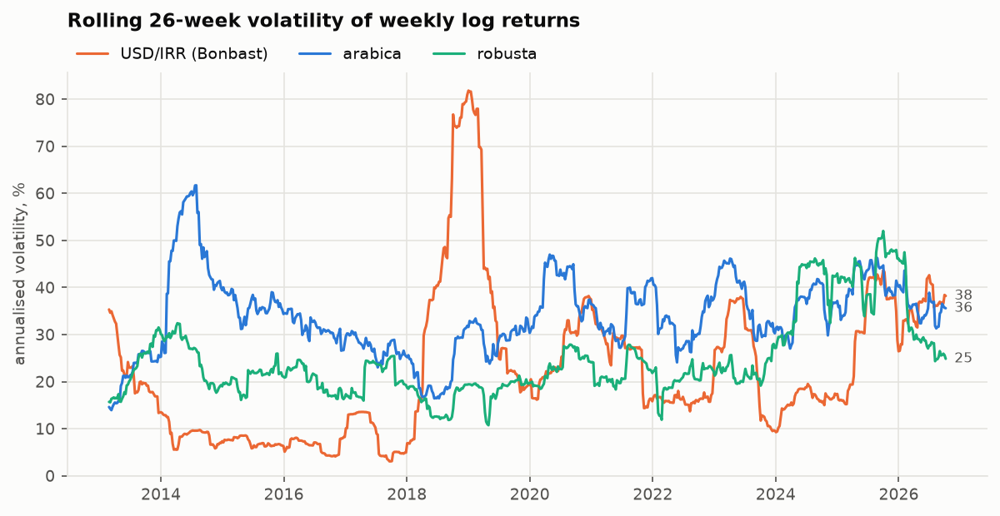
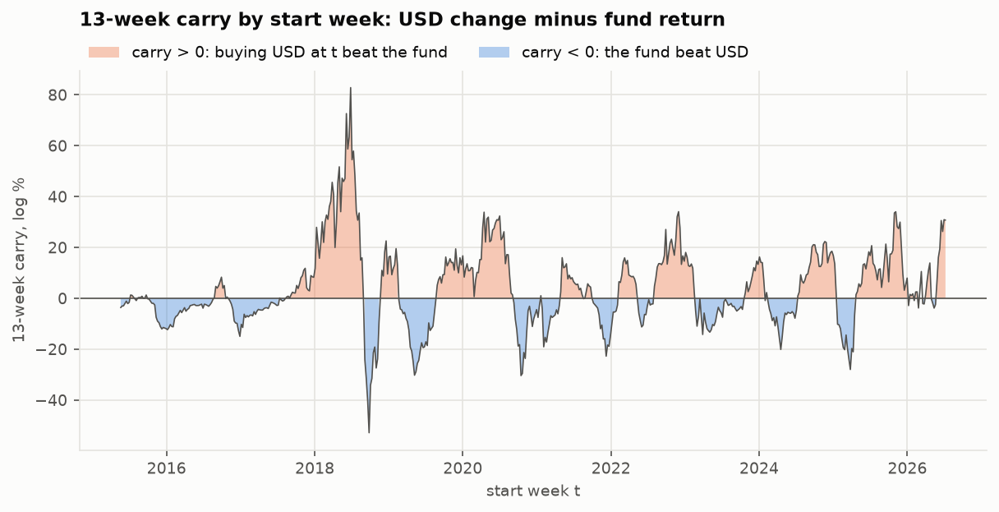
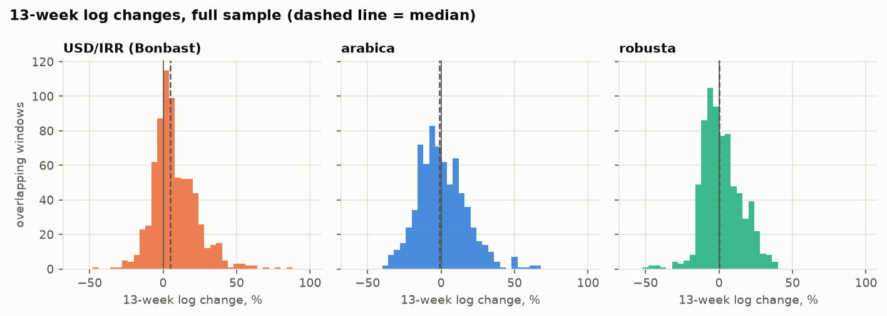
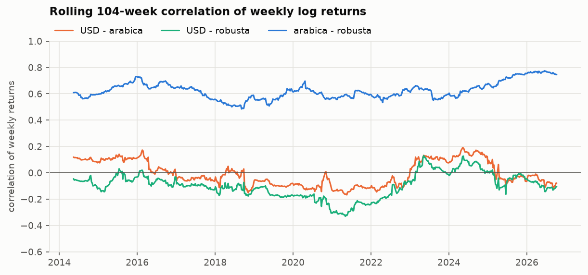
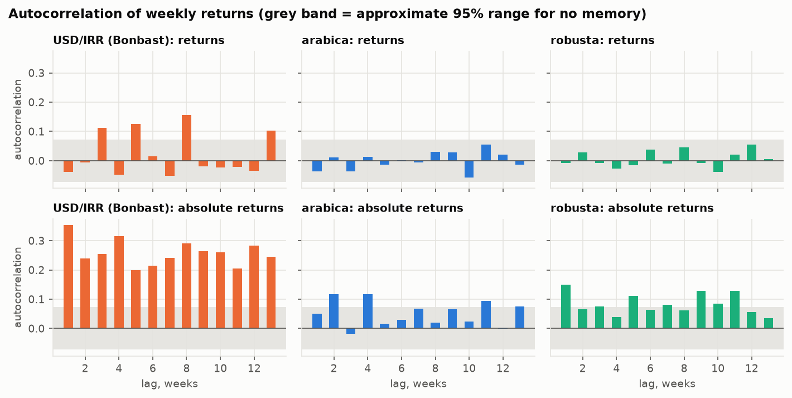
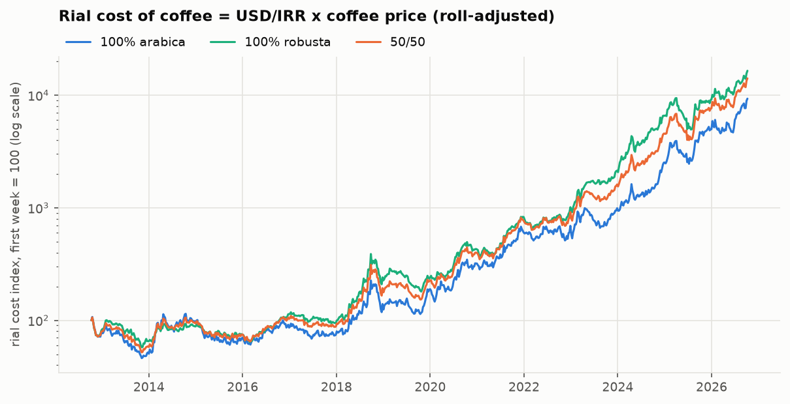
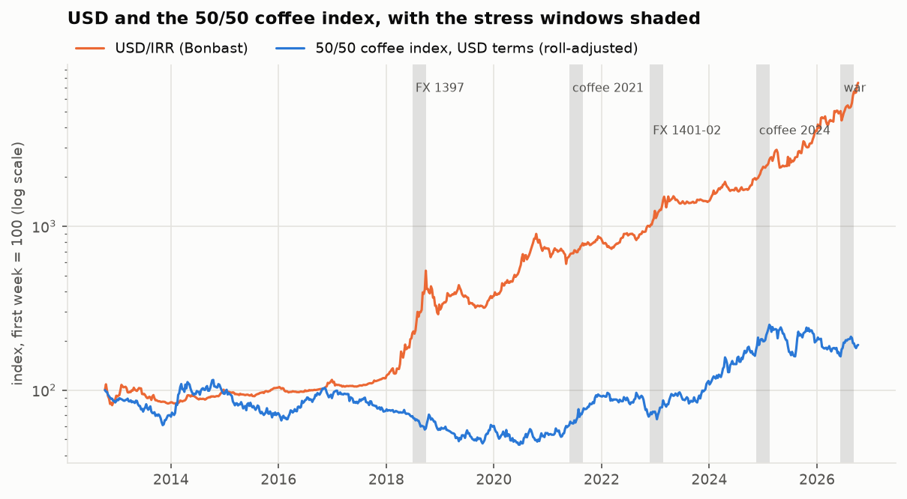

# گزارش مرحلهٔ D2 — شناخت داده‌ها

تاریخ ساخت: ۱۴۰۵-۰۷-۲۱ (2026-10-13). همهٔ عددها، جدول‌ها و شکل‌ها را `scripts/d2_report.py` از پنل هفتگی ساخته است. این مرحله فقط اندازه می‌گیرد: نه شبیه‌ساز، نه راهبرد، نه تنظیم پارامتر.

**قراردادها**

* **افق:** ۱۳ هفته، یعنی سه ماه.
* **نمونهٔ «کل»:** همهٔ ۷۳۱ چهارشنبه از ۱۳۹۱-۰۷-۱۹ (2012-10-10) تا ۱۴۰۵-۰۷-۱۵ (2026-10-07). **نمونهٔ «بک‌تست»:** از هفتهٔ ۱۳۹۴-۰۲-۳۰ (2015-05-20) (D-015)، ۵۹۵ هفته. هر عدد می‌گوید از کدام نمونه است.
* **دلار** = Bonbast. **قهوه** = آتی ICE، بدون روزهای رول. **صندوق** = شاخص بازده کل صندوق درآمد ثابت «اعتماد».
* **بازدهٔ لگاریتمی** لگاریتم نسبت دو قیمت است. برای تغییرهای کوچک همان درصد تغییر است؛ برای بزرگ‌ها نه: تغییر لگاریتمی ٪۷۰ یعنی رشد ٪۱۰۱. در جدول‌ها هر جا «لگاریتمی» نوشته، عدد لگاریتمی است؛ ستون‌های «درصد ساده» تبدیل‌شده‌اند.
* **آمار هفتگی** (نوسان، همبستگی، مخزن) از بازده‌های هفتگی پنل است، با ۶ هفتهٔ روبوستا که از ICO پر شده (D-020).
* **تغییر ۱۳ هفته‌ای:** برای دلار و صندوق از سطح (پنجره‌ای که اول یا آخرش روی سطح کهنه بیفتد خالی است). برای قهوه همه‌جا جمعِ همان بازده‌های هفتگی است: بدون روزهای رول و با هفته‌های پرشده از ICO (D-022). پنجره‌ای که هفته‌ای بدون بازده داشته باشد خالی است.

**هشدار نگاه به آینده.** هر چیزی که بعداً داخل بک‌تست به کار برود (طول بلوک، سطح نوسان، میانگین رانش) اگر روی کل نمونه برآورد شده باشد، در بک‌تست از آینده خبر دارد. این موارد در متن با علامت ⚠ مشخص شده‌اند.

## آنچه در D2b عوض شد

این گزارش پس از بازبینی D2 دوباره ساخته شده است. سه تغییر:

1. **ماه ۲۰۲۶-۰۷ ICO با یک استثنا پذیرفته شد (D-021).** میانگین ۲۳ ردیفِ خوانده‌شده ۱۸۴.۷۸۴ است و PDF ۱۸۴.۸۷ چاپ کرده؛ قانون اعتبارسنجی عوض نشده و این ماه هنوز آن را رد می‌کند. طبق تصمیم، ۱ ردیف (2026-07-17، که عدد روز قبل را تکرار کرده) خالی شد و بقیهٔ ماه استفاده شد. استثنا به همین فایل (با sha256 آن) بسته است.
   * حالا ۶ بازدهٔ هفتگی روبوستا از ICO می‌آید (۱۴۰۵-۰۱-۱۹، ۱۴۰۵-۰۵-۰۷، ۱۴۰۵-۰۵-۱۴، ۱۴۰۵-۰۵-۲۱، ۱۴۰۵-۰۵-۲۸، ۱۴۰۵-۰۶-۰۴) و هیچ هفته‌ای خالی نمانده است.
   * **مخزن بوت‌استرپ: ۷۳۰ هفته از ۷۳۱** (فقط هفتهٔ اول بیرون است، چون بازده ندارد).
   * آزمون سازگاری ICO با TGJU با ماه تازه دوباره اجرا شد: ۴۴ هفته، همبستگی ۰.۹۷۵، نسبت نوسان ۰.۹۳۲؛ قبول.
2. **تغییر چندهفته‌ای قهوه همه‌جا یک‌جور ساخته می‌شود (D-022):** جمع بازده‌های هفتگیِ بدون رول، با هفته‌های ICO. دیگر از «دو سرِ سطح TGJU» استفاده نمی‌شود. اثرش روی حفرهٔ بزرگ روبوستا (۱۴۰۵-۰۵-۰۷ تا ۱۴۰۵-۰۶-۰۴): جمع بازده‌های ICO ٪۴.۸− است، در برابر ٪۷.۳− از دو سرِ سطح TGJU. اختلاف (٪۲.۵+) پرش رولِ داخل حفره و تفاوت شاخص فیزیکی با آتی است که حالا بیرون مانده. این تغییر چندک‌های ۱۳ هفته‌ای روبوستا و ترکیب‌ها، بدترین پنجره‌ها، پنجره‌های تنش و مسیر جنگ را عوض می‌کند (بخش‌های ۳، ۶ و ۷).
3. **یک اندازه‌گیری تازه در بخش ۲:** فاصلهٔ «میانگین درصد تغییر» با «درصدِ میانگین لگاریتمی» برای دلار، و اینکه چرا رشد لگاریتمی برابر به معنای هزینهٔ مورد انتظار برابر نیست.

تصمیم‌های بازبینی (D-021 تا D-027) در `DECISIONS.md` ثبت شده‌اند و در بخش ۹ کنار هر بند آمده‌اند. الحاقیهٔ D1b همان‌طور که بازبینی شد مانده است؛ وضعیت ICO در آن، پیش از D-021 است.

## خلاصه

1. **دلار الان پرنوسان است، قهوه نه.** نوسان ۲۶ هفتهٔ اخیر دلار ٪۳۸ در سال است، بالاتر از ٪۸۹ تاریخچه‌اش. عربیکا در صدک ۶۰ و روبوستا در صدک ۶۶ است.
2. **زود خریدن دلار به‌طور میانگین برده، ولی نه همیشه.** در نمونهٔ بک‌تست، رشد ۱۳ هفته‌ای دلار در ٪۵۳ شروع‌ها از سود صندوق بیشتر بوده؛ میانگین اختلاف ٪۳.۷+ و میانه ٪۰.۷+ است. دامنه بزرگ است: از ٪۱۹.۳− تا ٪۳۱.۰+ (صدک ۵ تا ۹۵).
3. **دلار و قهوه با هم حرکت نمی‌کنند.** همبستگی بازدهٔ هفتگی دلار با عربیکا ۰.۰۲− و با روبوستا ۰.۰۹− است. عربیکا و روبوستا با هم ۰.۶۳.
4. **تلاطم دلار خوشه‌ای و ماندگار است.** طول بلوک بهینه برای اندازهٔ حرکت‌های دلار حدود ۴۸ هفته است، بلندتر از افق. برای خودِ بازدهٔ دلار برآورد ناپایدار است (۱۶ هفته روی کل نمونه، ۳ هفته روی بک‌تست). قهوه حافظهٔ کوتاهی دارد.
5. **بدترین سه‌ماهه برای هزینهٔ ریالی قهوه** (ترکیب ۵۰/۵۰): ۱۳۹۷-۰۴-۰۶ تا ۱۳۹۷-۰۷-۰۴، با رشد ٪۱۰۲+ (دلار ٪۱۴۱+، قهوه ٪۱۶−). از آغاز جنگ تا امروز هزینهٔ ریالی ٪۶۸+ بالا رفته است.
6. **از پنج تصمیم D3، چهار تا گرفته شده** (بخش ۹): مخزن، طول بلوک، رفتار با نوسان و مجموعهٔ تنش. رانش دلار در اسپک D3 تعیین می‌شود.

## ۱. نوسان در زمان

«نوسان» انحراف معیار بازدهٔ لگاریتمی هفتگی است. برای اینکه با عددهای سالانه قابل مقایسه باشد در جذر ۵۲ ضرب شده («سالانه‌شده»). «نوسان غلتان ۲۶ هفته‌ای» همین عدد روی ۲۶ هفتهٔ آخر است که هر هفته از نو حساب می‌شود. نمونه: کل.

| سال | دلار: میانگین | دلار: بیشینه | عربیکا: میانگین | عربیکا: بیشینه | روبوستا: میانگین | روبوستا: بیشینه |
| --- | --- | --- | --- | --- | --- | --- |
| ۱۳۹۱ | ٪۳۵ | ٪۳۵ | ٪۱۴ | ٪۱۵ | ٪۱۶ | ٪۱۶ |
| ۱۳۹۲ | ٪۱۹ | ٪۳۳ | ٪۲۶ | ٪۵۰ | ٪۲۵ | ٪۳۲ |
| ۱۳۹۳ | ٪۸ | ٪۱۰ | ٪۴۸ | ٪۶۲ | ٪۲۳ | ٪۳۲ |
| ۱۳۹۴ | ٪۷ | ٪۹ | ٪۳۵ | ٪۳۹ | ٪۲۱ | ٪۲۶ |
| ۱۳۹۵ | ٪۷ | ٪۱۳ | ٪۳۱ | ٪۳۴ | ٪۱۹ | ٪۲۵ |
| ۱۳۹۶ | ٪۸ | ٪۱۶ | ٪۲۶ | ٪۲۹ | ٪۲۱ | ٪۲۵ |
| ۱۳۹۷ | ٪۵۷ | ٪۸۲ | ٪۲۴ | ٪۳۳ | ٪۱۶ | ٪۲۰ |
| ۱۳۹۸ | ٪۲۶ | ٪۵۷ | ٪۳۰ | ٪۳۶ | ٪۱۸ | ٪۲۱ |
| ۱۳۹۹ | ٪۳۰ | ٪۳۸ | ٪۳۹ | ٪۴۷ | ٪۲۴ | ٪۲۸ |
| ۱۴۰۰ | ٪۲۳ | ٪۳۰ | ٪۳۵ | ٪۴۲ | ٪۲۲ | ٪۲۸ |
| ۱۴۰۱ | ٪۱۹ | ٪۳۳ | ٪۳۴ | ٪۴۶ | ٪۲۱ | ٪۲۵ |
| ۱۴۰۲ | ٪۲۳ | ٪۳۸ | ٪۳۵ | ٪۴۶ | ٪۲۴ | ٪۳۰ |
| ۱۴۰۳ | ٪۱۷ | ٪۲۰ | ٪۳۶ | ٪۴۲ | ٪۴۱ | ٪۴۶ |
| ۱۴۰۴ | ٪۳۵ | ٪۴۴ | ٪۴۲ | ٪۴۶ | ٪۴۳ | ٪۵۲ |
| ۱۴۰۵ | ٪۳۷ | ٪۴۳ | ٪۳۵ | ٪۳۹ | ٪۲۸ | ٪۳۱ |

هر خانه میانگین یا بیشینهٔ نوسان غلتان ۲۶ هفته‌ای در آن سال جلالی است (سالانه‌شده). سال اول و سال جاری ناقص‌اند.

**نوسان فعلی و جایگاه آن در تاریخچه**

«صدک» می‌گوید چند درصد از تاریخچهٔ همان سنجه پایین‌تر یا برابر عدد فعلی بوده است.

| سری | ۱۳ هفتهٔ اخیر | صدک | ۲۶ هفتهٔ اخیر | صدک | میانهٔ تاریخی نوسان ۲۶ هفته‌ای | نوسان کل نمونه |
| --- | --- | --- | --- | --- | --- | --- |
| دلار | ٪۳۰ | ۷۴ | ٪۳۸ | ۸۹ | ٪۱۸ | ٪۲۸ |
| عربیکا | ٪۳۲ | ۴۵ | ٪۳۶ | ۶۰ | ٪۳۳ | ٪۳۵ |
| روبوستا | ٪۲۰ | ۴۰ | ٪۲۵ | ۶۶ | ٪۲۲ | ٪۲۶ |

تا هفتهٔ ۱۴۰۵-۰۷-۱۵ (2026-10-07). ⚠ صدک‌ها روی کل نمونه حساب شده‌اند.

**آیا این دوره برای هر سری غیرعادی است؟**

* **دلار:** بله، به‌وضوح بالاست. نوسان ۲۶ هفته‌ای ٪۳۸ است، در برابر میانهٔ تاریخی ٪۱۸؛ یعنی ۲.۲ برابر میانه و در صدک ۸۹.
* **عربیکا:** نه، در محدودهٔ معمول است. نوسان ۲۶ هفته‌ای ٪۳۶ است، در برابر میانهٔ تاریخی ٪۳۳؛ یعنی ۱.۱ برابر میانه و در صدک ۶۰.
* **روبوستا:** کمی بالاتر از معمول. نوسان ۲۶ هفته‌ای ٪۲۵ است، در برابر میانهٔ تاریخی ٪۲۲؛ یعنی ۱.۱ برابر میانه و در صدک ۶۶.

*شکل ۱ — نوسان غلتان ۲۶ هفته‌ای، سالانه‌شده، برای دلار، عربیکا و روبوستا.*

## ۲. رانش و کری

«رانش» میانگین بازده است: قیمت به‌طور متوسط هر هفته چقدر بالا می‌رود. این هستهٔ پرسشِ «دلار را الان بخرم یا بعداً» است: اگر دلار به‌طور متوسط تندتر از سود ریالی بالا برود، زود خریدن می‌ارزد.

| سال | هفته | دلار: میانگین هفتگی | دلار: سالانه | صندوق: میانگین هفتگی | صندوق: سالانه | اختلاف سالانه (دلار − صندوق) |
| --- | --- | --- | --- | --- | --- | --- |
| ۱۳۹۱ | ۲۳ | ٪۰.۱۵− | ٪۸− | — | — | — |
| ۱۳۹۲ | ۵۲ | ٪۰.۲۴− | ٪۱۳− | — | — | — |
| ۱۳۹۳ | ۵۲ | ٪۰.۲۰+ | ٪۱۱+ | — | — | — |
| ۱۳۹۴ | ۵۲ | ٪۰.۰۵+ | ٪۳+ | ٪۰.۴۴+ | ٪۲۳+ | ٪۲۰− |
| ۱۳۹۵ | ۵۲ | ٪۰.۱۶+ | ٪۹+ | ٪۰.۴۲+ | ٪۲۲+ | ٪۱۳− |
| ۱۳۹۶ | ۵۲ | ٪۰.۴۷+ | ٪۲۴+ | ٪۰.۴۱+ | ٪۲۱+ | ٪۳+ |
| ۱۳۹۷ | ۵۳ | ٪۱.۹۵+ | ٪۱۰۱+ | ٪۰.۴۰+ | ٪۲۱+ | ٪۸۱+ |
| ۱۳۹۸ | ۵۲ | ٪۰.۳۴+ | ٪۱۸+ | ٪۰.۴۰+ | ٪۲۱+ | ٪۳− |
| ۱۳۹۹ | ۵۲ | ٪۰.۸۵+ | ٪۴۴+ | ٪۰.۳۸+ | ٪۲۰+ | ٪۲۴+ |
| ۱۴۰۰ | ۵۲ | ٪۰.۱۰+ | ٪۵+ | ٪۰.۳۶+ | ٪۱۹+ | ٪۱۳− |
| ۱۴۰۱ | ۵۲ | ٪۱.۰۷+ | ٪۵۶+ | ٪۰.۴۰+ | ٪۲۱+ | ٪۳۵+ |
| ۱۴۰۲ | ۵۲ | ٪۰.۴۹+ | ٪۲۵+ | ٪۰.۴۴+ | ٪۲۳+ | ٪۲+ |
| ۱۴۰۳ | ۵۳ | ٪۰.۹۸+ | ٪۵۱+ | ٪۰.۵۳+ | ٪۲۷+ | ٪۲۳+ |
| ۱۴۰۴ | ۵۲ | ٪۰.۷۵+ | ٪۳۹+ | ٪۰.۶۰+ | ٪۳۱+ | ٪۸+ |
| ۱۴۰۵ | ۲۹ | ٪۲.۰۳+ | ٪۱۰۶+ | ٪۰.۶۴+ | ٪۳۳+ | ٪۷۲+ |
| **کل** | ۷۳۰ | ٪۰.۵۹+ | ٪۳۱+ | ٪۰.۴۴+ | ٪۲۳+ | ٪۸+ |
| **بک‌تست** | ۵۹۵ | ٪۰.۷۴+ | ٪۳۸+ | ٪۰.۴۴+ | ٪۲۳+ | ٪۱۵+ |

همه لگاریتمی. «سالانه» = میانگین هفتگی × ۵۲. میانگین صندوق روی هفته‌هایی است که بازدهٔ هفتگی دارد (هفته‌های نوروز طبق D-018 خالی‌اند). ⚠ میانگین‌های «کل» و «بک‌تست» از آینده خبر دارند.

**کریِ ۱۳ هفته‌ای**

«کری» را این‌طور تعریف می‌کنیم: c(t) = تغییر لگاریتمی دلار از هفتهٔ t تا t+13، منهای بازدهٔ لگاریتمی صندوق در همان ۱۳ هفته. **c > 0 یعنی کسی که در هفتهٔ t دلار خریده، از کسی که ریالش را تا t+13 در صندوق نگه داشته و بعد دلار خریده، جلوتر بوده است.** این یک واقعیتِ داده است، نه بک‌تست راهبرد.

| سال شروع | تعداد شروع | میانگین | میانه | صدک ۵ | صدک ۹۵ | سهم c > 0 |
| --- | --- | --- | --- | --- | --- | --- |
| ۱۳۹۴ | ۴۳ | ٪۴.۳− | ٪۲.۶− | ٪۱۱.۹− | ٪۱.۱+ | ٪۲۳ |
| ۱۳۹۵ | ۵۱ | ٪۳.۳− | ٪۲.۸− | ٪۱۰.۸− | ٪۵.۰+ | ٪۱۸ |
| ۱۳۹۶ | ۵۲ | ٪۶.۲+ | ٪۲.۱+ | ٪۴.۶− | ٪۳۰.۵+ | ٪۶۲ |
| ۱۳۹۷ | ۵۳ | ٪۱۶.۰+ | ٪۱۵.۹+ | ٪۳۲.۵− | ٪۶۰.۶+ | ٪۷۰ |
| ۱۳۹۸ | ۵۲ | ٪۰.۵− | ٪۷.۲+ | ٪۲۵.۱− | ٪۱۶.۱+ | ٪۵۸ |
| ۱۳۹۹ | ۵۱ | ٪۴.۲+ | ٪۱.۷− | ٪۲۲.۵− | ٪۳۱.۶+ | ٪۴۹ |
| ۱۴۰۰ | ۵۱ | ٪۰.۲+ | ٪۱.۵+ | ٪۱۷.۲− | ٪۱۳.۹+ | ٪۵۵ |
| ۱۴۰۱ | ۵۲ | ٪۸.۹+ | ٪۱۲.۱+ | ٪۹.۵− | ٪۲۷.۴+ | ٪۶۹ |
| ۱۴۰۲ | ۵۲ | ٪۱.۵− | ٪۳.۲− | ٪۱۲.۵− | ٪۱۴.۱+ | ٪۲۹ |
| ۱۴۰۳ | ۵۲ | ٪۲.۲+ | ٪۲.۳+ | ٪۱۹.۶− | ٪۲۱.۲+ | ٪۵۴ |
| ۱۴۰۴ | ۴۹ | ٪۸.۶+ | ٪۸.۷+ | ٪۱۴.۵− | ٪۲۹.۲+ | ٪۸۴ |
| ۱۴۰۵ | ۱۶ | ٪۱۱.۴+ | ٪۸.۷+ | ٪۲.۸− | ٪۳۰.۸+ | ٪۶۹ |
| **کل بک‌تست** | ۵۷۴ | ٪۳.۷+ | ٪۰.۷+ | ٪۱۹.۳− | ٪۳۱.۰+ | ٪۵۳ |

نمونه: بک‌تست؛ همهٔ شروع‌های هفتگی از ۱۳۹۴-۰۲-۳۰ تا ۱۴۰۵-۰۴-۱۷ (آخرین شروعی که ۱۳ هفته بعدش داده دارد). لگاریتمی. پنجره‌های پشت‌سرهم ۱۲ هفته هم‌پوشانی دارند، پس مستقل نیستند. ۴ چهارشنبه سطح صندوق کهنه دارد؛ پنجره‌هایی که از آن‌ها شروع یا به آن‌ها ختم می‌شوند کنار رفته‌اند.

* در کل بک‌تست، زود خریدن در ٪۵۳ شروع‌ها برده است: کمی بیشتر از نصف.
* میانگین (٪۳.۷+) خیلی بالاتر از میانه (٪۰.۷+) است. یعنی بُردِ زود خریدن از چند جهش بزرگ می‌آید، نه از یک برتری همیشگی.
* سال به سال فرق زیاد است: در ۱۴۰۴ سهم c > 0 برابر ٪۸۴ و در ۱۳۹۵ فقط ٪۱۸.
* صدک ۵ (٪۱۹.۳−) نشان می‌دهد زود خریدن هم می‌تواند گران تمام شود: دلار افت کرده و سود ریالی هم از دست رفته است.

**رشد لگاریتمی برابر، هزینهٔ مورد انتظار برابر نیست**

برای تغییر ۱۳ هفته‌ای دلار دو «میانگین» می‌شود گرفت: میانگینِ درصد تغییرها، و درصدی که از میانگینِ تغییرهای لگاریتمی به دست می‌آید. اولی همیشه بزرگ‌تر است.

| نمونه | پنجره | میانگین تغییر لگاریتمی | درصدِ همان (e به توان آن، منهای ۱) | میانگین درصد تغییر | فاصله | انحراف معیار تغییر ۱۳ هفته‌ای (σ) | σ² تقسیم بر ۲ |
| --- | --- | --- | --- | --- | --- | --- | --- |
| کل | ۷۱۸ | ٪۷.۶+ | ٪۷.۹+ | ٪۹.۲+ | ٪۱.۲۹+ | ٪۱۵.۱ | ٪۱.۱۳ |
| بک‌تست | ۵۸۲ | ٪۹.۳+ | ٪۹.۷+ | ٪۱۱.۲+ | ٪۱.۴۴+ | ٪۱۵.۸ | ٪۱.۲۵ |

| نوسان فعلی از | سالانه‌شده | σ برای ۱۳ هفته | σ² تقسیم بر ۲ |
| --- | --- | --- | --- |
| ۱۳ هفتهٔ اخیر | ٪۳۰ | ٪۱۴.۸ | ٪۱.۱۰ |
| ۲۶ هفتهٔ اخیر | ٪۳۸ | ٪۱۹.۱ | ٪۱.۸۲ |

جدول دوم همان فاصله را از نوسان *فعلی* می‌سازد: σ = انحراف معیار بازدهٔ هفتگی در هفته‌های اخیر، ضرب در جذر ۱۳. ردیف ۱۳ هفته همان است که اسپک خواسته؛ ردیف ۲۶ هفته برای مقایسه است. پنجره‌های جدول اول هم‌پوشان‌اند.

* **چرا؟** هزینهٔ ریالی با e به توانِ تغییر لگاریتمی بالا می‌رود، نه با خودِ آن. یک حرکتِ ٪۲۰ لگاریتمی رو به بالا هزینه را ٪۲۲ بیشتر می‌کند، ولی همان حرکت رو به پایین فقط ٪۱۸ کمتر. پس وقتی دلار نوسان دارد، میانگینِ هزینه از هزینهٔ «حالتِ میانی» بالاتر می‌افتد.
* **اندازه‌اش:** در تاریخچه ٪۱.۳ برای هر ۱۳ هفته (نمونهٔ کل)، نزدیک به σ²/۲ = ٪۱.۱. با نوسان ۱۳ هفتهٔ اخیر ٪۱.۱ است.
* **معنایش برای رانش (بند ۹-۳):** اگر در مدل فرض کنیم دلار به‌طور متوسط «به اندازهٔ سود صندوق رشد لگاریتمی می‌کند»، یعنی تقریباً نیمی از حالت‌ها بالاتر و نیمی پایین‌تر از صندوق‌اند (میانه تقریباً برابر). ولی *میانگینِ* هزینهٔ دلار خریدن در آینده هنوز حدود σ²/۲ از هزینهٔ الان خریدن (با احتساب سود صندوق) بیشتر است. پس «کری صفر» را باید روشن کرد: صفر در میانه (لگاریتمی) یا صفر در میانگین هزینه. این دو به اندازهٔ همین فاصله با هم فرق دارند.

*شکل ۲ — کریِ ۱۳ هفته‌ای برای هر هفتهٔ شروع در نمونهٔ بک‌تست. نارنجی: دلار خریدن برده؛ آبی: صندوق برده.*

## ۳. شکل توزیع

«چولگی» می‌گوید توزیع به کدام سو کشیده است (مثبت = جهش‌های رو به بالا بزرگ‌ترند). «کشیدگی مازاد» می‌گوید دُم‌ها چقدر از توزیع نرمال سنگین‌ترند (صفر = مثل نرمال؛ عدد بزرگ = حرکت‌های شدید بیشتر از انتظار).

| نمونه | سری | هفته | میانگین | انحراف معیار | چولگی | کشیدگی مازاد | کمینه | بیشینه |
| --- | --- | --- | --- | --- | --- | --- | --- | --- |
| کل | دلار | ۷۳۰ | ٪۰.۵۹+ | ٪۳.۸۵ | ۰.۵۱ | ۹.۷ | ٪۲۵.۷− | ٪۲۶.۸+ |
| کل | عربیکا | ۷۳۰ | ٪۰.۰۳+ | ٪۴.۸۱ | ۰.۳۸ | ۰.۸ | ٪۱۳.۲− | ٪۲۰.۱+ |
| کل | روبوستا | ۷۳۰ | ٪۰.۱۱+ | ٪۳.۶۱ | ۰.۱۶ | ۲.۴ | ٪۱۵.۳− | ٪۱۷.۵+ |
| کل | صندوق | ۵۷۰ | ٪۰.۴۴+ | ٪۰.۲۲ | ۰.۴۱ | ۳۱.۳ | ٪۱.۴− | ٪۲.۵+ |
| بک‌تست | دلار | ۵۹۵ | ٪۰.۷۴+ | ٪۴.۰۹ | ۰.۴۷ | ۸.۹ | ٪۲۵.۷− | ٪۲۶.۸+ |
| بک‌تست | عربیکا | ۵۹۵ | ٪۰.۰۸+ | ٪۴.۷۱ | ۰.۱۸ | ۰.۲ | ٪۱۳.۲− | ٪۱۵.۹+ |
| بک‌تست | روبوستا | ۵۹۵ | ٪۰.۱۷+ | ٪۳.۷۰ | ۰.۱۶ | ۲.۷ | ٪۱۵.۳− | ٪۱۷.۵+ |
| بک‌تست | صندوق | ۵۷۰ | ٪۰.۴۴+ | ٪۰.۲۲ | ۰.۴۱ | ۳۱.۳ | ٪۱.۴− | ٪۲.۵+ |

بازدهٔ لگاریتمی هفتگی.

* دلار دُم بسیار سنگین دارد (کشیدگی مازاد ۹.۷): بیشتر هفته‌ها آرام‌اند و چند هفته حرکت خیلی بزرگ دارند. قهوه به نرمال نزدیک‌تر است.

**۱۰ رشد و ۱۰ افت بزرگ هفتگی دلار** (نمونه: کل، لگاریتمی):

| رتبه | هفتهٔ رشد | رشد | هفتهٔ افت | افت |
| --- | --- | --- | --- | --- |
| ۱ | ۱۳۹۷-۰۷-۰۴ (2018-09-26) | ٪۲۶.۸+ | ۱۳۹۷-۰۷-۱۱ (2018-10-03) | ٪۲۵.۷− |
| ۲ | ۱۳۹۷-۰۶-۱۴ (2018-09-05) | ٪۲۴.۵+ | ۱۴۰۵-۰۳-۲۷ (2026-06-17) | ٪۱۳.۲− |
| ۳ | ۱۳۹۷-۰۱-۲۲ (2018-04-11) | ٪۱۷.۵+ | ۱۴۰۰-۰۲-۱۵ (2021-05-05) | ٪۱۳.۲− |
| ۴ | ۱۴۰۵-۰۲-۰۹ (2026-04-29) | ٪۱۴.۹+ | ۱۴۰۴-۰۴-۰۴ (2025-06-25) | ٪۱۲.۲− |
| ۵ | ۱۴۰۴-۱۱-۰۸ (2026-01-28) | ٪۱۴.۲+ | ۱۳۹۷-۰۹-۰۷ (2018-11-28) | ٪۱۲.۲− |
| ۶ | ۱۳۹۷-۱۰-۰۵ (2018-12-26) | ٪۱۳.۶+ | ۱۳۹۷-۰۸-۲۳ (2018-11-14) | ٪۱۱.۹− |
| ۷ | ۱۳۹۷-۰۵-۱۰ (2018-08-01) | ٪۱۳.۶+ | ۱۴۰۴-۰۱-۲۷ (2025-04-16) | ٪۱۱.۸− |
| ۸ | ۱۴۰۴-۰۳-۲۸ (2025-06-18) | ٪۱۳.۰+ | ۱۴۰۱-۱۰-۱۴ (2023-01-04) | ٪۱۰.۰− |
| ۹ | ۱۳۹۷-۰۵-۰۳ (2018-07-25) | ٪۱۲.۶+ | ۱۳۹۹-۰۵-۰۱ (2020-07-22) | ٪۹.۹− |
| ۱۰ | ۱۳۹۷-۰۳-۲۳ (2018-06-13) | ٪۱۱.۷+ | ۱۳۹۷-۰۹-۲۱ (2018-12-12) | ٪۹.۵− |

* ۱۱ مورد از این ۲۰ هفته در ۱۳۹۷ است.

**چندک‌های تغییر ۱۳ هفته‌ای** (لگاریتمی؛ پنجره‌های هم‌پوشان)

| نمونه | سری | پنجره | ٪۱ | ٪۵ | ٪۵۰ | ٪۹۵ | ٪۹۹ | ٪۹۵ به درصد ساده |
| --- | --- | --- | --- | --- | --- | --- | --- | --- |
| کل | دلار | ۷۱۸ | ٪۲۴.۹− | ٪۱۳.۳− | ٪۵.۰+ | ٪۳۵.۹+ | ٪۵۳.۳+ | ٪۴۳+ |
| کل | عربیکا | ۷۱۸ | ٪۳۲.۷− | ٪۲۳.۹− | ٪۱.۲− | ٪۲۹.۳+ | ٪۵۰.۴+ | ٪۳۴+ |
| کل | روبوستا | ۷۱۸ | ٪۳۱.۲− | ٪۱۵.۳− | ٪۰.۰ | ٪۲۵.۴+ | ٪۳۳.۰+ | ٪۲۹+ |
| کل | صندوق | ۵۷۵ | ٪۳.۷+ | ٪۴.۴+ | ٪۵.۴+ | ٪۷.۸+ | ٪۸.۲+ | ٪۸+ |
| کل | هزینهٔ ریالی، ۱۰۰٪ عربیکا | ۷۱۸ | ٪۳۶.۷− | ٪۲۴.۸− | ٪۵.۹+ | ٪۵۱.۳+ | ٪۶۳.۳+ | ٪۶۷+ |
| کل | هزینهٔ ریالی، ۱۰۰٪ روبوستا | ۷۱۸ | ٪۳۷.۳− | ٪۲۲.۲− | ٪۷.۳+ | ٪۴۵.۸+ | ٪۵۷.۳+ | ٪۵۸+ |
| کل | هزینهٔ ریالی، ۵۰/۵۰ | ۷۱۸ | ٪۳۴.۸− | ٪۲۲.۳− | ٪۶.۷+ | ٪۴۴.۷+ | ٪۵۸.۳+ | ٪۵۶+ |
| بک‌تست | دلار | ۵۸۲ | ٪۲۵.۵− | ٪۱۳.۸− | ٪۶.۴+ | ٪۳۷.۲+ | ٪۵۷.۱+ | ٪۴۵+ |
| بک‌تست | عربیکا | ۵۸۲ | ٪۳۲.۵− | ٪۲۳.۸− | ٪۰.۳+ | ٪۲۷.۳+ | ٪۳۵.۷+ | ٪۳۱+ |
| بک‌تست | روبوستا | ۵۸۲ | ٪۳۳.۲− | ٪۱۵.۴− | ٪۰.۷+ | ٪۲۶.۱+ | ٪۳۳.۸+ | ٪۳۰+ |
| بک‌تست | صندوق | ۵۷۴ | ٪۳.۷+ | ٪۴.۴+ | ٪۵.۴+ | ٪۷.۸+ | ٪۸.۲+ | ٪۸+ |
| بک‌تست | هزینهٔ ریالی، ۱۰۰٪ عربیکا | ۵۸۲ | ٪۳۷.۴− | ٪۲۲.۲− | ٪۸.۹+ | ٪۴۹.۷+ | ٪۵۹.۶+ | ٪۶۴+ |
| بک‌تست | هزینهٔ ریالی، ۱۰۰٪ روبوستا | ۵۸۲ | ٪۳۹.۱− | ٪۲۳.۳− | ٪۱۰.۵+ | ٪۴۷.۱+ | ٪۵۷.۶+ | ٪۶۰+ |
| بک‌تست | هزینهٔ ریالی، ۵۰/۵۰ | ۵۸۲ | ٪۳۶.۲− | ٪۲۰.۷− | ٪۱۰.۰+ | ٪۴۶.۲+ | ٪۵۹.۰+ | ٪۵۹+ |

**این پنجره‌ها مستقل نیستند:** هر پنجره با پنجرهٔ بعدی ۱۲ هفتهٔ مشترک دارد. تعداد پنجره‌های واقعاً جدا فقط حدود ۵۵ تاست. پس چندک‌های ٪۱ و ٪۹۹ روی چند رویداد انگشت‌شمار تکیه دارند.

*شکل ۳ — توزیع تغییر لگاریتمی ۱۳ هفته‌ای برای دلار، عربیکا و روبوستا (نمونهٔ کل، پنجره‌های هم‌پوشان). خط‌چین میانه است.*

## ۴. وابستگی

همبستگی پیرسون رابطهٔ خطی را می‌سنجد و به چند هفتهٔ شدید حساس است. همبستگی اسپیرمن روی رتبه‌هاست و به آن‌ها حساس نیست. هر دو بین ۱− و ۱+.

| دوره | جفت | پیرسون | اسپیرمن |
| --- | --- | --- | --- |
| کل | دلار – عربیکا | ۰.۰۲− | ۰.۰۱ |
| کل | دلار – روبوستا | ۰.۰۹− | ۰.۱۱− |
| کل | عربیکا – روبوستا | ۰.۶۳ | ۰.۶۱ |
| کل | دلار – صندوق | ۰.۰۴ | ۰.۰۵ |
| کل | عربیکا – صندوق | ۰.۰۱ | ۰.۰۳ |
| کل | روبوستا – صندوق | ۰.۰۱− | ۰.۰۱ |
| ۲۰۱۲-۱۰ تا ۲۰۱۷ | دلار – عربیکا | ۰.۰۴ | ۰.۰۳ |
| ۲۰۱۲-۱۰ تا ۲۰۱۷ | دلار – روبوستا | ۰.۰۸− | ۰.۱۴− |
| ۲۰۱۲-۱۰ تا ۲۰۱۷ | عربیکا – روبوستا | ۰.۶۱ | ۰.۶۰ |
| ۲۰۱۲-۱۰ تا ۲۰۱۷ | دلار – صندوق | ۰.۰۱− | ۰.۰۲− |
| ۲۰۱۲-۱۰ تا ۲۰۱۷ | عربیکا – صندوق | ۰.۰۰ | ۰.۰۴− |
| ۲۰۱۲-۱۰ تا ۲۰۱۷ | روبوستا – صندوق | ۰.۱۳− | ۰.۰۹− |
| ۲۰۱۸ تا ۲۰۲۲ | دلار – عربیکا | ۰.۰۸− | ۰.۰۴− |
| ۲۰۱۸ تا ۲۰۲۲ | دلار – روبوستا | ۰.۱۷− | ۰.۱۴− |
| ۲۰۱۸ تا ۲۰۲۲ | عربیکا – روبوستا | ۰.۶۰ | ۰.۵۶ |
| ۲۰۱۸ تا ۲۰۲۲ | دلار – صندوق | ۰.۰۲ | ۰.۰۲− |
| ۲۰۱۸ تا ۲۰۲۲ | عربیکا – صندوق | ۰.۰۱− | ۰.۰۵ |
| ۲۰۱۸ تا ۲۰۲۲ | روبوستا – صندوق | ۰.۰۲− | ۰.۰۶ |
| ۲۰۲۳ تا امروز | دلار – عربیکا | ۰.۰۰ | ۰.۰۴ |
| ۲۰۲۳ تا امروز | دلار – روبوستا | ۰.۰۶− | ۰.۰۴− |
| ۲۰۲۳ تا امروز | عربیکا – روبوستا | ۰.۷۰ | ۰.۶۶ |
| ۲۰۲۳ تا امروز | دلار – صندوق | ۰.۱۱ | ۰.۰۸ |
| ۲۰۲۳ تا امروز | عربیکا – صندوق | ۰.۰۱− | ۰.۰۳− |
| ۲۰۲۳ تا امروز | روبوستا – صندوق | ۰.۰۹− | ۰.۱۶− |

بازدهٔ هفتگی؛ هر جفت روی هفته‌هایی که هر دو داده دارند. صندوق از ۱۳۹۴ داده دارد.

**همبستگی تغییرهای ۱۳ هفته‌ایِ بدون هم‌پوشانی.** بسته به اینکه شمارش از کدام هفته شروع شود ۱۳ حالت هست؛ بازهٔ نتیجه‌ها:

| جفت | کمینه | میانه | بیشینه | تعداد پنجره در هر حالت |
| --- | --- | --- | --- | --- |
| دلار – عربیکا | ۰.۱۴− | ۰.۰۴− | ۰.۱۳ | ۵۵ تا ۵۶ |
| دلار – روبوستا | ۰.۰۵− | ۰.۰۶ | ۰.۱۸ | ۵۵ تا ۵۶ |
| عربیکا – روبوستا | ۰.۵۹ | ۰.۷۱ | ۰.۷۷ | ۵۵ تا ۵۶ |
| دلار – صندوق | ۰.۰۰ | ۰.۰۷ | ۰.۱۸ | ۴۱ تا ۴۵ |

**هم‌حرکتی در دُم.** در هفته‌هایی که یک سری بالاتر از صدک ۹۵ خودش بوده، سری دیگر چه کرده است؟

| شرط | سری دیگر | هفته | میانگین | میانه | سهم مثبت | میانگین در همهٔ هفته‌ها | میانه در همهٔ هفته‌ها | سهم مثبت در همه |
| --- | --- | --- | --- | --- | --- | --- | --- | --- |
| دلار بالای صدک ۹۵ (٪۶.۷+) | عربیکا | ۳۷ | ٪۰.۲۴+ | ٪۰.۵۷+ | ٪۵۱ | ٪۰.۰۳+ | ٪۰.۴۰− | ٪۴۶ |
| دلار بالای صدک ۹۵ (٪۶.۷+) | روبوستا | ۳۷ | ٪۰.۰۳− | ٪۰.۳۲+ | ٪۵۷ | ٪۰.۱۱+ | ٪۰.۱۰+ | ٪۵۱ |
| عربیکا بالای صدک ۹۵ (٪۸.۴+) | دلار | ۳۷ | ٪۰.۹۲− | ٪۰.۱۴− | ٪۴۶ | ٪۰.۵۹+ | ٪۰.۳۱+ | ٪۵۸ |
| روبوستا بالای صدک ۹۵ (٪۵.۹+) | دلار | ۳۷ | ٪۰.۲۴− | ٪۰.۱۴+ | ٪۵۱ | ٪۰.۵۹+ | ٪۰.۳۱+ | ٪۵۸ |

**آیا جهش دلار با جهش قهوه هم‌زمان می‌شود؟**

* **نه.** در ۳۷ هفته‌ای که دلار بیشترین جهش را داشته، میانهٔ بازدهٔ عربیکا ٪۰.۵۷+ و روبوستا ٪۰.۳۲+ بوده است؛ نزدیک به هفته‌های عادی (٪۰.۴۰− و ٪۰.۱۰+).
* همبستگی هفتگی دلار با قهوه در هر سه دوره نزدیک صفر است و همبستگی ۱۳ هفته‌ای هم بین ۰.۱۴− و ۰.۱۸ می‌چرخد.
* این با انتظار هم می‌خواند: قیمت قهوه در بازار جهانی تعیین می‌شود و دلار آزاد در ایران. در داده، این دو مثل دو منبع ریسک جدا رفتار می‌کنند: در هزینهٔ ریالی روی هم جمع می‌شوند، ولی هم را تشدید نمی‌کنند.
* عربیکا و روبوستا با هم حرکت می‌کنند (هفتگی ۰.۶۳، ۱۳ هفته‌ای میانه ۰.۷۱). پس ترکیب ۵۰/۵۰ فقط کمی از ریسک قهوه کم می‌کند.

*شکل ۴ — همبستگی غلتان ۱۰۴ هفته‌ای بازده‌های هفتگی.*

## ۵. ماندگاری و طول بلوک

«خودهمبستگی» می‌گوید بازدهٔ این هفته چقدر به بازدهٔ k هفته پیش شبیه است. خودهمبستگیِ «قدرمطلق بازده» می‌گوید آیا هفته‌های پرتلاطم پشت‌سرهم می‌آیند (خوشه‌ای بودن نوسان). اگر سری حافظه نداشته باشد، این عددها باید داخل نوار ۹۵٪ (حدود ±۱.۹۶ تقسیم بر جذر تعداد هفته) بمانند. نمونه: کل.

| سری | نوع | تأخیر ۱ | ۲ | ۳ | ۴ | ۸ | ۱۳ | تأخیرهای بیرون نوار (از ۱۳) | نوار ± |
| --- | --- | --- | --- | --- | --- | --- | --- | --- | --- |
| دلار | بازده | ۰.۰۴− | ۰.۰۱− | ۰.۱۱ | ۰.۰۵− | ۰.۱۶ | ۰.۱۰ | ۴ | ۰.۰۷ |
| دلار | قدرمطلق | ۰.۳۵ | ۰.۲۴ | ۰.۲۵ | ۰.۳۲ | ۰.۲۹ | ۰.۲۴ | ۱۳ | ۰.۰۷ |
| عربیکا | بازده | ۰.۰۴− | ۰.۰۱ | ۰.۰۴− | ۰.۰۱ | ۰.۰۳ | ۰.۰۱− | ۰ | ۰.۰۷ |
| عربیکا | قدرمطلق | ۰.۰۵ | ۰.۱۲ | ۰.۰۲− | ۰.۱۲ | ۰.۰۲ | ۰.۰۸ | ۴ | ۰.۰۷ |
| روبوستا | بازده | ۰.۰۱− | ۰.۰۳ | ۰.۰۱− | ۰.۰۳− | ۰.۰۵ | ۰.۰۱ | ۰ | ۰.۰۷ |
| روبوستا | قدرمطلق | ۰.۱۵ | ۰.۰۷ | ۰.۰۸ | ۰.۰۴ | ۰.۰۶ | ۰.۰۴ | ۷ | ۰.۰۷ |
| صندوق | بازده | ۰.۲۹ | ۰.۰۳− | ۰.۱۳− | ۰.۰۱ | ۰.۲۲ | ۰.۰۹ | ۷ | ۰.۰۸ |
| صندوق | قدرمطلق | ۰.۵۲ | ۰.۳۵ | ۰.۲۸ | ۰.۳۱ | ۰.۱۸ | ۰.۰۵ | ۱۲ | ۰.۰۸ |

**طول بلوک بهینه (پولیتیس–وایت).** در «بوت‌استرپ بلوکی» به‌جای هفته‌های تک، تکه‌های پشت‌سرهم از تاریخ را برمی‌داریم تا حافظهٔ سری حفظ شود. «طول بلوک بهینه» را روش پولیتیس و وایت (تابع `optimal_block_length` در بستهٔ `arch`) از روی خودهمبستگی برآورد می‌کند. واحد: هفته.

| نمونه | سری | بازده: ایستا | بازده: دایره‌ای | قدرمطلق: ایستا | قدرمطلق: دایره‌ای |
| --- | --- | --- | --- | --- | --- |
| کل | دلار | ۱۴.۰ | ۱۶.۱ | ۴۲.۲ | ۴۸.۳ |
| کل | عربیکا | ۱.۷ | ۱.۹ | ۱.۸ | ۲.۱ |
| کل | روبوستا | ۰.۶ | ۰.۷ | ۵.۸ | ۶.۷ |
| کل | صندوق | ۲۶.۲ | ۳۰.۰ | ۲۳.۶ | ۲۷.۱ |
| بک‌تست | دلار | ۲.۳ | ۲.۶ | ۳۶.۹ | ۴۲.۲ |
| بک‌تست | عربیکا | ۱.۳ | ۱.۵ | ۲.۴ | ۲.۷ |
| بک‌تست | روبوستا | ۱.۰ | ۱.۱ | ۵.۳ | ۶.۱ |
| بک‌تست | صندوق | ۲۶.۲ | ۳۰.۰ | ۲۳.۶ | ۲۷.۱ |

«ایستا» و «دایره‌ای» دو گونهٔ بوت‌استرپ بلوکی‌اند (بلوک با طول تصادفی یا ثابت). هفته‌های خالی پیش از برآورد حذف شده‌اند. ⚠ برآورد روی کل نمونه از آینده خبر دارد؛ ردیف‌های «بک‌تست» هم روی همهٔ دورهٔ بک‌تست‌اند.

**جمع ۱۳ هفته در برابر هفته‌های مستقل.** یک اندازه‌گیری مستقیم‌تر از حافظه: اگر هفته‌ها مستقل بودند، واریانسِ جمعِ ۱۳ هفته ۱۳ برابر واریانس یک هفته می‌شد («نسبت واریانس» = ۱) و کشیدگیِ آن جمع، کشیدگی هفتگی تقسیم بر ۱۳.

| نمونه | سری | نسبت واریانس | کشیدگی مازاد جمع ۱۳ هفته | همان، اگر هفته‌ها مستقل بودند |
| --- | --- | --- | --- | --- |
| کل | دلار | ۱.۱۸ | ۲.۷ | ۰.۷ |
| کل | عربیکا | ۰.۹۳ | ۱.۰ | ۰.۱ |
| کل | روبوستا | ۱.۰۲ | ۰.۸ | ۰.۲ |
| بک‌تست | دلار | ۱.۱۵ | ۲.۳ | ۰.۷ |
| بک‌تست | عربیکا | ۰.۸۱ | ۰.۱− | ۰.۰ |
| بک‌تست | روبوستا | ۱.۰۴ | ۰.۸ | ۰.۲ |

جمع‌های هم‌پوشان. نسبت بالاتر از ۱ یعنی حرکت‌ها ادامه پیدا می‌کنند؛ کشیدگیِ بیشتر از ستون آخر یعنی هفته‌های آرام و پرتلاطم خوشه‌ای می‌آیند.

**پیشنهاد یک طول بلوک مشترک**

* بوت‌استرپ *مشترک* یعنی هفته‌های دلار، عربیکا و روبوستا با هم برداشته می‌شوند تا هم‌زمانی‌شان حفظ شود. پس یک طول بلوک برای هر سه لازم است و سریِ با حافظهٔ بلندتر تعیین‌کننده است.
* برآورد پولیتیس–وایت برای *بازدهٔ* دلار پایدار نیست: ۱۶ هفته روی کل نمونه و ۳ هفته روی بک‌تست. به این عدد نمی‌شود تکیه کرد. قهوه در هر دو نمونه ۲ هفته یا کمتر است.
* آنچه پایدار است خوشه‌ای بودن *تلاطم* دلار است: ۴۸ هفته روی کل و ۴۲ روی بک‌تست؛ و کشیدگی جمع ۱۳ هفته‌ای دلار ۲.۷ است، در برابر ۰.۷ اگر هفته‌ها مستقل بودند. نسبت واریانس دلار هم ۱.۱۸ است.
* نتیجه: بلوک کوتاه (مثلاً ۴ هفته) هفته‌های آرام و بحرانی را قاطی می‌کند و دُم توزیع ۱۳ هفته‌ای دلار را کوچک‌تر از واقع نشان می‌دهد. خوشه‌ها از خودِ افق بلندترند، پس بلوکی به طول افق کافی است تا داخل هر مسیر حفظ شوند؛ بلندتر از آن فایده‌ای ندارد.
* **پیشنهاد: میانگین طول بلوک ۱۳ هفته** (برابر افق)، با بوت‌استرپ ایستا (طول تصادفی). بهایش این است که هر مسیر شبیه‌سازی‌شده تقریباً یک تکهٔ پیوسته از تاریخ است؛ تنوع مسیرها از تعداد نقطه‌های شروع می‌آید، نه از ترکیب تکه‌ها. سطح نوسان را «رفتار با نوسان» تنظیم می‌کند (بند ۹-۴).

*شکل ۵ — خودهمبستگی بازده (ردیف بالا) و قدرمطلق بازده (ردیف پایین) تا تأخیر ۱۳ هفته. نوار خاکستری محدودهٔ تقریبی ۹۵٪ برای سریِ بی‌حافظه است.*

## ۶. هزینهٔ ریالی قهوه

هزینهٔ ریالی یک کیلو قهوه = قیمت دلاری قهوه × نرخ دلار. پس تغییر لگاریتمی هفتگی آن = بازدهٔ دلار + بازدهٔ قهوه. سه ترکیب: ۱۰۰٪ عربیکا، ۱۰۰٪ روبوستا، و ۵۰/۵۰ که هر هفته به نسبت ۵۰/۵۰ برمی‌گردد (بازدهٔ قهوه‌اش = لگاریتمِ نصفِ e به توان بازدهٔ عربیکا به‌اضافهٔ نصفِ e به توان بازدهٔ روبوستا). این فقط بخش «آتی» است؛ اضافه‌بهای فیزیکی جدا می‌آید (D-012).

| ترکیب | نوسان هفتگی | سالانه‌شده | کل: ٪۵ | کل: ٪۵۰ | کل: ٪۹۵ | کل: ٪۹۹ | بک‌تست: ٪۵ | بک‌تست: ٪۵۰ | بک‌تست: ٪۹۵ | بک‌تست: ٪۹۹ |
| --- | --- | --- | --- | --- | --- | --- | --- | --- | --- | --- |
| ۱۰۰٪ عربیکا | ٪۶.۰۹ | ٪۴۴ | ٪۲۴.۸− | ٪۵.۹+ | ٪۵۱.۳+ | ٪۶۳.۳+ | ٪۲۲.۲− | ٪۸.۹+ | ٪۴۹.۷+ | ٪۵۹.۶+ |
| ۱۰۰٪ روبوستا | ٪۵.۰۳ | ٪۳۶ | ٪۲۲.۲− | ٪۷.۳+ | ٪۴۵.۸+ | ٪۵۷.۳+ | ٪۲۳.۳− | ٪۱۰.۵+ | ٪۴۷.۱+ | ٪۵۷.۶+ |
| ۵۰/۵۰ | ٪۵.۲۶ | ٪۳۸ | ٪۲۲.۳− | ٪۶.۷+ | ٪۴۴.۷+ | ٪۵۸.۳+ | ٪۲۰.۷− | ٪۱۰.۰+ | ٪۴۶.۲+ | ٪۵۹.۰+ |

چندک‌ها برای تغییر لگاریتمی ۱۳ هفته‌ای، پنجره‌های هم‌پوشان (جدول کامل در بخش ۳). نوسان هفتگی روی نمونهٔ کل.

* نوسان هفتگی دلار ٪۳.۸۵ و قهوهٔ ۵۰/۵۰ ٪۳.۸۱ است؛ هزینهٔ ریالی ۵۰/۵۰ ٪۵.۲۶. چون این دو تقریباً ناهمبسته‌اند، نوسان‌ها به‌صورت «جذر مجموع مربع‌ها» جمع می‌شوند (٪۵.۴۲)، نه ساده.

**۱۰ بدترین پنجرهٔ ۱۳ هفته‌ایِ جدا از هم، ترکیب ۵۰/۵۰** (نمونه: کل)

| رتبه | شروع | پایان | رشد هزینهٔ ریالی (ساده) | همان، لگاریتمی | سهم دلار (لگاریتمی) | سهم قهوه (لگاریتمی) | دلار از کل |
| --- | --- | --- | --- | --- | --- | --- | --- |
| ۱ | ۱۳۹۷-۰۴-۰۶ (2018-06-27) | ۱۳۹۷-۰۷-۰۴ (2018-09-26) | ٪۱۰۲+ | ٪۷۰.۴+ | ٪۸۷.۸+ | ٪۱۷.۴− | ٪۱۲۵ |
| ۲ | ۱۴۰۳-۰۸-۲۳ (2024-11-13) | ۱۴۰۳-۱۱-۲۴ (2025-02-12) | ٪۹۰+ | ٪۶۳.۹+ | ٪۲۸.۲+ | ٪۳۵.۷+ | ٪۴۴ |
| ۳ | ۱۴۰۴-۰۴-۱۸ (2025-07-09) | ۱۴۰۴-۰۷-۱۶ (2025-10-08) | ٪۸۳+ | ٪۶۰.۳+ | ٪۲۸.۳+ | ٪۳۲.۰+ | ٪۴۷ |
| ۴ | ۱۴۰۱-۰۹-۰۲ (2022-11-23) | ۱۴۰۱-۱۲-۰۳ (2023-02-22) | ٪۷۹+ | ٪۵۸.۳+ | ٪۳۷.۵+ | ٪۲۰.۷+ | ٪۶۴ |
| ۵ | ۱۳۹۲-۱۱-۰۲ (2014-01-22) | ۱۳۹۳-۰۲-۰۳ (2014-04-23) | ٪۷۸+ | ٪۵۷.۵+ | ٪۱۱.۲+ | ٪۴۶.۳+ | ٪۲۰ |
| ۶ | ۱۴۰۲-۱۰-۲۷ (2024-01-17) | ۱۴۰۳-۰۱-۲۹ (2024-04-17) | ٪۷۰+ | ٪۵۳.۲+ | ٪۲۰.۲+ | ٪۳۳.۰+ | ٪۳۸ |
| ۷ | ۱۳۹۹-۰۳-۲۱ (2020-06-10) | ۱۳۹۹-۰۶-۱۹ (2020-09-09) | ٪۶۹+ | ٪۵۲.۸+ | ٪۳۵.۶+ | ٪۱۷.۲+ | ٪۶۷ |
| ۸ | ۱۴۰۵-۰۳-۲۰ (2026-06-10) | ۱۴۰۵-۰۶-۱۸ (2026-09-09) | ٪۵۸+ | ٪۴۵.۷+ | ٪۲۷.۵+ | ٪۱۸.۲+ | ٪۶۰ |
| ۹ | ۱۳۹۷-۰۱-۰۸ (2018-03-28) | ۱۳۹۷-۰۴-۰۶ (2018-06-27) | ٪۵۸+ | ٪۴۵.۶+ | ٪۵۰.۴+ | ٪۴.۸− | ٪۱۱۰ |
| ۱۰ | ۱۴۰۰-۰۳-۰۵ (2021-05-26) | ۱۴۰۰-۰۶-۰۳ (2021-08-25) | ٪۴۵+ | ٪۳۷.۱+ | ٪۱۸.۱+ | ٪۱۹.۰+ | ٪۴۹ |

«جدا از هم» یعنی هیچ دو پنجره‌ای هفتهٔ مشترک ندارند: اول بدترین پنجره انتخاب می‌شود، بعد بدترینِ باقی‌مانده که با قبلی‌ها هم‌پوشانی ندارد، و همین‌طور. تغییر لگاریتمی هزینه دقیقاً جمع دو سهم است.

* در ۵ پنجره از ۱۰، سهم دلار از سهم قهوه بزرگ‌تر است.

*شکل ۶ — شاخص هزینهٔ ریالی قهوه برای سه ترکیب، مقیاس لگاریتمی، اولین هفته = ۱۰۰.*

## ۷. پنجره‌های تنش (D-005)

برای هر رویداد، در بازهٔ جست‌وجویش پنجرهٔ ۱۳ هفته‌ای با بیشترین رشد هزینهٔ ریالی ۵۰/۵۰ پیدا شده است. پنجره باید کامل داخل بازه باشد. درصدها ساده‌اند (نه لگاریتمی).

| رویداد | شروع | پایان | دلار | عربیکا | روبوستا | هزینه: ۱۰۰٪ عربیکا | هزینه: ۱۰۰٪ روبوستا | هزینه: ۵۰/۵۰ | صندوق |
| --- | --- | --- | --- | --- | --- | --- | --- | --- | --- |
| جهش ارز ۱۳۹۷ | ۱۳۹۷-۰۴-۰۶ (2018-06-27) | ۱۳۹۷-۰۷-۰۴ (2018-09-26) | ٪۱۴۱+ | ٪۲۳− | ٪۹− | ٪۸۶+ | ٪۱۱۹+ | ٪۱۰۲+ | ٪۵.۰+ |
| جهش ارز ۱۴۰۱–۱۴۰۲ | ۱۴۰۱-۰۹-۰۲ (2022-11-23) | ۱۴۰۱-۱۲-۰۳ (2023-02-22) | ٪۴۶+ | ٪۲۲+ | ٪۲۳+ | ٪۷۷+ | ٪۸۰+ | ٪۷۹+ | ٪۵.۶+ |
| قهوه ۲۰۲۱ | ۱۴۰۰-۰۳-۰۵ (2021-05-26) | ۱۴۰۰-۰۶-۰۳ (2021-08-25) | ٪۲۰+ | ٪۱۱+ | ٪۳۱+ | ٪۳۳+ | ٪۵۷+ | ٪۴۵+ | ٪۴.۶+ |
| قهوه ۲۰۲۴ | ۱۴۰۳-۰۸-۲۳ (2024-11-13) | ۱۴۰۳-۱۱-۲۴ (2025-02-12) | ٪۳۳+ | ٪۶۴+ | ٪۲۴+ | ٪۱۱۷+ | ٪۶۴+ | ٪۹۰+ | ٪۷.۲+ |
| دورهٔ جنگ | ۱۴۰۵-۰۳-۲۰ (2026-06-10) | ۱۴۰۵-۰۶-۱۸ (2026-09-09) | ٪۳۲+ | ٪۳۵+ | ٪۶+ | ٪۷۷+ | ٪۴۰+ | ٪۵۸+ | ٪۸.۴+ |

بازه‌های جست‌وجو: جهش ارز ۱۳۹۷: ۱۳۹۷-۰۱-۰۱ تا ۱۳۹۷-۱۲-۲۹؛ جهش ارز ۱۴۰۱–۱۴۰۲: ۱۴۰۱-۰۱-۰۱ تا ۱۴۰۲-۱۲-۲۹؛ قهوه ۲۰۲۱: ۱۳۹۹-۱۰-۱۲ تا ۱۴۰۰-۱۰-۱۰؛ قهوه ۲۰۲۴: ۱۴۰۲-۱۰-۱۱ تا ۱۴۰۴-۰۱-۱۱؛ دورهٔ جنگ: ۱۴۰۴-۱۲-۰۶ تا آخرین هفته.

**دو رویداد قهوه: پنجره با بیشترین رشد خودِ عربیکا و خودِ روبوستا**

| رویداد | شروع | پایان | دلار | عربیکا | روبوستا | هزینه: ۱۰۰٪ عربیکا | هزینه: ۱۰۰٪ روبوستا | هزینه: ۵۰/۵۰ | صندوق |
| --- | --- | --- | --- | --- | --- | --- | --- | --- | --- |
| قهوه ۲۰۲۱ — بیشترین رشد عربیکا | ۱۴۰۰-۰۶-۰۳ (2021-08-25) | ۱۴۰۰-۰۹-۰۳ (2021-11-24) | ٪۵+ | ٪۳۴+ | ٪۱۷+ | ٪۴۱+ | ٪۲۳+ | ٪۳۲+ | ٪۴.۹+ |
| قهوه ۲۰۲۱ — بیشترین رشد روبوستا | ۱۴۰۰-۰۴-۰۲ (2021-06-23) | ۱۴۰۰-۰۶-۳۱ (2021-09-22) | ٪۱۴+ | ٪۱۴+ | ٪۳۴+ | ٪۲۹+ | ٪۵۲+ | ٪۴۰+ | ٪۴.۸+ |
| قهوه ۲۰۲۴ — بیشترین رشد عربیکا | ۱۴۰۳-۰۸-۱۶ (2024-11-06) | ۱۴۰۳-۱۱-۱۷ (2025-02-05) | ٪۲۳+ | ٪۶۵+ | ٪۲۹+ | ٪۱۰۲+ | ٪۵۸+ | ٪۸۰+ | ٪۷.۳+ |
| قهوه ۲۰۲۴ — بیشترین رشد روبوستا | ۱۴۰۲-۱۰-۱۳ (2024-01-03) | ۱۴۰۳-۰۱-۱۵ (2024-04-03) | ٪۲۵+ | ٪۹+ | ٪۴۳+ | ٪۳۶+ | ٪۷۸+ | ٪۵۶+ | ٪۶.۲+ |

**دورهٔ جنگ: کل مسیر از آغاز تا امروز**

| شروع | پایان | هفته | دلار | عربیکا | روبوستا | هزینه: ۱۰۰٪ عربیکا | هزینه: ۱۰۰٪ روبوستا | هزینه: ۵۰/۵۰ | صندوق |
| --- | --- | --- | --- | --- | --- | --- | --- | --- | --- |
| ۱۴۰۴-۱۲-۰۶ (2026-02-25) | ۱۴۰۵-۰۷-۱۵ (2026-10-07) | ۳۲ | ٪۶۰+ | ٪۱۵+ | ٪۵− | ٪۸۴+ | ٪۵۲+ | ٪۶۸+ | ٪۲۲.۰+ |

* شروع، هفتهٔ ۱۴۰۴-۱۲-۰۶ است: آخرین چهارشنبه پیش از ۹ اسفند ۱۴۰۴.
* بدترین پنجرهٔ جنگ ۵ هفته با بازدهٔ روبوستا از ICO دارد و کل مسیر جنگ ۶ هفته. تغییر روبوستا در آن‌ها جمع بازده‌های هفتگی است (D-022)، بدون پرش رولِ داخل حفره.
* در جهش ۱۳۹۷ قهوه خودش ارزان شد (عربیکا ٪۲۳−، روبوستا ٪۹−) و بخشی از جهش دلار را جبران کرد. در رویدادهای قهوه، دلار هم بالا می‌رفت و دو ریسک روی هم افتادند.

*شکل ۷ — دلار (نارنجی) و شاخص دلاری قهوهٔ ۵۰/۵۰ (آبی)، هر دو اولین هفته = ۱۰۰، مقیاس لگاریتمی. نوارهای خاکستری پنجره‌های تنش‌اند.*

## ۸. مخزن بوت‌استرپ

«مخزن» مجموعهٔ هفته‌هایی است که شبیه‌ساز از آن‌ها نمونه برمی‌دارد. برای بوت‌استرپ مشترک، هفته‌ای در مخزن است که بازدهٔ هفتگی دلار، عربیکا و روبوستا هر سه را داشته باشد.

| سال | هفته | در مخزن | سهم از مخزن |
| --- | --- | --- | --- |
| ۱۳۹۱ | ۲۴ | ۲۳ | ٪۳.۲ |
| ۱۳۹۲ | ۵۲ | ۵۲ | ٪۷.۱ |
| ۱۳۹۳ | ۵۲ | ۵۲ | ٪۷.۱ |
| ۱۳۹۴ | ۵۲ | ۵۲ | ٪۷.۱ |
| ۱۳۹۵ | ۵۲ | ۵۲ | ٪۷.۱ |
| ۱۳۹۶ | ۵۲ | ۵۲ | ٪۷.۱ |
| ۱۳۹۷ | ۵۳ | ۵۳ | ٪۷.۳ |
| ۱۳۹۸ | ۵۲ | ۵۲ | ٪۷.۱ |
| ۱۳۹۹ | ۵۲ | ۵۲ | ٪۷.۱ |
| ۱۴۰۰ | ۵۲ | ۵۲ | ٪۷.۱ |
| ۱۴۰۱ | ۵۲ | ۵۲ | ٪۷.۱ |
| ۱۴۰۲ | ۵۲ | ۵۲ | ٪۷.۱ |
| ۱۴۰۳ | ۵۳ | ۵۳ | ٪۷.۳ |
| ۱۴۰۴ | ۵۲ | ۵۲ | ٪۷.۱ |
| ۱۴۰۵ | ۲۹ | ۲۹ | ٪۴.۰ |
| **جمع** | ۷۳۱ | ۷۳۰ | ٪۱۰۰ |

* مخزن: ۷۳۰ هفته از ۷۳۱. بیرون از مخزن: هفتهٔ اول (بازده ندارد).
* سهم ۱۳۹۷: ۵۳ هفته، ٪۷.۳ مخزن. سهم دورهٔ جنگ (پس از ۱۴۰۴-۱۲-۰۶): ۳۲ هفته، ٪۴.۴.
* ۶ هفته از مخزن بازدهٔ روبوستا را از ICO دارد (D-020 و D-021).
* مخزنِ نمونهٔ بک‌تست: ۵۹۵ هفته.

## ۹. این‌ها برای D3 چه معنایی دارد

برای هر تصمیم: آنچه اندازه گرفته شد، گزینه‌ها، پیشنهاد من، و آنچه در بازبینی تصمیم گرفته شد.

**۹-۱. پنجرهٔ مخزن**
* اندازه‌گیری: مخزن کامل ۷۳۰ هفته است؛ ۱۳۹۷ فقط ٪۷.۳ آن است ولی ۱۱ مورد از ۲۰ حرکت شدید هفتگی دلار را دارد. نوسان دلار پیش از ۱۳۹۷ (۱۳۹۳ تا ۱۳۹۶) حدود ٪۸ در سال بود و از ۱۳۹۷ به بعد حدود ٪۳۰.
* گزینه‌ها: (الف) همهٔ هفته‌ها از مهر ۱۳۹۱؛ (ب) از ۱۳۹۷ به بعد (رژیم پرنوسان فعلی)؛ (ج) پنجرهٔ غلتان، مثلاً ۵ سال آخر. در بک‌تست، هر کدام باید «تا آن روز» باشد: مخزنِ هر تاریخ فقط هفته‌های پیش از آن.
* پیشنهاد: **(الف)** برای ماشین‌حساب (بیشترین داده، شامل دورهٔ آرام و دورهٔ بحران)، با مخزنِ «تا آن روز» در بک‌تست. دورهٔ آرام ۱۳۹۳ تا ۱۳۹۶ را رفتار با نوسان (۹-۴) تعدیل می‌کند، نه حذف.
* **تصمیم (D-024):** مخزن = همهٔ هفته‌ها از مهر ۱۳۹۱؛ داخل بک‌تست فقط هفته‌های پیش از هر تاریخ تصمیم.

**۹-۲. طول بلوک**
* اندازه‌گیری: بخش ۵. خوشه‌های تلاطم دلار حدود ۴۸ هفته (پایدار در هر دو نمونه)؛ برآورد برای بازدهٔ دلار ناپایدار (۱۶ در برابر ۳ هفته)؛ قهوه چند هفته.
* گزینه‌ها: (الف) ۴ هفته (مسیرهای متنوع‌تر، ولی خوشه‌های تلاطم دلار می‌شکند)؛ (ب) میانگین ۱۳ هفته، بوت‌استرپ ایستا؛ (ج) طول ثابت ۱۳ هفته = نمونه‌گیری از پنجره‌های تاریخی کامل.
* پیشنهاد: **(ب)**. این عدد از افق می‌آید، نه از برآوردی روی داده؛ پس در بک‌تست از آینده خبر ندارد و برای همهٔ تاریخ‌ها ثابت می‌ماند. ⚠ خودِ اندازه‌گیری‌های بخش ۵ روی کل نمونه‌اند. حساسیت نتیجه به ۴ و ۸ هفته در D3 گزارش شود.
* **تصمیم (D-025):** بوت‌استرپ ایستا با میانگین طول بلوک ۱۳ هفته؛ حساسیت در ۴ و ۸ هفته.

**۹-۳. رانش دلار**
* اندازه‌گیری: آنچه هر گزینه برای تغییر ۱۳ هفته‌ای دلار و برای کری می‌گوید:

| رانش | سالانه | میانگین تغییر ۱۳ هفته‌ای دلار | میانهٔ تقریبی | کری در برابر سود فعلی صندوق | کری در برابر میانگین سود صندوق |
| --- | --- | --- | --- | --- | --- |
| میانگین تاریخی، نمونهٔ کل ⚠ | ٪۳۱+ | ٪۷.۷+ | ٪۵.۱+ | ٪۰.۵− | ٪۲.۰+ |
| میانگین تاریخی، نمونهٔ بک‌تست ⚠ | ٪۳۸+ | ٪۹.۶+ | ٪۷.۰+ | ٪۱.۴+ | ٪۳.۹+ |
| صفر (بازده‌ها میانگین‌زدایی شوند) | ٪۰ | ٪۰.۰ | ٪۲.۶− | ٪۸.۲− | ٪۵.۷− |
| برابر سود فعلی صندوق (کری صفر) | ٪۳۳+ | ٪۸.۲+ | ٪۵.۶+ | ٪۰.۰ | ٪۲.۵+ |

همه لگاریتمی. سود ۱۳ هفته‌ای صندوق: فعلی ٪۸.۲+، میانگین بک‌تست ٪۵.۷+. «میانهٔ تقریبی» = میانهٔ تاریخی تغییر ۱۳ هفته‌ای دلار (٪۵.۰+) که به اندازهٔ تفاوت رانش جابه‌جا شده؛ میانه پایین‌تر از میانگین (٪۷.۶+) است چون توزیع به راست چوله است.

* گزینه‌ها: (الف) میانگین تاریخی: می‌گوید زود خریدن به‌طور متوسط می‌برد، ولی این میانگین را چند جهش ساخته‌اند و از آینده خبر دارد؛ (ب) صفر: محافظه‌کارانه برای «زود خریدن»، چون فرض می‌کند دلار رشد نمی‌کند و فقط سود صندوق از دست می‌رود؛ (ج) ورودی کاربر، با یک پیش‌فرض.
* پیشنهاد: **(ج)**، با پیش‌فرضِ «رانش برابر سود فعلی صندوق» (کری صفر: نه زود خریدن از پیش برنده است، نه دیر خریدن) و نمایش نتیجه برای میانگین تاریخی و صفر در کنارش. این‌طور تصمیم از توزیع ریسک می‌آید، نه از یک فرض پنهان دربارهٔ جهت دلار.
* **وضعیت:** باز. در اسپک D3 تعیین می‌شود. اندازه‌گیری «رشد لگاریتمی برابر در برابر هزینهٔ مورد انتظار برابر» در بخش ۲ برای همین تصمیم است.

**۹-۴. رفتار با نوسان**
* اندازه‌گیری:

| سری | نوسان ۲۶ هفتهٔ اخیر | نوسان کل نمونه | نسبت | خودهمبستگی قدرمطلق، تأخیر ۱ | همبستگی رتبه‌ای نوسان ۲۶ هفتهٔ گذشته با ۱۳ هفتهٔ بعد | تعداد دوره |
| --- | --- | --- | --- | --- | --- | --- |
| دلار | ٪۳۸ | ٪۲۸ | ۱.۳۸ | ۰.۳۵ | ۰.۶۳ | ۵۴ |
| عربیکا | ٪۳۶ | ٪۳۵ | ۱.۰۳ | ۰.۰۵ | ۰.۳۴ | ۵۴ |
| روبوستا | ٪۲۵ | ٪۲۶ | ۰.۹۶ | ۰.۱۵ | ۰.۳۸ | ۵۴ |

ستون آخر روی دوره‌های ۱۳ هفته‌ایِ بدون هم‌پوشانی است: آیا نوسانِ اخیر چیزی دربارهٔ نوسانِ سه‌ماههٔ بعد می‌گوید؟ ⚠ نمونهٔ کل.

* گزینه‌ها: (الف) بوت‌استرپ ساده: نوسان شبیه‌سازی‌شده میانگین تاریخ است، که برای دلار الان کم‌برآورد است؛ (ب) «شبیه‌سازی تاریخی فیلترشده»: هر بازدهٔ تاریخی بر نوسانِ همان زمانش تقسیم و در نوسان فعلی ضرب می‌شود، تا شکل توزیع از تاریخ و اندازه از امروز بیاید؛ (ج) فقط پنجرهٔ اخیر (مثلاً ۲ سال): ساده، ولی فقط حدود ۸ سه‌ماههٔ جدا دارد و دُم ۱۳۹۷ را ندارد.
* پیشنهاد: **(ب) برای دلار، (الف) برای قهوه.** دلیل: نوسان دلار ماندگار و قابل پیش‌بینی است (همبستگی ۰.۶۳) و الان ۱.۴ برابر میانگین تاریخی است؛ برای قهوه نوسان فعلی نزدیک معمول است و ماندگاری‌اش ضعیف‌تر. نتیجهٔ بوت‌استرپ ساده هم برای مقایسه گزارش شود. ⚠ برآورد نوسانِ هر زمان باید فقط از دادهٔ پیش از آن باشد.
* **تصمیم (D-026):** شبیه‌سازی تاریخی فیلترشده برای دلار، با نوسانی که فقط از دادهٔ گذشته برآورد می‌شود؛ بوت‌استرپ ساده برای قهوه؛ نتیجهٔ بوت‌استرپ ساده هم گزارش می‌شود.

**۹-۵. فهرست پنجره‌های تنش**
* اندازه‌گیری: جدول‌های بخش ۷.
* گزینه‌ها: (الف) پنج پنجرهٔ جدول اول، همان‌طور که هست؛ (ب) به‌علاوهٔ پنجره‌های «بیشترین رشد عربیکا/روبوستا» برای دو رویداد قهوه؛ (ج) به‌علاوهٔ کل مسیر جنگ به‌عنوان یک سناریوی بلندتر از افق.
* پیشنهاد: **(الف) + (ج)**. پنجره‌های (ب) با پنجره‌های اصلی هم‌پوشانی زیاد دارند.
* **تصمیم (D-027):** مجموعهٔ تنش = پنج پنجرهٔ جدول اول بخش ۷ به‌علاوهٔ کل مسیر جنگ.

