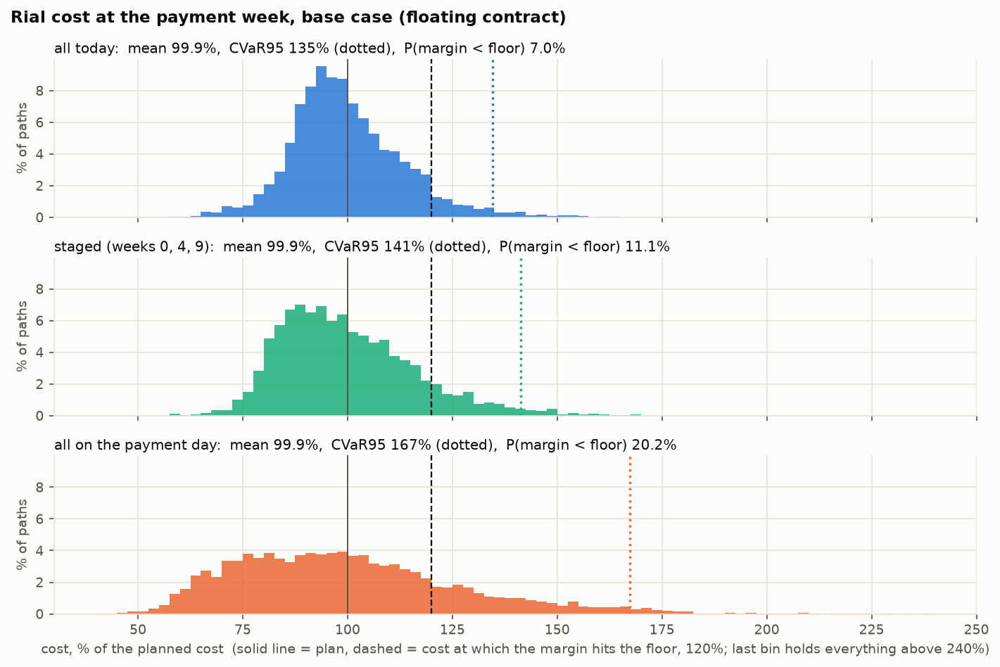
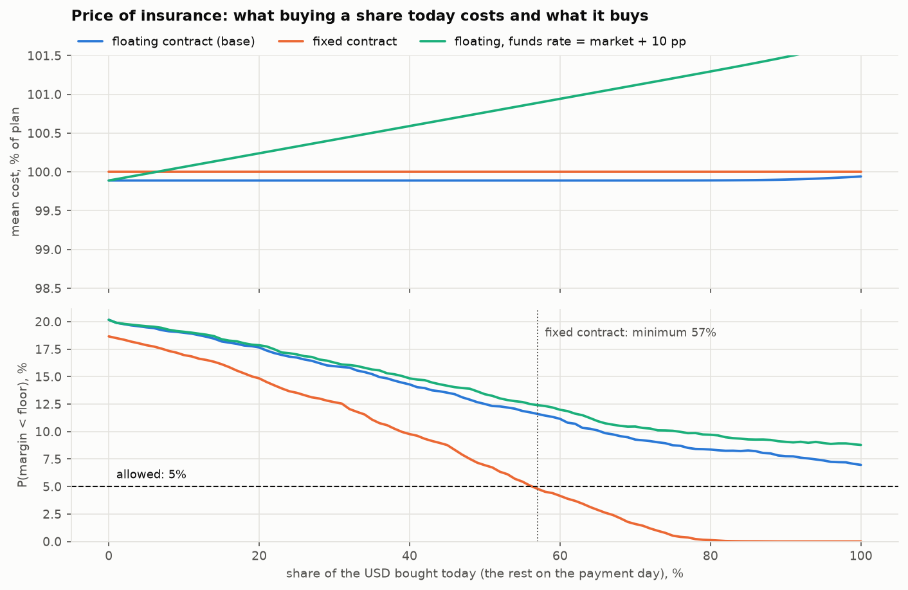
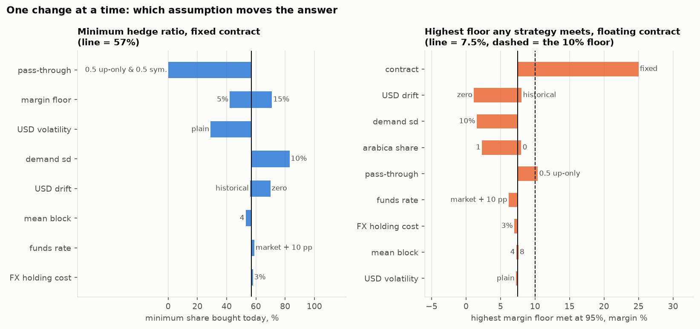
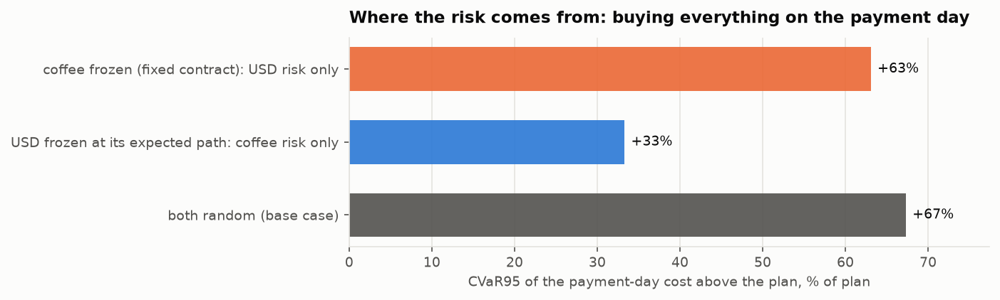
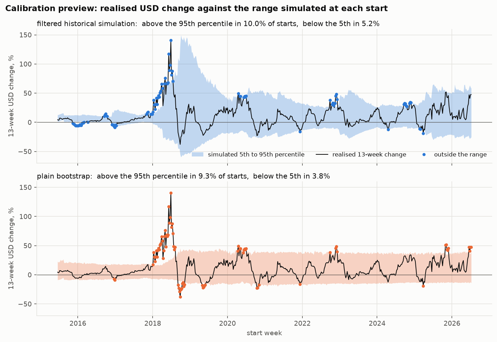

# گزارش مرحلهٔ D3 — موتور

تاریخ ساخت: ۱۴۰۵-۰۷-۲۱ (2026-10-13). همهٔ عددها، جدول‌ها و شکل‌ها را `scripts/d3_report.py` ساخته است: ۲۰٬۰۰۰ مسیر، بذر ثابت `20261013`، تاریخ تصمیم = آخرین هفتهٔ پنل، ۱۴۰۵-۰۷-۱۵ (2026-10-07).

## آنچه در D3b عوض شد

این گزارش پس از بازبینی D3 دوباره ساخته شده است. تصمیم‌های بازبینی (D-036 تا D-043) در `DECISIONS.md` ثبت شده‌اند و در بخش ۷ کنار هر بند آمده‌اند. شش تغییر:

1. **هفتهٔ منتهی به تاریخ تصمیم حالا در مخزن و در برآورد نوسان است (D-038).** مخزنِ فیلترشده از ۷۱۶ به ۷۱۷ هفته رسید و نوسان هفتگی دلار از ٪۵.۴۲ به ٪۵.۳۴. اثر روی عددهای اصلی کوچک است: احتمال حاشیهٔ زیر کف برای «همه امروز» از ٪۷.۱ به ٪۷.۰، بالاترین کفِ شدنی از ٪۷.۴ به ٪۷.۵، و حداقل نسبت پوشش با قرارداد ثابت از ٪۵۸ به ٪۵۷. شبیه‌ساز همچنان فقط گذشته را می‌بیند: هیچ هفته‌ای پس از تاریخ تصمیم.
2. **قاعدهٔ تساوی (D-037).** اختلاف میانگین هزینهٔ کمتر از ٪۰.۲۵ برنامه تساوی است و CVaR95 کمتر برنده می‌شود. خروجی اصلی «حداقل نسبت پوشش» است و «راهبرد منتخب» کنارش می‌آید؛ ستون‌های جدول‌ها به همین ترتیب شده‌اند. در ۴ ردیف از ۳۱ ردیفِ دو جدول حساسیت، راهبرد منتخب عوض شد: شناور، انتقال به قیمت فروش: ۰.۵، فقط بالا: از «٪۷۰ امروز» به «همه امروز»؛ شناور، کف حاشیهٔ سود: ٪۵: از «٪۸۰ امروز» به «همه امروز»؛ ثابت، نرخ تأمین مالی بنگاه: نرخ بازار + ۱۰ واحد درصد: از «٪۶۰ امروز» به «٪۷۰ امروز»؛ ثابت، هزینهٔ نگهداری ارز: ٪۳ در سال: از «٪۶۰ امروز» به «٪۹۰ امروز».
3. **حساسیت نرخ تأمین مالی = نرخ بازار + ۱۰ واحد درصد (D-039)**، به‌جای سطح ثابت ٪۴۰. امروز یعنی ٪۴۸.۷ در سال.
4. **انتقال به قیمت فروش دو حالت دارد (D-043):** «فقط بالا» (قیمت فروش با جهشِ نامنتظر دلار بالا می‌رود ولی با اُفت دلار پایین نمی‌آید) و «متقارن». هر جا انتقال بزرگ‌تر از صفر باشد پیش‌فرض «فقط بالا» است. هر دو ردیف در جدول‌های بخش ۳ آمده‌اند. یافتهٔ تازه: با انتقال ۰.۵ِ «فقط بالا»، قرارداد شناور هم قید را برآورده می‌کند (حداقل نسبت پوشش ٪۶۴).
5. **بخش تازه: پیش‌نمایش کالیبراسیون (بخش ۵)**، با شکل ۵. جمع‌بندی به بخش ۶ رفت و «خروجی ماشین‌حساب و آزمون‌ها» پیوست شد. شمارهٔ بندهای بخش ۷ همان است که بود.
6. **بک‌تست از ۱۳۹۴-۰۳-۲۷ شروع می‌شود (D-041).** پیش‌نمایش کالیبراسیون از همین تاریخ است. گزارش D2 (بازبینی‌شده) دست نخورده و نمونهٔ «بک‌تست» آن همان تعریف D-015 را دارد.

**این مرحله چه ساخت.** یک موتور آزموده در `src/coffee_risk/engine/` که برای یک تاریخ تصمیم و یک دسته ورودی: (۱) مسیرهای مشترک ۱۳ هفته‌ای دلار، عربیکا و روبوستا را شبیه‌سازی می‌کند؛ (۲) هزینهٔ ریالی هر راهبرد خرید ارز را روی هر مسیر حساب می‌کند؛ (۳) معیارهای ریسک را می‌دهد؛ (۴) قاعدهٔ تصمیم D-035 را اجرا می‌کند؛ (۵) فایل مسیرهای ماشین‌حساب را می‌نویسد. رابط ماشین‌حساب، بک‌تست غلتان (D5) و اجرای تنش (D4) ساخته نشده‌اند؛ تابع‌های هزینه و تصمیم هر «مسیر»ی را می‌پذیرند (شبیه‌سازی‌شده، یک مسیر تنش یا یک مسیر واقعی تاریخی)، پس هر دو مرحله همین تابع‌ها را به کار می‌برند.

**همهٔ پیش‌فرض‌ها موقت‌اند.** فقط سه ورودی از داده می‌آید (نرخ دلار، نرخ بازار، پرمیوم). بقیه فرض کاریِ نویسنده است و در جدول بخش ۱-۱ با «فرض موقت» مشخص شده است.

## نتیجه در چند خط

1. **در حالت پایه (قرارداد شناور) حداقل نسبت پوشش وجود ندارد: هیچ راهبردی قید را برآورده نمی‌کند.** قید: حاشیهٔ سود با احتمال ٪۹۵ زیر ٪۱۰ نیفتد. بهترین راهبرد («همه امروز») به ٪۹۳.۰ می‌رسد. بالاترین کفی که در ٪۹۵ شدنی است ٪۷.۵ است.
2. **دلیلش قیمت قهوه است، نه دلار.** با قرارداد شناور، حتی وقتی همهٔ دلار امروز خریده شود، مقدار دلارِ لازم با قیمت قهوه بالا و پایین می‌رود. زمان خرید ارز این ریسک را برنمی‌دارد.
3. **اگر قیمت قهوه امروز ثابت شود، حداقل نسبت پوشش ٪۵۷ است:** خرید دست‌کم همین سهم از دلار در همین امروز قید را برآورده می‌کند.
4. **انتقالِ «فقط بالا» هم قید را شدنی می‌کند، با حاشیهٔ کم.** با انتقال ۰.۵ و قرارداد شناور حداقل نسبت پوشش ٪۶۴ است؛ احتمالِ «همه امروز» ٪۹۵.۲ است، فقط کمی بالای ٪۹۵. با انتقال متقارن شدنی نیست.
5. **بیمه در حالت پایه تقریباً رایگان است، و این از فرض می‌آید.** رانش خنثی یعنی میانگین هزینهٔ «امروز» و «روز پرداخت» برابر است. اختلاف میانگین هزینهٔ این دو ٪۰.۰۵ برنامه است.
6. **پیش‌نمایش کالیبراسیون دو روش نوسان را از هم جدا نمی‌کند.** در ۵۷۸ شروع هفتگی، دلارِ واقعی در ٪۱۰.۰ موارد از صدک ۹۵ِ روش فیلترشده بالاتر رفت و در ٪۹.۳ موارد از صدک ۹۵ِ بوت‌استرپ ساده. هر دو حدود دو برابر ٪۵ هستند؛ با فقط ۴۵ پنجرهٔ مستقل این هنوز در دامنهٔ یک شبیه‌سازِ درست است (بخش ۵).
7. **۲ تصمیم تازه لازم است** (بندهای آخر بخش ۷).

## ۱. حالت پایه

### ۱-۱. ورودی‌ها

| ورودی | مقدار | منبع |
| --- | --- | --- |
| نرخ دلار در تاریخ تصمیم (s0) | ۲٬۶۵۹٬۰۰۰ ریال | از داده: فروش Bonbast در ۱۴۰۵-۰۷-۱۵ |
| نرخ بازار، سالانه (market_rate) | ٪۳۸.۷ | از داده: بازده ۱۳ هفتهٔ اخیر صندوق، سالانه‌شده |
| سهم پرمیوم فیزیکی از فاکتور (premium_share) | ٪۷.۳ | از داده: ۱ − میانهٔ نسبت آتی به شاخص IMF در ۳۶ ماه (عربیکا ٪۷.۶، روبوستا ٪۷.۰)، با وزن ترکیب |
| مبلغ فاکتور (usd_amount) | ۱۰۰٬۰۰۰ دلار | فرض موقت |
| هفتهٔ پرداخت (T) | ۱۳ | فرض موقت |
| تخفیف کانال رسمی (channel_discount) | ٪۰ | فرض موقت |
| قرارداد قهوه (contract) | شناور | فرض موقت؛ D-036 |
| سهم عربیکا (w) | ۰.۵ | فرض موقت |
| نرخ تأمین مالی بنگاه، سالانه (funds_rate) | برابر نرخ بازار (٪۳۸.۷) | فرض موقت |
| هزینهٔ نگهداری ارز، سالانه (fx_holding_cost) | ٪۰ | فرض موقت |
| اختلاف بازفروش دلار اضافه (sellback_spread) | ٪۱ | فرض موقت |
| حاشیهٔ سود برنامه (planned_margin) | ٪۲۵ | فرض موقت |
| کف حاشیهٔ سود (margin_floor) | ٪۱۰ | فرض موقت |
| اطمینان (confidence) | ٪۹۵ | فرض موقت |
| انتقال به قیمت فروش (pass_through) | ۰.۰؛ اگر بزرگ‌تر از صفر شود: «فقط بالا» | فرض موقت؛ D-043 |
| نااطمینانی فروش (demand_sd) | ٪۰ | فرض موقت |
| بودجه (budget) | ۱.۱۰ × هزینهٔ برنامه | فرض موقت |
| آستانهٔ تساوی میانگین هزینه (tie_tolerance) | ٪۰.۲۵ برنامه | D-037 |
| رانش دلار (drift) | خنثی | D-028 |
| نوسان دلار | شبیه‌سازی تاریخی فیلترشده، نیمه‌عمر ۱۳ هفته | D-026 |
| میانگین طول بلوک | ۱۳ هفته | D-025 |

* **هزینهٔ برنامه** = مبلغ فاکتور × نرخ امروز × رشد مورد انتظار دلار تا هفتهٔ پرداخت (٪۸.۵+) = **۲۸۸.۶ میلیارد ریال**. همهٔ هزینه‌ها در این گزارش درصدی از همین عددند و به ارزش هفتهٔ پرداخت.
* **درآمد برنامه** = هزینهٔ برنامه ÷ (۱ − حاشیهٔ سود برنامه) = ۳۸۴.۸ میلیارد ریال. با انتقال صفر و بدون نااطمینانی فروش، درآمد ثابت است؛ پس «حاشیهٔ سود زیر ٪۱۰» دقیقاً یعنی «هزینه بالای ٪۱۲۰ برنامه».
* **پرمیوم** از ماه‌هایی حساب شده که در تاریخ تصمیم منتشر شده بودند: IMF با تأخیر منتشر می‌کند و موتور هر ماه را ۳ ماه بعد «دانسته» می‌گیرد (D-042). آخرین ماه استفاده‌شده: عربیکا 2026-07، روبوستا 2026-06 (ماهی که کمتر از ۱۵ روز دادهٔ آتی دارد کنار می‌رود؛ 2026-07 روبوستا ۱۳ روز دارد).
* **محدودیت کانال رسمی:** کانال رسمی به شکل «نرخ آزاد × (۱ − تخفیف)» با همان رفتار نرخ آزاد مدل شده است. نرخی که اداری و پله‌ای حرکت کند مدل نشده است.

### ۱-۲. شبیه‌ساز چه ساخت

چند اصطلاح، هر کدام یک بار:

* **بوت‌استرپ ایستا:** هر مسیر از یک هفتهٔ تصادفیِ تاریخ شروع می‌شود و هر هفته یا با هفتهٔ بعدیِ تاریخ ادامه می‌دهد یا (با احتمال یک‌سیزدهم) به هفتهٔ تصادفی دیگری می‌پرد. هر سه سری از همان هفته‌ها برداشته می‌شوند، پس هم‌حرکتی‌شان حفظ می‌شود.
* **نوسان EWMA:** برآورد نوسانِ هر هفته از هفته‌های پیش از آن، با وزنی که هر ۱۳ هفته نصف می‌شود. نوسانِ «امروز» از همهٔ هفته‌ها تا خودِ تاریخ تصمیم برآورد می‌شود (D-038).
* **بازدهٔ استانداردشده:** بازدهٔ دلار در یک هفته تقسیم بر نوسانِ برآوردشده برای همان هفته. شبیه‌ساز این عددها را نمونه می‌گیرد و در نوسانِ امروز ضرب می‌کند: شکل از تاریخ، اندازه از امروز.
* **کف نوسان:** اگر برآورد نوسانِ یک هفته از صدک ۵ برآوردهای تا آن روز کمتر باشد، همان صدک به کار می‌رود تا هفته‌های تقریباً ساکن عدد استانداردشدهٔ بزرگ نسازند.
* **تنظیم رانش:** سطح‌های هر هفته در یک عدد ضرب می‌شوند تا میانگینِ نسبت قیمت روی همهٔ مسیرها دقیقاً برابر هدف شود (برای دلار: رشد ریال با نرخ بازار؛ برای هر قهوه: ۱).

| مورد | مقدار |
| --- | --- |
| مخزن، دلارِ فیلترشده | ۷۱۷ هفته، از ۱۳۹۱-۱۰-۲۷ تا ۱۴۰۵-۰۷-۱۵ |
| مخزن، بوت‌استرپ ساده | ۷۳۰ هفته (۱۳ هفتهٔ اول برآورد نوسان ندارند) |
| آخرین هفته‌ای که در برآورد نوسان آمده | ۱۴۰۵-۰۷-۱۵ (2026-10-07) |
| نوسان هفتگی دلار در تاریخ تصمیم | ٪۵.۳۴ (سالانه ٪۳۹) |
| میانهٔ همین برآورد در مخزن | ٪۲.۸۸ (سالانه ٪۲۱) |
| کف نوسان در تاریخ تصمیم | ٪۰.۹۱ |
| هفته‌هایی که به کف خوردند | ۱۳۹ از ۷۱۷، همه بین ۱۳۹۱-۱۱-۰۴ و ۱۳۹۵-۰۹-۱۰ |
| میانگین بازده‌های استانداردشده (کم شد) | ۰.۲۲ |
| انحراف معیار بازده‌های استانداردشده | ۱.۰۵ |
| بزرگ‌ترین قدرمطلق بازدهٔ استانداردشده | ۶.۴ |
| انحراف معیار هفتگی دلارِ نمونه‌گیری‌شده | ٪۵.۶۲ (بوت‌استرپ ساده: ٪۳.۸۵) |
| رشد هدف دلار تا هفتهٔ ۱۳ (خنثی) | ٪۸.۵۲+ |

آیا مسیرها به تاریخ شبیه‌اند؟ تغییر ۱۳ هفته‌ای، درصد ساده:

| سری | میانگین | صدک ۵ | صدک ۲۵ | میانه | صدک ۷۵ | صدک ۹۵ |
| --- | --- | --- | --- | --- | --- | --- |
| دلار، شبیه‌سازی (فیلترشده، پایه) | ٪۸.۵+ | ٪۲۵.۵− | ٪۱۱.۲− | ٪۳.۹+ | ٪۲۳.۴+ | ٪۵۸.۱+ |
| دلار، شبیه‌سازی (بوت‌استرپ ساده) | ٪۸.۵+ | ٪۱۳.۰− | ٪۲.۰− | ٪۵.۴+ | ٪۱۶.۵+ | ٪۳۹.۰+ |
| دلار، تاریخ (۷۱۸ پنجره) | ٪۹.۲+ | ٪۱۲.۵− | ٪۱.۸− | ٪۵.۱+ | ٪۱۷.۶+ | ٪۴۳.۲+ |
| عربیکا، شبیه‌سازی | ٪۰.۰ | ٪۲۳.۵− | ٪۱۲.۰− | ٪۲.۸− | ٪۹.۳+ | ٪۳۱.۴+ |
| عربیکا، تاریخ | ٪۲.۱+ | ٪۲۱.۲− | ٪۱۰.۳− | ٪۱.۲− | ٪۱۱.۹+ | ٪۳۴.۰+ |
| روبوستا، شبیه‌سازی | ٪۰.۰ | ٪۱۷.۶− | ٪۹.۱− | ٪۱.۹− | ٪۷.۶+ | ٪۲۴.۶+ |
| روبوستا، تاریخ | ٪۲.۶+ | ٪۱۴.۲− | ٪۶.۸− | ٪۰.۰ | ٪۱۰.۷+ | ٪۲۸.۹+ |

* فاصلهٔ صدک ۵ تا ۹۵ دلارِ شبیه‌سازی‌شده ۱.۵ برابر تاریخ است، چون نوسانِ امروز ۱.۹ برابر میانهٔ مخزن است. دُم پایین هم پهن شده است: شبیه‌ساز اُفت بزرگ دلار را محتمل‌تر از تاریخ می‌بیند. اینکه این پهنا درست است یا نه، پرسش بخش ۵ است.
* میانگین‌ها با تاریخ فرق دارند و باید داشته باشند: رانش را D-028 و D-029 تعیین می‌کنند، نه تاریخ.
* هفته‌های «کف» همه در سال‌های آرامِ پس از بحران ۱۳۹۱ هستند، وقتی نوسان مدام رکورد پایین تازه می‌زد.

### ۱-۳. جدول راهبردها

* **VaR95:** هزینه‌ای که در ٪۹۵ مسیرها از آن بیشتر نمی‌شود. **CVaR95:** میانگین هزینه در بدترین ٪۵ مسیرها.
* **خطای شبیه‌سازی:** خطای معیار مونت‌کارلو؛ یعنی عدد با بذر دیگر حدوداً چقدر جابه‌جا می‌شود.
* هزینه‌ها درصدی از هزینهٔ برنامه‌اند. بودجه = ٪۱۱۰ برنامه.

| راهبرد | میانگین هزینه | میانه | VaR95 | CVaR95 | احتمال هزینه بالای بودجه | صدک ۵ حاشیهٔ سود | احتمال حاشیهٔ زیر کف | خطای شبیه‌سازیِ میانگین | خطای شبیه‌سازیِ احتمال |
| --- | --- | --- | --- | --- | --- | --- | --- | --- | --- |
| همه امروز | ٪۹۹.۹ | ٪۹۸.۱ | ٪۱۲۳ | ٪۱۳۵ | ٪۲۰.۴ | ٪۷.۵ | ٪۷.۰ | ٪۰.۱۰ | ٪۰.۱۸ |
| سه‌پله‌ای | ٪۹۹.۹ | ٪۹۷.۵ | ٪۱۳۰ | ٪۱۴۱ | ٪۲۳.۸ | ٪۲.۴ | ٪۱۱.۱ | ٪۰.۱۱ | ٪۰.۲۲ |
| همه روز پرداخت | ٪۹۹.۹ | ٪۹۶.۵ | ٪۱۵۲ | ٪۱۶۷ | ٪۳۱.۰ | ٪۱۴.۱− | ٪۲۰.۲ | ٪۰.۱۹ | ٪۰.۲۸ |
| ٪۱۰ امروز | ٪۹۹.۹ | ٪۹۶.۸ | ٪۱۴۷ | ٪۱۶۲ | ٪۳۰.۰ | ٪۱۰.۵− | ٪۱۹.۰ | ٪۰.۱۸ | ٪۰.۲۸ |
| ٪۲۰ امروز | ٪۹۹.۹ | ٪۹۶.۹ | ٪۱۴۴ | ٪۱۵۷ | ٪۲۹.۰ | ٪۷.۹− | ٪۱۷.۷ | ٪۰.۱۶ | ٪۰.۲۷ |
| ٪۳۰ امروز | ٪۹۹.۹ | ٪۹۷.۰ | ٪۱۴۱ | ٪۱۵۳ | ٪۲۷.۶ | ٪۵.۵− | ٪۱۶.۰ | ٪۰.۱۵ | ٪۰.۲۶ |
| ٪۴۰ امروز | ٪۹۹.۹ | ٪۹۷.۰ | ٪۱۳۷ | ٪۱۴۸ | ٪۲۵.۸ | ٪۲.۹− | ٪۱۴.۳ | ٪۰.۱۴ | ٪۰.۲۵ |
| ٪۵۰ امروز | ٪۹۹.۹ | ٪۹۷.۰ | ٪۱۳۴ | ٪۱۴۵ | ٪۲۴.۹ | ٪۰.۲− | ٪۱۲.۵ | ٪۰.۱۲ | ٪۰.۲۳ |
| ٪۶۰ امروز | ٪۹۹.۹ | ٪۹۷.۰ | ٪۱۳۰ | ٪۱۴۲ | ٪۲۳.۴ | ٪۲.۱ | ٪۱۱.۲ | ٪۰.۱۱ | ٪۰.۲۲ |
| ٪۷۰ امروز | ٪۹۹.۹ | ٪۹۷.۰ | ٪۱۲۹ | ٪۱۳۹ | ٪۲۱.۹ | ٪۳.۵ | ٪۹.۳ | ٪۰.۱۱ | ٪۰.۲۱ |
| ٪۸۰ امروز | ٪۹۹.۹ | ٪۹۷.۳ | ٪۱۲۶ | ٪۱۳۷ | ٪۲۰.۳ | ٪۵.۲ | ٪۸.۴ | ٪۰.۱۰ | ٪۰.۲۰ |
| ٪۹۰ امروز | ٪۹۹.۹ | ٪۹۷.۶ | ٪۱۲۵ | ٪۱۳۶ | ٪۱۹.۹ | ٪۶.۵ | ٪۷.۸ | ٪۰.۱۰ | ٪۰.۱۹ |

سه راهبرد اصلی به میلیارد ریال:

| راهبرد | میانگین | میانه | VaR95 | CVaR95 |
| --- | --- | --- | --- | --- |
| همه امروز | ۲۸۸.۴ | ۲۸۳.۱ | ۳۵۵.۹ | ۳۸۸.۶ |
| سه‌پله‌ای | ۲۸۸.۴ | ۲۸۱.۲ | ۳۷۵.۴ | ۴۰۷.۶ |
| همه روز پرداخت | ۲۸۸.۲ | ۲۷۸.۵ | ۴۳۸.۹ | ۴۸۲.۸ |

*شکل ۱ — توزیع هزینهٔ ریالی سه راهبرد اصلی در حالت پایه، درصدی از هزینهٔ برنامه. خط پر: برنامه. خط‌چین: هزینه‌ای که حاشیهٔ سود را به کف می‌رساند. نقطه‌چین: CVaR95 همان راهبرد.*

### ۱-۴. قاعدهٔ تصمیم

قاعده (D-035 و D-037): راهبردهایی بمانند که احتمال «حاشیهٔ سود ≥ کف» در آن‌ها دست‌کم ٪۹۵ است؛ از میان آن‌ها کمترین میانگین هزینه؛ اختلافِ کمتر از ٪۰.۲۵ برنامه تساوی است و در تساوی CVaR95 کمتر برنده می‌شود. خروجی اصلی «حداقل نسبت پوشش» است: کوچک‌ترین سهمی از دلار که اگر امروز خریده شود (و بقیه روز پرداخت) قید برآورده می‌شود. روی شبکهٔ یک‌درصدی جست‌وجو شده است.

| مورد | قرارداد شناور (پایه) | قرارداد ثابت |
| --- | --- | --- |
| **حداقل نسبت پوشش** | هیچ؛ حتی ٪۱۰۰ کافی نیست | **٪۵۷** |
| راهبرد منتخب | هیچ | همه امروز |
| بیشترین احتمالِ رسیدن به کف | ٪۹۳.۰ («همه امروز») | ٪۱۰۰.۰ («همه امروز») |
| بالاترین کفِ شدنی در اطمینان ٪۹۵ | ٪۷.۵ («همه امروز») | ٪۲۵.۰ («همه امروز») |

خطای شبیه‌سازی: اگر احتمال‌ها دو خطای معیار پایین یا بالا بروند، حداقل پوششِ قرارداد ثابت ٪۵۶ یا ٪۵۸ می‌شود. در حالت شناور نتیجه عوض نمی‌شود: احتمال «همه امروز» ٪۹۳.۰ است با خطای معیار ٪۰.۱۸.

**به زبان ساده**

* برنامه این است که فاکتور ۲۸۸.۶ میلیارد ریال تمام شود. کف ٪۱۰ یعنی هزینه نباید از ٪۱۲۰ برنامه (۳۴۶.۳ میلیارد ریال) بگذرد، و این فقط در ٪۵ حالت‌ها مجاز است.
* اگر خرید به روز پرداخت بماند، در ٪۲۰ حالت‌ها هزینه از این حد می‌گذرد، و در بدترین ٪۵ حالت‌ها هزینه به‌طور میانگین ٪۱۶۷ برنامه است.
* اگر همهٔ دلار امروز خریده شود، این احتمال به ٪۷.۰ می‌رسد: بهتر، ولی هنوز بالای ٪۵. چرا؟ چون فاکتور با قیمت قهوه در روز پرداخت بسته می‌شود. اگر قهوه گران شود، دلارِ بیشتری لازم است و باید با نرخ همان روز خریده شود.
* خرید سه‌پله‌ای بین این دو است (٪۱۱.۱).
* میانگین هزینهٔ همهٔ راهبردها تقریباً یکی است (٪۹۹.۸۹ تا ٪۹۹.۹۴ برنامه). کمی زیر ٪۱۰۰ است چون در مسیرها دلار و قهوه اندکی خلاف هم حرکت می‌کنند (همبستگی نرخ دلار هفتهٔ ۱۳ با مقدار دلارِ لازم: ۰.۰۳−). راهبردها در ریسک فرق دارند، نه در میانگین.

## ۲. بهای بیمه

برای هر سهم از دلار که امروز خریده شود (و بقیه روز پرداخت): میانگین هزینه و احتمال افتادن حاشیهٔ سود زیر کف.

*شکل ۲ — بالا: میانگین هزینه (درصد برنامه). پایین: احتمال حاشیهٔ سود زیر ٪۱۰. محور افقی: سهم خرید امروز. خط‌چین: حد مجاز (٪۵). سه خط: حالت پایه (قرارداد شناور)، قرارداد ثابت، و حالت پایه با نرخ تأمین مالیِ «نرخ بازار + ۱۰ واحد درصد».*

| سهم خرید امروز | شناور: میانگین هزینه | شناور: CVaR95 | شناور: احتمال زیر کف | ثابت: میانگین هزینه | ثابت: CVaR95 | ثابت: احتمال زیر کف |
| --- | --- | --- | --- | --- | --- | --- |
| ٪۰ | ٪۹۹.۸۹ | ٪۱۶۷ | ٪۲۰.۲ | ٪۱۰۰.۰۰ | ٪۱۶۳ | ٪۱۸.۷ |
| ٪۲۵ | ٪۹۹.۸۹ | ٪۱۵۵ | ٪۱۶.۷ | ٪۱۰۰.۰۰ | ٪۱۴۷ | ٪۱۳.۵ |
| ٪۵۰ | ٪۹۹.۸۹ | ٪۱۴۵ | ٪۱۲.۵ | ٪۱۰۰.۰۰ | ٪۱۳۲ | ٪۶.۹ |
| ٪۷۵ | ٪۹۹.۸۹ | ٪۱۳۸ | ٪۸.۸ | ٪۱۰۰.۰۰ | ٪۱۱۶ | ٪۰.۵ |
| ٪۱۰۰ | ٪۹۹.۹۴ | ٪۱۳۵ | ٪۷.۰ | ٪۱۰۰.۰۰ | ٪۱۰۰ | ٪۰.۰ |

* **آنچه بیمه می‌خرد:** با قرارداد شناور، خرید ٪۱۰۰ امروز احتمال زیر کف را از ٪۲۰.۲ به ٪۷.۰ می‌رساند و به ٪۵ نمی‌رسد. با قرارداد ثابت از ٪۱۸.۷ به صفر می‌رسد و از سهم ٪۵۷ به بالا زیر حد مجاز است.
* **آنچه بیمه می‌ارزد:** در حالت پایه تقریباً هیچ. تفاوت میانگین هزینهٔ ٪۱۰۰ با ٪۰ برابر ٪۰.۰۵+ برنامه است. این همان اختلاف بازفروش است: در ٪۵۷ مسیرها قهوه ارزان می‌شود، دلار اضافه می‌ماند و با ٪۱ تخفیف فروخته می‌شود.
* **این «رایگان بودن» نتیجه نیست، فرض است.** رانش خنثی (D-028) طوری ساخته شده که میانگین هزینهٔ زود خریدن و دیر خریدن برابر شود. بها وقتی پیدا می‌شود که یکی از این‌ها عوض شود:

| تغییر نسبت به پایه | بهای پوشش کامل (میانگین هزینهٔ ٪۱۰۰ منهای ٪۰) |
| --- | --- |
| پایه | ٪۰.۰۵+ |
| نرخ تأمین مالی = نرخ بازار + ۱۰ واحد درصد (٪۴۸.۷) | ٪۱.۸۱+ |
| هزینهٔ نگهداری ارز ٪۳ در سال | ٪۰.۷۴+ |
| رانش صفر (دلار به‌طور میانگین رشد نکند) | ٪۸.۵۸+ |

واحد: درصدی از هزینهٔ برنامهٔ همان ردیف.

## ۳. حساسیت

هر ردیف یک تغییر نسبت به حالت پایه است؛ بقیهٔ ورودی‌ها همان‌اند. همهٔ ردیف‌ها با همان بذر اجرا شده‌اند. هزینه‌ها درصدی از هزینهٔ برنامهٔ همان ردیف‌اند. «بالاترین کفِ شدنی» بالاترین کف حاشیهٔ سود است که دست‌کم یک راهبرد در اطمینان ٪۹۵ برآورده می‌کند. برای ردیف‌های سهم عربیکا، پرمیوم پیش‌فرض از نو حساب شده است.

**۳-۱. پایه = قرارداد شناور (D-036)**

| تغییر | حداقل پوشش | راهبرد منتخب | بالاترین کفِ شدنی | میانگین: امروز | میانگین: پله‌ای | میانگین: روز پرداخت | CVaR95: امروز | CVaR95: پله‌ای | CVaR95: روز پرداخت |
| --- | --- | --- | --- | --- | --- | --- | --- | --- | --- |
| **پایه** | هیچ | هیچ (نزدیک‌ترین: همه امروز، ٪۹۳.۰) | ٪۷.۵ | ٪۹۹.۹ | ٪۹۹.۹ | ٪۹۹.۹ | ٪۱۳۵ | ٪۱۴۱ | ٪۱۶۷ |
| رانش دلار: میانگین تاریخی (فقط گذشته) | هیچ | هیچ (نزدیک‌ترین: همه امروز، ٪۹۳.۵) | ٪۸.۰ | ٪۹۹.۲ | ٪۹۹.۴ | ٪۹۹.۹ | ٪۱۳۴ | ٪۱۴۱ | ٪۱۶۷ |
| رانش دلار: صفر | هیچ | هیچ (نزدیک‌ترین: ٪۸۰ امروز، ٪۸۴.۲) | ٪۱.۱ | ٪۱۰۸.۵ | ٪۱۰۵.۶ | ٪۹۹.۹ | ٪۱۴۳ | ٪۱۴۷ | ٪۱۶۷ |
| نرخ تأمین مالی بنگاه: نرخ بازار + ۱۰ واحد درصد | هیچ | هیچ (نزدیک‌ترین: همه امروز، ٪۹۱.۲) | ٪۶.۲ | ٪۱۰۱.۷ | ٪۱۰۱.۱ | ٪۹۹.۹ | ٪۱۳۶ | ٪۱۴۳ | ٪۱۶۷ |
| هزینهٔ نگهداری ارز: ٪۳ در سال | هیچ | هیچ (نزدیک‌ترین: همه امروز، ٪۹۲.۲) | ٪۷.۰ | ٪۱۰۰.۶ | ٪۱۰۰.۴ | ٪۹۹.۹ | ٪۱۳۵ | ٪۱۴۲ | ٪۱۶۷ |
| قرارداد قهوه: ثابت | ٪۵۷ | همه امروز | ٪۲۵.۰ | ٪۱۰۰.۰ | ٪۱۰۰.۰ | ٪۱۰۰.۰ | ٪۱۰۰ | ٪۱۲۵ | ٪۱۶۳ |
| سهم عربیکا: ۰ | هیچ | هیچ (نزدیک‌ترین: همه امروز، ٪۹۳.۰) | ٪۸.۰ | ٪۱۰۰.۰ | ٪۱۰۰.۰ | ٪۹۹.۹ | ٪۱۳۱ | ٪۱۳۹ | ٪۱۶۷ |
| سهم عربیکا: ۱ | هیچ | هیچ (نزدیک‌ترین: همه امروز، ٪۹۰.۰) | ٪۲.۳ | ٪۹۹.۹ | ٪۹۹.۹ | ٪۹۹.۸ | ٪۱۴۶ | ٪۱۵۲ | ٪۱۷۳ |
| نوسان دلار: فیلترشده، نیمه‌عمر ۲۶ | هیچ | هیچ (نزدیک‌ترین: همه امروز، ٪۹۳.۱) | ٪۷.۳ | ٪۹۹.۹ | ٪۹۹.۹ | ٪۹۹.۹ | ٪۱۳۴ | ٪۱۴۰ | ٪۱۶۸ |
| نوسان دلار: بوت‌استرپ ساده | هیچ | هیچ (نزدیک‌ترین: همه امروز، ٪۹۲.۵) | ٪۷.۲ | ٪۱۰۰.۰ | ٪۱۰۰.۰ | ٪۱۰۰.۰ | ٪۱۳۴ | ٪۱۳۷ | ٪۱۵۰ |
| میانگین طول بلوک: ۴ هفته | هیچ | هیچ (نزدیک‌ترین: همه امروز، ٪۹۲.۹) | ٪۷.۳ | ٪۹۹.۹ | ٪۹۹.۹ | ٪۹۹.۹ | ٪۱۳۴ | ٪۱۴۱ | ٪۱۶۷ |
| میانگین طول بلوک: ۸ هفته | هیچ | هیچ (نزدیک‌ترین: همه امروز، ٪۹۳.۰) | ٪۷.۶ | ٪۹۹.۹ | ٪۹۹.۹ | ٪۹۹.۹ | ٪۱۳۴ | ٪۱۴۱ | ٪۱۶۸ |
| انتقال به قیمت فروش: ۰.۵، فقط بالا | ٪۶۴ | همه امروز | ٪۱۰.۴ | ٪۹۹.۹ | ٪۹۹.۹ | ٪۹۹.۹ | ٪۱۳۵ | ٪۱۴۱ | ٪۱۶۷ |
| انتقال به قیمت فروش: ۰.۵، متقارن | هیچ | هیچ (نزدیک‌ترین: ٪۴۰ امروز، ٪۹۳.۰) | ٪۷.۶ | ٪۹۹.۹ | ٪۹۹.۹ | ٪۹۹.۹ | ٪۱۳۵ | ٪۱۴۱ | ٪۱۶۷ |
| نااطمینانی فروش: ٪۱۰ | هیچ | هیچ (نزدیک‌ترین: همه امروز، ٪۸۷.۵) | ٪۱.۵ | ٪۹۹.۹ | ٪۹۹.۹ | ٪۹۹.۹ | ٪۱۳۵ | ٪۱۴۱ | ٪۱۶۷ |
| کف حاشیهٔ سود: ٪۵ | ٪۷۹ | همه امروز | ٪۷.۵ | ٪۹۹.۹ | ٪۹۹.۹ | ٪۹۹.۹ | ٪۱۳۵ | ٪۱۴۱ | ٪۱۶۷ |
| کف حاشیهٔ سود: ٪۱۵ | هیچ | هیچ (نزدیک‌ترین: همه امروز، ٪۸۴.۹) | ٪۷.۵ | ٪۹۹.۹ | ٪۹۹.۹ | ٪۹۹.۹ | ٪۱۳۵ | ٪۱۴۱ | ٪۱۶۷ |

* از ۱۶ تغییر، ۳ تا قید را شدنی می‌کنند: «قرارداد قهوه: ثابت»، «انتقال به قیمت فروش: ۰.۵، فقط بالا»، «کف حاشیهٔ سود: ٪۵».
* هزینهٔ برنامه با رانش عوض می‌شود: خنثی ۲۸۸.۶، میانگین تاریخی ۲۹۰.۷، صفر ۲۶۵.۹ میلیارد ریال. پس در ردیف «رانش صفر» عدد «میانگین: امروز» بالای ٪۱۰۰ است: دلار قرار نیست رشد کند ولی پولِ خرید زودهنگام هزینهٔ تأمین مالی دارد.
* «راهبرد منتخب» از میان ۱۲ راهبرد است (امروز، سه‌پله‌ای، روز پرداخت، و سهم‌های ٪۱۰ تا ٪۹۰). «حداقل پوشش» روی شبکهٔ یک‌درصدی است. این دو یکی نیستند: حداقل پوشش می‌گوید چه مقدار لازم است؛ راهبرد منتخب می‌گوید از میان راهبردهای مجازی که هزینه‌شان در حد ٪۰.۲۵ برنامه یکی است، کدام کم‌ریسک‌تر است.

**۳-۲. همان تغییرها، با پایه = قرارداد ثابت**

سهم عربیکا در این جدول نیست: با قرارداد ثابت هزینه به قیمت قهوه بستگی ندارد.

| تغییر | حداقل پوشش | راهبرد منتخب | بالاترین کفِ شدنی | میانگین: امروز | میانگین: پله‌ای | میانگین: روز پرداخت | CVaR95: امروز | CVaR95: پله‌ای | CVaR95: روز پرداخت |
| --- | --- | --- | --- | --- | --- | --- | --- | --- | --- |
| **پایه** | ٪۵۷ | همه امروز | ٪۲۵.۰ | ٪۱۰۰.۰ | ٪۱۰۰.۰ | ٪۱۰۰.۰ | ٪۱۰۰ | ٪۱۲۵ | ٪۱۶۳ |
| رانش دلار: میانگین تاریخی (فقط گذشته) | ٪۵۶ | همه امروز | ٪۲۵.۶ | ٪۹۹.۳ | ٪۹۹.۵ | ٪۱۰۰.۰ | ٪۹۹ | ٪۱۲۵ | ٪۱۶۳ |
| رانش دلار: صفر | ٪۷۰ | ٪۷۰ امروز | ٪۱۸.۶ | ٪۱۰۸.۵ | ٪۱۰۵.۶ | ٪۱۰۰.۰ | ٪۱۰۹ | ٪۱۳۲ | ٪۱۶۳ |
| نرخ تأمین مالی بنگاه: نرخ بازار + ۱۰ واحد درصد | ٪۵۹ | ٪۷۰ امروز | ٪۲۳.۷ | ٪۱۰۱.۸ | ٪۱۰۱.۲ | ٪۱۰۰.۰ | ٪۱۰۲ | ٪۱۲۷ | ٪۱۶۳ |
| هزینهٔ نگهداری ارز: ٪۳ در سال | ٪۵۸ | ٪۹۰ امروز | ٪۲۴.۵ | ٪۱۰۰.۷ | ٪۱۰۰.۵ | ٪۱۰۰.۰ | ٪۱۰۱ | ٪۱۲۶ | ٪۱۶۳ |
| نوسان دلار: فیلترشده، نیمه‌عمر ۲۶ | ٪۵۶ | همه امروز | ٪۲۵.۰ | ٪۱۰۰.۰ | ٪۱۰۰.۰ | ٪۱۰۰.۰ | ٪۱۰۰ | ٪۱۲۵ | ٪۱۶۶ |
| نوسان دلار: بوت‌استرپ ساده | ٪۲۹ | همه امروز | ٪۲۵.۰ | ٪۱۰۰.۰ | ٪۱۰۰.۰ | ٪۱۰۰.۰ | ٪۱۰۰ | ٪۱۱۷ | ٪۱۴۳ |
| میانگین طول بلوک: ۴ هفته | ٪۵۳ | همه امروز | ٪۲۵.۰ | ٪۱۰۰.۰ | ٪۱۰۰.۰ | ٪۱۰۰.۰ | ٪۱۰۰ | ٪۱۲۵ | ٪۱۶۱ |
| میانگین طول بلوک: ۸ هفته | ٪۵۶ | همه امروز | ٪۲۵.۰ | ٪۱۰۰.۰ | ٪۱۰۰.۰ | ٪۱۰۰.۰ | ٪۱۰۰ | ٪۱۲۵ | ٪۱۶۲ |
| انتقال به قیمت فروش: ۰.۵، فقط بالا | ٪۰ | همه امروز | ٪۲۵.۳ | ٪۱۰۰.۰ | ٪۱۰۰.۰ | ٪۱۰۰.۰ | ٪۱۰۰ | ٪۱۲۵ | ٪۱۶۳ |
| انتقال به قیمت فروش: ۰.۵، متقارن | ٪۰ | همه امروز | ٪۲۵.۰ | ٪۱۰۰.۰ | ٪۱۰۰.۰ | ٪۱۰۰.۰ | ٪۱۰۰ | ٪۱۲۵ | ٪۱۶۳ |
| نااطمینانی فروش: ٪۱۰ | ٪۸۳ | همه امروز | ٪۱۱.۳ | ٪۱۰۰.۰ | ٪۱۰۰.۰ | ٪۱۰۰.۰ | ٪۱۰۰ | ٪۱۲۵ | ٪۱۶۳ |
| کف حاشیهٔ سود: ٪۵ | ٪۴۲ | همه امروز | ٪۲۵.۰ | ٪۱۰۰.۰ | ٪۱۰۰.۰ | ٪۱۰۰.۰ | ٪۱۰۰ | ٪۱۲۵ | ٪۱۶۳ |
| کف حاشیهٔ سود: ٪۱۵ | ٪۷۱ | همه امروز | ٪۲۵.۰ | ٪۱۰۰.۰ | ٪۱۰۰.۰ | ٪۱۰۰.۰ | ٪۱۰۰ | ٪۱۲۵ | ٪۱۶۳ |

* با قرارداد ثابت و رانش خنثی میانگین هزینهٔ همهٔ راهبردها دقیقاً برابر است؛ پس CVaR95 کمتر تصمیم می‌گیرد و «همه امروز» منتخب می‌شود، در حالی که حداقلِ لازم کمتر است. وقتی زود خریدن هزینه دارد (نرخ تأمین مالیِ بالاتر، هزینهٔ نگهداری، رانش صفر) راهبرد منتخب به سمت حداقل پوشش برمی‌گردد.

**۳-۳. انتقال به قیمت فروش: دو حالت (D-043)**

انتقال ۰.۵ یعنی نیمی از حرکتِ نامنتظر دلار به قیمت فروش می‌رسد. «متقارن»: در هر دو جهت. «فقط بالا»: فقط وقتی دلار بالاتر از انتظار تمام شود. «دامنهٔ مجاز» سهم‌هایی از خرید امروز است که قید را برآورده می‌کنند؛ «امن‌ترین سهم» کمترین احتمالِ حاشیهٔ زیر کف را دارد.

| قرارداد | حالت انتقال | دامنهٔ مجاز | امن‌ترین سهم | احتمال زیر کف: همه روز پرداخت | احتمال زیر کف: همه امروز | میانگین درآمد نسبت به برنامه |
| --- | --- | --- | --- | --- | --- | --- |
| شناور | فقط بالا | ٪۶۴ تا ٪۱۰۰ | ٪۷۶ | ٪۱۰.۵ | ٪۴.۸ | ٪۴.۸+ |
| شناور | متقارن | هیچ | ٪۴۳ | ٪۱۱.۲ | ٪۱۴.۰ | ٪۰.۰ |
| ثابت | فقط بالا | ٪۰ تا ٪۱۰۰ | ٪۲۹ | ٪۴.۲ | ٪۰.۰ | ٪۴.۸+ |
| ثابت | متقارن | ٪۰ تا ٪۱۰۰ | ٪۲۹ | ٪۴.۲ | ٪۳.۴ | ٪۰.۰ |

* **حالت متقارن خرید کامل را خطرناک نشان می‌دهد:** با قرارداد شناور احتمال زیر کف برای «همه امروز» ٪۱۴.۰ است، بدتر از حالت بدون انتقال (٪۷.۰)، چون اگر دلار بیفتد درآمد هم می‌افتد و دلارِ گران‌خریده می‌ماند. این همان اثری است که D-043 می‌گوید شاید واقعی نباشد.
* **حالت «فقط بالا» این اثر را برمی‌دارد:** احتمال «همه امروز» به ٪۴.۸ می‌رسد و قرارداد شناور از سهم ٪۶۴ به بالا قید را برآورده می‌کند. حاشیه کم است: خطای معیار این احتمال ٪۰.۱۵ است.
* **ولی «فقط بالا» درآمد میانگین را هم بالا می‌برد:** ٪۴.۸+ نسبت به درآمد برنامه، چون جهش‌ها منتقل می‌شوند و اُفت‌ها نه. بخشی از بهبود از همین می‌آید (تصمیم ۷-۸).

*شکل ۳ — چپ: حداقل نسبت پوشش با قرارداد ثابت؛ هر میله دامنهٔ یک ورودی است و خط عمودی حالت پایه. راست: بالاترین کف حاشیهٔ سود که در قرارداد شناور شدنی است؛ خط‌چین کف ٪۱۰ است. نوشتهٔ سرِ هر میله می‌گوید کدام مقدار آن سر را ساخته است؛ سرِ بی‌نوشته همان حالت پایه است.*

بزرگ‌ترین دامنه‌ها:

| رتبه | قرارداد ثابت: حداقل نسبت پوشش | دامنه | قرارداد شناور: بالاترین کفِ شدنی | دامنه |
| --- | --- | --- | --- | --- |
| ۱ | انتقال به قیمت فروش | ٪۰ تا ٪۵۷ | قرارداد قهوه | ٪۷.۵ تا ٪۲۵.۰ |
| ۲ | کف حاشیهٔ سود | ٪۴۲ تا ٪۷۱ | رانش دلار | ٪۱.۱ تا ٪۸.۰ |
| ۳ | نوسان دلار | ٪۲۹ تا ٪۵۷ | نااطمینانی فروش | ٪۱.۵ تا ٪۷.۵ |
| ۴ | نااطمینانی فروش | ٪۵۷ تا ٪۸۳ | سهم عربیکا | ٪۲.۳ تا ٪۸.۰ |

## ۴. ریسک از کجا می‌آید

راهبرد: همه روز پرداخت. سه حالت روی همان مسیرها: قهوه ثابت (قرارداد ثابت، فقط ریسک دلار)؛ دلار ثابت روی مسیر مورد انتظارش (فقط ریسک قهوه)؛ هر دو تصادفی (حالت پایه). هزینه‌ها درصدی از هزینهٔ برنامه.

| حالت | میانگین | انحراف معیار | VaR95 | CVaR95 |
| --- | --- | --- | --- | --- |
| قهوه ثابت: فقط دلار | ٪۱۰۰.۰ | ٪۲۴.۴ | ٪۱۴۶ | ٪۱۶۳ |
| دلار ثابت: فقط قهوه | ٪۱۰۰.۰ | ٪۱۳.۲ | ٪۱۲۳ | ٪۱۳۳ |
| هر دو تصادفی | ٪۹۹.۹ | ٪۲۷.۰ | ٪۱۵۲ | ٪۱۶۷ |

*شکل ۴ — CVaR95 هزینهٔ «همه روز پرداخت» منهای برنامه، در سه حالت.*

* ریسک دلار بزرگ‌تر است: به‌تنهایی CVaR95 را به ٪۱۶۳ برنامه می‌رساند؛ قهوه به‌تنهایی به ٪۱۳۳.
* با هم ٪۱۶۷ است، خیلی کمتر از جمع دو فاصله: دو ریسک تقریباً مستقل‌اند و روی هم جمع نمی‌شوند.
* ولی ریسک قهوه به‌تنهایی از حد قید (٪۱۲۰) می‌گذرد. خرید زودهنگام دلار فقط ریسک اول را برمی‌دارد؛ برای همین در حالت پایه هیچ راهبردی کافی نیست.

## ۵. پیش‌نمایش کالیبراسیون

**فقط برای اطلاع؛ هیچ چیز با این نتیجه تنظیم نشده است.** پرسش: صدک ۹۵ دلارِ شبیه‌سازی‌شده امروز ٪۵۸+ است (روش فیلترشده) در برابر ٪۳۹+ با بوت‌استرپ ساده، و همین انتخاب حداقل نسبت پوشش را از ٪۵۷ به ٪۲۹ می‌برد. کدام به واقعیت نزدیک‌تر بوده؟

**روش.** برای هر چهارشنبه از ۱۳۹۴-۰۳-۲۷ (2015-06-17) (D-041) تا ۱۴۰۵-۰۴-۱۷ (2026-07-08) (آخرین شروعی که نتیجهٔ ۱۳ هفته‌اش معلوم است): موتور با دادهٔ تا همان روز و ۲٬۰۰۰ مسیر شبیه‌سازی می‌کند (تنظیم‌های پایه: رانش خنثی با نرخ بازارِ همان روز، بلوک ۱۳، نیمه‌عمر ۱۳). بعد تغییر واقعیِ ۱۳ هفته‌ای دلار با صدک ۵ و ۹۵ شبیه‌سازی مقایسه می‌شود. اگر شبیه‌ساز کالیبره باشد، واقعیت حدود ٪۵ موارد از هر طرف بیرون می‌افتد.

* شروع‌ها: ۵۷۸؛ قابل‌استفاده: ۵۷۸ (کنار گذاشته: ۰).
* **پنجرهٔ مستقل:** شروع‌های هفتگی ۱۲ هفتهٔ مشترک با همسایه دارند، پس مشاهدهٔ مستقل نیستند. «پنجرهٔ مستقل» تعداد پنجره‌هایی است که هیچ هفتهٔ مشترکی ندارند. سالِ هر ردیف سالِ شروع پنجره است.

| سال شروع | شروع‌ها | پنجرهٔ مستقل | فیلترشده: بالای صدک ۹۵ | فیلترشده: زیر صدک ۵ | ساده: بالای صدک ۹۵ | ساده: زیر صدک ۵ |
| --- | --- | --- | --- | --- | --- | --- |
| ۱۳۹۴ | ۴۰ | ۴ | ٪۰.۰ | ٪۴۲.۵ | ٪۰.۰ | ٪۰.۰ |
| ۱۳۹۵ | ۵۲ | ۴ | ٪۷.۷ | ٪۱۵.۴ | ٪۰.۰ | ٪۳.۸ |
| ۱۳۹۶ | ۵۲ | ۴ | ٪۳۲.۷ | ٪۰.۰ | ٪۲۱.۲ | ٪۰.۰ |
| ۱۳۹۷ | ۵۳ | ۵ | ٪۲۶.۴ | ٪۰.۰ | ٪۳۹.۶ | ٪۱۸.۹ |
| ۱۳۹۸ | ۵۲ | ۴ | ٪۰.۰ | ٪۰.۰ | ٪۰.۰ | ٪۹.۶ |
| ۱۳۹۹ | ۵۲ | ۴ | ٪۱۳.۵ | ٪۰.۰ | ٪۱۷.۳ | ٪۵.۸ |
| ۱۴۰۰ | ۵۲ | ۴ | ٪۰.۰ | ٪۱.۹ | ٪۰.۰ | ٪۱.۹ |
| ۱۴۰۱ | ۵۲ | ۴ | ٪۱۵.۴ | ٪۰.۰ | ٪۷.۷ | ٪۰.۰ |
| ۱۴۰۲ | ۵۲ | ۴ | ٪۰.۰ | ٪۰.۰ | ٪۰.۰ | ٪۰.۰ |
| ۱۴۰۳ | ۵۳ | ۵ | ٪۱۵.۱ | ٪۵.۷ | ٪۰.۰ | ٪۰.۰ |
| ۱۴۰۴ | ۵۲ | ۴ | ٪۰.۰ | ٪۱.۹ | ٪۹.۶ | ٪۱.۹ |
| ۱۴۰۵ | ۱۶ | ۲ | ٪۰.۰ | ٪۰.۰ | ٪۲۵.۰ | ٪۰.۰ |
| **همه** | ۵۷۸ | ۴۵ | ٪۱۰.۰ | ٪۵.۲ | ٪۹.۳ | ٪۳.۸ |

*شکل ۵ — خط سیاه: تغییر واقعیِ ۱۳ هفته‌ای دلار برای هر هفتهٔ شروع. نوار رنگی: فاصلهٔ صدک ۵ تا ۹۵ که موتور در همان هفته شبیه‌سازی کرد. نقطه‌ها: شروع‌هایی که واقعیت بیرون از نوار افتاد. بالا: روش فیلترشده؛ پایین: بوت‌استرپ ساده.*

**خواندن جدول**

* **روی هم، دو روش تقریباً یک‌جور عمل کرده‌اند.** بالای صدک ۹۵: فیلترشده ٪۱۰.۰، ساده ٪۹.۳. زیر صدک ۵: فیلترشده ٪۵.۲، ساده ٪۳.۸. در هر دو، واقعیت ۲.۰ و ۱.۹ برابرِ ٪۵ از بالای نوار بیرون زده است.
* **نمونه کوچک است.** با ۴۵ پنجرهٔ مستقل، شبیه‌سازی که واقعاً کالیبره باشد با احتمال ٪۹۵ نرخی بین ٪۰.۰ و ٪۱۱.۱ نشان می‌دهد (تقریب با توزیع دوجمله‌ای روی پنجره‌های مستقل). ۴ نرخ از ۴ نرخ بالا داخل این دامنه‌اند. پس این پیش‌نمایش هیچ‌کدام از دو روش را رد نمی‌کند و بینشان هم داوری نمی‌کند.
* **خطاها خوشه‌ای‌اند.** سال‌هایی که نرخِ «بالای صدک ۹۵» دست‌کم ٪۱۵ بود: فیلترشده: ۱۳۹۶ (٪۳۳)، ۱۳۹۷ (٪۲۶)، ۱۴۰۱ (٪۱۵)، ۱۴۰۳ (٪۱۵)؛ ساده: ۱۳۹۶ (٪۲۱)، ۱۳۹۷ (٪۴۰)، ۱۳۹۹ (٪۱۷)، ۱۴۰۵ (٪۲۵). برای «زیر صدک ۵»: فیلترشده: ۱۳۹۴ (٪۴۲)، ۱۳۹۵ (٪۱۵)؛ ساده: ۱۳۹۷ (٪۱۹).
* **دو روش در زمان فرق دارند، نه در مجموع.** در ٪۴۹ شروع‌ها نوار فیلترشده باریک‌تر از نوار ساده بود؛ امروز برعکس است (جدول زیر). روش فیلترشده در دورهٔ آرام نوار را تنگ می‌کند و در دورهٔ پرنوسان باز؛ روش ساده تقریباً ثابت می‌ماند. نمونه: در شروع‌های ۱۳۹۴ میانهٔ پهنای نوار فیلترشده ٪۱۱ بود و نوار ساده ٪۲۹؛ میانهٔ رشد واقعی دلار ٪۳.۶+ بود در برابر رشد هدفِ ٪۶.۲+ (نرخ بازار)، پس واقعیت از پایینِ نوارِ باریک بیرون افتاد. شمارش کلی نمی‌گوید این واکنش به‌اندازه است یا نه.
* **دورهٔ پرنوسانِ اخیر.** در ۶۸ شروعِ سال‌های ۱۴۰۴ و ۱۴۰۵ واقعیت در ٪۱۳.۲ موارد از صدک ۹۵ِ بوت‌استرپ ساده بالاتر رفت و در ٪۰.۰ موارد از صدک ۹۵ِ روش فیلترشده. این فقط ۶ پنجرهٔ مستقل است؛ نشانه است، نه نتیجه.

| روش | میانهٔ صدک ۵ در شروع‌ها | میانهٔ صدک ۹۵ در شروع‌ها | میانهٔ پهنای نوار | امروز: صدک ۵ | امروز: صدک ۹۵ | امروز: پهنا |
| --- | --- | --- | --- | --- | --- | --- |
| فیلترشده | ٪۱۴.۳− | ٪۳۵.۵+ | ٪۵۰.۲ | ٪۲۵.۵− | ٪۵۸.۱+ | ٪۸۳.۶ |
| بوت‌استرپ ساده | ٪۱۳.۹− | ٪۳۷.۱+ | ٪۵۱.۲ | ٪۱۳.۰− | ٪۳۹.۰+ | ٪۵۲.۱ |

«امروز» از اجرای پایه با ۲۰٬۰۰۰ مسیر است.

**اثر رانش بر همین شمارش** (روی هم، همهٔ شروع‌ها):

| رانش | فیلترشده: بالای صدک ۹۵ | فیلترشده: زیر صدک ۵ | ساده: بالای صدک ۹۵ | ساده: زیر صدک ۵ |
| --- | --- | --- | --- | --- |
| خنثی (پایه) | ٪۱۰.۰ | ٪۵.۲ | ٪۹.۳ | ٪۳.۸ |
| میانگین تاریخی (فقط گذشته) | ٪۱۱.۸ | ٪۳.۵ | ٪۱۰.۷ | ٪۴.۲ |
| صفر | ٪۲۱.۳ | ٪۱.۶ | ٪۱۵.۲ | ٪۲.۲ |

شمارش به رانش هم بستگی دارد، نه فقط به روش نوسان: با رانش صفر مرکز نوار پایین‌تر است و جهش‌ها بیشتر بیرون می‌افتند. آزمون کامل در D5 می‌آید (تصمیم ۷-۹).

## ۶. جمع‌بندی به زبان ساده

**موتور امروز چه می‌گوید**

1. با فرض‌های پایه، زمان خرید ارز به‌تنهایی نمی‌تواند حاشیهٔ سود ٪۱۰ را با اطمینان ٪۹۵ نگه دارد. بهترین کار («همه امروز») احتمال شکست را از ٪۲۰ به ٪۷ می‌رساند.
2. اهرم دوم (D-032) لازم است: اگر قیمت قهوه با فروشنده امروز ثابت شود، خرید ٪۵۷ از دلار در همین امروز قید را برآورده می‌کند.
3. اگر ثابت کردن قیمت قهوه ممکن نباشد، قیدِ شدنی کف ٪۷.۵ است، نه ٪۱۰؛ مگر اینکه بنگاه بتواند جهش دلار را به قیمت فروش منتقل کند: با انتقال ۰.۵ِ «فقط بالا» حداقل پوشش ٪۶۴ می‌شود.
4. زود خریدن در حالت پایه چیزی از میانگین هزینه کم یا زیاد نمی‌کند. این از فرض رانش خنثی می‌آید، نه از داده. موتور دربارهٔ جهت دلار حرفی نمی‌زند؛ فقط ریسک را اندازه می‌گیرد.

**کدام فرض جواب را بیشتر جابه‌جا می‌کند**

1. **نوع قرارداد قهوه.** شناور: هیچ راهبردی مجاز نیست. ثابت: حداقل پوشش ٪۵۷.
2. با قرارداد ثابت، حداقل پوشش بیش از همه به «انتقال به قیمت فروش» (٪۰ تا ٪۵۷)، «کف حاشیهٔ سود» (٪۴۲ تا ٪۷۱) و «نوسان دلار» (٪۲۹ تا ٪۵۷) حساس است.
3. با قرارداد شناور، کفِ شدنی بیش از همه به «قرارداد قهوه»، «رانش دلار» و «نااطمینانی فروش» حساس است.
4. طول بلوک و نیمه‌عمر نوسان تقریباً اثری ندارند (حداقل پوشش با بلوک ۴ و ۸ هفته: ٪۵۳ و ٪۵۶؛ با نیمه‌عمر ۲۶: ٪۵۶). روش نوسان دارد: با بوت‌استرپ ساده حداقل پوشش ٪۲۹ می‌شود، چون نوسان بالای امروز را نمی‌بیند. پیش‌نمایش بخش ۵ هنوز نمی‌گوید کدام درست‌تر است.

## پیوست: خروجی ماشین‌حساب و آزمون‌ها

**فایل مسیرها (D-014).** `export_paths` بازده‌های لگاریتمی هفتگیِ شبیه‌سازی‌شده را می‌نویسد: بدون تاریخ، بدون سری قیمت، با رانش صفر و نوسان امروز. ماشین‌حساب رانشِ کاربر را با همان ضربِ هفته‌به‌هفتهٔ موتور اعمال می‌کند، پس جوابش با موتور یکی است.

| مورد | مقدار |
| --- | --- |
| مسیر فایل | `data/export/calculator_paths.json` (زیر `data/`، در گیت نیست) |
| اندازه | ۱.۰۴ مگابایت؛ فشرده با gzip: ۰.۳۰ مگابایت |
| عددها | ۱۹۵٬۰۰۰ = ۵٬۰۰۰ مسیر × ۱۳ هفته × ۳ سری، عدد صحیح با مقیاس ۰.۰۰۰۰۱ (۵ رقم اعشار) |
| فیلدهای دیگر | تاریخ تصمیم، s0، نرخ بازار، نوسان EWMA دلار، روش و نیمه‌عمر، طول بلوک، پرمیوم پیش‌فرض هر قهوه |
| میانگین سطح هفتهٔ ۱۳ پس از گرد کردن | usd: ۱.۰۰۰۰۰، arabica: ۱.۰۰۰۰۰، robusta: ۱.۰۰۰۰۰ |

بلوک‌های قهوه در این فایل تکه‌هایی از بازده‌های واقعیِ هفتگی‌اند، بدون تاریخ و بدون سطح قیمت؛ D-014 همین را مجاز کرده است. بازده‌های دلار استانداردشده و دوباره مقیاس‌شده‌اند.

**آزمون‌ها.** `pytest`: ۱۱۰ آزمون سبز، ۰ قرمز؛ ۴۲ تای آن‌ها برای موتور است (`tests/test_engine.py`). آزمون‌های اسپک D3:

* نوسان صفر: هزینه ÷ (مبلغ × نرخ) برابر ۱.۰۷۰ برای «امروز»، ۱.۰۴۶ برای سه‌پله‌ای و ۱.۰۰۰ برای «روز پرداخت»؛ هم با مسیر دست‌ساز، هم از راه شبیه‌ساز.
* قرارداد ثابت: هزینه به مسیر قهوه بستگی ندارد.
* رانش خنثی، نرخ تأمین مالی برابر نرخ بازار، بدون اصطکاک: میانگین هزینهٔ «امروز» و «روز پرداخت» در محدودهٔ ۳ خطای شبیه‌سازی برابرند.
* تنظیم رانش در هر هفته دقیقاً به هدف می‌رسد (هر چهار نوع رانش، هر دو روش نوسان).
* قاعدهٔ تصمیم روی توزیع دست‌ساز، با حالت «هیچ‌کدام مجاز نیست».
* بذر یکسان، نتیجهٔ یکسان. شبیه‌ساز با یک پیاده‌سازی کُند و ساده (حلقه‌به‌حلقه) عدد به عدد یکی است.

آزمون‌های D3b:

* D-037: اختلاف میانگینِ کمتر از ٪۰.۲۵ برنامه تساوی است و CVaR95 کمتر برنده می‌شود؛ اختلافِ برابر یا بیشتر از آن تساوی نیست؛ آستانه سهمی از برنامه است.
* D-038: هفتهٔ منتهی به تاریخ تصمیم در مخزن و در برآورد نوسان هست؛ اگر بازده‌های پس از تاریخ تصمیم با عددهای بی‌معنی عوض شوند (یا حذف شوند) خروجی شبیه‌ساز عوض نمی‌شود.
* D-039: نرخ تأمین مالی = نرخ بازار + فاصله.
* D-043: در حالت «فقط بالا»، وقتی دلار زیر S₀·g_T تمام شود درآمد همان درآمد برنامه می‌ماند؛ بالای آن با حالت متقارن یکی است.
* کالیبراسیون: صدک‌ها همان صدک‌های موتور در همان هفته‌اند؛ آنچه پس از هفتهٔ شروع رخ می‌دهد صدک‌ها را عوض نمی‌کند؛ شروعِ غیرقابل‌استفاده شمرده می‌شود، حذف نمی‌شود.

## ۷. تصمیم‌ها

بندهای ۷-۱ تا ۷-۷ در بازبینی D3 تصمیم گرفته شدند. بندهای پس از آن تازه‌اند و تصمیم می‌خواهند: برای هر کدام آنچه دیده شد، گزینه‌ها و پیشنهاد من آمده است.

**۷-۱. حالت پایهٔ یادداشت**
* دیده شد: با قرارداد شناور هیچ راهبردی قید را برآورده نمی‌کند (بهترین ٪۹۳.۰). با قرارداد ثابت حداقل پوشش ٪۵۷ است.
* **تصمیم (D-036):** پایهٔ یادداشت «شناور» می‌ماند و «ثابت» کنارش نشان داده می‌شود. یافتهٔ اصلی همین است: تا قیمت قهوه باز است، زمان خرید ارز به‌تنهایی حاشیهٔ سود را نگه نمی‌دارد.

**۷-۲. تساوی در قاعدهٔ تصمیم**
* دیده شد: با رانش خنثی میانگین هزینه‌ها به‌طور ساختاری برابرند و اصطکاک‌های ریز، کمتر از خطای شبیه‌سازی، «کمترین میانگین» را تعیین می‌کردند.
* **تصمیم (D-037):** اختلاف میانگینِ کمتر از ٪۰.۲۵ برنامه تساوی است و CVaR95 کمتر برنده می‌شود. خروجی اصلی حداقل نسبت پوشش است؛ راهبرد منتخب کنارش می‌آید. اعمال شد.

**۷-۳. هفتهٔ منتهی به تاریخ تصمیم**
* دیده شد: بازدهٔ این هفته (٪۳.۷+ برای دلار) در تاریخ تصمیم دانسته است ولی در D3 بیرون مانده بود.
* **تصمیم (D-038):** این هفته در مخزن و در برآورد نوسان می‌آید. اعمال شد: نوسان ٪۵.۳۴ (پیش‌تر ٪۵.۴۲).

**۷-۴. حساسیت نرخ تأمین مالی**
* دیده شد: نرخ بازار امروز ٪۳۸.۷ است، پس سطح ثابت ٪۴۰ تقریباً همان پایه بود.
* **تصمیم (D-039):** حساسیت = نرخ بازار + ۱۰ واحد درصد. اعمال شد: بهای پوشش کامل ٪۱.۸۱+ برنامه (پایه ٪۰.۰۵+).

**۷-۵. جزئیات برآورد نوسان**
* دیده شد: میانگین در EWMA صفر؛ دست‌کم ۱۳ بازدهٔ قبلی؛ کف = صدک ۵ِ برآوردهای تا آن روز، که در ۱۳۹ هفته فعال شد.
* **تصمیم (D-040):** همین می‌ماند.

**۷-۶. شروع بک‌تست**
* دیده شد: نرخ بازار (بازده ۱۳ هفتهٔ صندوق) در ۴ هفتهٔ اولِ پس از ۱۳۹۴-۰۲-۳۰ (D-015) وجود ندارد.
* **تصمیم (D-041):** بک‌تست از ۱۳۹۴-۰۳-۲۷ (2015-06-17) شروع می‌شود. پیش‌نمایش بخش ۵ از همین تاریخ است.

**۷-۷. دو تعریف کوچک**
* دیده شد: تأخیر انتشار IMF = ۳ ماه؛ رانش «میانگین تاریخی» = میانگین بازدهٔ سادهٔ هفتگی دلار در مخزنِ همان تاریخ، مرکب‌شده (امروز ٪۹.۳+ برای ۱۳ هفته، در برابر ٪۸.۵+ خنثی).
* **تصمیم (D-042):** هر دو همین می‌مانند.

**۷-۸. انتقالِ «فقط بالا» و درآمد برنامه** (تازه)
* دیده شد: با انتقال ۰.۵ِ «فقط بالا»، میانگین درآمد ٪۴.۸+ بالاتر از درآمد برنامه است (در حالت متقارن برابر است). پس «حاشیهٔ سود برنامه» دیگر حاشیهٔ میانگین نیست، حاشیه در حالتی است که دلار طبق انتظار یا پایین‌تر تمام شود. بخشی از شدنی شدنِ قرارداد شناور (حداقل پوشش ٪۶۴) از همین درآمدِ بالاتر می‌آید.
* گزینه‌ها: (الف) همین بماند و در یادداشت گفته شود؛ (ب) درآمد برنامه طوری پایین بیاید که میانگین درآمد برابر برنامه بماند، تا «فقط بالا» فقط شکل ریسک را عوض کند، نه سطح درآمد را.
* پیشنهاد: **(الف)**. بنگاهی که می‌تواند جهش را منتقل کند واقعاً درآمد میانگین بالاتری دارد؛ کم کردن آن فرض تازه‌ای می‌خواهد. پیش‌فرض موقت: (الف).

**۷-۹. آزمون کامل کالیبراسیون در D5** (تازه)
* دیده شد: شمارش کلی دو روش را جدا نمی‌کند (بالای صدک ۹۵: ٪۱۰.۰ و ٪۹.۳، با ۴۵ پنجرهٔ مستقل). تفاوت دو روش در این است که نوار را کِی باز و بسته می‌کنند، و شمارش کلی این را نمی‌سنجد. نتیجه به رانش هم بستگی دارد.
* گزینه‌ها: (الف) D5 همین شمارش را تکرار کند؛ (ب) به‌علاوه، شمارش جدا برای هفته‌های پرنوسان و کم‌نوسان (مثلاً نیمهٔ بالا و پایینِ نوسان EWMAِ همان روز)، چون پرسشِ امروز دربارهٔ یک هفتهٔ پرنوسان است؛ (ج) به‌علاوه، معیاری که پهنای نوار را هم جریمه کند، تا نوارِ بی‌جهت پهن امتیاز نگیرد.
* پیشنهاد: **(ب)**، با مرز دسته‌بندی که پیش از دیدن نتیجه ثبت شود. تا آن وقت روش فیلترشده (D-026) پیش‌فرض می‌ماند و عدد بوت‌استرپ ساده کنارش گزارش می‌شود.

