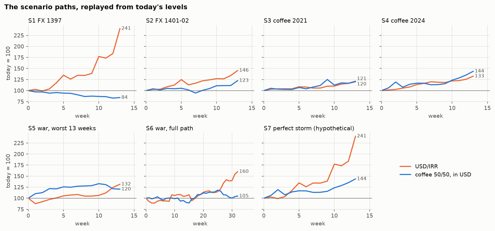
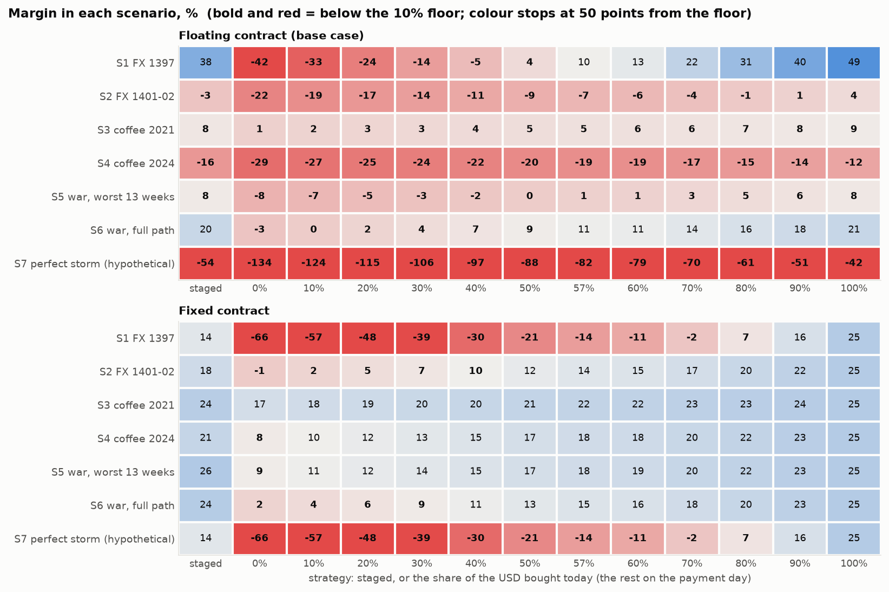
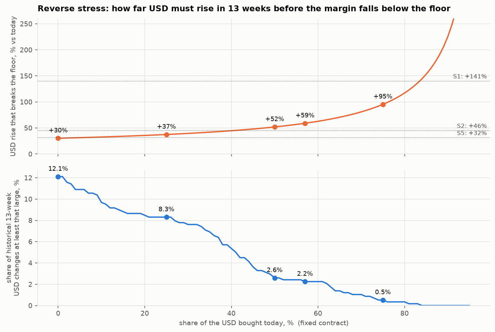

# گزارش مرحلهٔ D4 — سناریوهای تنش

تاریخ ساخت: ۱۴۰۵-۰۷-۲۱ (2026-10-13). همهٔ عددها، جدول‌ها و شکل‌ها را `scripts/d4_report.py` ساخته است. موقعیت امروز = حالت پایهٔ D3 در آخرین هفتهٔ پنل، ۱۴۰۵-۰۷-۱۵ (2026-10-07).

**این مرحله چه می‌کند.** چیزی شبیه‌سازی نمی‌شود. هر سناریو یک مسیر واقعی است که «از امروز» دوباره بازی می‌شود: بازده‌های هفتگیِ همان پنجرهٔ تاریخی (دلار؛ قهوه بدون روزهای رول، D-022) روی نرخ دلارِ امروز و قیمت قهوهٔ امروز سوار می‌شوند. نرخ تأمین مالی، پرمیوم و برنامه مالِ امروزند. هزینهٔ هر راهبرد با همان تابع‌های موتور D3 حساب می‌شود. در پایان یک تنش معکوس می‌آید: دلار چقدر باید بالا برود تا کف بشکند.

**قراردادها**

* **برنامه:** ۱۰۰٬۰۰۰ دلار با نرخ امروز (۲٬۶۵۹٬۰۰۰ ریال) و رشد خنثی تا هفتهٔ پرداخت (نرخ بازار ٪۳۸.۷ در سال). برای ۱۳ هفته: ۲۸۸.۶ میلیارد ریال.
* **حاشیهٔ سود** = ۱ − هزینه ÷ درآمد برنامه. برنامه ٪۲۵، کف ٪۱۰. علامت ✗ یعنی کف شکسته است. حاشیهٔ منفی یعنی زیان.
* **٪۵۷ امروز** همان «حداقل نسبت پوشش» حالت پایه با قرارداد ثابت است (گزارش D3).
* **قرارداد شناور** (پایه، D-036): فاکتور با قیمت قهوهٔ روز پرداخت بسته می‌شود. **قرارداد ثابت:** قیمت قهوه امروز بسته شده و مسیر قهوه اثری ندارد.
* همهٔ ورودی‌ها همان پیش‌فرض‌های موقت D3 هستند.

## نتیجه در چند خط

1. **صبر تا روز پرداخت در همهٔ ۷ سناریو کف را می‌شکند** (قرارداد شناور)؛ با قرارداد ثابت در ۶ سناریو از ۷ سناریو.
2. **قرارداد ثابت + خرید کاملِ امروز در هیچ سناریویی نمی‌شکند** (۰ از ۷): هزینه از پیش بسته شده است. این تنها ترکیبی است که از همهٔ هفت مسیر سالم بیرون می‌آید.
3. **قرارداد شناور + خرید کاملِ امروز در ۵ سناریو می‌شکند**: هر جا قهوه گران شده، دلارِ اضافه باید با نرخ جهش‌کرده خریده شود.
4. **حداقل پوشش ٪۵۷ برای تکرار ۱۳۹۷ کافی نیست.** با قرارداد ثابت در ۲ سناریو می‌شکند (S1، S7). این عدد برای «۹۵٪ حالت‌ها» ساخته شده، نه برای بدترین مسیر تاریخ.
5. **تنش معکوس:** با پوشش ٪۵۷ کف وقتی می‌شکند که دلار در ۱۳ هفته بیش از ٪۵۹ بالا برود. در ۵۷۸ پنجرهٔ تاریخی (از ۱۳۹۴-۰۳-۲۷) این در ٪۲.۲ موارد رخ داده است؛ بدون پوشش (٪۳۰) در ٪۱۲.۱ موارد.

## ۱. سناریوها

پنج پنجرهٔ ۱۳ هفته‌ای همان پنجره‌های بخش ۷ گزارش D2 هستند (D-027): در هر رویداد، ۱۳ هفته‌ای که هزینهٔ ریالی قهوهٔ ۵۰/۵۰ بیشترین رشد را داشت. درصدها ساده‌اند.

| سناریو | پنجره | هفته | دلار | عربیکا | روبوستا | قهوهٔ ۵۰/۵۰ (دلاری) | هزینهٔ ریالی ۵۰/۵۰ | برنامه (میلیارد ریال) |
| --- | --- | --- | --- | --- | --- | --- | --- | --- |
| S1 جهش ارز ۱۳۹۷ | ۱۳۹۷-۰۴-۰۶ تا ۱۳۹۷-۰۷-۰۴ | ۱۳ | ٪۱۴۱+ | ٪۲۳− | ٪۹− | ٪۱۶− | ٪۱۰۲+ | ۲۸۸.۶ |
| S2 جهش ارز ۱۴۰۱–۱۴۰۲ | ۱۴۰۱-۰۹-۰۲ تا ۱۴۰۱-۱۲-۰۳ | ۱۳ | ٪۴۶+ | ٪۲۲+ | ٪۲۳+ | ٪۲۳+ | ٪۷۸+ | ۲۸۸.۶ |
| S3 قهوه ۲۰۲۱ | ۱۴۰۰-۰۳-۰۵ تا ۱۴۰۰-۰۶-۰۳ | ۱۳ | ٪۲۰+ | ٪۱۱+ | ٪۳۱+ | ٪۲۱+ | ٪۴۵+ | ۲۸۸.۶ |
| S4 قهوه ۲۰۲۴ | ۱۴۰۳-۰۸-۲۳ تا ۱۴۰۳-۱۱-۲۴ | ۱۳ | ٪۳۳+ | ٪۶۴+ | ٪۲۴+ | ٪۴۴+ | ٪۹۱+ | ۲۸۸.۶ |
| S5 جنگ، بدترین ۱۳ هفته | ۱۴۰۵-۰۳-۲۰ تا ۱۴۰۵-۰۶-۱۸ | ۱۳ | ٪۳۲+ | ٪۳۵+ | ٪۶+ | ٪۲۰+ | ٪۵۹+ | ۲۸۸.۶ |
| S6 جنگ، کل مسیر | ۱۴۰۴-۱۲-۰۶ تا ۱۴۰۵-۰۷-۱۵ | ۳۲ | ٪۶۰+ | ٪۱۵+ | ٪۵− | ٪۵+ | ٪۶۸+ | ۳۲۵.۲ |
| S7 توفان کامل (فرضی) | دلار: ۱۳۹۷-۰۴-۰۶ تا ۱۳۹۷-۰۷-۰۴؛ قهوه: ۱۴۰۳-۰۸-۲۳ تا ۱۴۰۳-۱۱-۲۴ | ۱۳ | ٪۱۴۱+ | ٪۶۴+ | ٪۲۴+ | ٪۴۴+ | ٪۲۴۶+ | ۲۸۸.۶ |

* **S6** کل مسیر جنگ است، ۳۲ هفته: هفتهٔ پرداخت ۳۲، خرید سه‌پله‌ای در هفته‌های ۰، ۱۱، ۲۱، و برنامه با رشد خنثی تا هفتهٔ ۳۲ (برای همین برنامه‌اش بزرگ‌تر است).
* **S7 فرضی است:** مسیر دلارِ S1 با مسیر قهوهٔ S4. این دو هرگز با هم رخ نداده‌اند، و D2 دلار و قهوه را تقریباً مستقل یافت. برای دیدنِ بدترین ترکیب است، نه برای برآورد احتمال.
* نرخ تأمین مالی در همهٔ سناریوها نرخ بازارِ امروز است، نه سود صندوق در همان دوره.

*شکل ۱ — دلار (نارنجی) و سبد قهوهٔ ۵۰/۵۰ به دلار (آبی) در هر سناریو؛ امروز = ۱۰۰. عدد کنار هر خط سطح پایانی است.*

## ۲. قرارداد شناور (حالت پایه)

فاکتور با قیمت قهوهٔ روز پرداخت بسته می‌شود؛ هم دلار و هم قهوه اثر دارند. ستون آخرِ جدول سوم از همان جدول خوانده شده است (شبکهٔ ده‌درصدی): کوچک‌ترین سهمِ خرید امروز که در آن سناریو حاشیه را بالای کف نگه می‌داشت.

**هزینه (درصد برنامه) و حاشیهٔ سود، چهار راهبرد اصلی**

| سناریو | همه امروز: هزینه | حاشیه | سه‌پله‌ای: هزینه | حاشیه | همه روز پرداخت: هزینه | حاشیه | ٪۵۷ امروز: هزینه | حاشیه |
| --- | --- | --- | --- | --- | --- | --- | --- | --- |
| S1 جهش ارز ۱۳۹۷ | ٪۶۸ | ٪۴۹.۱ | ٪۸۳ | ٪۳۷.۶ | ٪۱۸۹ | ٪۴۱.۹− ✗ | ٪۱۲۰ | ٪۱۰.۱ |
| S2 جهش ارز ۱۴۰۱–۱۴۰۲ | ٪۱۲۸ | ٪۳.۹ ✗ | ٪۱۳۷ | ٪۲.۸− ✗ | ٪۱۶۲ | ٪۲۱.۷− ✗ | ٪۱۴۳ | ٪۷.۱− ✗ |
| S3 قهوه ۲۰۲۱ | ٪۱۲۲ | ٪۸.۸ ✗ | ٪۱۲۳ | ٪۷.۵ ✗ | ٪۱۳۲ | ٪۱.۰ ✗ | ٪۱۲۶ | ٪۵.۵ ✗ |
| S4 قهوه ۲۰۲۴ | ٪۱۴۹ | ٪۱۲.۱− ✗ | ٪۱۵۵ | ٪۱۶.۴− ✗ | ٪۱۷۲ | ٪۲۸.۸− ✗ | ٪۱۵۹ | ٪۱۹.۳− ✗ |
| S5 جنگ، بدترین ۱۳ هفته | ٪۱۲۳ | ٪۷.۷ ✗ | ٪۱۲۲ | ٪۸.۴ ✗ | ٪۱۴۴ | ٪۸.۳− ✗ | ٪۱۳۲ | ٪۰.۸ ✗ |
| S6 جنگ، کل مسیر | ٪۱۰۶ | ٪۲۰.۵ | ٪۱۰۷ | ٪۲۰.۰ | ٪۱۳۷ | ٪۲.۷− ✗ | ٪۱۱۹ | ٪۱۰.۵ |
| S7 توفان کامل (فرضی) | ٪۱۹۰ | ٪۴۲.۳− ✗ | ٪۲۰۵ | ٪۵۳.۸− ✗ | ٪۳۱۱ | ٪۱۳۳.۵− ✗ | ٪۲۴۲ | ٪۸۱.۵− ✗ |

**همان هزینه‌ها به میلیارد ریال**

| سناریو | برنامه | همه امروز | سه‌پله‌ای | همه روز پرداخت | ٪۵۷ امروز |
| --- | --- | --- | --- | --- | --- |
| S1 جهش ارز ۱۳۹۷ | ۲۸۸.۶ | ۱۹۵.۸ | ۲۳۹.۹ | ۵۴۵.۸ | ۳۴۵.۸ |
| S2 جهش ارز ۱۴۰۱–۱۴۰۲ | ۲۸۸.۶ | ۳۶۹.۸ | ۳۹۵.۷ | ۴۶۸.۲ | ۴۱۲.۱ |
| S3 قهوه ۲۰۲۱ | ۲۸۸.۶ | ۳۵۰.۸ | ۳۵۵.۸ | ۳۸۱.۰ | ۳۶۳.۸ |
| S4 قهوه ۲۰۲۴ | ۲۸۸.۶ | ۴۳۱.۴ | ۴۴۷.۹ | ۴۹۵.۵ | ۴۵۸.۹ |
| S5 جنگ، بدترین ۱۳ هفته | ۲۸۸.۶ | ۳۵۵.۰ | ۳۵۲.۴ | ۴۱۶.۷ | ۳۸۱.۵ |
| S6 جنگ، کل مسیر | ۳۲۵.۲ | ۳۴۴.۶ | ۳۴۶.۹ | ۴۴۵.۴ | ۳۸۷.۹ |
| S7 توفان کامل (فرضی) | ۲۸۸.۶ | ۵۴۷.۶ | ۵۹۱.۷ | ۸۹۸.۵ | ۶۹۸.۵ |

**حاشیهٔ سود برای هر سهمِ خرید امروز** (بقیه روز پرداخت)

| سناریو | ٪۰ | ٪۱۰ | ٪۲۰ | ٪۳۰ | ٪۴۰ | ٪۵۰ | ٪۶۰ | ٪۷۰ | ٪۸۰ | ٪۹۰ | ٪۱۰۰ | کمترین سهمی که کف را نگه می‌دارد |
| --- | --- | --- | --- | --- | --- | --- | --- | --- | --- | --- | --- | --- |
| S1 جهش ارز ۱۳۹۷ | ٪۴۲− ✗ | ٪۳۳− ✗ | ٪۲۴− ✗ | ٪۱۴− ✗ | ٪۵− ✗ | ٪۴ ✗ | ٪۱۳ | ٪۲۲ | ٪۳۱ | ٪۴۰ | ٪۴۹ | ٪۶۰ |
| S2 جهش ارز ۱۴۰۱–۱۴۰۲ | ٪۲۲− ✗ | ٪۱۹− ✗ | ٪۱۷− ✗ | ٪۱۴− ✗ | ٪۱۱− ✗ | ٪۹− ✗ | ٪۶− ✗ | ٪۴− ✗ | ٪۱− ✗ | ٪۱ ✗ | ٪۴ ✗ | هیچ |
| S3 قهوه ۲۰۲۱ | ٪۱ ✗ | ٪۲ ✗ | ٪۳ ✗ | ٪۳ ✗ | ٪۴ ✗ | ٪۵ ✗ | ٪۶ ✗ | ٪۶ ✗ | ٪۷ ✗ | ٪۸ ✗ | ٪۹ ✗ | هیچ |
| S4 قهوه ۲۰۲۴ | ٪۲۹− ✗ | ٪۲۷− ✗ | ٪۲۵− ✗ | ٪۲۴− ✗ | ٪۲۲− ✗ | ٪۲۰− ✗ | ٪۱۹− ✗ | ٪۱۷− ✗ | ٪۱۵− ✗ | ٪۱۴− ✗ | ٪۱۲− ✗ | هیچ |
| S5 جنگ، بدترین ۱۳ هفته | ٪۸− ✗ | ٪۷− ✗ | ٪۵− ✗ | ٪۳− ✗ | ٪۲− ✗ | ٪۰ ✗ | ٪۱ ✗ | ٪۳ ✗ | ٪۵ ✗ | ٪۶ ✗ | ٪۸ ✗ | هیچ |
| S6 جنگ، کل مسیر | ٪۳− ✗ | ٪۰ ✗ | ٪۲ ✗ | ٪۴ ✗ | ٪۷ ✗ | ٪۹ ✗ | ٪۱۱ | ٪۱۴ | ٪۱۶ | ٪۱۸ | ٪۲۱ | ٪۶۰ |
| S7 توفان کامل (فرضی) | ٪۱۳۴− ✗ | ٪۱۲۴− ✗ | ٪۱۱۵− ✗ | ٪۱۰۶− ✗ | ٪۹۷− ✗ | ٪۸۸− ✗ | ٪۷۹− ✗ | ٪۷۰− ✗ | ٪۶۱− ✗ | ٪۵۱− ✗ | ٪۴۲− ✗ | هیچ |

* **S1 (۱۳۹۷):** خرید کاملِ امروز حاشیه را به ٪۴۹ می‌رساند، بالاتر از برنامه. دلیل: قهوه ٪۱۶− ارزان شد، پس دلارِ کمتری لازم بود و دلارِ اضافه با نرخ جهش‌کرده فروخته شد. این سودِ بادآورده به فرضِ «بازفروش با نرخ بازار» بسته است (تصمیم ۷-۱).
* **S4 (قهوه ۲۰۲۴):** حتی خرید کاملِ امروز زیان می‌دهد (٪۱۲−): قهوه ٪۴۴+ گران شد و دلارِ اضافه با نرخ ٪۳۳+ بالاتر خریده شد. زمان خرید ارز جلوی این را نمی‌گیرد.
* در ۵ سناریو از ۷ سناریو هیچ سهمی کف را نگه نمی‌دارد.

## ۳. قرارداد ثابت

قیمت قهوه امروز بسته شده است؛ فقط مسیر دلار اثر دارد. برای همین S7 با S1 یکی است. ستون آخرِ جدول سوم از همان جدول خوانده شده است (شبکهٔ ده‌درصدی): کوچک‌ترین سهمِ خرید امروز که در آن سناریو حاشیه را بالای کف نگه می‌داشت.

**هزینه (درصد برنامه) و حاشیهٔ سود، چهار راهبرد اصلی**

| سناریو | همه امروز: هزینه | حاشیه | سه‌پله‌ای: هزینه | حاشیه | همه روز پرداخت: هزینه | حاشیه | ٪۵۷ امروز: هزینه | حاشیه |
| --- | --- | --- | --- | --- | --- | --- | --- | --- |
| S1 جهش ارز ۱۳۹۷ | ٪۱۰۰ | ٪۲۵.۰ | ٪۱۱۵ | ٪۱۳.۵ | ٪۲۲۲ | ٪۶۶.۲− ✗ | ٪۱۵۲ | ٪۱۴.۲− ✗ |
| S2 جهش ارز ۱۴۰۱–۱۴۰۲ | ٪۱۰۰ | ٪۲۵.۰ | ٪۱۰۹ | ٪۱۸.۳ | ٪۱۳۴ | ٪۰.۶− ✗ | ٪۱۱۵ | ٪۱۴.۰ |
| S3 قهوه ۲۰۲۱ | ٪۱۰۰ | ٪۲۵.۰ | ٪۱۰۲ | ٪۲۳.۷ | ٪۱۱۰ | ٪۱۷.۲ | ٪۱۰۴ | ٪۲۱.۶ |
| S4 قهوه ۲۰۲۴ | ٪۱۰۰ | ٪۲۵.۰ | ٪۱۰۶ | ٪۲۰.۷ | ٪۱۲۲ | ٪۸.۳ ✗ | ٪۱۱۰ | ٪۱۷.۸ |
| S5 جنگ، بدترین ۱۳ هفته | ٪۱۰۰ | ٪۲۵.۰ | ٪۹۹ | ٪۲۵.۷ | ٪۱۲۱ | ٪۹.۰ ✗ | ٪۱۰۹ | ٪۱۸.۱ |
| S6 جنگ، کل مسیر | ٪۱۰۰ | ٪۲۵.۰ | ٪۱۰۱ | ٪۲۴.۵ | ٪۱۳۱ | ٪۱.۷ ✗ | ٪۱۱۳ | ٪۱۵.۰ |
| S7 توفان کامل (فرضی) | ٪۱۰۰ | ٪۲۵.۰ | ٪۱۱۵ | ٪۱۳.۵ | ٪۲۲۲ | ٪۶۶.۲− ✗ | ٪۱۵۲ | ٪۱۴.۲− ✗ |

**همان هزینه‌ها به میلیارد ریال**

| سناریو | برنامه | همه امروز | سه‌پله‌ای | همه روز پرداخت | ٪۵۷ امروز |
| --- | --- | --- | --- | --- | --- |
| S1 جهش ارز ۱۳۹۷ | ۲۸۸.۶ | ۲۸۸.۶ | ۳۳۲.۷ | ۶۳۹.۵ | ۴۳۹.۵ |
| S2 جهش ارز ۱۴۰۱–۱۴۰۲ | ۲۸۸.۶ | ۲۸۸.۶ | ۳۱۴.۵ | ۳۸۷.۰ | ۳۳۰.۹ |
| S3 قهوه ۲۰۲۱ | ۲۸۸.۶ | ۲۸۸.۶ | ۲۹۳.۶ | ۳۱۸.۷ | ۳۰۱.۵ |
| S4 قهوه ۲۰۲۴ | ۲۸۸.۶ | ۲۸۸.۶ | ۳۰۵.۱ | ۳۵۲.۶ | ۳۱۶.۱ |
| S5 جنگ، بدترین ۱۳ هفته | ۲۸۸.۶ | ۲۸۸.۶ | ۲۸۶.۰ | ۳۵۰.۲ | ۳۱۵.۱ |
| S6 جنگ، کل مسیر | ۳۲۵.۲ | ۳۲۵.۲ | ۳۲۷.۶ | ۴۲۶.۰ | ۳۶۸.۶ |
| S7 توفان کامل (فرضی) | ۲۸۸.۶ | ۲۸۸.۶ | ۳۳۲.۷ | ۶۳۹.۵ | ۴۳۹.۵ |

**حاشیهٔ سود برای هر سهمِ خرید امروز** (بقیه روز پرداخت)

| سناریو | ٪۰ | ٪۱۰ | ٪۲۰ | ٪۳۰ | ٪۴۰ | ٪۵۰ | ٪۶۰ | ٪۷۰ | ٪۸۰ | ٪۹۰ | ٪۱۰۰ | کمترین سهمی که کف را نگه می‌دارد |
| --- | --- | --- | --- | --- | --- | --- | --- | --- | --- | --- | --- | --- |
| S1 جهش ارز ۱۳۹۷ | ٪۶۶− ✗ | ٪۵۷− ✗ | ٪۴۸− ✗ | ٪۳۹− ✗ | ٪۳۰− ✗ | ٪۲۱− ✗ | ٪۱۱− ✗ | ٪۲− ✗ | ٪۷ ✗ | ٪۱۶ | ٪۲۵ | ٪۹۰ |
| S2 جهش ارز ۱۴۰۱–۱۴۰۲ | ٪۱− ✗ | ٪۲ ✗ | ٪۵ ✗ | ٪۷ ✗ | ٪۱۰ ✗ | ٪۱۲ | ٪۱۵ | ٪۱۷ | ٪۲۰ | ٪۲۲ | ٪۲۵ | ٪۵۰ |
| S3 قهوه ۲۰۲۱ | ٪۱۷ | ٪۱۸ | ٪۱۹ | ٪۲۰ | ٪۲۰ | ٪۲۱ | ٪۲۲ | ٪۲۳ | ٪۲۳ | ٪۲۴ | ٪۲۵ | ٪۰ |
| S4 قهوه ۲۰۲۴ | ٪۸ ✗ | ٪۱۰ | ٪۱۲ | ٪۱۳ | ٪۱۵ | ٪۱۷ | ٪۱۸ | ٪۲۰ | ٪۲۲ | ٪۲۳ | ٪۲۵ | ٪۱۰ |
| S5 جنگ، بدترین ۱۳ هفته | ٪۹ ✗ | ٪۱۱ | ٪۱۲ | ٪۱۴ | ٪۱۵ | ٪۱۷ | ٪۱۹ | ٪۲۰ | ٪۲۲ | ٪۲۳ | ٪۲۵ | ٪۱۰ |
| S6 جنگ، کل مسیر | ٪۲ ✗ | ٪۴ ✗ | ٪۶ ✗ | ٪۹ ✗ | ٪۱۱ | ٪۱۳ | ٪۱۶ | ٪۱۸ | ٪۲۰ | ٪۲۳ | ٪۲۵ | ٪۴۰ |
| S7 توفان کامل (فرضی) | ٪۶۶− ✗ | ٪۵۷− ✗ | ٪۴۸− ✗ | ٪۳۹− ✗ | ٪۳۰− ✗ | ٪۲۱− ✗ | ٪۱۱− ✗ | ٪۲− ✗ | ٪۷ ✗ | ٪۱۶ | ٪۲۵ | ٪۹۰ |

* خرید کاملِ امروز در همهٔ سناریوها دقیقاً حاشیهٔ برنامه را می‌دهد: نرخ تأمین مالی برابر نرخ بازار است و هیچ چیزِ دیگری باز نمانده.
* با پوشش ٪۵۷: در S1 حاشیه ٪۱۴− می‌شود؛ در بقیهٔ مسیرهای واقعی بالای کف می‌ماند (کمترین: ٪۱۴).
* **S6:** در مسیر ۳۲ هفته‌ای جنگ، خرید سه‌پله‌ای (٪۲۴) تقریباً به خوبیِ خرید کاملِ امروز بود و صبر تا پایان (٪۲) کف را شکست.

*شکل ۲ — حاشیهٔ سود (درصد) در هر سناریو و هر راهبرد. بالا: قرارداد شناور؛ پایین: قرارداد ثابت. آبی: بالای کف ٪۱۰؛ قرمز و پررنگ: زیر کف؛ خاکستری: نزدیک کف. رنگ در ۵۰ واحد فاصله از کف ثابت می‌ماند؛ عددِ داخل هر خانه مقدار واقعی است.*

## ۴. قرارداد شناور با انتقال ۰.۵ِ «فقط بالا»

همان حالت پایه، با این تفاوت که نیمی از جهشِ نامنتظر دلار به قیمت فروش می‌رسد و اُفت دلار منتقل نمی‌شود (D-043، D-044). درآمد دیگر ثابت نیست؛ هزینه‌ها همان هزینه‌های بخش ۲ هستند.

| سناریو | همه امروز: حاشیه | سه‌پله‌ای: حاشیه | همه روز پرداخت: حاشیه | ٪۵۷ امروز: حاشیه | روز پرداخت، بدون انتقال |
| --- | --- | --- | --- | --- | --- |
| S1 جهش ارز ۱۳۹۷ | ٪۶۸.۴ | ٪۶۱.۲ | ٪۱۱.۸ | ٪۴۴.۱ | ٪۴۱.۹− |
| S2 جهش ارز ۱۴۰۱–۱۴۰۲ | ٪۱۷.۹ | ٪۱۲.۱ | ٪۴.۰− ✗ | ٪۸.۵ ✗ | ٪۲۱.۷− |
| S3 قهوه ۲۰۲۱ | ٪۱۳.۴ | ٪۱۲.۱ | ٪۵.۹ ✗ | ٪۱۰.۱ | ٪۱.۰ |
| S4 قهوه ۲۰۲۴ | ٪۰.۹− ✗ | ٪۴.۸− ✗ | ٪۱۵.۹− ✗ | ٪۷.۴− ✗ | ٪۲۸.۸− |
| S5 جنگ، بدترین ۱۳ هفته | ٪۱۶.۶ | ٪۱۷.۲ | ٪۲.۲ ✗ | ٪۱۰.۴ | ٪۸.۳− |
| S6 جنگ، کل مسیر | ٪۳۱.۲ | ٪۳۰.۷ | ٪۱۱.۱ | ٪۲۲.۵ | ٪۲.۷− |
| S7 توفان کامل (فرضی) | ٪۱۱.۵ | ٪۴.۴ ✗ | ٪۴۵.۲− ✗ | ٪۱۲.۹− ✗ | ٪۱۳۳.۵− |

**حاشیهٔ سود برای هر سهمِ خرید امروز**

| سناریو | ٪۰ | ٪۱۰ | ٪۲۰ | ٪۳۰ | ٪۴۰ | ٪۵۰ | ٪۶۰ | ٪۷۰ | ٪۸۰ | ٪۹۰ | ٪۱۰۰ | کمترین سهمی که کف را نگه می‌دارد |
| --- | --- | --- | --- | --- | --- | --- | --- | --- | --- | --- | --- | --- |
| S1 جهش ارز ۱۳۹۷ | ٪۱۲ | ٪۱۷ | ٪۲۳ | ٪۲۹ | ٪۳۴ | ٪۴۰ | ٪۴۶ | ٪۵۱ | ٪۵۷ | ٪۶۳ | ٪۶۸ | ٪۰ |
| S2 جهش ارز ۱۴۰۱–۱۴۰۲ | ٪۴− ✗ | ٪۲− ✗ | ٪۰ ✗ | ٪۳ ✗ | ٪۵ ✗ | ٪۷ ✗ | ٪۹ ✗ | ٪۱۱ | ٪۱۴ | ٪۱۶ | ٪۱۸ | ٪۷۰ |
| S3 قهوه ۲۰۲۱ | ٪۶ ✗ | ٪۷ ✗ | ٪۷ ✗ | ٪۸ ✗ | ٪۹ ✗ | ٪۱۰ ✗ | ٪۱۰ | ٪۱۱ | ٪۱۲ | ٪۱۳ | ٪۱۳ | ٪۶۰ |
| S4 قهوه ۲۰۲۴ | ٪۱۶− ✗ | ٪۱۴− ✗ | ٪۱۳− ✗ | ٪۱۱− ✗ | ٪۱۰− ✗ | ٪۸− ✗ | ٪۷− ✗ | ٪۵− ✗ | ٪۴− ✗ | ٪۲− ✗ | ٪۱− ✗ | هیچ |
| S5 جنگ، بدترین ۱۳ هفته | ٪۲ ✗ | ٪۴ ✗ | ٪۵ ✗ | ٪۷ ✗ | ٪۸ ✗ | ٪۹ ✗ | ٪۱۱ | ٪۱۲ | ٪۱۴ | ٪۱۵ | ٪۱۷ | ٪۶۰ |
| S6 جنگ، کل مسیر | ٪۱۱ | ٪۱۳ | ٪۱۵ | ٪۱۷ | ٪۱۹ | ٪۲۱ | ٪۲۳ | ٪۲۵ | ٪۲۷ | ٪۲۹ | ٪۳۱ | ٪۰ |
| S7 توفان کامل (فرضی) | ٪۴۵− ✗ | ٪۴۰− ✗ | ٪۳۴− ✗ | ٪۲۸− ✗ | ٪۲۳− ✗ | ٪۱۷− ✗ | ٪۱۱− ✗ | ٪۶− ✗ | ٪۰ ✗ | ٪۶ ✗ | ٪۱۲ | ٪۱۰۰ |

* انتقال، ضربهٔ جهش دلار را نرم می‌کند ولی برنمی‌دارد: «همه روز پرداخت» هنوز در ۵ سناریو می‌شکند (بدون انتقال: ۷). «همه امروز» در ۱ سناریو می‌شکند (بدون انتقال: ۵).
* انتقال به ریسک قهوه کمکی نمی‌کند: درآمد با دلار بالا می‌رود، نه با قیمت جهانی قهوه.

## ۵. تنش معکوس

پرسش وارونه: با قرارداد ثابت، قهوهٔ بی‌تغییر و بدون اصطکاک، دلار تا هفتهٔ پرداخت چقدر باید بالا برود تا حاشیهٔ سود زیر کف بیفتد؟

**فرمول.** سهم h امروز خریده می‌شود و بقیه روز پرداخت. به واحدِ «مبلغ × نرخ امروز»: هزینه = h·F + (۱ − h)·x که x نسبتِ نرخ روز پرداخت به نرخ امروز است و F رشد پولِ خرید زودهنگام تا روز پرداخت. هزینهٔ مجاز = (۱ − کف) ÷ (۱ − حاشیهٔ برنامه) × g، که g رشد مورد انتظار دلار است. پس کف وقتی می‌شکند که

> x > (هزینهٔ مجاز − h·F) ÷ (۱ − h)

با ورودی‌های پایه (حاشیهٔ برنامه ٪۲۵، کف ٪۱۰، نرخ تأمین مالی برابر نرخ بازار، پس F = g = ۱.۰۸۵۲): دلار باید ۰.۲ ÷ (۱ − h) بالاتر از سطح مورد انتظارش تمام شود.

| سهم خرید امروز | رشدِ شکننده، بالاتر از انتظار | رشدِ شکننده نسبت به امروز | نرخ دلارِ شکننده | سهم پنجره‌های تاریخی با رشدِ دست‌کم همین‌قدر | تعداد پنجره |
| --- | --- | --- | --- | --- | --- |
| ٪۰ | ٪۲۰+ | ٪۳۰+ | ۳٬۴۶۲٬۸۱۴ ریال | ٪۱۲.۱ | ۷۰ |
| ٪۲۵ | ٪۲۷+ | ٪۳۷+ | ۳٬۶۵۵٬۱۹۲ ریال | ٪۸.۳ | ۴۸ |
| ٪۵۰ | ٪۴۰+ | ٪۵۲+ | ۴٬۰۳۹٬۹۵۰ ریال | ٪۲.۶ | ۱۵ |
| ٪۵۷ | ٪۴۷+ | ٪۵۹+ | ۴٬۲۲۷٬۸۵۴ ریال | ٪۲.۲ | ۱۳ |
| ٪۷۵ | ٪۸۰+ | ٪۹۵+ | ۵٬۱۹۴٬۲۲۱ ریال | ٪۰.۵ | ۳ |
| ٪۱۰۰ | هیچ‌وقت | هیچ‌وقت | — | ٪۰.۰ | ۰ |

* **نمونهٔ تاریخی:** همهٔ پنجره‌های ۱۳ هفته‌ایِ دلار با شروع هفتگی از ۱۳۹۴-۰۳-۲۷ (2015-06-17) (D-041) که پایانشان معلوم است: ۵۷۸ پنجرهٔ هم‌پوشان، برابر با ۴۵ پنجرهٔ مستقل. سهم‌ها را باید با همین عددِ کوچک خواند.
* **بزرگ‌ترین رشد ۱۳ هفته‌ای:** ٪۱۴۱+، از ۱۳۹۷-۰۴-۰۶ (2018-06-27) تا ۱۳۹۷-۰۷-۰۴ (2018-09-26). فقط پوشش بالای ٪۸۴ از آن جان به در می‌بُرد.
* با خرید کاملِ امروز هیچ سطحی از دلار کف را نمی‌شکند: هزینه بسته شده است.

*شکل ۳ — بالا: رشدی از دلار (نسبت به امروز، در ۱۳ هفته) که کف را می‌شکند، برای هر سهمِ خرید امروز. خط‌چین‌ها رشد دلار در S1، S2 و S5 هستند: هر جا منحنی زیر خط‌چین باشد، آن سناریو کف را می‌شکند. پایین: سهم پنجره‌های تاریخی که دلار دست‌کم همین‌قدر بالا رفت.*

## ۶. به زبان ساده

**در چند سناریو از هفت سناریو کف می‌شکند**

| راهبرد | قرارداد شناور | شناور با انتقال ۰.۵ِ فقط بالا | قرارداد ثابت |
| --- | --- | --- | --- |
| همه امروز | ۵ | ۱ | ۰ |
| سه‌پله‌ای | ۵ | ۲ | ۰ |
| همه روز پرداخت | ۷ | ۵ | ۶ |
| ٪۵۷ امروز | ۵ | ۳ | ۲ |

1. **صبر کردن بدترین انتخاب است.** خرید در روز پرداخت با قرارداد شناور در همهٔ ۷ سناریو و با قرارداد ثابت در ۶ سناریو از ۷ سناریو کف را می‌شکند. تعجبی ندارد: این پنجره‌ها برای بیشترین رشد هزینه انتخاب شده‌اند.
2. **دو اهرم با هم کار می‌کنند، نه جدا.** خرید کاملِ امروز جلوی دلار را می‌گیرد ولی جلوی قهوه را نه؛ قرارداد ثابت جلوی قهوه را می‌گیرد ولی جلوی دلار را نه. فقط هر دو با هم از همهٔ سناریوها سالم بیرون می‌آیند.
3. **«حداقل پوشش» بیمهٔ بحران نیست.** ٪۵۷ یعنی در ۹۵٪ مسیرهای شبیه‌سازی‌شده کف می‌ماند. برای جهشی مثل ۱۳۹۷ (٪۱۴۱+ در ۱۳ هفته) پوششی نزدیک به کامل لازم است.
4. **سناریوها احتمال ندارند.** این‌ها بدترین پنجره‌های ۱۴ سال‌اند، از امروز بازی‌شده. می‌گویند اگر تاریخ تکرار شود چه می‌شود، نه اینکه چقدر محتمل است؛ احتمال را بخش ۵ و بک‌تست D5 می‌دهند.

## ۷. تصمیم‌های لازم

**۷-۱. بازفروش دلارِ اضافه در بحران**
* دیده شد: در S1 با قرارداد شناور، خرید کاملِ امروز حاشیهٔ ٪۴۹ می‌دهد (برنامه ٪۲۵). بیشترِ این از فروش دلارِ اضافه با نرخ بازار آزاد (منهای ٪۱) می‌آید، وقتی قهوه ارزان شده و دلار ٪۱۴۱+ بالا رفته است. موتور این را سودِ واقعی حساب می‌کند.
* گزینه‌ها: (الف) همین بماند (قاعدهٔ D3)؛ (ب) دلارِ اضافه حداکثر به قیمت خریدش ارزش‌گذاری شود، تا راهبردها از سفته‌بازیِ ناخواسته سود نبرند؛ (ج) اختلاف بازفروش در بحران بزرگ‌تر گرفته شود.
* پیشنهاد: **(الف)**، با یک جمله در یادداشت: حاشیهٔ بالاتر از برنامه در S1 سودِ نگه‌داشتن دلار است، نه هدف راهبرد. پیش‌فرض موقت: (الف).

**۷-۲. نرخ تأمین مالی در سناریوها**
* دیده شد: طبق اسپک، همهٔ سناریوها با نرخ بازارِ امروز (٪۳۸.۷) قیمت‌گذاری شده‌اند، نه با سود صندوق در همان دوره. برای همین «قرارداد ثابت + همه امروز» در همهٔ سناریوها دقیقاً حاشیهٔ برنامه را می‌دهد.
* گزینه‌ها: (الف) همین (سناریو فقط قیمت‌ها را جابه‌جا می‌کند)؛ (ب) سود صندوق در همان پنجره هم بازی شود.
* پیشنهاد: **(الف)**. بک‌تست D5 سود واقعی صندوق را به کار می‌برد و این پرسش را آنجا جواب می‌دهد.

