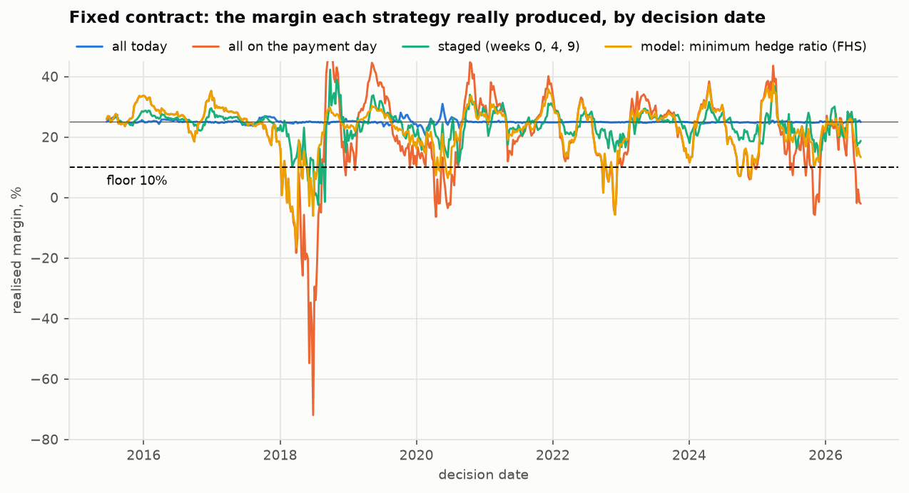
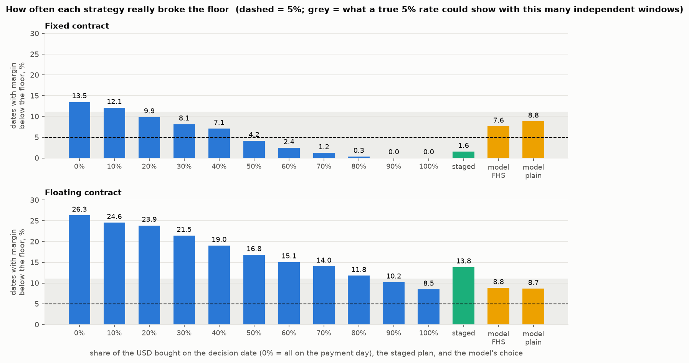
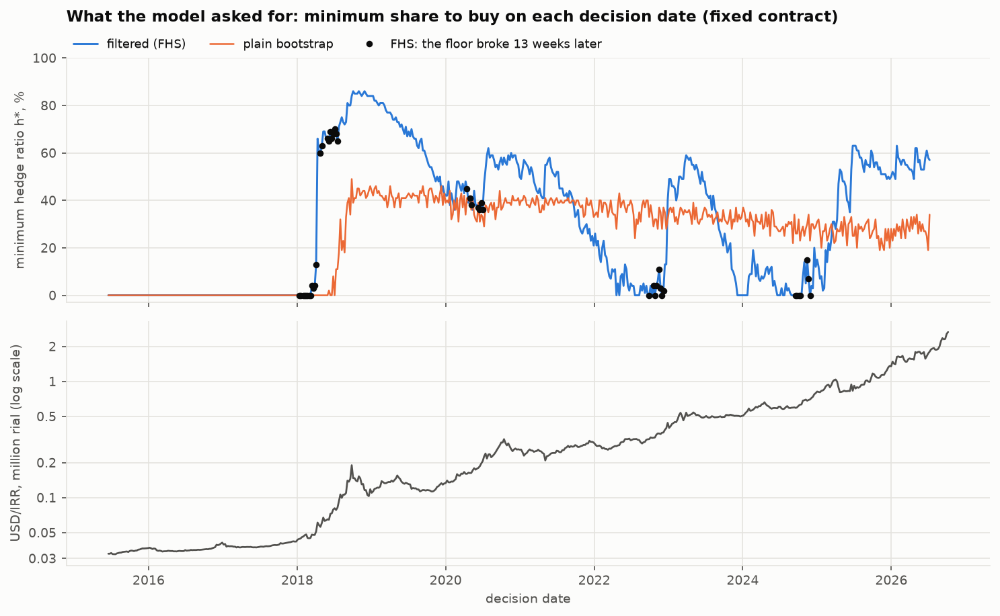
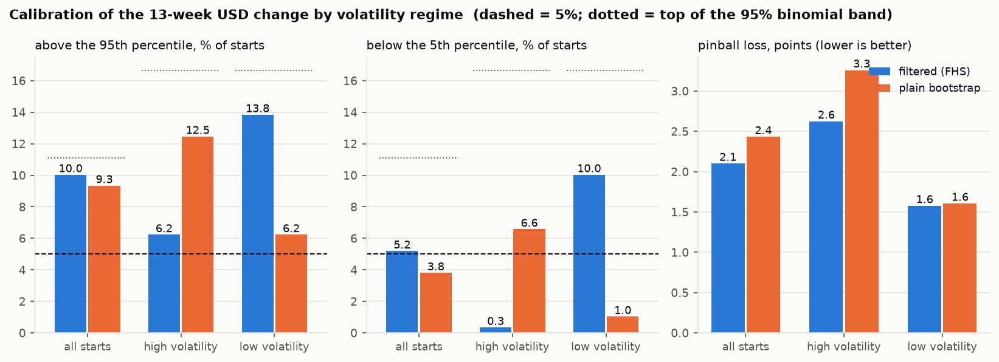
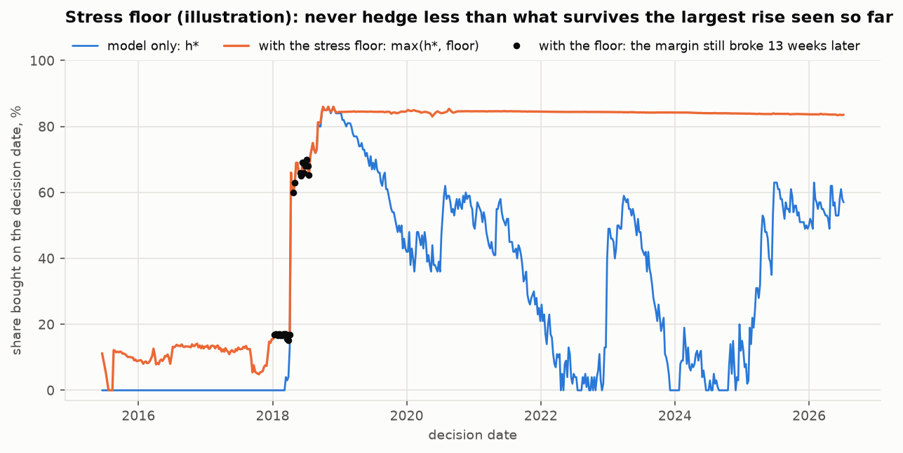

# گزارش مرحلهٔ D5 — بک‌تست

تاریخ ساخت: ۱۴۰۵-۰۷-۲۱ (2026-10-13). همهٔ عددها، جدول‌ها و شکل‌ها را `scripts/d5_report.py` ساخته است: هر تاریخ تصمیم ۲٬۰۰۰ مسیر، بذر ثابت برای هر تاریخ (`20261013` + شمارهٔ هفته).

## آنچه در D5b عوض شد

این گزارش پس از بازبینی D4 و D5 دوباره ساخته شده است. سه تغییر؛ عددهای بخش‌های ۱ تا ۴ همان‌اند که بودند (همان بذرها).

1. **بخش تازه «D5b. کفِ تنش»** (پیش از بخش ۵)، با شکل ۵: نمایشِ قاعدهٔ D-051 روی همین بک‌تست. این فکر پس از دیدن نتیجه‌های D5 آمد؛ پس آن بخش نمایش است، نه شاهدِ بیرون از نمونه.
2. **بخش ۵ حالا «تصمیم‌ها» است:** تصمیم‌های بازبینی (D-048 تا D-051) کنار هر بند آمده‌اند. تصمیم‌های D4 (D-046، D-047) در `DECISIONS.md` ثبت شده‌اند.
3. **افزوده پس از بازبینی D5b: جدول «حساسیت به سناریوی کف»** در بخش D5b، با دو ردیف برای کفِ S2، و تصمیم D-053 در بخش ۵. بقیهٔ بخش D5b همان است.

**دو پرسش، هر دو روی تاریخ واقعی و فقط با دادهٔ گذشته.** (۱) اگر بنگاه از ۱۳۹۴ هر هفته یکی از راهبردهای ساده را دنبال کرده بود، حاشیهٔ سود چند بار زیر کف می‌رفت و به چه هزینه‌ای؟ (۲) وعدهٔ مدل درست بود؟ وقتی گفت «حداکثر ۵٪ ریسک»، ریسکِ واقعی نزدیک ۵٪ بود؟

**قراردادها**

* **تاریخ تصمیم:** هر چهارشنبه از ۱۳۹۴-۰۳-۲۷ (2015-06-17) (D-041) تا ۱۴۰۵-۰۴-۱۷ (2026-07-08)، آخرین هفته‌ای که نتیجهٔ ۱۳ هفته‌اش معلوم است. ۵۷۸ تاریخ؛ ۵۷۸ قابل‌استفاده (کنار گذاشته: ۰).
* **پنجرهٔ مستقل:** تاریخ‌های هفتگی ۱۲ هفتهٔ مشترک با همسایه دارند. ۵۷۸ تاریخ برابر با ۴۵ پنجرهٔ بدون هم‌پوشانی است؛ کنار هر نرخ همین عدد آمده است.
* **دامنهٔ دوجمله‌ای:** اگر نرخِ واقعی ۵٪ باشد، با ۴۵ پنجرهٔ مستقل نرخِ مشاهده‌شده با احتمال ۹۵٪ بین ٪۰.۰ تا ٪۱۱.۱ می‌افتد (تقریب). نرخی داخل این دامنه با «۵٪» سازگار است.
* **ورودی‌های هر تاریخ، همان روز:** نرخ دلار، نرخ بازار (بازده ۱۳ هفتهٔ اخیر صندوق)، پرمیوم با تأخیر انتشار IMF. برنامه با رانش خنثی. انتقال صفر، نااطمینانی فروش خاموش، حاشیهٔ برنامه ٪۲۵، کف ٪۱۰. همه پیش‌فرض‌های موقت D3.
* **هزینهٔ واقعی:** نرخ‌های واقعی دلار در هفته‌های خرید؛ قهوه از جمع بازده‌های هفتگیِ بدون رول (D-022)؛ هزینهٔ پولِ خرید زودهنگام = رشد واقعی صندوق از هفتهٔ خرید تا هفتهٔ پرداخت. با همان تابع هزینهٔ موتور حساب شده است. هزینه‌ها درصدی از هزینهٔ برنامهٔ همان تاریخ‌اند.
* در ۱۶ تاریخ، یکی از هفته‌های خرید یا پرداخت روی تعطیلی بازار افتاده و آخرین سطحِ منتشرشدهٔ صندوق (بیش از ۵ روز پیش) به کار رفته است. این تاریخ‌ها حذف نشده‌اند.

## خلاصه به زبان ساده

**چه می‌شد**

1. **با قرارداد ثابت، خرید کاملِ دلار در روز تصمیم هیچ‌وقت کف را نشکست** (٪۰.۰ از ۵۷۸ هفته). صبر تا روز پرداخت در ٪۱۳.۵ هفته‌ها کف را شکست، با بدترین حاشیهٔ ٪۷۲−. خرید سه‌پله‌ای: ٪۱.۶.
2. **زود خریدن به‌طور میانگین ارزان‌تر هم بود:** میانگین هزینه ٪۱۰۰.۰ برنامه برای «همه امروز» در برابر ٪۱۰۵.۱ برای «همه روز پرداخت». ولی میانه‌ها نزدیک‌اند (٪۱۰۰.۱ و ٪۱۰۰.۹) و هر کدام تقریباً در نیمی از هفته‌ها ارزان‌تر بود (٪۴۴ و ٪۴۳): فاصلهٔ میانگین را چند جهش بزرگ ساخته است.
3. **با قرارداد شناور هیچ راهبردی امن نبود:** «همه امروز» در ٪۸.۵ هفته‌ها کف را شکست و «همه روز پرداخت» در ٪۲۶.۳. این همان یافتهٔ D3 است، این بار روی تاریخ واقعی.

**می‌شود به مدل اعتماد کرد؟**

4. **تا حدی.** اگر بنگاه هر هفته همان «حداقل نسبت پوشش» مدل را می‌خرید (قرارداد ثابت، روش فیلترشده)، کف در ٪۷.۶ هفته‌ها می‌شکست. وعده ۵٪ بود. با ۴۵ پنجرهٔ مستقل این هنوز داخلِ دامنهٔ ٪۰.۰ تا ٪۱۱.۱ است، ولی در سمت بدِ آن. بوت‌استرپ ساده: ٪۸.۸.
5. **در هفته‌های پرنوسان، مثل امروز، روش فیلترشده نزدیک وعده ماند:** نرخ شکست ٪۵.۹ در برابر ٪۱۲.۱ برای بوت‌استرپ ساده.

**کجا شکست می‌خورد**

6. **در هفته‌های آرامِ پیش از جهش.** در نیمهٔ کم‌نوسان، مدلِ فیلترشده به‌طور میانگین فقط ٪۵ پوشش می‌خواست و کف در ٪۹.۳ هفته‌ها شکست. شکست‌ها در چند سال جمع شده‌اند: ۱۳۹۶ (٪۱۷)، ۱۳۹۷ (٪۲۵)، ۱۳۹۹ (٪۱۳)، ۱۴۰۱ (٪۱۵)، ۱۴۰۳ (٪۱۳). مدل آرامش را ادامه‌دار فرض می‌کند و جهش را نمی‌بیند.
7. **قرارداد شناور:** مدل فقط در ٪۴۸ هفته‌ها راهبرد مجازی پیدا کرد؛ و در همان هفته‌ها کف در ٪۱۰.۱ موارد شکست. وعده حداکثر ۵٪ بود.

## ۱. راهبردهای ساده، بدون مدل

هر ردیف یک راهبرد است که هر هفته بی‌استثنا اجرا شده. **CVaR95** میانگینِ ۵٪ گران‌ترین هفته‌هاست. «شکست کف» سهم هفته‌هایی است که حاشیهٔ سود زیر کف رفت.

| راهبرد | ثابت: میانگین هزینه | میانه | CVaR95 | شکست کف | بدترین حاشیه | شناور: میانگین هزینه | میانه | CVaR95 | شکست کف | بدترین حاشیه |
| --- | --- | --- | --- | --- | --- | --- | --- | --- | --- | --- |
| همه روز پرداخت | ٪۱۰۵.۱ | ٪۱۰۰.۹ | ٪۱۵۶ | ٪۱۳.۵ | ٪۷۲− | ٪۱۰۷.۶ | ٪۱۰۴.۷ | ٪۱۵۹ | ٪۲۶.۳ | ٪۴۸− |
| ٪۱۰ امروز | ٪۱۰۴.۶ | ٪۱۰۰.۸ | ٪۱۵۱ | ٪۱۲.۱ | ٪۶۲− | ٪۱۰۷.۱ | ٪۱۰۴.۰ | ٪۱۵۵ | ٪۲۴.۶ | ٪۳۸− |
| ٪۲۰ امروز | ٪۱۰۴.۱ | ٪۱۰۰.۷ | ٪۱۴۵ | ٪۹.۹ | ٪۵۳− | ٪۱۰۶.۶ | ٪۱۰۳.۶ | ٪۱۵۱ | ٪۲۳.۹ | ٪۲۹− |
| ٪۳۰ امروز | ٪۱۰۳.۶ | ٪۱۰۰.۶ | ٪۱۴۰ | ٪۸.۱ | ٪۴۳− | ٪۱۰۶.۱ | ٪۱۰۳.۱ | ٪۱۴۸ | ٪۲۱.۵ | ٪۲۳− |
| ٪۴۰ امروز | ٪۱۰۳.۱ | ٪۱۰۰.۶ | ٪۱۳۴ | ٪۷.۱ | ٪۳۳− | ٪۱۰۵.۶ | ٪۱۰۲.۸ | ٪۱۴۵ | ٪۱۹.۰ | ٪۲۲− |
| ٪۵۰ امروز | ٪۱۰۲.۶ | ٪۱۰۰.۵ | ٪۱۲۸ | ٪۴.۲ | ٪۲۴− | ٪۱۰۵.۱ | ٪۱۰۲.۳ | ٪۱۴۲ | ٪۱۶.۸ | ٪۲۰− |
| ٪۶۰ امروز | ٪۱۰۲.۱ | ٪۱۰۰.۴ | ٪۱۲۳ | ٪۲.۴ | ٪۱۴− | ٪۱۰۴.۶ | ٪۱۰۱.۹ | ٪۱۴۰ | ٪۱۵.۱ | ٪۱۸− |
| ٪۷۰ امروز | ٪۱۰۱.۶ | ٪۱۰۰.۳ | ٪۱۱۷ | ٪۱.۲ | ٪۴− | ٪۱۰۴.۱ | ٪۱۰۱.۲ | ٪۱۳۸ | ٪۱۴.۰ | ٪۱۶− |
| ٪۸۰ امروز | ٪۱۰۱.۰ | ٪۱۰۰.۳ | ٪۱۱۲ | ٪۰.۳ | ٪۶ | ٪۱۰۳.۶ | ٪۱۰۱.۰ | ٪۱۳۶ | ٪۱۱.۸ | ٪۱۴− |
| ٪۹۰ امروز | ٪۱۰۰.۵ | ٪۱۰۰.۲ | ٪۱۰۶ | ٪۰.۰ | ٪۱۵ | ٪۱۰۳.۱ | ٪۱۰۰.۶ | ٪۱۳۴ | ٪۱۰.۲ | ٪۱۳− |
| همه امروز | ٪۱۰۰.۰ | ٪۱۰۰.۱ | ٪۱۰۲ | ٪۰.۰ | ٪۲۱ | ٪۱۰۲.۶ | ٪۱۰۰.۷ | ٪۱۳۳ | ٪۸.۵ | ٪۱۱− |
| سه‌پله‌ای | ٪۱۰۱.۶ | ٪۱۰۰.۳ | ٪۱۲۰ | ٪۱.۶ | ٪۲− | ٪۱۰۴.۲ | ٪۱۰۲.۰ | ٪۱۴۰ | ٪۱۳.۸ | ٪۱۶− |

تعداد: ۵۷۸ تاریخ، ۴۵ پنجرهٔ مستقل. «همه روز پرداخت» همان سهم ٪۰ است و «همه امروز» همان سهم ٪۱۰۰.

**کدام ارزان‌تر تمام شد؟** از میان سه راهبرد اصلی، سهم هفته‌هایی که هر کدام ارزان‌ترین بود:

| قرارداد | همه امروز | سه‌پله‌ای | همه روز پرداخت |
| --- | --- | --- | --- |
| ثابت | ٪۴۳.۶ | ٪۱۳.۸ | ٪۴۲.۶ |
| شناور | ٪۴۳.۶ | ٪۱۳.۷ | ٪۴۲.۷ |

سهم‌های میانی (٪۱۰ تا ٪۹۰) در این شمارش نیامده‌اند، چون هزینه‌شان بین «همه امروز» و «همه روز پرداخت» است: یک سهم میانی فقط در ۰ تاریخ (قرارداد ثابت) و ۱۲ تاریخ (شناور) از هر دو ارزان‌تر شد.

*شکل ۱ — قرارداد ثابت: حاشیهٔ سودی که هر راهبرد واقعاً ساخت، برای هر تاریخ تصمیم. خط‌چین: کف. زرد: خریدِ «حداقل نسبت پوشش» مدل (بخش ۲).*

*شکل ۲ — سهم تاریخ‌هایی که کف شکست، برای هر سهمِ خرید در روز تصمیم، خرید سه‌پله‌ای و انتخاب مدل. بالا: قرارداد ثابت؛ پایین: شناور. خط‌چین: ۵٪. نوار خاکستری: دامنهٔ دوجمله‌ای ٪۰.۰ تا ٪۱۱.۱.*

* **قرارداد ثابت:** هر ده واحد پوششِ بیشتر، نرخ شکست را پایین می‌آورد؛ از ٪۵۰ به بالا زیر ۵٪ است و از ٪۹۰ به بالا صفر.
* **قرارداد شناور:** حتی پوشش کامل نرخ شکست را زیر ٪۸ نمی‌آورد. ریسک قهوه با خرید ارز برداشته نمی‌شود.
* **هزینهٔ صبر:** CVaR95 «همه روز پرداخت» ٪۱۵۶ برنامه است (ثابت)؛ یعنی در ۵٪ بدترین هفته‌ها فاکتور بیش از یک‌ونیم برابرِ برنامه تمام شد.

### سال به سال

سالِ هر ردیف سالِ تاریخ تصمیم است. نرخ شکست کف:

| سال | تاریخ‌ها | پنجرهٔ مستقل | ثابت: همه امروز | ثابت: سه‌پله‌ای | ثابت: همه روز پرداخت | شناور: همه امروز | شناور: سه‌پله‌ای | شناور: همه روز پرداخت |
| --- | --- | --- | --- | --- | --- | --- | --- | --- |
| ۱۳۹۴ | ۴۰ | ۴ | ٪۰.۰ | ٪۰.۰ | ٪۰.۰ | ٪۰.۰ | ٪۰.۰ | ٪۰.۰ |
| ۱۳۹۵ | ۵۲ | ۴ | ٪۰.۰ | ٪۰.۰ | ٪۰.۰ | ٪۰.۰ | ٪۰.۰ | ٪۰.۰ |
| ۱۳۹۶ | ۵۲ | ۴ | ٪۰.۰ | ٪۰.۰ | ٪۱۷.۳ | ٪۰.۰ | ٪۰.۰ | ٪۱۵.۴ |
| ۱۳۹۷ | ۵۳ | ۵ | ٪۰.۰ | ٪۱۷.۰ | ٪۴۳.۴ | ٪۰.۰ | ٪۱۵.۱ | ٪۴۱.۵ |
| ۱۳۹۸ | ۵۲ | ۴ | ٪۰.۰ | ٪۰.۰ | ٪۱.۹ | ٪۰.۰ | ٪۰.۰ | ٪۱۵.۴ |
| ۱۳۹۹ | ۵۲ | ۴ | ٪۰.۰ | ٪۰.۰ | ٪۲۶.۹ | ٪۵.۸ | ٪۹.۶ | ٪۲۸.۸ |
| ۱۴۰۰ | ۵۲ | ۴ | ٪۰.۰ | ٪۰.۰ | ٪۰.۰ | ٪۱۳.۵ | ٪۲۵.۰ | ٪۳۸.۵ |
| ۱۴۰۱ | ۵۲ | ۴ | ٪۰.۰ | ٪۰.۰ | ٪۱۵.۴ | ٪۹.۶ | ٪۲۳.۱ | ٪۳۲.۷ |
| ۱۴۰۲ | ۵۲ | ۴ | ٪۰.۰ | ٪۰.۰ | ٪۰.۰ | ٪۲۶.۹ | ٪۲۸.۸ | ٪۳۲.۷ |
| ۱۴۰۳ | ۵۳ | ۵ | ٪۰.۰ | ٪۰.۰ | ٪۱۷.۰ | ٪۱۵.۱ | ٪۳۰.۲ | ٪۴۱.۵ |
| ۱۴۰۴ | ۵۲ | ۴ | ٪۰.۰ | ٪۰.۰ | ٪۱۷.۳ | ٪۱۵.۴ | ٪۱۵.۴ | ٪۲۵.۰ |
| ۱۴۰۵ | ۱۶ | ۲ | ٪۰.۰ | ٪۰.۰ | ٪۳۱.۲ | ٪۲۵.۰ | ٪۱۸.۸ | ٪۶۲.۵ |
| **همه** | ۵۷۸ | ۴۵ | ٪۰.۰ | ٪۱.۶ | ٪۱۳.۵ | ٪۸.۵ | ٪۱۳.۸ | ٪۲۶.۳ |

هزینه (درصد برنامه)، قرارداد ثابت: میانگین / میانه / CVaR95

| سال | همه امروز | سه‌پله‌ای | همه روز پرداخت |
| --- | --- | --- | --- |
| ۱۳۹۴ | ٪۱۰۰ / ٪۱۰۰ / ٪۱۰۱ | ٪۹۸ / ٪۹۸ / ٪۱۰۱ | ٪۹۵ / ٪۹۷ / ٪۱۰۲ |
| ۱۳۹۵ | ٪۱۰۰ / ٪۱۰۰ / ٪۱۰۱ | ٪۹۹ / ٪۹۹ / ٪۱۰۴ | ٪۹۷ / ٪۹۷ / ٪۱۰۷ |
| ۱۳۹۶ | ٪۱۰۰ / ٪۱۰۰ / ٪۱۰۲ | ٪۱۰۱ / ٪۱۰۰ / ٪۱۱۷ | ٪۱۰۷ / ٪۱۰۱ / ٪۱۴۰ |
| ۱۳۹۷ | ٪۱۰۰ / ٪۱۰۰ / ٪۱۰۱ | ٪۱۰۸ / ٪۱۰۶ / ٪۱۳۵ | ٪۱۲۳ / ٪۱۱۷ / ٪۲۰۸ |
| ۱۳۹۸ | ٪۱۰۰ / ٪۱۰۰ / ٪۱۰۵ | ٪۱۰۰ / ٪۱۰۰ / ٪۱۱۲ | ٪۱۰۱ / ٪۱۰۸ / ٪۱۲۰ |
| ۱۳۹۹ | ٪۱۰۰ / ٪۱۰۰ / ٪۱۰۲ | ٪۱۰۲ / ٪۱۰۱ / ٪۱۱۷ | ٪۱۰۵ / ٪۹۷ / ٪۱۳۹ |
| ۱۴۰۰ | ٪۱۰۰ / ٪۱۰۰ / ٪۱۰۰ | ٪۱۰۰ / ٪۱۰۰ / ٪۱۰۷ | ٪۱۰۱ / ٪۱۰۱ / ٪۱۱۷ |
| ۱۴۰۱ | ٪۱۰۰ / ٪۱۰۰ / ٪۱۰۰ | ٪۱۰۴ / ٪۱۰۵ / ٪۱۱۲ | ٪۱۱۰ / ٪۱۱۳ / ٪۱۳۷ |
| ۱۴۰۲ | ٪۱۰۰ / ٪۱۰۰ / ٪۱۰۱ | ٪۱۰۰ / ٪۹۹ / ٪۱۰۷ | ٪۹۹ / ٪۹۷ / ٪۱۱۶ |
| ۱۴۰۳ | ٪۱۰۰ / ٪۱۰۰ / ٪۱۰۱ | ٪۱۰۱ / ٪۱۰۰ / ٪۱۱۰ | ٪۱۰۳ / ٪۱۰۳ / ٪۱۲۵ |
| ۱۴۰۴ | ٪۱۰۰ / ٪۱۰۰ / ٪۱۰۱ | ٪۱۰۳ / ٪۱۰۴ / ٪۱۱۵ | ٪۱۱۰ / ٪۱۰۹ / ٪۱۳۹ |
| ۱۴۰۵ | ٪۱۰۰ / ٪۱۰۰ / ٪۱۰۱ | ٪۱۰۳ / ٪۱۰۲ / ٪۱۱۱ | ٪۱۱۳ / ٪۱۰۹ / ٪۱۳۶ |
| **همه** | ٪۱۰۰ / ٪۱۰۰ / ٪۱۰۲ | ٪۱۰۲ / ٪۱۰۰ / ٪۱۲۰ | ٪۱۰۵ / ٪۱۰۱ / ٪۱۵۶ |

هزینه (درصد برنامه)، قرارداد شناور: میانگین / میانه / CVaR95

| سال | همه امروز | سه‌پله‌ای | همه روز پرداخت |
| --- | --- | --- | --- |
| ۱۳۹۴ | ٪۱۰۰ / ٪۹۸ / ٪۱۱۷ | ٪۹۸ / ٪۹۷ / ٪۱۱۶ | ٪۹۵ / ٪۹۴ / ٪۱۱۲ |
| ۱۳۹۵ | ٪۱۰۳ / ٪۱۰۳ / ٪۱۱۶ | ٪۱۰۲ / ٪۱۰۲ / ٪۱۱۵ | ٪۱۰۰ / ٪۱۰۳ / ٪۱۱۴ |
| ۱۳۹۶ | ٪۹۵ / ٪۹۵ / ٪۱۰۲ | ٪۹۷ / ٪۹۶ / ٪۱۱۱ | ٪۱۰۲ / ٪۹۷ / ٪۱۳۵ |
| ۱۳۹۷ | ٪۹۱ / ٪۹۲ / ٪۱۰۸ | ٪۹۹ / ٪۹۶ / ٪۱۴۲ | ٪۱۱۴ / ٪۱۰۸ / ٪۱۸۴ |
| ۱۳۹۸ | ٪۱۰۰ / ٪۹۸ / ٪۱۱۹ | ٪۱۰۰ / ٪۹۹ / ٪۱۱۹ | ٪۱۰۱ / ٪۱۰۳ / ٪۱۲۹ |
| ۱۳۹۹ | ٪۱۰۳ / ٪۱۰۴ / ٪۱۲۱ | ٪۱۰۵ / ٪۱۰۳ / ٪۱۳۵ | ٪۱۰۹ / ٪۱۰۰ / ٪۱۵۵ |
| ۱۴۰۰ | ٪۱۱۰ / ٪۱۱۳ / ٪۱۲۳ | ٪۱۰۹ / ٪۱۱۲ / ٪۱۲۶ | ٪۱۱۰ / ٪۱۱۳ / ٪۱۳۲ |
| ۱۴۰۱ | ٪۱۰۲ / ٪۱۰۲ / ٪۱۳۱ | ٪۱۰۶ / ٪۱۰۴ / ٪۱۳۹ | ٪۱۱۲ / ٪۱۰۶ / ٪۱۵۸ |
| ۱۴۰۲ | ٪۱۱۱ / ٪۱۱۳ / ٪۱۳۴ | ٪۱۱۱ / ٪۱۱۴ / ٪۱۳۶ | ٪۱۱۰ / ٪۱۱۰ / ٪۱۴۶ |
| ۱۴۰۳ | ٪۱۱۳ / ٪۱۱۳ / ٪۱۴۴ | ٪۱۱۴ / ٪۱۱۵ / ٪۱۵۰ | ٪۱۱۶ / ٪۱۱۵ / ٪۱۶۵ |
| ۱۴۰۴ | ٪۹۷ / ٪۹۲ / ٪۱۴۶ | ٪۱۰۰ / ٪۹۴ / ٪۱۵۴ | ٪۱۰۷ / ٪۱۰۳ / ٪۱۶۰ |
| ۱۴۰۵ | ٪۱۱۱ / ٪۱۱۲ / ٪۱۲۴ | ٪۱۱۳ / ٪۱۱۵ / ٪۱۲۲ | ٪۱۲۳ / ٪۱۲۵ / ٪۱۴۴ |
| **همه** | ٪۱۰۳ / ٪۱۰۱ / ٪۱۳۳ | ٪۱۰۴ / ٪۱۰۲ / ٪۱۴۰ | ٪۱۰۸ / ٪۱۰۵ / ٪۱۵۹ |

در هر خانه سه عدد است، به ترتیب از راست: میانگین، میانه، CVaR95. CVaR95 یک سال میانگینِ یک تا سه گران‌ترین هفتهٔ همان سال است.

## ۲. پیروی از مدل

در هر تاریخ، موتور فقط با دادهٔ تا همان روز اجرا شد. **قرارداد ثابت:** «حداقل نسبت پوشش» h* همان روز خریده شد و بقیه روز پرداخت. **قرارداد شناور:** راهبردِ منتخبِ قاعدهٔ تصمیم (D-035، D-037)؛ اگر هیچ راهبردی مجاز نبود، راهبردی با بیشترین احتمال، با برچسب «ناشدنی». بعد همان انتخاب روی آنچه واقعاً رخ داد قیمت‌گذاری شد.

**قرارداد ثابت**

| راهبرد | میانگین h* | میانگین هزینه | میانه | CVaR95 | شکست کف | نسبت به دامنهٔ ٪۰.۰ تا ٪۱۱.۱ | بدترین حاشیه |
| --- | --- | --- | --- | --- | --- | --- | --- |
| مدل، فیلترشده | ٪۳۰ | ٪۱۰۳.۱ | ٪۱۰۰.۷ | ٪۱۳۲ | ٪۷.۶ | داخل | ٪۱۷− |
| مدل، بوت‌استرپ ساده | ٪۲۵ | ٪۱۰۴.۲ | ٪۱۰۰.۷ | ٪۱۵۳ | ٪۸.۸ | داخل | ٪۶۴− |
| همه امروز | — | ٪۱۰۰.۰ | ٪۱۰۰.۱ | ٪۱۰۲ | ٪۰.۰ | — | ٪۲۱ |
| سه‌پله‌ای | — | ٪۱۰۱.۶ | ٪۱۰۰.۳ | ٪۱۲۰ | ٪۱.۶ | — | ٪۲− |
| همه روز پرداخت | — | ٪۱۰۵.۱ | ٪۱۰۰.۹ | ٪۱۵۶ | ٪۱۳.۵ | — | ٪۷۲− |

* **وعده و واقعیت:** مدل در هر تاریخ وعده داد که با h* احتمالِ ماندن بالای کف دست‌کم ٪۹۵ است (میانگین وعدهٔ روش فیلترشده: ٪۹۶.۳). در واقعیت کف در ٪۷.۶ تاریخ‌ها شکست (۴۴ تاریخ از ۵۷۸).
* **h* چقدر بود:** میانگین ٪۳۰، میانه ٪۳۰، از ٪۰ تا ٪۸۶. در ٪۳۰ تاریخ‌ها مدل گفت پوششی لازم نیست. در تاریخ‌هایی که کف شکست میانگین h* ٪۲۳ بود.
* **هزینه:** پیروی از مدل (فیلترشده) به‌طور میانگین ٪۱۰۳.۱ برنامه تمام شد؛ بین «همه امروز» (٪۱۰۰.۰) و «همه روز پرداخت» (٪۱۰۵.۱).

نرخ شکستِ مدل (قرارداد ثابت) به تفکیک رژیم نوسان در تاریخ تصمیم و سال:

| رژیم | تاریخ‌ها | پنجرهٔ مستقل | دامنهٔ دوجمله‌ای | فیلترشده: میانگین h* | فیلترشده: شکست کف | ساده: میانگین h* | ساده: شکست کف | همه روز پرداخت: شکست کف |
| --- | --- | --- | --- | --- | --- | --- | --- | --- |
| همه | ۵۷۸ | ۴۵ | ٪۰.۰ تا ٪۱۱.۱ | ٪۳۰ | ٪۷.۶ | ٪۲۵ | ٪۸.۸ | ٪۱۳.۵ |
| پرنوسان | ۲۸۹ | ۲۴ | ٪۰.۰ تا ٪۱۶.۷ | ٪۵۶ | ٪۵.۹ | ٪۳۴ | ٪۱۲.۱ | ٪۱۷.۰ |
| کم‌نوسان | ۲۸۹ | ۲۴ | ٪۰.۰ تا ٪۱۶.۷ | ٪۵ | ٪۹.۳ | ٪۱۶ | ٪۵.۵ | ٪۱۰.۰ |

| سال | تاریخ‌ها | پنجرهٔ مستقل | مدل فیلترشده: شکست کف | مدل ساده: شکست کف | همه روز پرداخت: شکست کف |
| --- | --- | --- | --- | --- | --- |
| ۱۳۹۴ | ۴۰ | ۴ | ٪۰.۰ | ٪۰.۰ | ٪۰.۰ |
| ۱۳۹۵ | ۵۲ | ۴ | ٪۰.۰ | ٪۰.۰ | ٪۰.۰ |
| ۱۳۹۶ | ۵۲ | ۴ | ٪۱۷.۳ | ٪۱۷.۳ | ٪۱۷.۳ |
| ۱۳۹۷ | ۵۳ | ۵ | ٪۲۴.۵ | ٪۳۹.۶ | ٪۴۳.۴ |
| ۱۳۹۸ | ۵۲ | ۴ | ٪۰.۰ | ٪۰.۰ | ٪۱.۹ |
| ۱۳۹۹ | ۵۲ | ۴ | ٪۱۳.۵ | ٪۱۵.۴ | ٪۲۶.۹ |
| ۱۴۰۰ | ۵۲ | ۴ | ٪۰.۰ | ٪۰.۰ | ٪۰.۰ |
| ۱۴۰۱ | ۵۲ | ۴ | ٪۱۵.۴ | ٪۷.۷ | ٪۱۵.۴ |
| ۱۴۰۲ | ۵۲ | ۴ | ٪۰.۰ | ٪۰.۰ | ٪۰.۰ |
| ۱۴۰۳ | ۵۳ | ۵ | ٪۱۳.۲ | ٪۰.۰ | ٪۱۷.۰ |
| ۱۴۰۴ | ۵۲ | ۴ | ٪۰.۰ | ٪۹.۶ | ٪۱۷.۳ |
| ۱۴۰۵ | ۱۶ | ۲ | ٪۰.۰ | ٪۲۵.۰ | ٪۳۱.۲ |
| **همه** | ۵۷۸ | ۴۵ | ٪۷.۶ | ٪۸.۸ | ٪۱۳.۵ |

*شکل ۳ — بالا: حداقل نسبت پوششی که مدل در هر تاریخ خواست (آبی: فیلترشده؛ نارنجی: بوت‌استرپ ساده). نقطه‌های سیاه: تاریخ‌هایی که با پیروی از مدلِ فیلترشده، کف ۱۳ هفته بعد شکست. پایین: نرخ دلار، مقیاس لگاریتمی.*

* روش فیلترشده با نوسان بالا و پایین می‌رود: در دورهٔ آرام نزدیک صفر، پس از هر جهش بالا. روش ساده کُند حرکت می‌کند.
* نقطه‌های سیاه درست پیش از جهش‌ها و در آغازشان جمع شده‌اند، وقتی h* هنوز پایین بود. مدل جهش را پس از دیدنش به حساب می‌آورد، نه پیش از آن.
* در نیمهٔ کم‌نوسان، مدلِ فیلترشده تقریباً همان «همه روز پرداخت» بود: میانگین h* ٪۵ و شکست کف ٪۹.۳ در برابر ٪۱۰.۰. تا پیش از ۱۳۹۶-۱۲-۲۳ هر دو روش h* را صفر دادند.

**قرارداد شناور**

| راهبرد | تاریخ‌های «شدنی» | میانگین هزینه | CVaR95 | شکست کف، همهٔ تاریخ‌ها | شکست کف وقتی مدل گفت «شدنی» (وعده: حداکثر ۵٪) | شکست کف وقتی گفت «ناشدنی» |
| --- | --- | --- | --- | --- | --- | --- |
| مدل، فیلترشده | ٪۴۸ | ٪۱۰۲.۸ | ٪۱۳۳ | ٪۸.۸ | ٪۱۰.۱ (۲۷۶ تاریخ، ۲۷ مستقل، دامنه ٪۰.۰ تا ٪۱۴.۸) | ٪۷.۶ |
| مدل، بوت‌استرپ ساده | ٪۴۲ | ٪۱۰۲.۸ | ٪۱۳۳ | ٪۸.۷ | ٪۸.۳ (۲۴۱ تاریخ، ۲۵ مستقل، دامنه ٪۰.۰ تا ٪۱۶.۰) | ٪۸.۹ |
| همه امروز | — | ٪۱۰۲.۶ | ٪۱۳۳ | ٪۸.۵ | — | — |
| همه روز پرداخت | — | ٪۱۰۷.۶ | ٪۱۵۹ | ٪۲۶.۳ | — | — |

* مدلِ فیلترشده در ٪۵۲ تاریخ‌ها گفت هیچ راهبردی قید را برآورده نمی‌کند. انتخابش در ٪۷۹ تاریخ‌ها «همه امروز» بود؛ برای همین نتیجه‌اش به «همه امروز» نزدیک است.
* وقتی گفت «شدنی»، کف در ٪۱۰.۱ موارد شکست: دو برابرِ وعده، هرچند با این تعداد پنجرهٔ مستقل هنوز داخل دامنهٔ دوجمله‌ای است. نشانه‌ای است که مدل ریسک قرارداد شناور را کم می‌بیند (بخش ۳).

## ۳. کالیبراسیون (D-045)

در هر تاریخ، مقدار واقعی با صدک ۵ و ۹۵ شبیه‌سازیِ همان روز مقایسه شد. شبیه‌سازِ کالیبره از هر طرف حدود ٪۵ موارد بیرون می‌افتد.

* **رژیم نوسان:** «پرنوسان» = نوسان EWMA دلار در تاریخ تصمیم بالاتر از میانهٔ همین نوسان روی همهٔ تاریخ‌ها (٪۳.۱۹ در هفته). این مرز پیش از دیدن نتیجه ثبت شده بود. امروز (٪۵.۴۹ در آخرین تاریخ تصمیم) در نیمهٔ پرنوسان است.
* **زیان چندکی (pinball):** معیاری که هم بیرون‌افتادن از نوار را جریمه می‌کند و هم پهنای بی‌جهتِ نوار را. برای صدک ۹۵: اگر واقعیت بالاتر از صدک باشد ۰.۹۵ × فاصله، وگرنه ۰.۰۵ × فاصله (و برعکس برای صدک ۵). کمتر بهتر است. واحد: برای دلار واحد درصدِ تغییر؛ برای هزینه واحد درصدِ برنامه.
* **دامنهٔ دوجمله‌ای** هر ردیف با تعداد پنجره‌های مستقلِ همان ردیف حساب شده است.

**تغییر ۱۳ هفته‌ای دلار**

| رژیم | روش | تاریخ‌ها | پنجرهٔ مستقل | دامنهٔ دوجمله‌ای | بالای صدک ۹۵ | زیر صدک ۵ | زیان چندکی، صدک ۵ | زیان چندکی، صدک ۹۵ | میانگین دو زیان | میانهٔ پهنای نوار |
| --- | --- | --- | --- | --- | --- | --- | --- | --- | --- | --- |
| همه | فیلترشده | ۵۷۸ | ۴۵ | ٪۰.۰ تا ٪۱۱.۱ | ٪۱۰.۰ | ٪۵.۲ | ۱.۵۴ | ۲.۶۶ | ۲.۱۰ | ٪۵۰ |
| همه | بوت‌استرپ ساده | ۵۷۸ | ۴۵ | ٪۰.۰ تا ٪۱۱.۱ | ٪۹.۳ | ٪۳.۸ | ۱.۴۷ | ۳.۳۹ | ۲.۴۳ | ٪۵۱ |
| پرنوسان | فیلترشده | ۲۸۹ | ۲۴ | ٪۰.۰ تا ٪۱۶.۷ | ٪۶.۲ | ٪۰.۳ | ۲.۰۱ | ۳.۲۴ | ۲.۶۳ | ٪۷۶ |
| پرنوسان | بوت‌استرپ ساده | ۲۸۹ | ۲۴ | ٪۰.۰ تا ٪۱۶.۷ | ٪۱۲.۵ | ٪۶.۶ | ۱.۹۵ | ۴.۵۷ | ۳.۲۶ | ٪۵۴ |
| کم‌نوسان | فیلترشده | ۲۸۹ | ۲۴ | ٪۰.۰ تا ٪۱۶.۷ | ٪۱۳.۸ | ٪۱۰.۰ | ۱.۰۸ | ۲.۰۸ | ۱.۵۸ | ٪۳۳ |
| کم‌نوسان | بوت‌استرپ ساده | ۲۸۹ | ۲۴ | ٪۰.۰ تا ٪۱۶.۷ | ٪۶.۲ | ٪۱.۰ | ۱.۰۰ | ۲.۲۲ | ۱.۶۱ | ٪۳۲ |

**هزینهٔ «همه روز پرداخت»، قرارداد ثابت**

| رژیم | روش | تاریخ‌ها | پنجرهٔ مستقل | دامنهٔ دوجمله‌ای | بالای صدک ۹۵ | زیر صدک ۵ | زیان چندکی، صدک ۵ | زیان چندکی، صدک ۹۵ | میانگین دو زیان | میانهٔ پهنای نوار |
| --- | --- | --- | --- | --- | --- | --- | --- | --- | --- | --- |
| همه | فیلترشده | ۵۷۸ | ۴۵ | ٪۰.۰ تا ٪۱۱.۱ | ٪۱۰.۰ | ٪۵.۲ | ۱.۴۶ | ۲.۵۲ | ۱.۹۹ | ٪۴۷ |
| همه | بوت‌استرپ ساده | ۵۷۸ | ۴۵ | ٪۰.۰ تا ٪۱۱.۱ | ٪۹.۳ | ٪۳.۸ | ۱.۳۹ | ۳.۲۲ | ۲.۳۱ | ٪۴۸ |
| پرنوسان | فیلترشده | ۲۸۹ | ۲۴ | ٪۰.۰ تا ٪۱۶.۷ | ٪۶.۲ | ٪۰.۳ | ۱.۹۰ | ۳.۰۷ | ۲.۴۹ | ٪۷۲ |
| پرنوسان | بوت‌استرپ ساده | ۲۸۹ | ۲۴ | ٪۰.۰ تا ٪۱۶.۷ | ٪۱۲.۵ | ٪۶.۶ | ۱.۸۵ | ۴.۳۳ | ۳.۰۹ | ٪۵۱ |
| کم‌نوسان | فیلترشده | ۲۸۹ | ۲۴ | ٪۰.۰ تا ٪۱۶.۷ | ٪۱۳.۸ | ٪۱۰.۰ | ۱.۰۲ | ۱.۹۸ | ۱.۵۰ | ٪۳۱ |
| کم‌نوسان | بوت‌استرپ ساده | ۲۸۹ | ۲۴ | ٪۰.۰ تا ٪۱۶.۷ | ٪۶.۲ | ٪۱.۰ | ۰.۹۴ | ۲.۱۱ | ۱.۵۲ | ٪۳۰ |

**هزینهٔ «همه روز پرداخت»، قرارداد شناور**

| رژیم | روش | تاریخ‌ها | پنجرهٔ مستقل | دامنهٔ دوجمله‌ای | بالای صدک ۹۵ | زیر صدک ۵ | زیان چندکی، صدک ۵ | زیان چندکی، صدک ۹۵ | میانگین دو زیان | میانهٔ پهنای نوار |
| --- | --- | --- | --- | --- | --- | --- | --- | --- | --- | --- |
| همه | فیلترشده | ۵۷۸ | ۴۵ | ٪۰.۰ تا ٪۱۱.۱ | ٪۱۰.۷ | ٪۱.۴ | ۱.۸۱ | ۳.۰۴ | ۲.۴۳ | ٪۵۸ |
| همه | بوت‌استرپ ساده | ۵۷۸ | ۴۵ | ٪۰.۰ تا ٪۱۱.۱ | ٪۱۲.۵ ✗ | ٪۳.۱ | ۱.۸۲ | ۳.۱۰ | ۲.۴۶ | ٪۶۱ |
| پرنوسان | فیلترشده | ۲۸۹ | ۲۴ | ٪۰.۰ تا ٪۱۶.۷ | ٪۶.۶ | ٪۱.۰ | ۲.۲۸ | ۳.۰۰ | ۲.۶۴ | ٪۸۰ |
| پرنوسان | بوت‌استرپ ساده | ۲۸۹ | ۲۴ | ٪۰.۰ تا ٪۱۶.۷ | ٪۱۳.۱ | ٪۵.۲ | ۲.۱۳ | ۳.۶۰ | ۲.۸۷ | ٪۶۲ |
| کم‌نوسان | فیلترشده | ۲۸۹ | ۲۴ | ٪۰.۰ تا ٪۱۶.۷ | ٪۱۴.۹ | ٪۱.۷ | ۱.۳۵ | ۳.۰۹ | ۲.۲۲ | ٪۴۸ |
| کم‌نوسان | بوت‌استرپ ساده | ۲۸۹ | ۲۴ | ٪۰.۰ تا ٪۱۶.۷ | ٪۱۱.۸ | ٪۱.۰ | ۱.۵۱ | ۲.۵۹ | ۲.۰۵ | ٪۵۹ |

علامت ✗ یعنی نرخ بیرون از دامنهٔ دوجمله‌ایِ همان ردیف است. جدول دوم (قرارداد ثابت) همان نرخ‌های جدول دلار را دارد: هزینهٔ «همه روز پرداخت» با قرارداد ثابت همان تغییر دلار است به واحدی دیگر.

*شکل ۴ — تغییر ۱۳ هفته‌ای دلار: سهم تاریخ‌هایی که واقعیت بالای صدک ۹۵ (چپ) یا زیر صدک ۵ (وسط) افتاد، و میانگین زیان چندکی (راست)، برای همهٔ تاریخ‌ها و دو رژیم. آبی: فیلترشده؛ نارنجی: بوت‌استرپ ساده. خط‌چین: ۵٪؛ نقطه‌چین: سقف دامنهٔ دوجمله‌ای.*

**خواندن جدول‌ها**

* **هفته‌های پرنوسان (وضع امروز):** روش فیلترشده نزدیک هدف است (بالای صدک ۹۵: ٪۶.۲؛ زیر صدک ۵: ٪۰.۳). بوت‌استرپ ساده جهش‌ها را دو برابرِ هدف از دست می‌دهد (٪۱۲.۵). زیان چندکی هم به نفع فیلترشده است (۲.۶۳ در برابر ۳.۲۶)، با اینکه نوارش پهن‌تر است.
* **هفته‌های کم‌نوسان:** برعکس. نوار فیلترشده زیادی باریک است: واقعیت در ٪۱۳.۸ موارد از بالا و ٪۱۰.۰ از پایین بیرون افتاد. بوت‌استرپ ساده نزدیک‌تر به هدف است (٪۶.۲ و ٪۱.۰). زیان چندکی دو روش تقریباً برابر است (۱.۵۸ و ۱.۶۱).
* **روی هم:** زیان چندکی فیلترشده کمتر است (۲.۱۰ در برابر ۲.۴۳). نرخ‌های کلی همان‌هایی‌اند که پیش‌نمایش D3b داد.
* **قرارداد شناور:** هر دو روش سمت بالا را دست‌کم می‌گیرند (فیلترشده ٪۱۰.۷، ساده ٪۱۲.۵) و سمت پایین را دست‌بالا (٪۱.۴ و ٪۳.۱). یعنی هزینهٔ واقعی بیشتر از آنچه شبیه‌ساز می‌گفت به سمت گران‌تر کج بوده است. قهوه برای هر دو روش یکسان (بوت‌استرپ ساده) شبیه‌سازی می‌شود، پس این ضعف مشترک است.
* **اندازهٔ نمونه:** هر رژیم فقط ۲۴ پنجرهٔ مستقل دارد و دامنهٔ دوجمله‌ای‌اش پهن است (٪۰.۰ تا ٪۱۶.۷). جهتِ تفاوت‌ها روشن است؛ اندازهٔ دقیقشان نه.

## ۴. جمع‌بندی برای یادداشت

1. **اهرم اول کار می‌کند.** با قرارداد ثابت، هر چه سهم خریدِ روز تصمیم بیشتر، شکست کف کمتر: از ٪۱۳.۵ (هیچ) تا ٪۰.۰ (کامل). این روی ۵۷۸ هفتهٔ واقعی است، نه شبیه‌سازی.
2. **بدون اهرم دوم کافی نیست.** با قرارداد شناور بهترین راهبرد هم در ٪۸.۵ هفته‌ها کف را شکست.
3. **عدد مدل را باید «حداقل» خواند، نه «کافی».** پیروی از h* نرخ شکست را از ٪۱۳.۵ به ٪۷.۶ رساند، نه به ۵٪؛ و در دورهٔ آرام پیش از جهش کمکی نکرد.
4. **برای امروز، روش فیلترشده انتخاب بهتری است.** در هفته‌های پرنوسان کالیبره‌تر از بوت‌استرپ ساده بود و نرخ شکستش نزدیک وعده ماند. ضعفش در هفته‌های آرام است، که وضع امروز نیست.

## D5b. کفِ تنش (D-051): یک نمایش، نه شاهد

**هشدار.** فکرِ کفِ تنش پس از دیدن نتیجه‌های همین بک‌تست آمد (مدل جهشِ پس از دورهٔ آرام را نمی‌بیند). پس آزمودنش روی همین داده شاهدِ بیرون از نمونه نیست. عددهای این بخش فقط نشان می‌دهند قاعده چه می‌کند.

**قاعده (بدون پارامتر، فقط گذشته).** در هر تاریخ تصمیم:

1. بزرگ‌ترین رشد ۱۳ هفته‌ای دلار که تا همان روز در داده دیده شده است؛
2. **کفِ تنش** = سهمی که با قرارداد ثابت و ورودی‌های همان روز، از تکرارِ همان رشد جان به در می‌بَرد (فرمول تنش معکوس گزارش D4: h ≥ (x − هزینهٔ مجاز) ÷ (x − F))؛
3. پوشش = بزرگ‌ترِ این دو: h* مدل (روش فیلترشده) و کفِ تنش.

تا پیش از ۱۳۹۷-۰۱-۲۲ بزرگ‌ترین رشدِ دیده‌شده ٪۳۰+ بود و کفِ تنش کوچک (میانگین ٪۱۱). از ۱۳۹۷-۰۷-۰۴ که جهش ۱۳۹۷ (٪۱۴۱+) کامل در تاریخچه آمد، کف تقریباً ٪۸۴ شد و همان‌جا ماند.

| رژیم | راهبرد | تاریخ‌ها | پنجرهٔ مستقل | میانگین پوشش | میانگین هزینه | CVaR95 | شکست کف | بدترین حاشیه |
| --- | --- | --- | --- | --- | --- | --- | --- | --- |
| همه | فقط مدل (h*) | ۵۷۸ | ۴۵ | ٪۳۰ | ٪۱۰۳.۱ | ٪۱۳۲ | ٪۷.۶ | ٪۱۷− |
| همه | مدل با کفِ تنش | ۵۷۸ | ۴۵ | ٪۶۵ | ٪۱۰۱.۴ | ٪۱۲۶ | ٪۳.۸ | ٪۱۲− |
| همه | سه‌پله‌ای | ۵۷۸ | ۴۵ | — | ٪۱۰۱.۶ | ٪۱۲۰ | ٪۱.۶ | ٪۲− |
| همه | همه امروز | ۵۷۸ | ۴۵ | — | ٪۱۰۰.۰ | ٪۱۰۲ | ٪۰.۰ | ٪۲۱ |
| پرنوسان | فقط مدل (h*) | ۲۸۹ | ۲۴ | ٪۵۶ | ٪۱۰۳.۵ | ٪۱۲۶ | ٪۵.۹ | ٪۶− |
| پرنوسان | مدل با کفِ تنش | ۲۸۹ | ۲۴ | ٪۸۳ | ٪۱۰۱.۹ | ٪۱۲۳ | ٪۳.۵ | ٪۶− |
| پرنوسان | سه‌پله‌ای | ۲۸۹ | ۲۴ | — | ٪۱۰۲.۵ | ٪۱۲۵ | ٪۳.۱ | ٪۲− |
| پرنوسان | همه امروز | ۲۸۹ | ۲۴ | — | ٪۱۰۰.۱ | ٪۱۰۳ | ٪۰.۰ | ٪۲۱ |
| کم‌نوسان | فقط مدل (h*) | ۲۸۹ | ۲۴ | ٪۵ | ٪۱۰۲.۸ | ٪۱۳۷ | ٪۹.۳ | ٪۱۷− |
| کم‌نوسان | مدل با کفِ تنش | ۲۸۹ | ۲۴ | ٪۴۷ | ٪۱۰۰.۸ | ٪۱۲۸ | ٪۴.۲ | ٪۱۲− |
| کم‌نوسان | سه‌پله‌ای | ۲۸۹ | ۲۴ | — | ٪۱۰۰.۷ | ٪۱۱۳ | ٪۰.۰ | ٪۱۰ |
| کم‌نوسان | همه امروز | ۲۸۹ | ۲۴ | — | ٪۱۰۰.۰ | ٪۱۰۱ | ٪۰.۰ | ٪۲۴ |

قرارداد ثابت. هزینه درصدی از برنامه است. «همه امروز» یعنی پوشش ٪۱۰۰.

*شکل ۵ — سهمی که در هر تاریخ خریده می‌شد: آبی، فقط h* مدل؛ نارنجی، با کفِ تنش. نقطه‌های سیاه: تاریخ‌هایی که با وجودِ کف، حاشیهٔ سود ۱۳ هفته بعد زیر کف رفت.*

* **چه کرد:** نرخ شکست از ٪۷.۶ به ٪۳.۸ رسید، با میانگین پوشش ٪۶۵ به‌جای ٪۳۰. بیشترِ بهبود در هفته‌های کم‌نوسان است (٪۹.۳ به ٪۴.۲)، همان‌جا که مدل شکست می‌خورد.
* **هزینه:** میانگین هزینه ٪۱۰۱.۴ برنامه شد (فقط مدل: ٪۱۰۳.۱). در این تاریخچه پوششِ بیشتر ارزان‌تر هم تمام شد، چون زود خریدن به‌طور میانگین ارزان‌تر بود (بخش ۱). این را نباید به آینده تعمیم داد.
* **کجا هنوز شکست:** ۱۳۹۶ (٪۱۷)، ۱۳۹۷ (٪۲۵). کفِ تنش فقط از رشدی محافظت می‌کند که پیش‌تر دیده شده؛ جهش ۱۳۹۷ بزرگ‌تر از هر چیزی بود که تا آن روز در داده بود.
* **قاعدهٔ زمختی است.** از ۱۳۹۷-۰۷-۰۴ به بعد کف هیچ‌وقت کمتر از ٪۸۳ نبود؛ یعنی «تقریباً همه را امروز بخر». «همه امروز» در همین بک‌تست هیچ شکستی نداشت و «سه‌پله‌ای» ٪۱.۶. ارزشِ کفِ تنش در ماشین‌حساب این است که سناریو را مدیریت انتخاب می‌کند (D-051)، نه اینکه از این جدول بهتر باشد.

**حساسیت به سناریوی کف**

قاعدهٔ بالا «بدترین جهشِ دیده‌شده تا آن روز» را مبنا می‌گیرد؛ از ۱۳۹۷-۰۷-۰۴ این همان جهش ۱۳۹۷ است (۴۰۷ تاریخ از ۵۷۸). اگر به‌جای آن جهش ۱۴۰۱–۱۴۰۲ (S2، دلار ٪۴۶+ در ۱۳ هفته) مبنا باشد چه می‌شود؟ همان ۵۷۸ تاریخ، قرارداد ثابت، پوشش = بزرگ‌ترِ h* مدل و کف.

| کف | میانگین پوشش | میانگین هزینه | شکست کف |
| --- | --- | --- | --- |
| بدون کف (فقط مدل) | ٪۳۰ | ٪۱۰۳.۱ | ٪۷.۶ |
| بدترین جهشِ دیده‌شده تا آن روز (قاعدهٔ این بخش) | ٪۶۵ | ٪۱۰۱.۴ | ٪۳.۸ |
| S2، فقط پس از رخ دادنش (فقط گذشته) | ٪۳۶ | ٪۱۰۲.۹ | ٪۶.۴ |
| S2 در همهٔ تاریخ‌ها (پیش از ۱۴۰۱-۱۲-۰۳ به آینده نگاه می‌کند؛ آزمون منصفانه نیست) | ٪۵۲ | ٪۱۰۲.۴ | ٪۳.۳ |

* **ردیف «فقط گذشته»:** پنجرهٔ S2 در ۱۴۰۱-۱۲-۰۳ (2023-02-22) تمام شد. پیش از آن (۴۰۱ تاریخ) کف صفر است و پوشش همان h* مدل؛ از آن روز کف سهمی است که از تکرار S2 جان به در می‌بَرد (٪۴۰ تا ٪۴۷، بسته به ورودی‌های همان روز).
* **خواندن:** کفِ S2 به‌شکلِ منصفانه‌اش نرخ شکست را به ٪۶.۴ می‌رساند، که هنوز بالای هدف ۵٪ است؛ کفِ «بدترینِ دیده‌شده» به ٪۳.۸. ردیف آخر (٪۳.۳) بهتر به نظر می‌رسد ولی در بیشترِ تاریخ‌ها از جهشی استفاده می‌کند که هنوز رخ نداده بود.
* همهٔ این ردیف‌ها نمایش‌اند: قاعده پس از دیدن نتیجهٔ «فقط مدل» انتخاب شد و از پیش ثبت نشده بود.

## ۵. تصمیم‌ها

سه بندِ زیر در بازبینی D5 تصمیم گرفته شدند. تصمیم تازه‌ای لازم نیست.

**۵-۱. فاصلهٔ وعده و واقعیت**
* دیده شد: پیروی از h* (فیلترشده، قرارداد ثابت) در ٪۷.۶ تاریخ‌ها کف را شکست؛ وعده ۵٪ بود. داخل دامنهٔ دوجمله‌ای است (٪۰.۰ تا ٪۱۱.۱)، ولی در نیمهٔ کم‌نوسان ٪۹.۳ بود.
* **تصمیم (D-048):** موتور دوباره تنظیم نمی‌شود. یادداشت هر دو عدد را می‌گوید (وعده ۵٪، واقعیت ٪۷.۶) و می‌گوید مدل کجا شکست می‌خورد: هفته‌های آرامِ پیش از جهش.
* **تصمیم (D-051):** «کفِ تنش» به‌عنوان گزینهٔ سیاستی: پوشش = بزرگ‌ترِ h* مدل و سهمی که از سناریوی تنشِ منتخبِ مدیریت جان به در می‌بَرد. به ماشین‌حساب می‌رود؛ نمایش آن در بخش D5b است.
* **تصمیم (D-053):** پیش‌فرض کفِ تنش در ماشین‌حساب همان قاعدهٔ بخش D5b است: بزرگ‌ترین جهش واقعیِ ۱۳ هفته‌ای دلار که تا تاریخ تصمیم دیده شده. امروز این جهش ۱۳۹۷ است (٪۱۴۱+). S2 در فهرست می‌ماند ولی پیش‌فرض نیست (جدول حساسیت بخش D5b).

**۵-۲. روش نوسان**
* دیده شد: زیان چندکی روی هم به نفع روش فیلترشده است (۲.۱۰ در برابر ۲.۴۳) و در هفته‌های پرنوسان با فاصلهٔ بیشتر. در هفته‌های کم‌نوسان نوار فیلترشده زیادی باریک است.
* **تصمیم (D-049):** روش فیلترشده پیش‌فرض می‌ماند.

**۵-۳. ریسک قهوه در شبیه‌ساز**
* دیده شد: با قرارداد شناور، هزینهٔ واقعی در ٪۱۰.۷ تاریخ‌ها بالای صدک ۹۵ شبیه‌سازی بود؛ و وقتی مدل گفت «شدنی»، کف در ٪۱۰.۱ موارد شکست. بخشی از این از دلار می‌آید و بخشی از قهوه، که بوت‌استرپ ساده با رانش صفر است (D-029).
* **تصمیم (D-050):** کالیبراسیون جداگانهٔ قهوه انجام نمی‌شود. جمله‌های یادداشت دربارهٔ قرارداد شناور از واقعیت‌های بک‌تست می‌آیند، نه از احتمال‌های مدل؛ ماشین‌حساب برای قرارداد شناور هشدار نشان می‌دهد.

